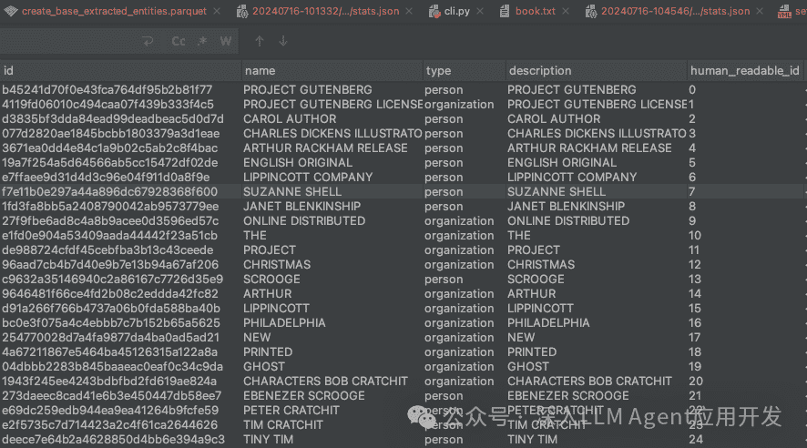
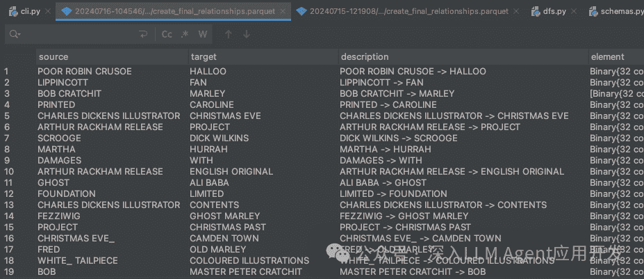
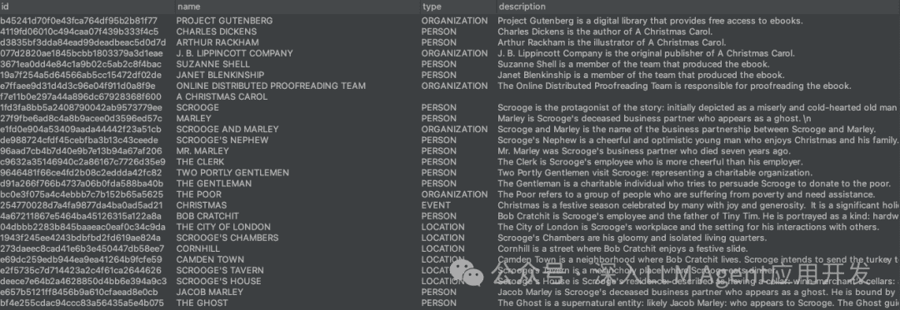

# NLTK vs LLM：GraphRAG实体提取方法深度大比

> 来源：https://agijuejin.feishu.cn/docx/FRLDdYqO3oHzWbxiT0PcptSgnad

> 作者：还就可 | 深入LLM Agent应用开发

> 原文：https://mp.weixin.qq.com/s/OjGv-7p41smBm4W5c3cj5g

书接上文《75% 成本和时间削减：优化微软 GraphRAG 索引的秘密》，我们在修复一些bug和缩减大量成本后，使得GraphRAG更易于使用。其实在缩减成本上，GraphaRAG还有一个隐藏的功能，那就是使用NLTK来提取实体。NLTK，全称Natural Language Toolkit（自然语言工具包），是一个开源的Python库，主要用于自然语言处理（NLP）的研究和开发。这篇文章主要讨论了如何通过使用NLTK和LLM两种不同的方法来进行实体提取，以优化和比较在GraphRAG中的应用效果。

## 1. GraphRAG配置NLTK

NLTK由Steven Bird和Edward Loper等人在宾夕法尼亚大学计算机和信息科学系开发，它为NLP研究者和开发者提供了一系列的工具、数据集和教程。NLTK包含的功能非常广泛，涵盖了自然语言处理的多个方面，包括但不限于：

+ 分词（Tokenization）：将文本分割成单词或短语。
+ 词性标注（Part-of-Speech Tagging）：为每个词标注其语法类别。
+ 命名实体识别（Named Entity Recognition）：识别文本中的专有名词，如人名、地名、组织名等。
+ 句法分析（Syntactic Parsing）：分析句子的结构和语法关系。
+ 语义分析（Semantic Analysis）：理解文本的深层含义。
+ 情感分析（Sentiment Analysis）：识别文本中表达的情感倾向。
+ 文本分类（Text Classification）：自动分类文本到预定义的类别。
+ 机器翻译（Machine Translation）：将文本从一种语言翻译成另一种语言。
+ 问答系统（Question Answering）：自动回答文本提出的问题。

由于其全面性和易用性，NLTK成为了教育和研究领域中最受欢迎的NLP库之一，尤其适合初学者学习自然语言处理的基础。在GraphRAG中，只需配置`settings.yaml`即可，找到`entity_extraction`按照如下配置：

```yaml
entity_extraction:
  strategy:
    type: "nltk"
  ## llm: override the global llm settings for this task
  ## parallelization: override the global parallelization settings for this task
  ## async_mode: override the global async_mode settings for this task
  prompt: "prompts/entity_extraction.txt"
  entity_types: [organization,person,geo,event]
  max_gleanings: 0
```

如果你使用的是OpenAI的LLM服务，这样配置即可。但如果你使用的是其他LLM服务，这个配置是无法生效的，这里还存一个bug，我已经提交了 PR [1] 进行修复，应该很快就会合并。实体提取的代码在目录 `graphrag/index/verbs/entities/extraction/strategies/graph_intelligence`，默认策略是 `graph_intelligence`，也就是使用LLM根据Prompt进行自动提取。上文有说到实体提取的Prompt很大（位于根目录 `prompts/entity_extraction.txt`），大约有2000多个Token，并且和文档的chunk的数量成倍数关系。因此，如果采用NLTK进行分词，将对成本进一步优化，岂不妙哉？

> 以下测试都采用Google的Gemma2-9b小模型，主要是groq的免费额度较大，而且它跟随指令比较好，基本上每次都能完整跑完索引。

## 2. 测试NLTK实体提取

以英国大文豪狄更斯的小说《圣诞颂歌》为例，将其存储为txt文件，放入`input`文件夹。

```bash
curl https://www.gutenberg.org/cache/epub/24022/pg24022.txt > ./input/book.txt
```

开始索引

```bash
poetry run poe index --root .
```

由于篇幅相对较长，大约46155个Tokens，耗时2149秒完成，其中实体提取耗时936秒，社区报告1200秒。顺便提一句，整个索引过程所耗时间，可以在输出文件夹 `output/{日期}/artfacts/stats.json` 文件中看到，他统计了每个workflow的时间以及总共耗时。本次索引输出文件都在 `output/20240716-104546`，方便下次指定使用。

```json
{
    "total_runtime": 2149.660534143448,
    "num_documents": 1,
    "input_load_time": 0,
    "workflows": {
        "create_base_text_units": {
            "overall": 0.25486016273498535,
            "0_orderby": 0.0034270286560058594,
            "1_zip": 0.0015499591827392578,
            "2_aggregate_override": 0.003968715667724609,
            "3_chunk": 0.13766002655029297,
            "4_select": 0.002666950225830078,
            "5_unroll": 0.0044748783111572266,
            "6_rename": 0.002095937728881836,
            "7_genid": 0.008743047714233398,
            "8_unzip": 0.003268003463745117,
            "9_copy": 0.0034067630767822266,
            "10_filter": 0.08233785629272461
        },
   ...
    }
}
```

提取的实体如下图所示，总共大约249个实体。



image-20240716110853919

多说一句，Parquet 是 一种专为大数据处理系统优化的列式存储文件格式 。它由Twitter 和Cloudera 两个在大数据生态系统中具有影响力的公司于2013 年共同创建。目标是开发一种高效，高性能的列式存储格式，并且能够与各种数据处理系统兼容。如果你使用JetBrains系列的IDE，可以安装官方的 Big Data Tools 插件即可查看。

我们详细测试一下，提问主要以英文提问。

问题1：这个小说的主题是什么？（What is the main theme of this story?），回复中的中文由ChatGPT翻译便于阅读，数据参考部分保留原始回复。

```bash
poetry run poe query --method global "What is the main theme of this story"
```

> SUCCESS: Global Search Response: Main Theme of the Story

> 在分析了多位分析师的报告后，显而易见，这个故事的主要主题是艾比尼泽·斯克鲁奇的转变。他是与城市、圣诞节、马利和坎登镇等多个实体相关的核心人物。故事围绕斯克鲁奇的中心地位、他与这些实体的联系以及改变和转变的潜力展开。

> **关键点**

+ 斯克鲁奇是故事中的核心人物，与多个实体有联系，暗示了复杂的关系网络和潜在的影响力。
+ 故事探讨了圣诞节、灵魂和潜在转变的主题，而斯克鲁奇是其中的中心人物。
+ 斯克鲁奇、马利、城市和坎登镇之间的联系暗示了复杂的关系网络和潜在的影响力。

> **含义**

> 故事的主要主题突出了个人变化和转变的潜力，特别是那些在复杂关系网络中具有重要影响力的人物。故事表明，即使是那些看似固执己见的人，在合适的环境和影响下也可能经历重大的转变。

> **Data References**

> * Ebenezer Scrooge is the central figure in the story, connected to various entities like the City, Christmas, Marley, and Camden Town [Data: Reports (1, 2, 3, 4, 5, +more)].
> * The story explores themes of Christmas, spirits, and potential transformations, with Scrooge as a central figure [Data: Reports (1, 2, 3, 4, 5, +more)].
> * The connections between Scrooge, Marley, the City, and Camden Town suggest a complex web of relationships and potential influence [Data: Reports (1, 2, 3, 4, 5, +more)].

问题2：Three Spirits是什么？

```bash
poetry run poe query --method local "Waht is the Three Spirits"
```

报错 `ValueError: Column weight not found in data` ，是因为 `create` 中缺乏`weight`列导致。



image-20240716115443211

此处简单添加一列 `weight` 都设置为1，方法如下：

```python
import pandas as pd
data = pd.read_parquet("output/20240716-104546/artifacts/create_final_relationships.parquet")
data['weight'] = 1.0
data.to_parquet("output/20240716-104546/artifacts/create_final_relationships.parquet")
```

修改之后，重新运行搜索即可成功。不太确定，`weight`对检索结果的影响，有知道的同学麻烦留个言。

> SUCCESS: Local Search Response: The Three Spirits of Christmas

> 在查尔斯·狄更斯的经典小说《圣诞颂歌》中，主角艾比尼泽·斯克鲁奇在圣诞夜被三位幽灵拜访，这些幽灵在他从一个吝啬刻薄的老人转变为一个善良慷慨的人过程中起到了关键作用。

> **第一位幽灵：过去的圣诞幽灵**

> 第一位幽灵，过去的圣诞幽灵，以一个温柔而飘渺的女性形象出现。她带着斯克鲁奇穿越他的过去，展示了他童年和青年时期的一些场景，这些场景突显了他失去的机会和未能实现的爱。这位幽灵帮助斯克鲁奇面对过去的错误和遗憾的选择，并理解这些选择如何塑造了今天的他。

> Data References:

+ [Data: Entities (193, 216, 184); Relationships (1046, 914, 1014); Sources (29)]

> **第二位幽灵：现在的圣诞幽灵**

> 第二位幽灵，现在的圣诞幽灵，是一个快乐而强壮的形象，身穿绿色长袍，手持大火炬。他向斯克鲁奇展示了他的行为如何影响周围的人，特别是他的职员鲍勃·克拉奇特及其家人，他们正艰难度日。这位幽灵突显了善良、慷慨和同情的重要性，并鼓励斯克鲁奇改变自己的行为。

> Data References:

+ [Data: Entities (193, 216, 184); Relationships (1556, 1632, 63); Sources (29)]

> **第三位幽灵：未来的圣诞幽灵**

> 第三位也是最后一位幽灵，未来的圣诞幽灵，是一个黑暗而不祥的形象，笼罩在迷雾和寂静中。他向斯克鲁奇展示了一个可能的未来，在这个未来里，他已经去世，并且无人哀悼，只有少数人因摆脱了他而感到轻松。这位幽灵作为对斯克鲁奇的警告，敦促他在为时已晚之前改变自己的行为并弥补过错。

> Data References:

+ [Data: Entities (193, 216, 184); Relationships (1337, 593, 1705); Sources (29)]

> 这三位幽灵，每位都有其独特的特征和信息，在斯克鲁奇的转变和救赎过程中起到了关键作用。通过他们的拜访，斯克鲁奇逐渐理解了自己行为的错误以及善良、慷慨和同情的重要性，最终成为了一个更好的人。

问题3：Marley是谁？

```bash
poetry run poe query --method local "Who is Marley"
```

> SUCCESS: Local Search Response: 马利是查尔斯·狄更斯小说《圣诞颂歌》中的一个角色。他是雅各布·马利的幽灵，雅各布·马利是艾比尼泽·斯克鲁奇的商业伙伴，在圣诞夜出现在斯克鲁奇面前。

> 根据小说，雅各布·马利曾是一个富有且成功的商人，与斯克鲁奇关系非常密切。然而，他变得越来越贪婪和自私，他的商业行为也变得越来越有问题。最终，他被谴责在地球上游荡，身上带着象征他自身罪恶和悔恨的沉重锁链。

> 马利的幽灵出现在斯克鲁奇面前，警告他自己自私和吝啬行为的后果。马利告诉斯克鲁奇，如果他不改变自己的行为，成为一个更好的人，他也注定会遭受同样的命运。马利的幽灵是小说中的一个关键角色，作为对斯克鲁奇的警示，并提醒他善良、慷慨和同情的重要性。

> 在提供的数据表中，马利在以下记录中被提及：

+ 1974: 马利被提到已经去世，斯克鲁奇被告知他已经死了。
+ 1337: 在两个商人的对话中提到马利，他们讨论了他的死亡以及他被谴责在地球上带着锁链游荡的事实。

> 这些记录进一步证明了马利的角色及其在小说中的重要性。

**注意：**

> 如果你在Global查询或者Local查询没有返回时，大概率是请求超过LLM的窗口大小了，一是切换为更大的模型，二是设置`max_token`为5000，或者更小。

## 3. 测试LLM实体提取

只需要删除`settings.yaml`中`entity_extraction`里的`strategy`即可退回到LLM提取。大约经过766秒12分钟左右索引完成，其中实体构建约674秒，社区报告88秒，存储在 `output/20240716-120906`。

提取的实体只有95个如下图所示，相较于NLTK实体的数量少了不少，但是描述上更加完整，而且没有那么多重复的。



我们使用相同的问题进行测试，以对比有何不同。

问题1：这个小说的主题是什么？

```bash
poetry run poe query --method local "Who is Marley?" --data output/20240716-120906/artifacts
```

> SUCCESS: Global Search Response: Main Theme of the Story

> 这个故事的主要主题是圣诞节的变革力量，斯克鲁奇经历了从一个吝啬冷酷的人到一个慷慨和富有同情心的人的重大变化，这一变化是由他与三位幽灵的相遇所驱动的[Data: Reports (6)]。

> **关键点**

+ 斯克鲁奇的转变是他与三位幽灵（过去、现在和未来）相遇的结果。
+ 故事强调了在节日期间善良、慷慨和同情的重要性。
+ 斯克鲁奇的变化证明了救赎的力量和个人成长的可能性。

> **含义**

+ 故事表明，改变自己的方式并成为一个更好的人永远不会太晚。
+ 圣诞节的变革力量可以给个人带来积极的变化，促进一个更加富有同情心和慷慨的社会。
+ 故事提醒我们在节日期间善良和慷慨的重要性。

> 注意：分析师1的报告的重要性得分为90，表明这个主题是故事中最突出的和最重要的方面。

问题2：Three Spirits是什么？

> SUCCESS: Local Search Response: The Three Spirits of Christmas


> 在查尔斯·狄更斯的小说《圣诞颂歌》中，圣诞节的三位幽灵是超自然的存在，他们在圣诞夜拜访艾比尼泽·斯克鲁奇，改变他对生活和圣诞真谛的看法。

## 过去的圣诞幽灵

第一位拜访斯克鲁奇的幽灵是过去的圣诞幽灵，她以一个温柔而飘渺的女性形象出现。她带着斯克鲁奇回顾他的过去，展示了他童年和早年生活中的一些时刻，这些时刻塑造了今天的他。过去的圣诞幽灵关注的是揭示斯克鲁奇过去的欢乐和悲伤，帮助他理解这些经历如何影响了他的现在。

[Data: `Entities` (18); `Relationships` (36)]

## 现在的圣诞幽灵

第二位拜访斯克鲁奇的幽灵是现在的圣诞幽灵，他以一个快乐而强壮的男子形象出现，身穿绿色长袍，留着长长的白胡子。他带着斯克鲁奇看现在的生活，展示他的行为如何影响周围的人，包括他的职员鲍勃·克拉奇特及其家人。现在的圣诞幽灵关注的是揭示斯克鲁奇周围人的欢乐和挣扎，帮助他理解自己的行为对他人的影响。

[Data: `Entities` (55); `Relationships` (25, 28)]

## 未来的圣诞幽灵

第三位也是最后一位拜访斯克鲁奇的幽灵是未来的圣诞幽灵，他以一个黑暗而不祥的形象出现。他带着斯克鲁奇看一个可能的未来，展示如果他死后只留下财富和财产，世界会是什么样子。未来的圣诞幽灵关注的是揭示斯克鲁奇行为的后果，帮助他理解改变行为的重要性。

[Data: `Entities` (83); `Relationships` (38)]

## 问题3：Marley是谁？

### SUCCESS: Local Search Response: Marley's Identity

马利是查尔斯·狄更斯小说《圣诞颂歌》中一个重要的角色。根据数据，马利是艾比尼泽·斯克鲁奇已故的商业伙伴，他以幽灵的形式出现，警告斯克鲁奇如果不改变自己的行为，他将面临同样的命运。

### Data References

Marley's identity is supported by multiple data references:

[Data: `Entities` (28); `Relationships` (43)]

[Data: `Sources` (0)]

### 马利的警告

马利的幽灵在圣诞夜出现，警告斯克鲁奇他将会被三位幽灵拜访：过去的圣诞幽灵、现在的圣诞幽灵和未来的圣诞幽灵。马利的幽灵是厄运的预兆，他的警告是促使斯克鲁奇转变的催化剂。

### 马利与斯克鲁奇的关系

马利与斯克鲁奇的关系非常重要，因为他们曾是商业伙伴。马利的死亡提醒斯克鲁奇他的行为后果，以及善待他人的重要性。

### 额外见解

马利的角色为故事增加了深度和复杂性，突显了贪婪的后果和救赎的重要性。他的出现是小说中的一个转折点，促使斯克鲁奇重新审视自己的人生，并弥补过去的错误。

### 结论

总之，马利是《圣诞颂歌》中一个关键角色，他警告斯克鲁奇其行为后果。他的身份得到了数据支持，他与斯克鲁奇的关系为故事增添了深度。

## 4. 总结

本文首先介绍了`GraphRAG`如何配置使用`NLTK`进行实体提取。接着展示了对英国作家狄更斯的小说《圣诞颂歌》使用`NLTK`进行实体提取的测试。通过索引整个文本并分析其实体，文章展示了`NLTK`在处理长文本和提取多种类型实体方面的优势。测试结果显示，`NLTK`提取了约249个实体，并且通过多个问题的查询展示了其详细和全面的提取效果。然后，文章比较了使用`LLM`进行实体提取的效果。虽然`NLTK`有成本优势，但是处理速度较长，且可能存在重复的实体信息，而且描述信息不如`LLM`的完整。最后从查询测试上来看，在全局查询上使用`LLM`提取实体的回复较为完整，在局部查询上相差不多。

总的来说，本文通过对`NLTK`和`LLM`两种实体提取方法的比较分析，展示了在`GraphRAG`中如何根据具体需求选择合适的实体提取策略，从而优化和改进自然语言处理任务的执行效率和结果质量。如果你处理的是中文文档，是没法简单配置使用，可能需要修改代码适配中文分词和实体提取。

**下一篇，我们将展示如何使用`neo4j`来处理、分析和可视化`GraphRAG`的索引结果。**

若您意犹未尽，渴望亲自操刀，将理论付诸实践，那么这本《大模型应用开发：动手做AI Agent》和这本火热的《GPT图解》 将是您理想的选择。

关注我，记得加🌟及时获取更新。

### 参考资料

#### [1]

PR: https://github.com/microsoft/graphrag/pull/522
