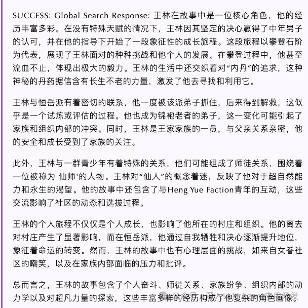
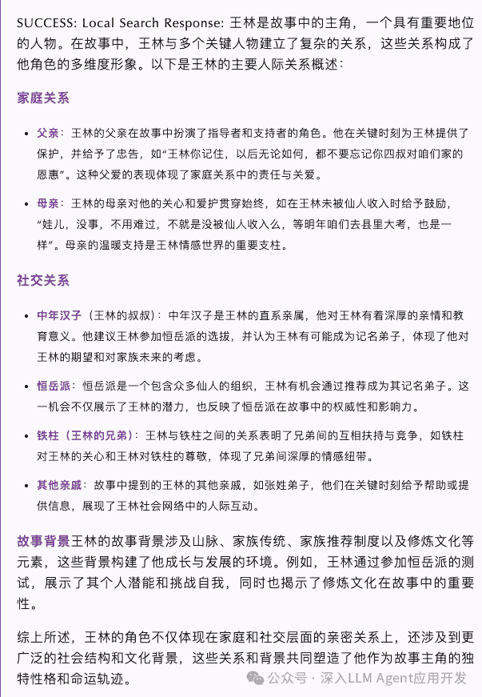
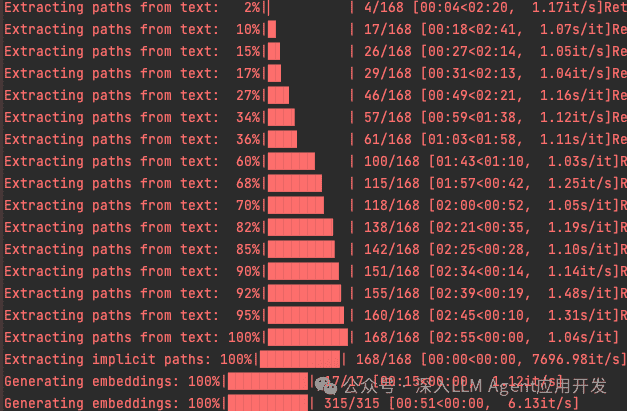

# 微软下一代RAG：GraphRAG与LlamaIndex巅峰对决

> 来源：[https://agijuejin.feishu.cn/docx/IJwkdvblnoVW5IxaNskco2sbnTd](https://agijuejin.feishu.cn/docx/IJwkdvblnoVW5IxaNskco2sbnTd)

> 作者：还就可 | 深入LLM Agent应用开发

> 原文： [https://mp.weixin.](https://mp.weixin.qq.com/s/lXmlgxPiK4_9jZ_URt994Q)qq.com/s/lXmlgxPi...

书接上文《 [实战微软新一代RAG：GraphRA](http://mp.weixin.qq.com/s?__biz=MzI0OTAzNTEwMw==&mid=2247484079&idx=1&sn=b79a12567425ef19304bd79667be71a4&chksm=e996e29fdee16b89113018d874b95040c71f3ab8fbde75be8a3687ec1b42dd600577d5ded38b&scene=21#wechat_redirect)G强大的全局理解能力，碾压朴素RAG？ 》，我使用GraphRAG在对热门网络小说《仙逆》进行了简单的测试，包括全局问题和局部问题。虽然考虑成本问题，我只索引了前10章，但依然能够看出它对全局问题的回答非常准确。类似这本小说讲述了什么，主角王林经历了哪些事情，都给出了非常好的总结。本文尝试通过LlamaIndex实现一个朴素的RAG和支持知识图谱的属性图索引（Property Graph Index），以此来分别比较他们和GraphRAG在总结整体故事脉络，实体关系上的区别。可能大部分同学都是使用Langchain，其实LlamaIndex也很简单，本文依然本着不会LlamaIndex也能看懂的原则编写。

##  1. LlamaIndex介绍

**LlamaIndex [1] **是一个利用大型语言模型（LLMs）构建具备情境增强功能的生成式人工智能应用程序的框架。LlamaIndex 实际上充当了一种桥梁角色，它专为简化大规模语言模型（LLM）在不同场景下的应用而设计。无论是自动文本补全、智能聊天机器人还是知识驱动的智能助手，LlamaIndex 提供了一套完整的工具链，帮助开发者和企业绕开数据处理及模型调用的繁复细节，直接进入应用开发的核心。LlamaIndex 只是让使用它们变得更简单。它提供以下工具：

+   数据连接器：从其原始来源和格式中导入现有数据，这些数据可以是 API、PDF、SQL 等等。

+   数据索引：以中间表示形式结构化数据，便于 LLM 高效使用。

+   引擎：提供对数据的自然语言访问。例如：

+   查询引擎：用于问答的强大接口（例如，RAG 管道）。

+   聊天引擎：用于与数据进行多轮“来回”互动的对话接口。

+   智能体：由 LLM 驱动的知识工作者，通过工具增强，从简单的助手功能到 API 集成等。

+   可观测性/评估集成：使你能够严格地实验、评估和监控你的应用程序，形成良性循环。

##  2. LlamaIndex实现朴素RAG

朴素RAG一词来源于GraphRAG论文中，它表示文本块被检索并添加到可用的上下文窗口，直到达到指定的令牌限制。所以我们在朴素RAG中，采用文本分割、嵌入并检索。按照GraphRAG中的settings.yaml配置，文本分割采用300 Token大小，重叠大小为100。

```
chunks:
  size: 300
  overlap: 100
  group_by_columns: [id] # by default, we don&#x27;t allow chunks to cross documents
```

首先，我们配置LLM。LLamaIndex对OpenAI库进行了抽象，并设置了模型等限制。因此使用第三方兼容OpenAI库的模型，需要按照如下方式配置。

```
**from**** llama**_index.llms.openai.utils import ALL_AVAILABLE_MODELS, CHAT_MODELS
MY_MODELS: Dict[str, int] = {
    &quot;qwen-turbo-0624&quot;: 32768,
    &quot;gpt-3.5-turbo&quot;: 4000,
    &quot;moonshot-v1-8k&quot;: 8000,
    &quot;llama3-70b-8192&quot;: 8192,
}
ALL_AVAILABLE_MODELS.update(MY_MODELS)
# 不加入这个字典，会导致它采用Completion而不是Chat Completion接口，Qwen不兼容Completion兼容。
CHAT_MODELS.update(MY_MODELS)
```

初始化LLM并将其配置到全局LLM上。

```
**from**** llama****_ind****ex.llm**s.openai import OpenAI
from llama_index.core.settings import Settings
Settings.llm = OpenAI(
    model=&quot;qwen-turbo-0624&quot;,
    temperature=0.1,
    max_tokens=2000,
    api_key=os.getenv(&quot;QWEN_API_TOKEN&quot;),
    api_base=&quot;https://dashscope.aliyuncs.com/compatible-mode/v1&quot;
)
```

**初始化嵌入模型，同**样将其配置到全局embed_model上，这里采用 北京智源 [2] BAAI/bge-base-zh-v1.5嵌入模型。

```
**!pip** install llama-i**ndex-e**mbeddings-huggingface 
from llama_index.embeddings.huggingface import HuggingFaceEmbedding
Settings.embed_model = HuggingFaceEmbedding(model_name=&quot;BAAI/bge-base-zh-v1.5&quot;)
```

按照GraphRAG配置文本分割器。

```
**from**** llama**_index.core.node_parser import SentenceSplitter
Settings.text_splitter = SentenceSplitter(chunk_size=300, chunk_overlap=100)
```

初始化配置已经完成，接下来使用数据连接器准备读取文本。

```
docs = SimpleDirectoryReader(input_files=[&quot;./data/xianni.txt&quot;]).load_data(show_progress=True)
```

数据读取完毕，按理说我们此时应该分割文本，然后执行嵌入并存储到高维向量数据库中，但LlamaIndex将这些步骤缩减为一个helper方法。

```
**from**** llama**_index.core import VectorStoreIndex
base_index = VectorStoreIndex.from_documents(docs, show_progress=True, transformations=[SentenceSplitter(chunk_size=300, chunk_overlap=100)])
```

索引大约耗时18秒，既然索引完成接下来就是执行查询了。

```
base_query_engine = index.as_query_engine()
resp = base_query_engine.query(&quot;在这个故事中王林的经历有哪些?&quot;)
print(resp)
```

> 在这个故事中，王林经历了从平凡生活到发现一处宛如世外桃源般仙境的过程。他首先遇到了几个门内长老，他们对凡人的生死并不关心，认为修道之人应该有更高的追求。接着，王林和几位同伴不慎摔落，却意外地来到了一个美丽的地方，这里有青山绿水、鸟语花香，给人一种隔世的感觉。他们看到了一座高耸入云的山峰，山峰上云雾缭绕，时而传来兽鸣，一条石阶小径蜿蜒而下，如同画中景色。最令人印象深刻的是，山峰顶端有一座大殿，虽然被云雾遮掩，但七彩光芒闪烁，让人不由自主地产生膜拜之情。

由于文字太多，不好使用图表进行比较现实，因此我将GraphRAG的输入截图，方便比较。我个人认为，相较于GraphRAG，朴素RAG的总结过于笼统。你们觉得呢？



第2个问题：

```
resp = query_engine.query(&quot;谁是王林 他的主要人际关系是什么样&quot;)
print(resp)
```

> 王林是故事中的一个角色，他是王氏家族的一员。在这个故事中，王林的主要人际关系包括他的家族成员，特别是他的大哥、父亲以及其他亲戚。他的大哥和三弟在家族聚会上是主角之一，所有的亲戚都前来庆祝。王林的父亲受到了特别的尊敬和赞美，因为他的儿子可能即将被选中，这意味着他将不再需要做木匠的工作，而家族成员会称呼他为“二爷”。此外，王林还与一位躺在对面的少年有短暂的互动，这位少年对王林的食物表示了兴趣，王林慷慨地分享了他的甘薯。

同样的GraphRAG回答，从家庭关系到社交关系，可以认为是暴打朴素RAG了。



但是LlamaIndex也支持知识图谱类型的RAG，叫做属性图索引（Property Graph Index）。

##  3. LlamaIndex属性图索引

属性图是一种知识集合，由带有属性（如元数据）的标记节点（如实体类别、文本标签等）组成，这些节点通过关系链接成结构化路径。在LlamaIndex中，PropertyGraphIndex 提供了关键功能，包括：

+   构建图

+   查询图

在第2节中，已经使用数据连接器加载了文本，本节只需要索引和查询即可。在LlamaIndex中，使用属性图索引非常简单，并且支持自定义或者连接已有知识图谱。

```
**from**** llama**_index.core import PropertyGraphIndex

graph_index = PropertyGraphIndex.from_documents(docs, show_progress=True, transformations=[SentenceSplitter(chunk_size=300, chunk_overlap=100)])
graph_query_engine = graph_index.as_query_engine()
resp = graph_query_engine.query(&quot;在这个故事中王林的经历有哪些?&quot;)
print(resp)

resp = query_engine.query(&quot;谁是王林 他的主要人际关系是什么样&quot;)
print(resp)
```

使用 PropertyGraphIndex.from_documents(docs, show_progress=True) 将会开始抽取实体关系构建知识图谱，过程如下。你可能会遇到诸多访问LLM的RateLimitError，我翻了一下文档没找到LlamaIndex有控制访问LLM频率的API，暂无解决方法，除非自己修改。整个索引过程大约耗时4分钟左右完成，与其评估时间差不多。



第一个问题是一个全局问题，但似乎LLM没能很好理解提问（也可能是我的提问过于笼统），这个回答可以说非常一般了，与GraphRAG依然没法比。

> 在这个故事中，王林经历了以下事件：

1.  **被抓住并休息 **：王林被某人抓住，之后他在某个地方休息了一夜，似乎没有受到太多干扰。

1.  **内心喜悦 **：王林内心感到喜悦，可能是因为某种原因或期待。

1.  。。。

1.  **笑道 **：王林以轻松的态度回应，可能在表达对某些情况的看法。

1.  **内心撕裂的伤口更大了 **：王林内心的痛苦加剧，可能是因为情感上的打击或失落。

所以我尝试修改了问题为 在这个故事中王林主要经历过程是什么 详细说说 ，这次结果可以说提高不少，只是缺少了一段开头的感觉。

> 在这个故事中，王林主要经历了找到、救治、被收为记名弟子、面临嘲讽和剑灵测试等过程。

> 首先，王林被找到，并被送到恒岳派大殿内，几个门内长老听张姓男子诉说找到王林的过程。

> 其次，王林受到救治，喝下汤药后身体恢复了不少，伤口疼痛也缓和许多。

> 然后，王林被收为记名弟子，一块精铁改变了他的命运，使他成为记名弟子。

> 接着，王林面临了嘲讽，一个长相贼眉鼠眼的黄衣青年嘲笑他靠自杀才成为记名弟子。

> 最后，王林参加了剑灵测试，虽然他的身上的伤势已经痊愈，但心灵的伤口却撕裂更大，止不住 地 吞噬他的身心。

第二个问题回答如下，相较于GraphRAG提取的社交关系，LLamaIndex的属性图索引似乎只是提取到了小说前半段，后半段的实体关系几乎完全没有。

> 王林是故事中的一个角色，他是王氏家族的一员。在这个故事中，王林的主要人际关系包括他的家族成员，特别是他的大哥、父亲以及其他亲戚。他的大哥和三弟在家族聚会上是主角之一，所有的亲戚都前来庆祝。王林的父亲受到了特别的尊敬和赞美，因为他的儿子可能即将被选中，这意味着他将不再需要做木匠的工作，而家族成员会称呼他为“二爷”。此外，王林还与一位躺在对面的少年有短暂的互动，这位少年对王林的食物表示了兴趣，王林慷慨地分享了他的甘薯。

关于铁柱和王林的关系，提问增加一句是否是同一个角色还是两个角色，答案就不一样了。

```
resp = graph_query_engine.query(&quot;王林和铁柱是什么关系？是同一个角色还是两个角色&quot;)
print(resp)
王林和铁柱是同一个角色。
resp = graph_query_engine.query(&quot;王林和铁柱是什么关系？&quot;)
print(resp)
王林和铁柱是表兄弟（cousins）。
```

## ** 4. 总结**

以上测试，都是采用LlamaIndex默认实现进行测试，未进行任何优化。因此，如果你有更好的优化手段和对比方法，欢迎评论区留言。从时间、成本和性能来看，时间和成本上GraphRAG不占任何优势，尤其是动辄大几十分钟到几小时的构建索引的时间，最主要的是还不一定能成功。其次，GraphRAG对Token消耗可以认为是非常可怕，尤其是输入的Token数量非常大，成本非常高，今天没事又跑几次GraphRAG的索引过程，原本还有60万Token额度，我现在已经欠费1.4了😂。。。从对全局的理解来看，GraphRAG确实强大。但朴素RAG就要被淘汰了吗？你怎么看呢？

若您意犹未尽，渴望亲自操刀，将理论付诸实践，那么这本《大模型应用开发：动手做AI Agent》和这本火热的蛇尾 书 《大模型应用开发极简入门》将是您理想的选择。

### **参考资料**

# [1]

LlamaIndex: https://www.llamaindex.ai/

# [2]

北京智源: https://www.baai.ac.cn/