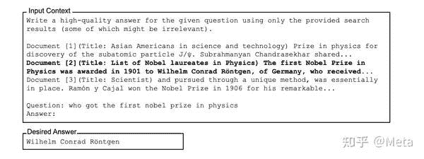
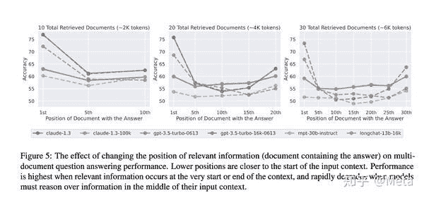
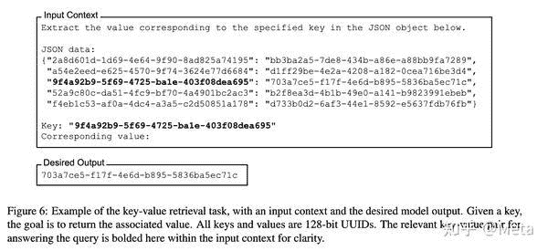
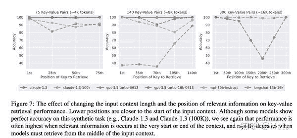
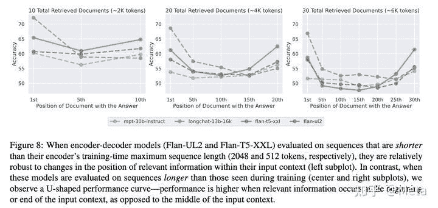
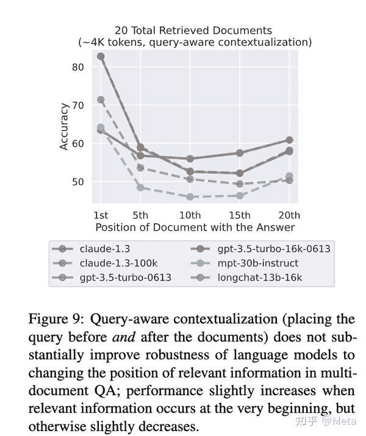
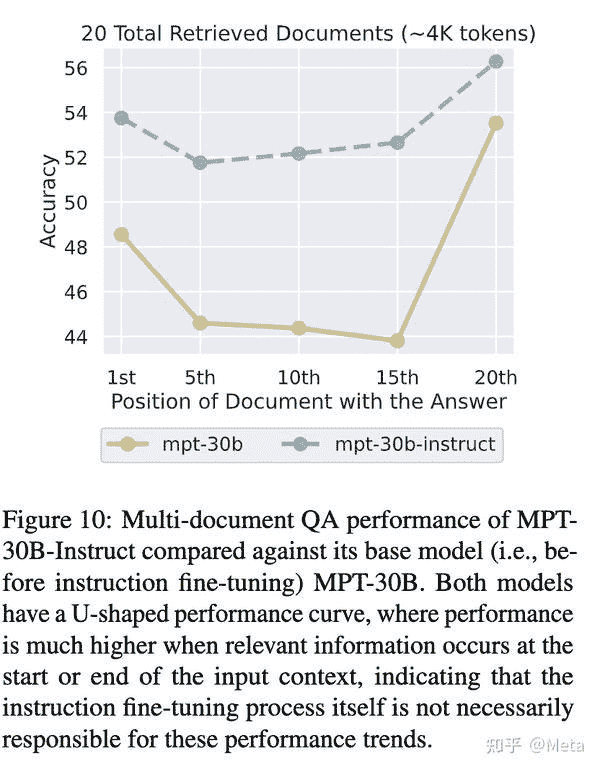
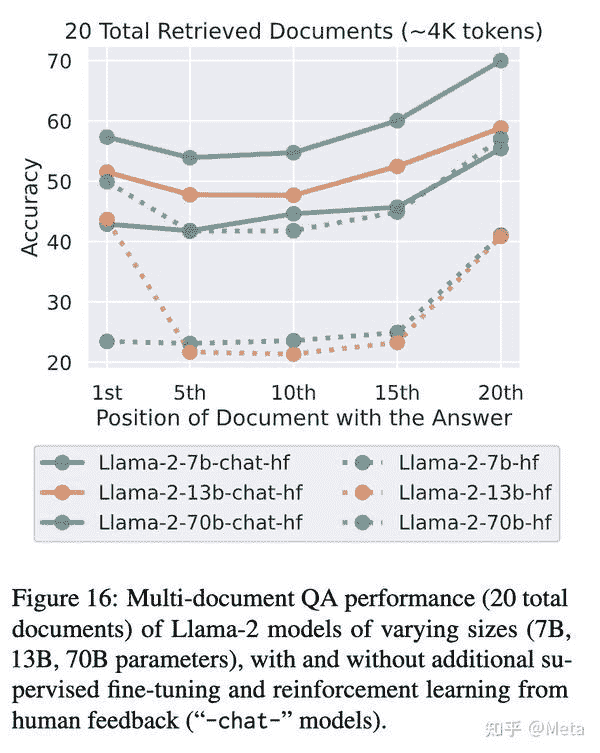
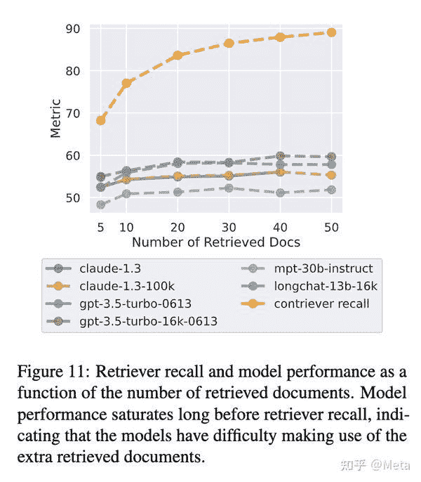

# 大模型的“Lost in the middle”现象探究

> 来源：[https://agijuejin.feishu.cn/docx/SDnIdDZ7CoQsCtxG3IpczWgznob](https://agijuejin.feishu.cn/docx/SDnIdDZ7CoQsCtxG3IpczWgznob)

> 作者：Meta

> 原文：[https://zhuanlan.z](https://zhuanlan.zhihu.com/p/678614880)hihu.com/p/678614...

许多研究致力于提升大模型的长文本处理能力，通过各种手段提高大模型所能处理的最大上下文长度，但是对于大模型在更长的上下文情况下效果怎么样却不那么重点关注。本文对大模型在长文本情况下的性能做了一系列实验研究，发现了一个有趣的“Lost in the middle”现象：在处理需要识别相关上下文的信息的任务（如文档问答、键值对索引）时，大模型对相关信息的位置很敏感，当相关的信息在输入prompt的开头或者结尾时，能够取得较好的效果，而当相关的信息在prompt中间部分时，性能会显著下降。同时研究者们对其中的原因进行了一些探讨，为未来更多支持长上下文的大模型的评估和优化提供一些参考。

## 多文档问答实验

输入的prompt如图所示，对于每个问题，主要包含1个能回答该问题的相关文档以及其他一些不相关的文档，这个相关文档被插入在不同的位置来测试大模型的稳定性。

实验结果如下：

+   在总文档数分别为10、20、30，对**应token数约为2K、4K、6K时， 均发现相关文档位于p**rompt的开始或者结尾时，能够取得更好的效果，而相关文档位于中间时，性能下降 。

+   进行了更长上下文支持的模型在这个任务上并未显著优于未进行更长上下文支持的模型（如图中的gpt-3.5-turbo-16K-0613的效果就与gpt-3.5-turbo-0613的效果十分接近）

## 键值对查询实验

用于比较大模型从长上下文中检索内容的能力，测试用的数据样例如下，需要查询的key也是放在prompt的不同位置用于比较LLM的检索能力。

相关的实验结论如下：

+   对于比较优秀的模型，如claude-1.3-100k、claude-1.3，它们在4k、8k、**16k的上下文长度下，不管目标key在哪个位置，都**能取得接近100%的准确率； 而对于差一些的模型，仍然有与上个实验相似的现象，目标key位于中间位置时，取得较差的结果。

## 原因探究

针对以上的“Lost in the middle”现象，作者试图从几个方面去探讨可能的原因：

+   是否和LLM的 **模型架构 **相关？Decoder-only/Encoder-Decoder等架构的LLM是否会有不同的表现？

+   query和参考的context信息的相对位置是否有影响？

+   是基座LLM就存在这种现象还是说因为进行了指令遵循微调成Chat模型才造成的这种现象？

## 模型架构的影响探究

上面的实验用的模型都是Decoder-only的架构，下图增加了两种Encoder-Decoder模型（flan-t5-xxl、flan-ul2）在多文档问答上的实验结果，可以看到同样有类似的现象。

## query和文档的相对位置影响

前面的实验都是将query放在文档之后进行的，那么将query放在文档之前，会有什么样的结果呢？

如下图所示，将query放在文档之前同样有“Lost in the middle”的现象。

## 指令微调的影响

这里比较了mpt-30b和mpt-30b-instruct模型的差异，发现指令微调之前，仍然具有“Lost in the middle”现象。

### 模型大小+指令微调的影响

从下图还可以看出，对于Llama模型来说，13B和70B的“Lost in the middle”的现象更加明显，而7B模型相对没这么明显。

## 更长的上下文就能取得更好的结果吗？

从上面的实验发现，给大模型提供更多信息有助于执行下游任务，但增加模型推理内容量，可能降低准确性。即使语言模型能处理16K tokens，但是提供这么长的prompt是否真的能起到正向的作用？这其实取决于下游任务，也取决于上下文的边际价值和模型有效使用长上下文的能力。

这里作者又做了一个实验来验证，通过控制检索系统召回相关文档的数量，对于每个问题，比较分别用检索系统召回Top5、10、20、30、40、50的相关文本时，LLM能够达到的准确率。

从下图的结果可以看到，准确率相比召回文档数量的边际收益是明显递减的，也就是说召回的多余的文档对于回答问题并没有太大作用。

## 总结

本文通过一系列对照实验，深入研究了LLM如何处理长输入上下文。实验结果显示，当相关信息的位置发生变化时，语言模型的性能会显著下降，这表明模型在处理长输入上下文时，难以稳定地获取和使用信息。特别是当模型需要在长输入上下文的中间部分使用信息时，性能通常最低。同时作者也做了一系列实验来探究模型架构、query和文档的相对顺序、指令微调这三个因素对LLM使用长上下文的影响。最后，通过一个开放领域问答的实际案例研究，研究者发现LLM的性能并不会随着相关文档的增加而显著改善。

本文的这些结果和分析为理解LLM如何使用其长输入上下文提供了新的视角，并为未来的长上下文模型提供了新的评估标准。

## 参考资料

1.  Liu N F, Lin K, Hewitt J, et al. Lost in the middle: How language models use long contexts[J]. arXiv preprint arXiv:2307.03172, 2