# “烧钱”的大模型：初探成本拆解与推理优化方法

> 来源：[https://agijuejin.feishu.cn/docx/GhEqdIPcko5QLjxIClscj5v2nwf](https://agijuejin.feishu.cn/docx/GhEqdIPcko5QLjxIClscj5v2nwf)

原文链接：https://mp.weixin.qq.com/s/ek9Z9E-T04BBP7g7rl2Eqw

作者：Dmytro Nikolaiev (Dimid)

编者按：大模型的成本问题一直以来是大家重点关注的问题，本文重点讨论了训练大型语言模型（LLMs）需要的成本，并简要介绍什么是LLM以及一些用于优化大模型推理表现的技术。

虽然很难准确预测LLMs未来会怎么发展，但可以肯定，如果成本问题得到解决，LLM会成为我们生活中不可或缺的一部分！

以下是译文，Enjoy!

作者 | Dmytro Nikolaiev (Dimid)

编译 | 岳扬

在过去的一段时间，机器学习被认为是一门复杂的、只有少数人可以理解的专业技术。然而，随着机器学习相关的应用变得越来越强大，公众的兴趣也随之高涨，导致大量有关人工智能的内容涌现。直到2022年11月我们看到ChatGPT时，高潮出现了，并且在2023年3月的GPT-4发布时达到了第二波高潮，此时即使是原来对AI最怀疑的人也会对当下神经网络的能力感到惊讶。

人工智能受到了大量群众的关注，网络上出现了大量有关人工智能的内容。其中一些内容无疑是有价值的，但其中相当大一部分在传播恐惧和误导性信息，比如传播人工智能将取代所有人类工作或发现神经网络可以赚取巨额财富的秘密之类的内容。因此，消除关于机器学习和大型语言模型（LLMs）的误解，提供有价值的内容来帮助人们更好地了解这些技术变得越来越重要。

本文旨在讨论当下机器学习领域中经常被忽视或误解的内容——训练大型语言模型需要的成本。同时，本文还将简要介绍什么是LLM以及一些可能用于优化大模型推理流程的技术。通过全面的介绍，希望能说服读者这些技术并非凭空而来。了解数据规模和底层计算有助于我们更好地理解这些强大的工具。

大多数时候，本文将依据Meta AI最近发布的关于LLaMA的那篇论文([1])，因为它清晰明了地展示了该团队用于训练这些模型的数据和计算量。本文将分成以下几个部分：

+ 首先，本文将简要介绍当下最新的LLM是什么；
+ 然后，本文将讨论训练这些模型的成本；
+ 最后，本文将简要介绍一些模型推理技术的优化方法。

随着深入大型语言模型的世界，您会发现它既非常简单，同时也非常复杂。

## 01 大型语言模型简介

在我们探讨与训练大型语言模型（LLM）有关的费用及成本之前，首先让我们简单地定义一下什么是语言模型。

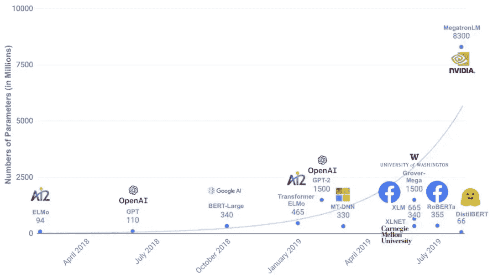

2018-2019年发布的几个语言模型的参数数量

如今的LLM通常有几百亿到几千亿的参数

图1来自DistilBERT论文

简单来说，语言模型是一种被设计用于理解或生成人类自然语言的机器学习算法。最近，语言生成模型变得越来越受欢迎，其中包括OpenAI开发的GPT模型系列：ChatGPT、GPT-4等（GPT是指Generative Pre-trained Transformer，这样命名为了表明它基于 Transformer 架构([2])）。

还有一些虽然不太流行，但依然很重要的模型。比如GPT-3（175B）([3])、BLOOM（176B）([4])、Gopher（280B）([5])、Chinchilla（70B）([6])和LLaMA（65B）([7])，其中B代表参数的数量，其中许多模型也有较少参数的版本。

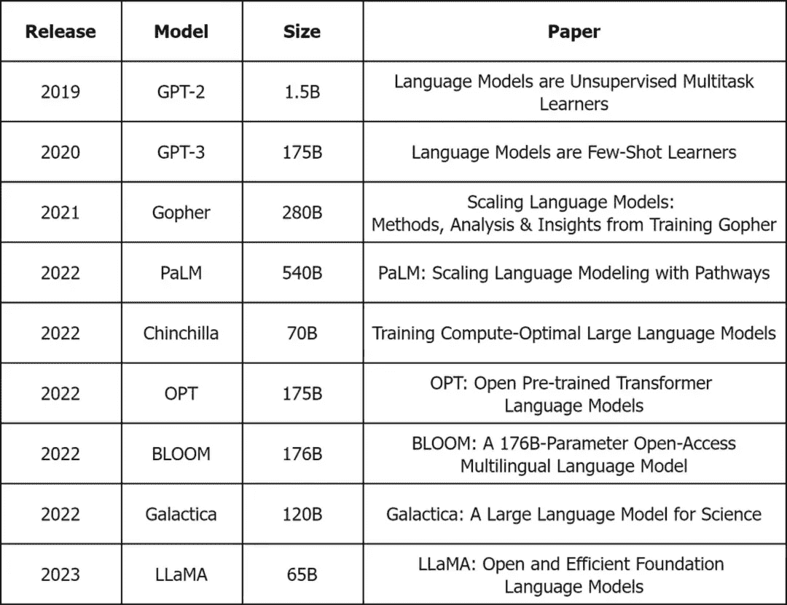

一些流行的LLMs架构。图片由作者提供

目前没有关于ChatGPT特别是GPT-4参数数量的信息，但似乎它们大概是相近的。

这些模型通过使用大量的文本数据进行“训练”，使它们能够学习自然语言复杂的模式和结构。然而，它们在训练期间解决的任务非常简单：预测序列（sequence）中下一个单词（或token）。

这种模型被称为自回归模型，这意味着它使用过去的输出作为未来预测的输入，并逐步生成输出。可以在ChatGPT的输出样例中看到：

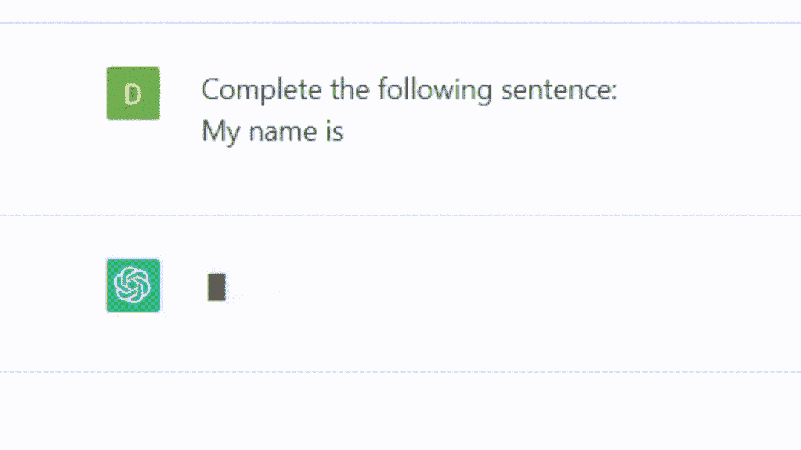

GhatGPT产生了回复

gif取自作者使用ChatGPT的过程

你可以发现ChatGPT是逐步生成答案，而且生成的内容有时是不完整的单词片段（chunks），这些片段（chunks）被称为tokens。

在每一个步骤中，模型将前一个输出连接到当前输入上，然后继续生成，直到达到特殊的“序列结束（End of Sequence）”（`EOS`） token。为了简单起见，省略了提示任务（prompt task），将单词作为tokens，这个过程可以如下所示：

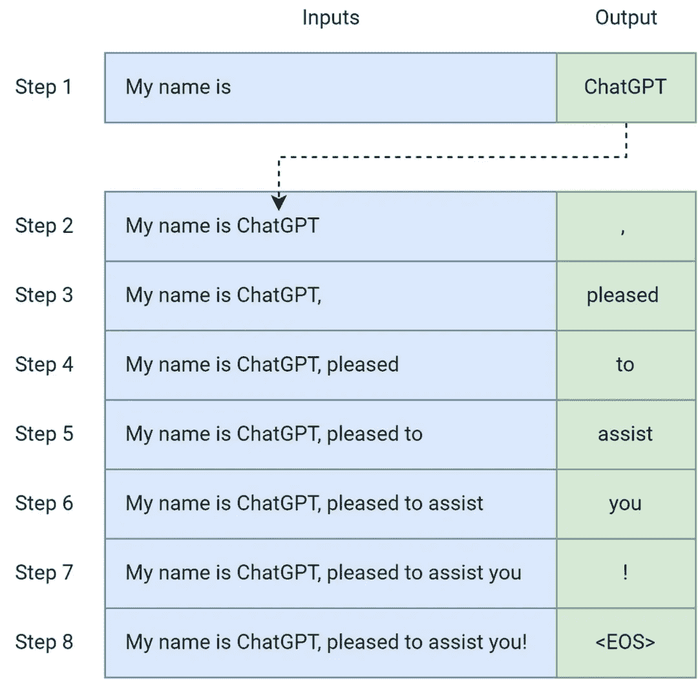

解释自回归模型的文本生成。图片由作者提供

这个简单的机制加上海量的数据（一个人的一生中可能无法阅读这么多数据）使模型能够生成连贯且上下文合适的文本，模拟人类的写作方式。

如果此处我们只谈论生成模型，为什么没有其他系列的模型呢？

原因很简单——文本生成任务是最难解决同时也是最让人类印象深刻的任务之一。ChatGPT在5天内就获得了100万用户([8])，比之前其他任何应用都要快，而且这种势头还在继续保持([9])。

所谓的编码器encoders([10])（BERT模型系列）可能不会太刺激人类，但它们也可以以人类的水平解决各种问题，并帮助完成文本分类([11])或命名实体识别（NER）([12])等任务。

我不会提供大语言模型可以做什么的具体例子，因为这已经在网络上遍地都是。最好的方法是自己试用ChatGPT，但也可以参考一些优秀的prompts，比如Awesome ChatGPT prompts。尽管大型语言模型具有惊人的能力，但它们目前还存在一些限制。其中最常见和最重要的包括：

+ 存在偏见和知识静态性：由于LLM模型是在许多个来源的数据上进行训练的，它们会无意中学习并再现这些数据中存在的偏见。此外，它们具有知识静态性，无法在不重新训练的情况下实时适应新数据或更新知识。
+ 不能完全理解输入和存在虚假信息：虽然LLM模型可以生成类似人类的文本，但它们并不总是完全理解输入的语境。而且，自回归生成输出文本的方式并不能避免模型产生谎言或无意义的内容。
+ 消耗太多资源：训练LLM模型需要大量的计算资源，这导致训练成本和能源消耗都很高。这一因素可能会限制较小公司或个人研究者的LLM模型发展。

这些以及其他缺点都是AI研究界的热门讨论话题。值得一提的是，AI领域发展得如此之快，以至于几个月内很难预测哪些缺点或限制会被克服，但毫无疑问，新的缺点和限制将会出现。

早先的模型只是增加参数数量，但现在认为更好的做法是训练更小的模型，并花更长的时间给它们提供更多的数据。这样减小了模型的规模和后续使用模型的成本。

在大致了解LLM以后，让我们进入这篇文章的主要部分——估算训练大型语言模型的成本。

## 02 估算机器学习模型一般情况下的成本，特别是LLM成本

要估算训练大型语言模型的成本，必须考虑三个关键因素：

+ 数据
+ 计算资源
+ 以及架构（或算法本身）

现在让我们深入地探讨这三个方面，了解它们对训练成本的影响。

### 2.1 数据

LLMs需要大量数据来学习自然语言的模式和结构。估算数据的成本可能具有挑战性，因为公司通常使用其业务运营中长期积累的数据以及开源数据集。

此外，还要考虑到数据需要进行清洗、标记、组织和存储，考虑到LLM的规模，数据管理和处理成本会迅速增加，特别是考虑到这些任务所需的基础设施、工具和数据工程师时。

举个具体的例子，已知LLaMA使用了包含1.4万亿个token的训练数据集，总大小为4.6TB！

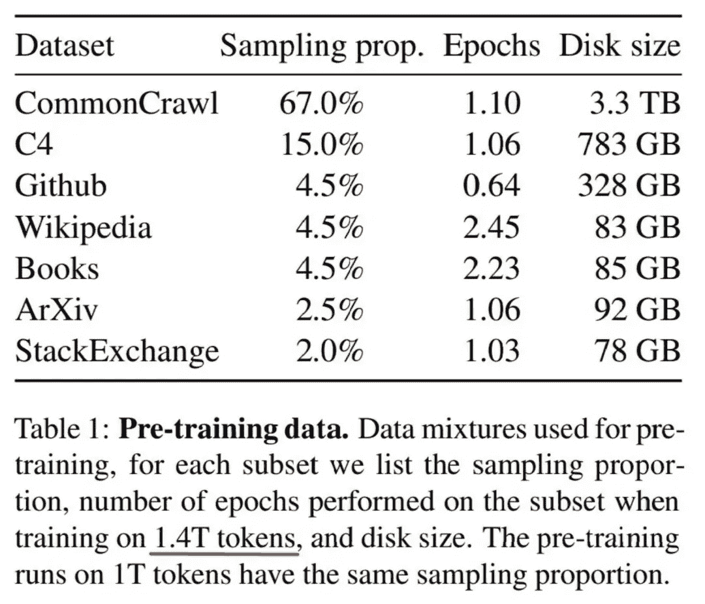

LLaMA模型的训练数据集，表1来自LLaMA论文

较小的模型（7B和13B）是使用了1T token训练的，而较大的模型（33B和65B）使用1.4T token的完整数据集。

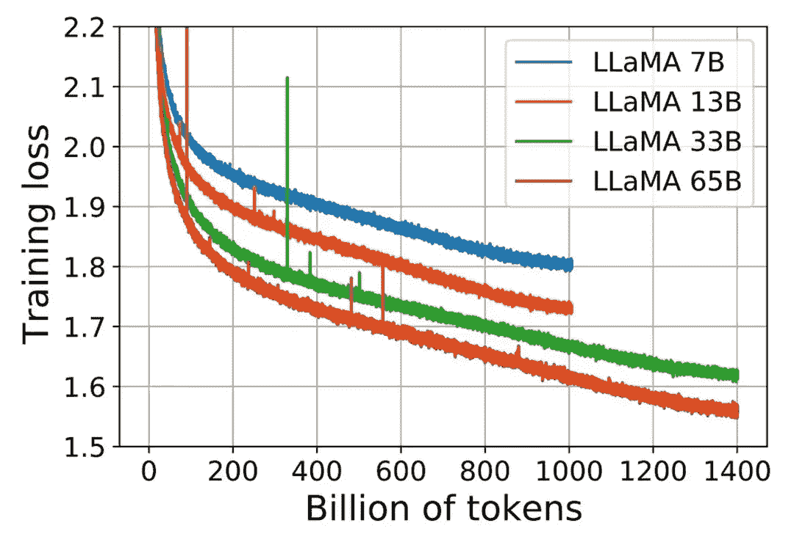

LLaMA模型的training loss值随token数量的变化图，来自LLaMA论文

现在应该明白，当向大家宣传这些数据集多么庞大时，其实并没有夸张，也能理解为什么在十年前大模型还无法做到这一点。但是，计算资源方面的问题更加有趣。

### 2.2 计算资源

训练过程的花费占据了LLM训练成本的很大一部分。训练大型语言模型需要大量计算资源，并且由于需要较强的并行处理能力，要使用功能强大的图形处理器（GPU）。NVIDIA每年都会推出新的GPU，其成本高达数十万美元。

如果使用云计算服务，训练这些模型的云计算服务成本可能也是惊人的，基本上需要几百万美元，特别是考虑到需要迭代各种配置。

回到LLaMA论文，文中说，他们使用了两千个GPU，每个GPU高达80 GB的显存，如此强大的计算能力来训练最大的65B模型也需要21天。

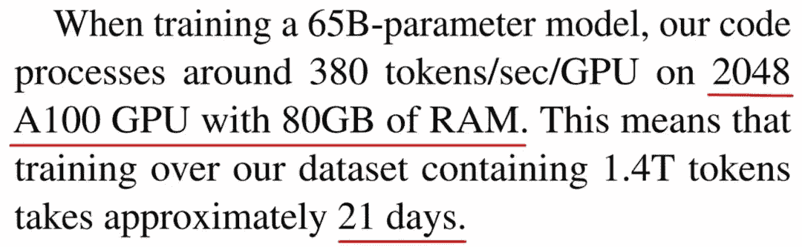

用于训练LLaMA模型的计算资源量，图片来自LLaMA论文

作者使用的NVIDIA A100 GPU是当下神经网络训练的常见选择。Google Cloud 平台提供此类 GPU 的费用是每小时3.93美元。

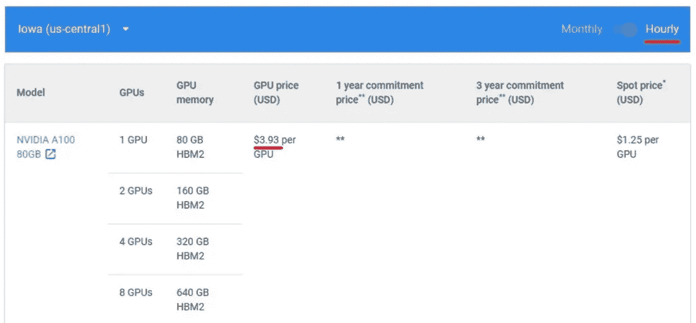

NVIDIA A100 GPU的价格

所以我们快速计算一下：

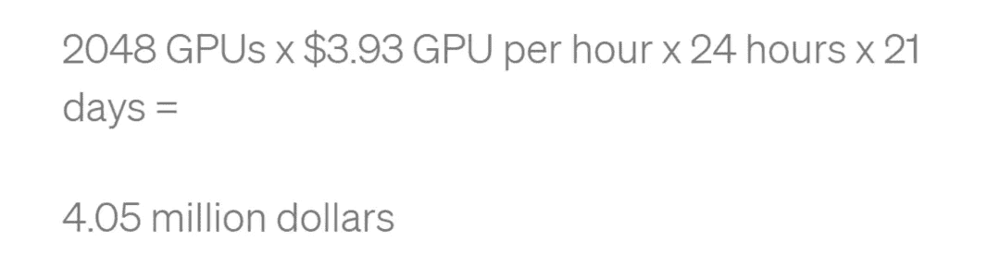

四百万美元的成本并不是每个研究人员都能负担得起的，对吧？而且这仅仅是运行一次的费用！这篇文章估计了GPT-3的训练成本([13])，作者说需要 355 GPU-years 和 460 万美元的成本。

### 2.3 架构（和基础设施）

一流LLM的开发还需要熟练的研究人员和工程师设计合理的架构并正确配置训练过程。架构是模型的基础，能够决定它如何学习和生成文本。

需要具备各种计算机科学领域的专业知识，才能设计、实现和控制这些架构。负责发布和提供优秀项目成果的工程师和研究人员可以获得数十万美元的薪水。有一点需要我们注意，训练LLM所需的技术栈可能与“经典”机器学习工程师的技术栈有很大不同。

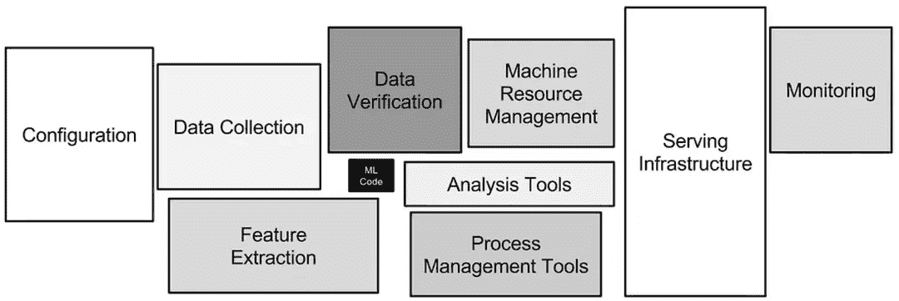

机器学习系统的基础设施，图来自论文《Hidden Technical Debt in Machine Learning Systems》([14])

训练LLM是一个非常困难和需要耗费很多资源的工程问题。现在让我们简要讨论一些使LLM推理过程更有效和节省成本的方法。

## 03 优化语言模型的推理能力

### 3.1 我们是否真的需要优化？

推理（Inference）是指使用已经训练好的语言模型生成预测（predictions）或响应（responses）的过程，通常作为API或Web服务。鉴于LLM的巨量资源消耗特性，必须对其进行优化来实现高效的推理。

例如，GPT-3模型有1750亿个参数，相当于700GB的`float32`数字。激活也需要大约同样数量的内存，而且需要注意的是，我们说的是RAM。

如果不使用任何优化技术来进行预测（predictions），我们将需要16个 80GB 显存的A100 GPU！

有几种流行的技术可以帮助减少内存需求和模型延迟（model latency），包括模型并行、模型量化等等。

### 3.2 模型并行

模型并行([15])将单个模型的计算分布到多个GPU上，可用于训练和推理流程。将模型的层（layers）或参数（parameters）分割到多个设备上可以显著提高整体推理速度，并且在实践中经常使用。

### 3.3 模型量化

模型量化([16])涉及减少模型数值（如权重）的精度。通过将浮点数转换为较低精度的整数，模型量化可以在不实质性损失模型性能的情况下实现显著的内存节省和更快的计算速度。你是不是会有一个想法：使用`float16`浮点数代替`float32`，这样将内存量减少一半。事实证明，甚至可以将模型权重转换为`int8`也几乎不会损失精度。

### 3.4 其他技术

优化LLM的方法相关研究一直是一个活跃的研究领域，其他技术包括：

+ 知识蒸馏([17]) 训练一个较小的学生模型（student model）来模仿一个较大教师模型（teacher model）的行为；
+ 参数剪枝([18]) 从模型中删除冗余或不重要的参数，以减小模型的大小和计算资源要求；
+ 使用像`ORT`（`ONNX Runtime`）([19])这样的框架来通过算子融合（operator fusion）和常数折叠（constant folding）等技术来优化计算图（calculation graphs）。

总的来说，优化大型语言模型的推理是LLM部署的一个重要方面。通过应用各种优化技术，开发人员可以确保LLM不仅功能强大和准确，而且性价比高和具备可扩展性。

## 04 为什么 OpenAI 要开放ChatGPT给大众使用呢？

考虑到大语言模型训练和推理的高成本，人们可能会产生这样的疑问。虽然我们无法确定OpenAI的确切动机，但我们可以分析这一决定背后的好处和潜在战略原因。

首先，OpenAI 将目前最先进的LLM给大家使用，获得了极高的知名度。通过展示大型语言模型的实际应用效果，该公司吸引了投资者、客户和整个技术领域的关注。

其次，OpenAI的使命就是围绕着人工智能的创造和发展。通过开放ChatGPT给大众访问，该公司可以被认为更接近实现其使命并为社会变革做好准备。开放如此强大的AI工具能够鼓励创新，推动人工智能研究领域继续向前发展。这种进步可以导致更高效的模型、更多元的应用程序和各种新解决方案的出现。不过，ChatGPT和GPT-4的架构都没有公开，但这是另一个需要讨论的话题。

虽然与训练和维护大型语言模型相关的成本无疑是巨大的，开放访问ChatGPT不仅增加了他们的知名度，证明了他们在人工智能领域的领导地位，还允许他们收集更多数据来训练更强大的模型。这种策略使他们能够持续推进他们的使命，并在某种程度上为人工智能和LLM技术的发展做出了卓越的贡献。

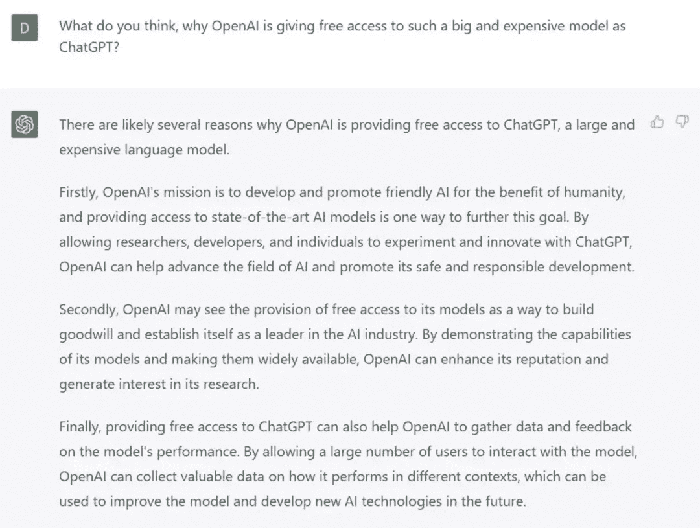

询问ChatGPT，为什么OpenAI要免费开放ChatGPT的使用权限

## 05 结论

正如本文所说的，训练大型语言模型的成本受到各种因素的影响，不仅包括昂贵的计算资源，还需要学习大数据管理和模型开发架构等领域的专业知识。

如今的LLM普遍具有数十亿个参数，训练时用到数万亿个token，训练成本高达数百万美元。

希望现在您已经了解训练和推理大型语言模型的成本，以及它们的限制和陷阱。

自然语言处理领域已经从持续了数年的ImageNet时代([20])转变到生成模型的时代了。广泛应用和使用生成语言模型（generative language models）有希望彻底改变各行各业和我们生活的方方面面。虽然很难准确预测这些变化，但我们可以肯定，LLM肯定将对世界产生一定影响。

就我个人而言，我更喜欢训练 "更聪明"的模型，而不仅仅是 "更大"的模型。通过探索更优雅的方式来开发和部署LLM，可以扩展人工智能和NLP的边界，为更具有创新性的解决方案和该领域的光明未来打开大门。

END

## 参考资料

1.https://ai.facebook.com/blog/large-language-model-llama-meta-ai/
2.https://huggingface.co/course/chapter1/4
3.https://en.wikipedia.org/wiki/GPT-3
4.https://bigscience.huggingface.co/blog/bloom
5.https://www.deepmind.com/blog/language-modelling-at-scale-gopher-ethical-considerations-and-retrieval
6.https://arxiv.org/abs/2203.15556
7.https://ai.facebook.com/blog/large-language-model-llama-meta-ai/
8.https://twitter.com/gdb/status/1599683104142430208
9.https://www.reuters.com/technology/chatgpt-sets-record-fastest-growing-user-base-analyst-note-2023-02-01/
10.https://huggingface.co/course/chapter1/5
11.https://paperswithcode.com/task/text-classification
12.https://paperswithcode.com/task/named-entity-recognition-ner
13.https://lambdalabs.com/blog/demystifying-gpt-3
14.https://proceedings.neurips.cc/paper_files/paper/2015/file/86df7dcfd896fcaf2674f757a2463eba-Paper.pdf
15.https://colossalai.org/docs/concepts/paradigms_of_parallelism/

## 参考文献

16. `https://huggingface.co/docs/optimum/concept_guides/quantization`
17. `https://neptune.ai/blog/knowledge-distillation`
18. `https://analyticsindiamag.com/a-beginners-guide-to-neural-network-pruning/`
19. `https://onnxruntime.ai/`
20. `https://thegradient.pub/nlp-imagenet/`

**本文经原作者授权，由Baihai IDP编译。** 如需转载译文，请联系获取授权。

**原文链接**：

`https://towardsdatascience.com/behind-the-millions-estimating-the-scale-of-large-language-models-97bd7287fb6b`
