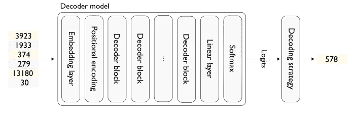
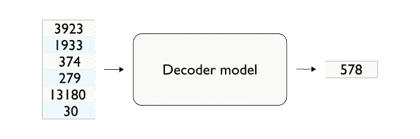
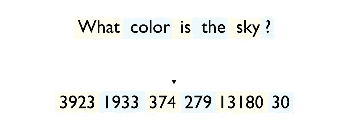
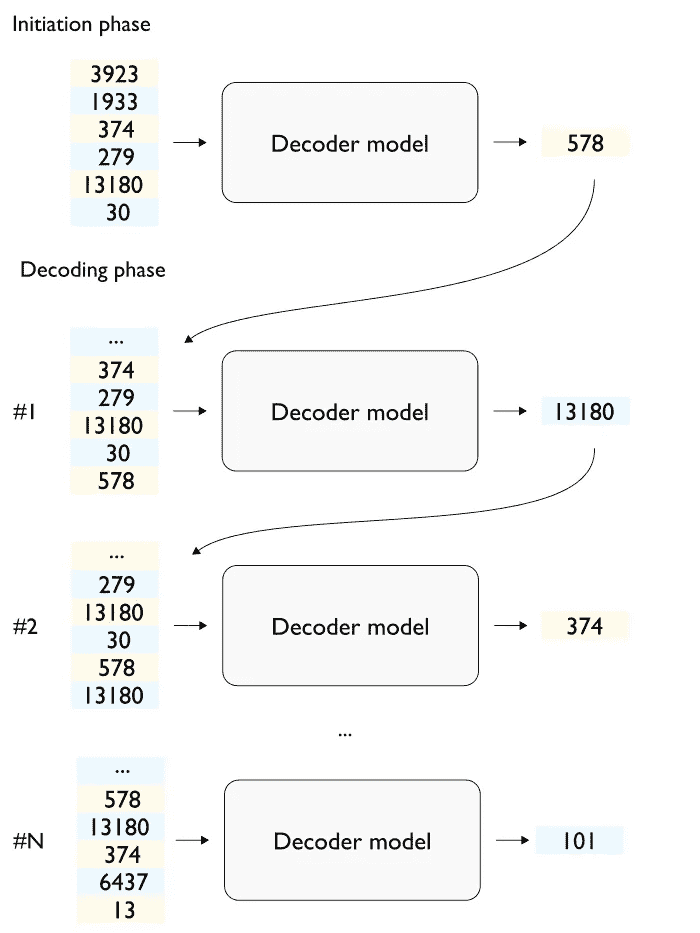
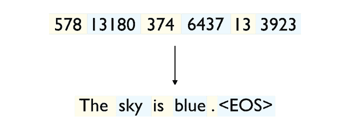

# LLM 推理优化探微 (1) ：Transformer 解码器的推理过程详解

> 来源：[https://agijuejin.feishu.cn/docx/UUmsdiEMloWoY3x4JVUcaBPWn2c](https://agijuejin.feishu.cn/docx/UUmsdiEMloWoY3x4JVUcaBPWn2c)

原文链接：https://mp.weixin.qq.com/s/GHjiyipB22q8dZES1Fc8XQ

作者： Pierre Lienhart

**编者按**：随着 LLM 赋能越来越多需要实时决策和响应的应用场景，以及用户体验不佳、成本过高、资源受限等问题的出现，大模型高效推理已成为一个重要的研究课题。为此，Baihai IDP 推出 Pierre Lienhart 的系列文章，从多个维度全面剖析 Transformer 大语言模型的推理过程，以期帮助读者对这个技术难点建立系统的理解，并在实践中做出正确的模型服务部署决策。

本文是该系列文章的第一篇，作者的核心观点是：透彻理解 Transformer 解码器的推理过程，是实现大语言模型高性能服务的基础。

作者通过解析文本生成的流程，明确了启动阶段和生成阶段的概念，并指出了键值缓存在其中起到的关键作用，为后续优化方法做好了理论铺垫。

作者 | Pierre Lienhart

**编译 | 岳扬**

# 01 **Introduction**

在本系列博文中，我将带领各位读者深入探讨 LLM 推**理的各方面知识以及实践中可能面临的挑战。本系列博文所说的 LLM 推理是指使用仅包含解码器**的 Transformer 模型生成词元（tokens），因为大多数挑战及其相关的补救方法都来自于该特定架构和使用场景。虽然重点在解码器模型，但我认为该系列博客中的一些较好的见解也可以用于理解和优化编码器模型的推理过程。

我假定各位读者已经对 Transformer 架构和著名的《Attention Is All You Need》论文([1])中介绍的缩放点积注意力（SDPA）机制有了基本的了解。不过，阅读本文无需深入理解注意力机制背后的原理。

希望在本系列博客结束时，各位读者能够理解与 LLM 推理相关的术语，如键-值 (KV) 缓存、内存带宽约束（memory-bandwidth bound）等，能够理解各种推理优化（模型量化（quantization）、内核融合（fused kernels）、模型架构修改（model architecture modifications）等）和配置（batch size、使用哪种 GPU 等）技术，最后能够将它们与延迟、吞吐量和成本等关键性能指标联系起来。

期望各位读者通过理解文章中的内容，形成一种具备洞察力的思维模式，以便在处理 LLM 服务的配置和优化时，能够做出基于充分信息的、迅速而明智的决策。和其他系列文章一样，我希望本系列文章为初次部署 LLM 到服务端的读者，提供他们希望获得的有关信息和指导。

现在，让我来介绍一下本系列的大纲。

首先，需要理解使用 Transformer 解码器（Transformer decoder）生成 tokens 需要以下两个步骤。这两个步骤分别是处理提示语步骤和多个自回归步骤。两个步骤在硬件利用上有着截然不同的特征，我们将在整个系列中详细探讨这种区别。

然后，我们将介绍对自回归步骤进行的第一个非常常见的优化，即 KV 缓存（KV caching）。重点介绍 KV 缓存是不可避免的，因为它作为一种关键的输入影响着整个自回归阶段。正如我们将看到的那样，KV 缓存并非免费的午餐，它也会引发一系列问题。在接下来的文章中，我们将更深入地探讨这些挑战及其缓解方法，并专门针对这一主题进行深入讨论。

当对 KV 缓存了如指掌之后，我们可以更深入地了解运行 Transformers 进行推理时，Transformer 模型如何（未）充分利用硬件资源。在这一阶段，我们必须引入算术强度（arithmetic intensity）这一关键概念，这是一个名为 "屋顶线模型"（roofline model）的 mental model （译者注："mental model" 意指人们在思考和理解复杂概念时构建的一种抽象思维模型。"屋顶线模型" 是一种特定的mental model，用于评估计算密集型任务的性能极限。这种模型通常以图形的形式呈现，帮助人们直观地理解任务在硬件性能方面的限制，并在优化过程中提供指导。），并将其与峰值 FLOPS、内存带宽等关键硬件特征以及延迟、吞吐量和成本等关键性能指标联系起来。然后，我们将这些知识应用于 Transformers 的推理，汇总关键见解，以了解如何更好地利用硬件并改善性能指标。通过对这一阶段基础知识的理解，我们将更好地把握性能优化过程中各种策略的真实动机，为实际应用提供更有深度的指导。

模型量化（Quantization）一直是去年最热门的优化策略之一，能够为性能带来重大提升。虽然模型量化本身就值得写一系列文章，但我将仅用一篇文章介绍，以期为读者打牢坚实的基础，明确模型量化算法在哪些方面能够有帮助，哪些方面没有帮助。

**最后，我们需要介绍目前的这些 L**LM 服务框架是如何工作的。遗憾的是，要想在 LLM 推理过程获得最佳性能，仅优化模型本身是不够的。事实上，模型服务器通过有效地管理传入的请求和硬件资源，在确保较好的 end-to-end 性能方面确实发挥着关键作用。我希望最后这篇文章能为读者提供有用的见解，帮助读者更好地部署LLM。

以下是本系列博客内容计划：

+   Introduction

+   The two-step process behind LLMs’ responses

+   KV caching unveiled

+   KV caching: A deeper look

+   Arithmetic intensity: Are you compute or memory-bandwidth bound?

+   Arithmetic intensity (and memory) is all you need

+   Shrink all the things! A guided tour of LLM quantization

+   Why you can’t just serve LLMs using a good old model server?

闲话少说，让我们直接开始吧！

# 02 LLM 做出回答前历经的两个步骤

此小节将为各位读者提供一个热身的机会，我们先来回顾 Transformer 架构和使用基于 Transformer 的解码器生成文本的基础知识。对于本系列博客的理解和学习，建立一致的专业用词体系是非常重要的。我将使用粗体标出我个人喜欢的专业术语。然后我们来一起了解文本生成的两个阶段：启动阶段和生成（或解码）阶段。

首先，我们来复习一下 Transformer。为简单起见，我们假设每次只处理单个序列（sequence）（即 batch size 为 1）。在下图中，我描绘了基于原始 Transformer 架构的解码器（图 1）的主要层次结构，该解码器（decoder）用于从输入的 tokens 序列中生成输出tokens。

图 1 -  Transformer 解码器的模型轮廓图

请注意，解码器本身并不输出 tokens，而是输出 logits（数量与词汇表的大小相同）（译者注：logits 是一个数值向量，其维度等于词汇表的大小，表示每个 token 的可能性分数。）。顺便说一下，输出 logits 的最后一层通常被称为 language model head 或 LM head 。在生成文本时，通过 logits 提取 tokens 的过程是通过一种被称为搜索策略（search strategy）、生成策略（generation strategy）或解码策略（decoding strategy）的启发式方法完成的。常见的解码策略包括：

+   贪婪解码（Greedy decoding），简单来说，就是选取具有最大 logit 的token，在选择最终的 token 之前，也可以对 logits 进行一些变换（如重复惩罚（repetition penalty））。

+   抽样解码（Sampling decoding），模型的 logits 被看作是一个多项分布，采用该分布进行抽样。换句话说，就是通过抽样从词汇表（vocabulary）中选择一个token。我们从中进行抽样的分布可以首先通过简单的一些转换操作（如temperature scaling、top-k和top-p）来调整，这是最为人熟知的。

+   还有更复杂的启发式方法，比如**束搜索（beam search）、对比解码（c**ontrastive decoding）([2])等。

为了简单起见，我们将假定解码策略是模型的一部分（图2）。这种 mental model 实际上在部署、运行和提供大语言模型服务的整体解决方案中非常有用，这种将 tokens 序列作为输入并返回相应输出 token 的实体通常被称为执行引擎（execution engine）或推理引擎（inference engine）。

图 2 - 一个简化的 Transformer 解码器模型示意图

那么如何生成多个 tokens 呢？使用基于 Transformer 的解码器从输入文本序列（通常称为提示语（prompt））生成文本（通常也被称为对输入文本的扩展或补充）基本上包括以下步骤：

1.  将模型权重加载到 GPU

1.  在 CPU 上对提示语（prompt）进行分词（tokenizing），并将 token 张量传输到 GPU （图3）

图 3 - 分词步骤示意图

1.  将分词完成后的提示语输入神经网络，生成扩展的第一个token

这一阶段通常被称为启动阶段（initiation phase）。在下一篇文章中，我们将看到它也经常被称为预填充阶段（pre-fill phase）。

1.  将生成的 token 附加到输入的 token 序列中，并将其用作生成扩展文本中第二个 token 的新输入。然后，重复此过程，直到生成了停止序列（stop sequence）（例如，单个 end-of-sequence（EOS） token）或达到所配置的最大序列长度（图4））。

**这个由多个步骤组成的阶段通常被称为生成阶段（generation phase）、解码阶段（decoding pha**se）、自回归阶段（auto-regressive phase），甚至是增量阶段（incremental phase）。

步骤3和步骤4都在下面的图中（图4）有所说明。

图4 - tokens 生成过程的启动和解码阶段

5. 将完成的 tokens 从 GPU 获取到 CPU ，并对它们进行 detokenize（译者注：”detokenize“指的是将模型生成的 tokens 序列转换回原始文本或句子的过程。可能包括去除 tokens 之间的空格、添加标点符号、还原缩写等操作，以还原生成文本的自然语言形式。），以获取生成的文本（图5）。

图 5 - detokenize步骤

注意：最近出现的旨在降低推理延迟的更先进技术，如投机抽样（speculative sampling([3]) ）或前向解码（lookahead decoding([4])），并不完全遵循上述简单算法。

说到这里，你应该会感到失望、困惑或两者兼而有之。您可能会问我：那么启动阶段和解码阶段有什么区别？现在看来，这充其量只是人为刻意区分的。启动阶段的感觉确实像是 while 循环的初始化步骤，而且我们在这两个阶段所做的事情本质上是一样的：在每次迭代时，我们都对 tokens 序列进行前向传递，每次传递序列都会增加一个 token。

你说得没错。在这一点上，无论在硬件上如何进行计算，两个阶段之间确实没有区别，因此两个阶段在这方面都没有什么特别之处。不过，正如我们将在下一篇文章中看到的那样，这种设置涉及大量冗余计算，因此在许多情况下效率低下。缓解这种情况的一种重要方式是缓存我们不想重新计算的内容。这种优化被称为 KV 缓存，并引入了我一直在暗示的这两个阶段之间的关键差异。下一篇文章见！

Thanks for reading!

**END**

**参考资料**

[1]: Attention Is All You Need (Vaswani et al., 2017) : https://arxiv.org/abs/1706.03762

[2]: A Contrastive Framework for Neural Text Generation (Su et al., 2022) : https://arxiv.org/abs/2202.06417

[3]: Fast Inference from Transformers via Speculative Decoding (Leviathan et al., 2022) : https://arxiv.org/abs/2211.17192

[4]: Breaking the Sequential Dependency of LLM Inference Using Lookahead Decoding (Fu et al. 2023) : https://lmsys.org/blog/2023-11-21-lookahead-decoding/

**本文经原作者授权，由Baihai I**DP编译。如需转载译文，请联系获取授权。

**原文链接：**

https://medium.com/@plienhar/llm-inference-series-1-introduction-9c78e56ef49d

https://medium.com/@plienhar/llm-inference-series-2-the-two-phase-process-behind-llms-responses-1ff1ff021cd5