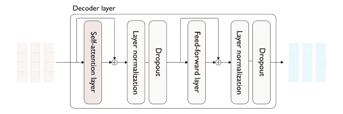
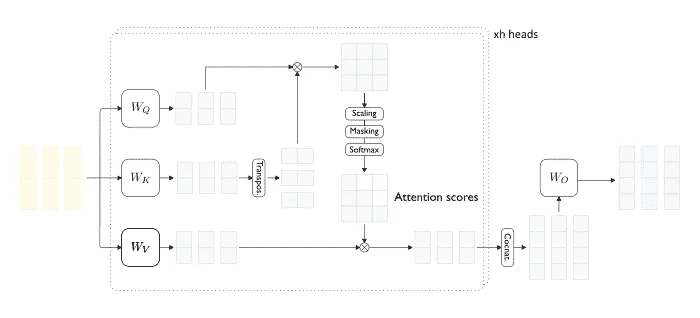
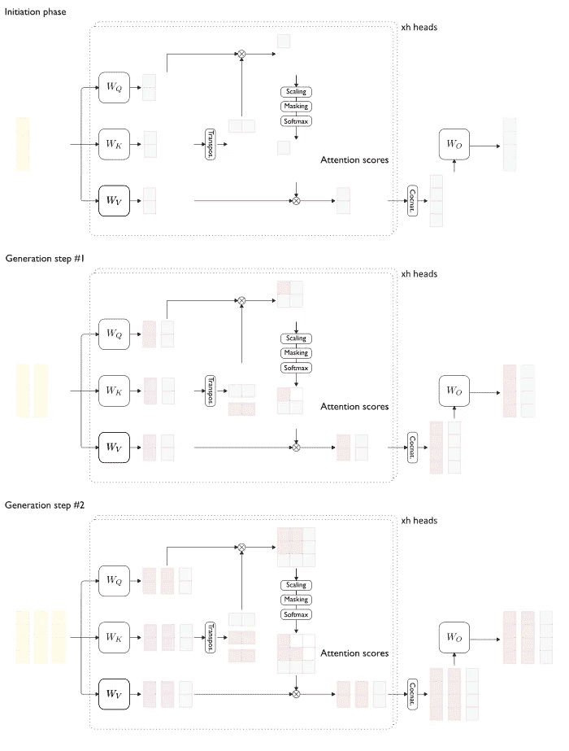
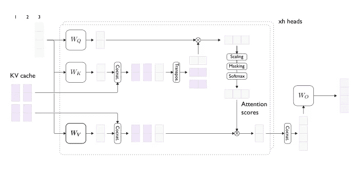
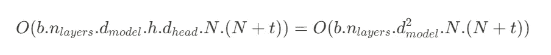
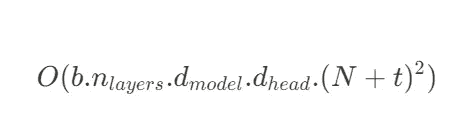

# LLM 推理优化探微 (2) ：Transformer 模型 KV 缓存技术详解

> 来源：[https://agijuejin.feishu.cn/docx/P0CtdJQqfoHtKWxHAD5ckJ1Cnjc](https://agijuejin.feishu.cn/docx/P0CtdJQqfoHtKWxHAD5ckJ1Cnjc)

原文链接：https://mp.weixin.qq.com/s/4FVqHVrnW6psNAd4_RMarg

作者： Pierre Lienhart

**编者按**：随着 LLM 赋能越来越多需要实时决策和响应的应用场景，以及用户体验不佳、成本过高、资源受限等问题的出现，大模型高效推理已成为一个重要的研究课题。为此，Baihai IDP 推出 Pierre Lienhart 的系列文章，从多个维度全面剖析 Transformer 大语言模型的推理过程，以期帮助读者对这个技术难点建立系统的理解，并在实践中做出正确的模型服务部署决策。

本文是该系列文章的第二篇，作者的核心观点是：KV 缓存可以显著减少语言模型的运算量，从而提高其生成文本的效率，但是这种技术并非免费的午餐。

本文主要介绍 Transformer 模型中存在计算冗余的原因，并详细阐述了 KV 缓存的工作机制，指出了 KV 缓存使模型的启动阶段和生成阶段有了差异。最后，通过公式量化了 KV 缓存所减少的计算量。

下一篇文章将探讨 KV 缓存大小相关问题。随后的文章将更详细地探讨硬件利用率问题，并讨论在某些情况下可以不使用 KV 缓存。

作者 | Pierre Lienhart

**编译 | 岳扬**

在[上一篇文章](http://mp.weixin.qq.com/s?__biz=MzkzMTI3MTg5MQ==&mid=2247484741&idx=1&sn=54edcfd01767f64d4ebb798f49692aba&chksm=c26cc0f9f51b49ef78ba2ea312ac23b41272d77162638efe02d3a864e3e07bcf936276252e28&scene=21#wechat_redirect)中，我们概要介**绍了 Transformer 解码器的文本生成算法，特别强调了文本**生成的两个阶段：仅由单个步骤组成的启动阶段（single-step initiation phase），即处理提示语（prompt）的阶段，以及由多个步骤组成的生成阶段（multi-step generation phase），在此阶段中，文本的生成是逐一进行的，即一个 token 一个 token 地生成。在这篇文章中，我们将演示每次在生成步骤中将整个序列（包括提示语 tokens 和生成的文本 tokens ）作为输入时，将会涉及到的冗余计算。也就是说，使用整个序列作为每一次 token 生成的输入可能会导致一些不必要的计算，而这篇文章将会探讨如何通过一种名为 KV 缓存的技术来避免这些冗余计算。该技术简单来说就是存储和重复使用我们原本需要重新计算的部分。最后，我们将了解 KV 缓存技术是如何修改生成阶段（generation phase）并使其有别于启动阶段（initiation phase）的。

# 01 关于 Transformer 注意力层的简要回顾

让我们先来了解一下最原始版本的 Transformer（图1） 模型中多头注意力（MHA）层的一些情况。

图1 — Transformer 解码器层（上方）和双头（自）注意力层（下方）的详细视图，输入序列长度为 3。

为了简单起见，我们假设只处理长度为 t 的单个输入序列（即 batch size 为 1 ）：

+   在整个处理过程的每一步上，输入序列（提示语）中的每个 token 都由一个稠密向量（dense vector）表示（图1中的浅黄色部分）。

+   注意力层的输入是一系列稠密向量，每个输入 token 由前一个解码器块（decoder block）产生。

+   对于每个输入向量，注意力层都产生一个相同维度的稠密向量（图1中的浅蓝色）。

接下来，我们来讨论单注意力头（single attention head）：

+   首先，我们使用三种不同的线性变换（projections）（查询、键和值）为每个输入向量生成三个低维稠密向量（图1中左侧的浅灰色向量）。总的来说，有 t 个查询向量、t 个键向量和 t 个值向量。

+   对于每个查询向量，都会生成一个输出向量，输出向量是输入序列中所有值向量的线性组合，每个值向量在线性组合中的权重由对应的注意力分数决定。换句话说，对于每个查询向量，生**成的输****出向量是通**过对输入序列中的值向量进行加权求和而得到的，其中权重由注意力分数确定。对于给定的查询向量，都会与所有的键向量进行点积运算。点积运算的结果表示了查询向量与每个键向量之间的关联度，即它们的相似性。这些点积的结果经过适当的处理后，成为了注意力分数，用于权衡对应值向量在输出向量中的贡献。这样，我们就能为序列中的每个 token 生成一个包含其他 token 信息的向量表征，也就是说，我们为每个 token 创建了一个上下文表征（contextual representation）。

然而，**在**自回归解码（auto-regressive decoding）的情境中，我们不能使用所有可能的值向量来构建给定查询向量的输出表征。实际上，在计算与特定 token 相关的查询向量的输出时，我们不能使用序列中后面出现的 token 的值向量。这种限制是通过一种称为 masking 的技术实现的，实质上是将被禁止的值向量（即被禁止的 token）的注意力分数设置为零。

# 02 masking 技术的使用导致生成阶段出现冗余计算

我们**现在要讨论的是问题的关键所在。由于 masking 技术的使用，在**生成当前 tokens 的输出表征时，仅使用之前已生成 tokens 的信息，而不使用之后生成的 tokens 的信息。因为之前的 tokens 在各次迭代中都是相同的，所以对于该特定 tokens 的输出表征在随后的所有迭代中也都是相同的，这就意味着存在冗余计算。

让我们以前一篇文章中的 tokens 序列为例（该序列的特点是每个单词都由一个token组成）。假设我们刚刚从“What color is the sky? The sky”的输入序列中生成了“is”。在上一次迭代中，“sky”是输入序列的最后一个 token ，因此与该 token 相关联的输出表征是通过使用序列中所有 token 的表征生成的，即“What”，“ color”，“ is”，“ the”，“ sky”，“?”，“The ”和“sky ”的值向量。

下一次迭代的输入序列将是”What color is the sky? The sky is ”，但由于 masking 技术的存在，从“sky ”的角度来看，似乎输入序列仍然是“What color is the sky? The sky ”。因此，为“sky ”生成的输出表征将与上一次迭代的表征完全相同。

现在，我们通过图1的图表，给出一个示例（图2）。在这个例子中，假设初始化步骤要处理一个长度为1的输入序列。作者使用颜色来突出显示会在计算中产生冗余的元素，其中浅红色和浅紫色分别表示冗余计算的键向量和值向量。

图2 — 在生成阶段的注意力层中的冗余计算

回到先前的例子，在自回归解码步骤的新一次迭代中，使用了“What color is the sky? The sky is ”作为输入序列，在之前的步骤中唯一尚未计算的是输入序列中的最后一个token “is”的表征。

更具体地说，我们需要什么才能做到这一点呢？

1.  “is”的查询向量。

1.  用于计算注意力分数的“What”，“ color”，“ is”，“ the”，“ sky”，“?”，“The ”，“sky ”和“is ” 的键向量。

1.  用于计算输出的“What”，“ color”，“ is”，“ the”，“ sky”，“?”，“The ”，“sky ”和“is ” 的值向量。

至于键（key）和值（value）向量，除了 ”is “之外，它们已经在之前的迭代中为所有 tokens 计算过了。因此，我们可以保存（即缓存）并重复使用先前迭代中的键和值向量（译者注：原文是“query vectors”，可能是作者笔误，此处译者修改为“值向量”）。这种优化简单地被称为 KV 缓存。为“is ”计算输出表征将会变得非常简单：

1.  计算“is ”的查询向量、键向量和值向量。

1.  从缓存中获取“What”，“ color”，“ is”，“ the”，“ sky”，“?”，“The ” 和 “sky ”的键和值向量，并将它们与刚刚为“is ”计算的键向量和值向量连接起来。

1.  使用“is ”查询向量和所有键向量计算注意力分数。

1.  使用注意力分数和所有值向量计算“is ”的输出向量。

在这种优化方法下，只要能使用它们的键和值向量，我们**实际上就不再需要之前的 tokens 。当我们使用 KV 缓**存时，模型的实际输入是最后生成的 tokens （而非整个序列）和 KV 缓存。下图 3  举例说明了这种在生成阶段运行注意力层的新方法。

图 3 — 启用 KV 缓存的生成步骤

回到前一篇文章中提到的两个阶段：

+   启动阶段（initiation phase）实际上不会受到 KV 缓存策略的影响，因为先前没有步骤被执行。

+   但是，解码阶段（decoding phase）的情况就大不相同了。我们不再使用整个序列作为输入，而只使用最后生成的 tokens （以及 KV 缓存）。

**在注意力阶段（attention phase），注意力层现在会一次性处理所有提示语（p**rompt）的 tokens ，而不像解码步骤那样一次只处理一个 token 。在文献[1]中，第一种设置称为批处理注意力（batched attention）（有时被误称为并行注意力（parallel attention）），而第二种称为增量注意力（incremental attention）。

当使用 KV 缓存时，启动阶段实际上是计算并（预）填充 KV 缓存中所有输入 token 的键向量和值向量，因此通常也被称为预填充阶段。在实践中，“预填充阶段”和“启动阶段”这两个术语可以互换使用，我们从现在开始将更倾向于使用前者。

# 03 **使用 HuggingFace Transf**ormers 实现 KV 缓存的实际示例

KV 缓存实际应用效果如何？我们可以启用或禁用 KV 缓存吗？让我们以HuggingFace Transformers([3])库为例。所有专用于文本生成的model类（即XXXForCausalLM类）都实现了一个名为generate的方法，该方法被用作整个生成过程的初始入口点。该方法接受大量配置参数([4])，主要用于控制 tokens 的搜索策略。KV 缓存是否启用由 use_cache 这个布尔类型的参数控制（默认为True）。

再深入一层，查看模型的 forward 方法（例如，查看 LlamaForCausalLM.forward([5]) 的文档），可以顺利地找到 use_cache 布尔类型参数。启用 KV 缓存后，会有两个输入：最后生成的 tokens 和 KV 缓存，它们分别通过参数 input_ids 和 past_key_values 传递。新的 KV 值（即在当前迭代中计算的新的键向量（key）和值向量（value））作为 forward 方法输出的一部分返回，供下一次迭代使用。

那么这些返回的 KV 值看起来如何？让我们做一些张量计算。启用 KV 缓存后，forward 方法返回一个张量对（tensor pairs）的列表（一个用于键向量，一个用于值向量）。模型中有多少个解码器块（通常称为解码器层，表示为n_layers），就有多少个张量对。对于 batch 中每个序列的每个 token ，每个注意力头都有一个维度为 d_head 的键/值向量，因此每个键/值张量的 shape 为（batch_size，seq_length，n_heads，d_head）。

具体到实际数值，以 Meta 的 Llama2–7B([6]) 为例，n_layers=32，n_heads=32，d_head=128。我们将在下一篇文章中详细介绍 KV 缓存的大小，但现在我们已经对它能达到的大小有了初步的直观认识。

# 04 使用 KV 缓存可以节省多少运算量？

假设有一批输入序列（input sequences），数量为 b 个，每个序列由 N 个生成的 tokens 和 t 个输入的 tokens （总长度为N+t）组成，对于这些序列的前 t+N-1 个 tokens，计算 KV 值是冗余的，也就是说，在生成步骤的第 N 步，我们可以为每个序列节省 t+N-1 次 KV 计算。如果不重新计算，那么在前 N 个生成步骤中，每个序列总共可以节省 N.t+N.(N-1)/2 次 KV 计算。

**如果不在第 N 步重新计算，我们可以节省多少 FLOP ？为特定的 tokens 计**算键或值向量就是简单地将其 size 为 d_model 的嵌入向量与 shape 为（d_model，d_head）的权重矩阵相乘即可。让我们进一步分解这个问题。

每个生成步骤要进行多少次不必要的键向量或值向量计算？在每个解码器层中，每个 token 和每个注意力头（attention head）都要进行两次计算（一次计算键向量，一次计算值向量），即每个 token 要进行 2.b.n_layers.h 次计算。这意味着在前 N 个生成步骤中，每个序列总共节省了 b.n_layers.h.N.(t+N-1) 次键向量或值向量计算。

一次矩阵乘法需要多少 FLOPs？将 shape 为 (n, p) 的矩阵与另一个 size 为 (n, m) 的矩阵相乘，大约需要 2.m.n.p 次运算。因此，在本文这个例子中，一个键向量或值向量的计算大约需要 2.d_model.d_head 的运算量。

总体而言，选择 KV 缓存将在前 N 个生成步骤中节省大约如下数量的FLOP：

使用 KV 缓存还能够实现不为前 t+N-1 个 tokens 计算查询向量，也不将 t+N-1 个输出表征（output representations）乘以输出权重矩阵（output weight matrix），但这并不会改变上述公式。不计算前 t+N-1 个 tokens 的注意力分数可以节省下面这么多 FLOP ：

从实际数字来看，以 Meta 的 Llama2-7B([6]) 为例，n_layer=32，d_model=128，d_model=4096。

最重要的是，我们注意到通过 KV 缓存节省的运算数量与生成的 tokens 数量的平方成正比。（译者注：换句话说，如果生成的 tokens 数量翻倍，通过KV缓存所节省的运算数量将变为原来的四倍。）

不过，到目前为止我们只看到了 KV 缓存的优点，缺点将在下一篇文章中讨论。请记住，KV 缓存是一种妥协，因此并不是免费的午餐：其实是使用更多的内存消耗和数据传输来换取更少的计算量。我们将在下一篇文章看到，使用 KV 缓存需要付出的代价可能很大，而且就像进行任何交易一样，它可能并不总是非常划算。

# 05 **Conclusion**

最后我们来总结一下本篇文章能够学到的知识。由于在注意力计算中使用了 masking 技术，在每一步生成步骤中，实际上都可以不用重新计算过去 tokens 的键向量和值向量，只需计算最后生成的 token 的键向量和值向量。每次我们计算新的键向量和值向量时，确实可以将它们缓存到 GPU 内存中，以便将来重复使用，从而节省了重新计算它们所需的运算。

与启动阶段所需的输入相比，强制执行这一缓存策略改变了注意力层在生成阶段的输入。在启动阶段，注意力层会一次性处理整个输入序列，而启用 KV 缓存的生成阶段只需要最后生成的 token 和 KV 缓存作为输入。这种启动阶段和生成阶段之间的新差异不仅仅是概念上的。例如，与在两个阶段使用相同的 GPU 内核相比，在每个阶段使用特定的 GPU 内核能带来更好的性能([2])。

正如上面提到的，KV 缓存并非免费的午餐，会带来一系列新的问题，我们将在接下来的文章中进行研究：

+   KV 缓存会消耗GPU内存，而且消耗非常多！不幸的是，GPU 内存非常稀缺，尤其是当你的机器配置仅供加载相对较小的大语言模型时。因此，KV 缓存是增加单次能够处理的序列数量（即吞吐量）的主要障碍，也是提高成本效益比的主要障碍。

+   与我们需要从内存中移动的数据量相比，KV 缓存在单个生**成**步骤中大大减少了我们执行的运算量：我们获取大权重矩阵和不断增长的 KV 缓存，只是为了执行微不足道的矩阵到向量运算（matrix-to-vector operations）。不幸的是，在现代硬件上，我们最终花费在加载数据上的时间要多于实际运算的时间，这显然会导致 GPU 的计算能力得不到充分利用。换句话说，我们的 GPU 利用率很低，因此成本效益比也很低。

下一篇文章将探讨 KV 缓存大小问题。随后的文章将更详细地探讨硬件利用率问题，并讨论在某些情况下可以不使用 KV 缓存。

Thanks for reading!

**END**

**参考资料**

[1]: See for example Fast Transformer Decoding: One Write-Head is All You Need (Shazeer, 2019), https://arxiv.org/abs/1911.02150

[2]: For example, since its release 2.2.0, the reference implementation(https://github.com/Dao-AILab/flash-attention) of the widely adopted Flash-Attention algorithm features a dedicated kernel for the decoding phase when KV caching is enabled (flash_attn_with_kvcache) also referred to as Flash-Decoding(https://pytorch.org/blog/flash-decoding/).

[3]https://huggingface.co/docs/transformers/index

[4]https://huggingface.co/docs/transformers/v4.29.1/en/main_classes/text_generation#transformers.GenerationConfig

[5]https://huggingface.co/docs/transformers/model_doc/llama2#transformers.LlamaForCausalLM.forward

[6]https://huggingface.co/meta-llama/Llama-2-7b-chat-hf/blob/main/config.json

**本文经原作者授权，由Baihai I**DP编译。如需转载译文，请联系获取授权。

**原文链接：**

https://medium.com/@plienhar/llm-inference-series-3-kv-caching-unveiled-048152e461c8