# LLM 推理优化探微 (4) ：模型性能瓶颈分类及优化策略

> 来源：[https://agijuejin.feishu.cn/docx/PfDkddc9doDtC9x8LHjcuASbnNg](https://agijuejin.feishu.cn/docx/PfDkddc9doDtC9x8LHjcuASbnNg)

**原文链接：****https://mp.weixin.qq.com/s/3g**BkRH3b0OPs4hOEm-hq6w

作者： Pierre Lienhart 🌺

**欢迎关注👸号：****Baihai IDP**

---

---

**编者按：**在人工智能浪潮袭卷全球的大背景下，进一步提升人工智能模型性能，满足更多应用需求已经刻不容缓。如何优化模型延迟和吞吐量，成为了业界亟待解决的重要问题。

我们今天为大家带来的这篇文章，其观点为：不同的性能瓶颈需要采取不同的优化策略，识别并解决主要的性能瓶颈是提升模型性能的关键。

文章指出，主要有 4 种影响模型性能的瓶颈：计算能力受限、内存带宽受限、通信受限和开销受限。作者分别介绍了针对这 4 种情况可采取的优化措施。另外，文章还全面分析了算术强度和硬件配置等因素对吞吐量的影响。作者提出可通过增加算术强度、优化算法实现等方式来提升吞吐量。最后以 FlashAttention 的优化案例阐述了理论分析在实践中的应用。

本文为人工智能模型性能优化提供了理论基础和实践指导，对于提高人工智能系统的延迟和吞吐量具有重要价值。对于从事相关工作的技术人员而言是一份不可多得的好资料。

作者 | Pierre Lienhart

**编译 | 岳扬**

在上一篇文章，我们深入探讨了 KV 缓存的相关优化方法。这篇文章我们将转变方向，探索可能影响机器学习模型速度的各种性能瓶颈。本文所介绍的内容广泛适用于任何机器学习模型（无论是用于训练场景还是推理场景）。不过，为了便于读者理解，本文所提供的示例将专注于大语言模型（LLM）的推理场景。

阅读本文之前，我强烈推荐各位阅读参考文献[1]（https://horace.io/brrr_intro.html），本文在很大程度上受到了该博文的启发。

# 01 **模型性能瓶颈的 4 种主要类型**

如若对模型现有的性能不满意，并准备投入时间进行优化，那么第一步就是确定瓶颈类型。性能瓶颈主要可分为四类，其中三类与硬件的限制相关，一类与软件相关。

先从与硬件相关的瓶颈开始探讨，每种硬件瓶颈对应于某一种特定的工作状态或操作模式（specific operational regime:）：

+   计**算能力受限情况（Compute bound regime）**：在该情况下，大部分时间（即延迟）都耗费在执行计算操作上（如图 1 所示）。与其他情况相比，这种情况在资源分配中的投入用于处理计算任务，Compute bound regime 是最经济高效的一种情况，因此也是我们最应该追求的操作模式。

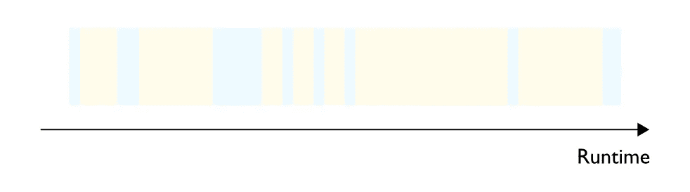

图 1 —— compute bound process，计算过程和数据传输过程分别用黄色和蓝色标出

+   内存带宽受限情况（Memory bandwidth bound）：在这种情况下，大部分时间都用于在嵌入于处理器芯片上的内存和处理器之间移动数据，如权重矩阵（weight matrices）、intermediate computations（译者注：在处理数据时产生的暂时性计算结果）等。

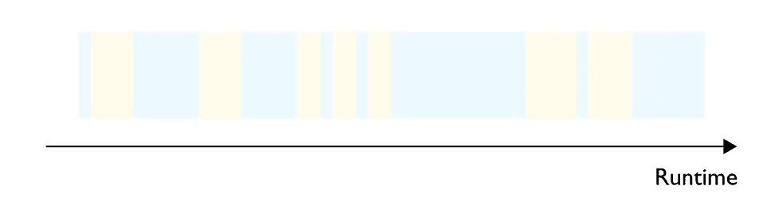

图 2 —— memory bandwidth bound process，计算过程和数据传输过程分别用黄色和蓝色标出

+   通信受限情况（Communications bound）（参考文献 [1] 中没有提到）：仅适用于计算和数据分布在多个芯片上的情况。大部分任务处理时间被芯片间的网络数据传输占用（图 3）。

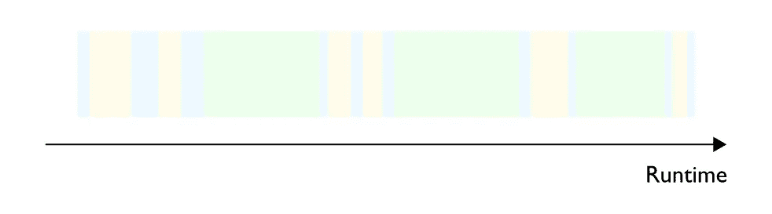

图 3 —— communications bound process，计算过程、数据传输过程和网络通信过程分别以黄色、蓝色和绿色标出

**请注意：我使用“芯片”这个词，因为这些概念适用于任何类型的芯片：CPU、GPU**、定制芯片（如Google的TPU、AWS的Neuron Cores...）等。

请注意，现在的计算硬件和 AI 框架都经过了高度优化，计算任务和数据传输任务通常在某些时候会同时发生（见图 4 ）。为简单起见，我们在本文中将继续假设它们是按顺序依次进行的。

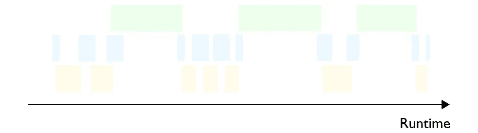

图 4 —— 数据传输与其他操作（比如计算）可同时进行的 communications bound process

+   最后一种是开销受限情况（overhead bound），是软件导致的瓶颈。在这种情况下，大部分时间都用于调度计算机系统中各项任务的执行顺序和时间并将计算任务或指令发送给计算机的**处**理器或其他硬件设备执行 —— 很多情况下，我们花费更多的时间来确定要做什么，而非在硬件上执行实际操作（图 5）。在使用非常灵活的编程语言（如 Python）或 AI 框架（如 PyTorch）时，更有可能出现开销受限的情况，因为这些编程语言或 AI 框架不需要明确指定程序运行时期（runtime）所需的所有信息（如张量数据类型（tensor data types）、目标设备（target device）、要调用的内核（kernels to invoke）等）。这些缺失的信息必须在任务运行时期（runtime）进行推理，处理各项任务相应的 CPU 周期称为开销（overhead）。与 CPU 相比，现在的 Accelerated hardware（译者注：用于加速特定类型计算任务的硬件，例如GPU、Google的TPU等） 速度已经非常快了，因此很可能出现开销影响硬件利用率，进而影响成本效益的情况 —— 很多情况下，硬件会处于闲置状态，等待软件提交下一个工作任务。

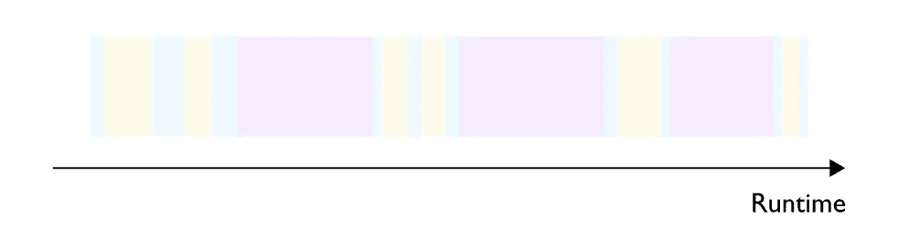

图 5 —— overhead bound process ，计算、数据传输过程和软件执行过程中花费的额外时间分别以黄色、蓝色和紫色标出

执行模型的前向传播**或反向传播（backward or** forward pass）涉及在GPU上并行执行多个内核函数或程序段。通常情况下，不可能所有内核都运行在同一种机制下。因此，关键在于识别出大部分时间都耗费在哪一种机制上。然后，我们应该优先优化这一主要的性能瓶颈，再找出下一个影响最大的性能瓶颈，如此循环往复。

**正**确识别出性能瓶颈类型至关重要。每个性能问题都需要不同的解决方案。如果诊断错误，即使实施了一些优化措施，效果也会大打折扣，这无疑是在浪费时间。

# 02 **确定导致系统性能受限的主要因素**

本文不会在此深入探讨这个话题，但参考文献 [1] 强调了当处于开**销受**限情况时，消耗时间不会随着计算量或数据传输量的增加而成正比地增长。换句话说，如果你增加了计算或数据传输能力，但程序运行时期（runtime）的时间长度没有相应地增加，那么这个程序很可能处于开销受限情况（overhead bound）。否则，程序性能很可能是遇到了硬件层面的瓶颈，但要区分计算能力瓶颈和内存带宽瓶颈，需要使用 FLOP count（译者注：系统或算法每秒钟能够执行的浮点运算次数）和数据传输量等这些指标，即使用性能分析器（profiler）帮助我们区分。

讲回 LLM（大语言模型），请记住，训练阶段和 inference pre-fill 阶段（译者注：可能指的是在进行推理之前，填充或准备数据或资源的阶段。）通常是处于计算能力受限情况的，而 inference decoding 阶段（译者注：将模型的输出解码成最终可读结果的过程。） 在大多数硬件上通常受到内存带宽的限制。因此，主要针对训练过程的优化方法（例如低精度的矩阵乘法（lower-precision matrix multiplications）），可能对减少总的推理过程延迟并没有太大帮助，因为推理过程的延迟大部分都是解码阶段的延迟。

# 03 针对不同类型的性能瓶颈进行优化，降低延迟

如果处于**计算能力受限情况**下，可以：

1.  升级到更强大、更昂贵、峰值 FLOPS 更高的芯片。

1.  对于矩阵乘法等特殊运算，NVIDIA Tensor Cores 等更快的专用硬件单元。例如，NVIDIA H100 PCIe ([2]) 如果使用 NVIDIA GPU 上的通用计算核心，其峰值计算性能为 51 TFLOPS ，而使用专用的 Tensor Cores 则为 378 TFLOPS （在全精度情况下）。

1.  减少模型运行所需的运算操作数量。更具体地说，对于 ML 模型，这可能说明使用更少的参数就能获得相同的结果。像模型剪枝（pruning）或知识蒸馏（knowledge distillation）这样的技术可以帮助实现这一点。

1.  使用精度更低、速度更快的数据类型进行计算。例如，对于相同的 NVIDIA H100 PCIe ，8-bit Tensor Cores 的峰值FLOPS（1,513 TFLOPS）是 16-bit Tensor Cores 峰值 FLOPS 的两倍（756 TFLOPS），而 16-bit Tensor Cores 峰值FLOPS则是 32-bit Tensor Cores 峰值FLOPS的两倍（378 TFLOPS）。不过，这需要对模型的所有输入数据都进行量化处理（例如权重矩阵（weight matrices）和激活值（activations），详细内容请了解 LLM.int8() ([3]) 或 SmoothQuant ([4]) 量化算法），并使用专用的低精度计算核心。

如果处于内存带宽受限情况（Memory bandwidth bound）下，可以：

1.  升级到功能更强大、更昂贵、具有更高内存带宽的芯片。

1.  使用模型量化（quantization）等模型压缩技术或并不流行的模型剪枝和知识蒸馏技术，减少需要移动的数据量。对于 LLM（大语言模型），data size issue（译者注：此处应当指的是由于大规模数据传输导致的内存带宽受限问题）主要通过仅对模型权重进行量化的技术来解决（如 GTPQ ([5]) 和 AWQ ([6]) 量化算法），以及 KV-cache 量化来解决。

1.  减少内存操作的次数。在 GPU 上运行任务实际上就是执行一个有向图，图中的每个节点都代表一个计算核心（或 GPU 函数）的执行。对于每个核心（kernel），必须从内存中获取输入，并将输出写入内存。将多个计算核心（或 GPU 函数）合并为一个更大的计算核心，即以调用单个计算核心的方式来执行最初分散在多个计算核心中的内存操作，可以减少内存操作的次数。将多个内存操作融合的过程（见图6）可以由编译器自动执行，也可以通过手动编写自定义的内核来进行内存操作融合（这种方式比较困难，但对于复杂的内存操作融合来说是必要的）。

1.  对于 Transformer 模型，为注意力层（attention layer）开发高效的经过融合处理后的计算核心（fused kernels）仍然是一个较为活跃的领域。许多经过优化的计算核心都基于流行的FlashAttention算法 ([7])。Transformer 模型所需的经过融合处理的计算核心库包括 FlashAttention 、 Meta 的 xFormers 以及现已废弃的 NVIDIA FasterTransformer （已并入 NVIDIA TensorRT-LLM 中）。

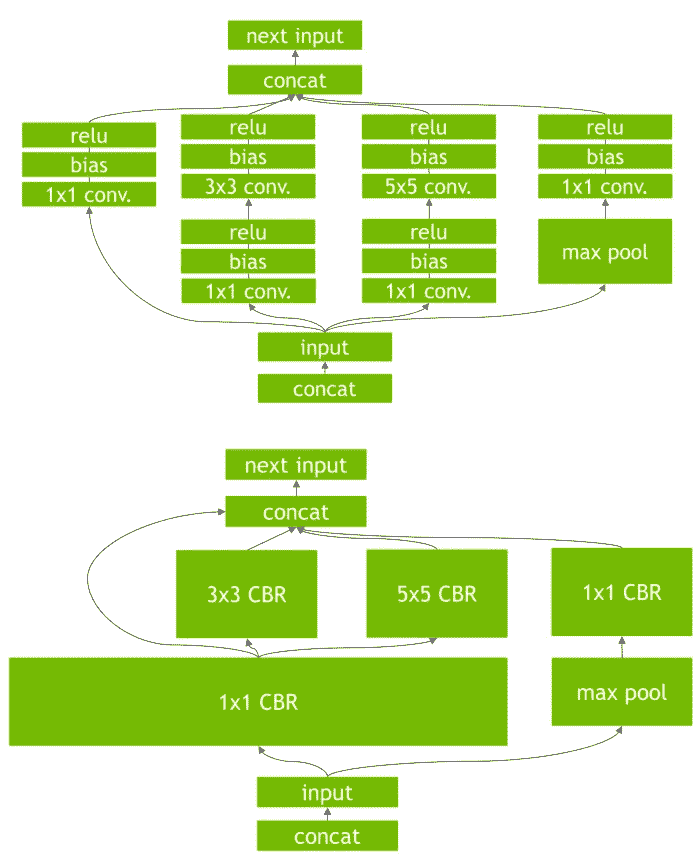

图 6 —— 对CNN模型进行水平和垂直方向上的各种内存操作融合，初始状态（上方）和最终状态（下方）([8])

如果处于通信受限情况（Communications bound）下，建议：

1.  升级到功能更强大、价格更昂贵的、具有更高通信带宽的芯片。

1.  通过选择更高效的 partitioning and collective communication strategy （译者注：是在分布式环境中采用的一种策略，用于有效地划分数据到多个节点或处理器上进行处理并进行多处理器之间的协作和通信。）来减少通信量。例如，参考文献[9]扩展了参考文献[10]中主流的 Transformer 模型的tensor parallelism layout（译者注：指如何在分布式环境中有效地划分和管理这些张量，以便在多个处理器或设备上并行处理），引入了新的张量并行策略（tensor parallel strategies），使在分布式系统中传输数据所需的时间在芯片数量和 batch sizes 较大的情况下能够更好地扩展（即防止通信时间成为瓶颈）。

例如，参考文献 [10] 中的 tensor parallelism layout 保持 weights shards（译者注：在分布式计算环境中，权重可能会被划分为多个部分，并在不同的设备或处理器上进行计算） 不随着计算过程的进行而改变，而 activation shards（译者注：在分布式计算环境中，激活值可能会被划分为多个部分，并在不同的设备或处理器上进行计算。）则在不同的处理器或计算设备之间进行移动。在预填充阶段（pre-fill stage）和处理非常大的数据序列的情况下，参考文献 [9] 指出激活值的大小可能会比权重大小要大。因此，从通信的角度来看，更有效的做法是不对激活值进行移动或调整，只移动 weight shards ，就像 “weight-gathered” 分区策略（译者注：在这种策略下，权重参数被聚集在一起，而激活值则在处理过程中进行移动。这与其他分区策略相反，其他分区策略可能会将激活值固定在某些设备上，而将权重参数在不同设备间移动。）一样。

如果你处于开销受限情况（overhead bound）下，建议：

1.  使用 C++ 等灵活性较差但效率较高的语言，以灵活性换取较少的开销（overhead）。

1.  将多个内核（kernel）任务一起提交给 GPU 执行，而不是一个接一个地提交，可以将任务提交的固定开销分散到多个内核上，而不是每个内核都承担相同的开销。当需要多次提交同一组执行时间较短的内核任务时（如在需要进行多次迭代的工作任务或计算任务中），这一点尤其有利。CUDA Graphs（自 PyTorch 1.10 版本发布以来已集成到 PyTorch 中）提供了一些实用工具，将代码块中的所有 GPU 操作（如内核启动）记录下来，并将它们整理成一个有向图，以便将其作为一个整体一次性提交给 GPU 执行。

1.  通过观察模型的输入和操作，记录下模型执行过程中的计算步骤，并生成一个可重现的计算图（compute graph）。例如， PyTorch 的 torch.jit.trace 可以追踪 PyTorch 程序并将其打包为可部署的 TorchScript 程序。

通过使用模型编译器（model compiler），可以进一步优化计算图。

无论如何，你又一次用灵活性（flexibility）换取了更少的开销（overhead），因为跟踪/编译（tracing/compilation）要求张量大小、类型（tensors sizes, types）等参数是静态的，因此在程序运行时期（runtime）中需要保持不变。控制流结构，如if-else，通常也会在此过程中丢失。

对于需要达到与 Ahead of Time (AOT) 编译（译者注：AOT 编译通常会将所有内容固定为静态，不允许在程序运行时期进行灵活调整）不兼容的灵活性要求（例如，dynamic tensor shapes（译者注：在模型运行过程中，张量的维度和大小可能会根据输入数据或其他因素而变化）、control flow（译者注：在程序运行时期可以根据输入数据或其他条件动态地改变程序的执行路径）等）， just-in-time（JIT）编译器可以在执行前对模型代码进行动态优化（但不如 AOT 编译器彻底）。例如，PyTorch 2.x 就提供了名为 TorchDynamo 的 just-in-time（JIT）编译器。由于使用 TorchDynamo 无需修改 PyTorch 程序，因此在保持优质的 Python 开发体验的同时，还能减少使用 JIT 编译器的开销。

**题外话：模型优化器（model optimizers）和（AOT）编译**器之间有区别吗？在我看来，两者的区别有点模糊。我是这样从概念上区分这两个术语的。

首先，两者都是 ahead-of-time （译者注：在程序实际运行之前，就对其进行编译或优化处理）的。经典的 AOT 编译器工作流程是：从所支持的 AI 框架（PyTorch、TensorFlow、MXNet 等）中跟踪代码，将计算图（compute graph）提取到 intermediate representation（IR）（译者注：是在源代码和目标代码之间的一种抽象表示一种通用的、与具体语言和平台无关的表示形式）中，将这些硬件无关的优化技术（algebraic rewriting（译者注：通过数学运算规则的重写来简化表达式，从而提高代码的执行效率）、loop unrolling（译者注：通过减少循环迭代次数来提高程序的执行速度）、operator fusion（译者注：将多个操作（如矩阵乘法、卷积等）合并为单个操作，以减少内存访问和计算开销的优化技术）等）用于生成经过优化的计算图，最后使用针对特定硬件的优化技术（选择最适合的计算内核或算法、优化数据在计算设备（如GPU、TPU等）和内存之间的移动方式等方法）为目标硬件创建可部署的工件（deployable artifact）。AOT 模型编译器的例子包括 PyTorch 的 TorchInductor、XLA 和 Meta 的 Glow 等。

模型优化器是一种工具套件，其中包括 Ahead of Time（AOT）编译，但通常针对特定硬件进行优化（如面向英特尔硬件的 OpenVINO 、面向英伟达硬件的 TensorRT 和 TensorRT-LLM），并且能够执行模型量化或模型剪枝等额外的 post-training optimizations （译者注：在模型训练完成后对模型进行的优化操作）技术。

到目前为止，我们只关注了延迟（处理单个请求所需的时间）这种情况，现在让我们深入研究计算能力受限和内存带宽受限的情况，将吞吐量（单位时间内可处理的请求数量）重新引入本文的逻辑框架。

# 04 **B**ottleneck（性能瓶颈） = f(Hardware（硬件配置）, Arithmetic intensity（算术强度）)

**有趣的是，在相同的算法处理相同的输入时，可能会出现两种情况：计算能力受限或内存带宽受**限。具体为哪种情况由算法的算术强度决定，即每访问一字节内存所执行的算术运算次数。

我们希望算术强度的值处于或更接近更经济高效的计算能力受限范围内。我们将看到，随着算术强度值的增加，吞吐量（throughput）和成本效益比（cost efficiency）也会提高。然而，一些增加算术强度的方法可能会降低延迟。因此，在设计系统时，需要权衡延迟和吞吐量之间的关系，并选择适当的算法或技术。

假设 b 是每次程序运行传输到内存（或者从内存传输出）的数据字节数，p 表示每次程序运行时执行的浮点运算次数（FLOPs）。假设 BW_mem（单位为 TB/s ）是硬件的内存带宽，BW_math（单位为 TFLOPS）是硬件的数学运算带宽，也称为峰值 FLOPS。t_mem 表示移动数据所花费的时间，而 t_math 表示执行算术操作所花费的时间。

“计算能力受限” 简单来说就是在进行计算任务时，花费的时间更多用于执行算术操作，而非数据传输（图 7）。

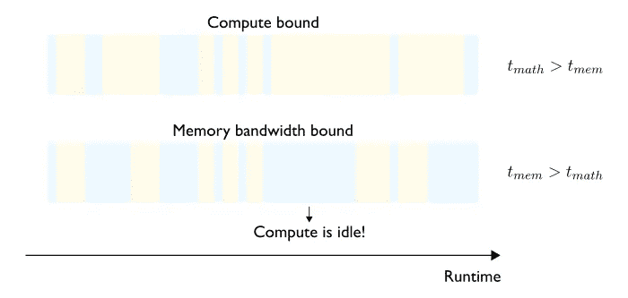

图 7 —— Compute vs. memory bandwidth bound regimes。计算时间和数据传输时间分别以黄色和蓝色标出。

因此，我们在进行计算任务时会受到限制：

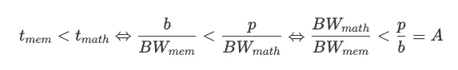

A 是该算法的算术强度，其以每字节的浮点运算次数（FLOP）来衡量。数据传输过程中的每一个字节进行的算术运算越多，算术强度就越高。

**正如公式中所示，要使算法处于计算能力受限的情况下，其算术强度必须超过硬件相关的峰值 FLOPS** 与内存带宽之间的比率。相反，若算术强度低于这个比率，则表示该算法受限于内存带宽（图 8）。

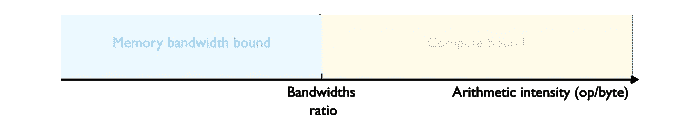

图 8 —— 受限于内存带宽或计算能力这两种情况的判断边界

让我们来看一看在英伟达™（NVIDIA®）硬件上使用半精度矩阵乘法（即使用 Tensor Cores ）的一些实际数据（表 1）：

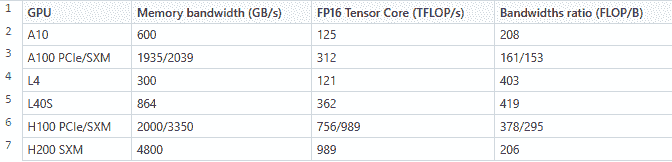

表 1 —— 常用于 LLM 训练和推理服务的英伟达™（NVIDIA®）数据中心 GPU 规格

这能够说明什么呢？以 NVIDIA A10 为例，bandwidths ratio为 208 意味着在该特定硬件上移动一个字节的数据与执行 208 次 FLOP（浮点运算）的速度相当。因此，如果在 NVIDIA A10 上运行的算法每传输一个字节的数据时，不能做到至少执行 208 次浮点运算（或每传输一个半精度浮点数不能做到至少执行 416 次浮点运算），那么这种情况下在数据的移动上花费的时间就会不可避免地超过计算时间，也就是说，它受到了内存带宽的限制。换句话说，算术强度低于 hardware bandwidths ratio （译者注：在特定硬件上进行运算时，每字节数据传输所需的时间与每次运算操作（FLOP）所需的时间之间的比率）的算法都是受到内存带宽限制的。

由于 LLM 推理过程的解码阶段具有较低的算术强度（详见下一篇博文），因此它在大多数硬件上都是受到内存带宽限制的。与 NVIDIA H100 相比，NVIDIA H200 的 bandwidth ratio 更适合此类低强度工作负载（low-intensity workloads）。这也是英伟达给 H200 的推广语设置为 "supercharging generative AI inference, " 的原因，因为 H200 的硬件设计就是针对这种内存受限情况的。

现在，让我们把算术强度与延迟和吞吐量联系起来：

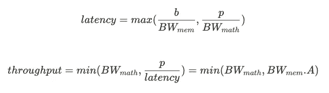

注意：这里的吞吐量以 TFLOPS 表示，而非每秒请求数，但两者是成正比的。此外，吞吐量以 TFLOPS 表示这一事实凸显了其与硬件利用率（hardware utilization）以及成本效益（cost efficiency）的关系。为了更明显地表现这种关系，吞吐量可以更精确地被表示为每个芯片处理器运行一秒钟内能够处理的请求或任务数量，即芯片处理器每次请求所需的芯片秒数越低，吞吐量就越高，成本效率也就越高。（参见参考文献 [9] 第4节）。

如果我们将算术强度绘制在 x 轴上，将（最大可达到的）吞吐量作为因变量表示在 y 轴上，就得到了所谓的（初始）roofline model （译者注：一种用于评估计算机程序性能的图形模型，帮助确定程序的性能瓶颈，以便进行优化）([12])（图9）。

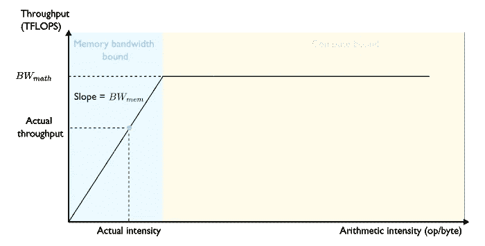

图 9 —— The roofline model

让我们通过一个小小的思维实验来理解绘制在图 9 上的吞吐量数值为什么是最大可达到的水平。在计算能力受到限制的情况下，这一点显而易见：没有什么能够阻止我们利用全部算力，我们只受限于硬件的峰值能力（hardware’s peak capacity）。在内存带宽受限制的情况下，我们在 1 秒内可获取的最大数据量由硬件的内存带宽 BW_mem 决定。如果算法的算术强度为 A，我们在 1 秒内可以实现的最大浮点运算数量为 BW_mem * A。

增加算法的算术强度会产生什么影响？我们可以考虑这三种情况（见图 10 ）：

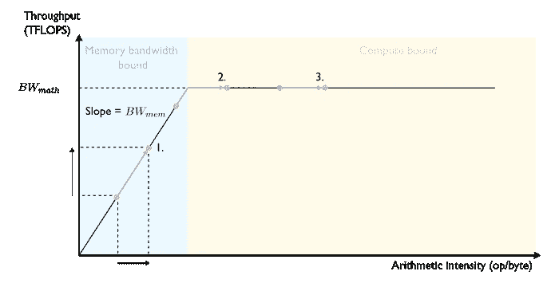

图 10 —— 增加算法的算术强度可能出现的三种情况

**情景1：算术强度的增加幅度过小，无法摆脱**内存带宽的限制，但吞吐量却会按比例增加。系统仍然受到内存带宽的限制，因此对延迟的影响将取决于这种算术强度如何影响数据传输的速度和效率。

情景2：算术强度的增加将系统切换到计算能力受限制的状态。吞吐量上升到硬件的峰值吞吐量。现在系统处于计算能力受限的状态，对延迟的影响取决于更高的算术强度如何改变该算法的总运算量。

**情**景3：由于已经受到计算能力的限制且达到了峰值吞吐量（peak throughput），增加的算术强度不会带来吞吐量的增益。对延迟的影响仍然取决于更高的算术强度如何影响该算法的总计算量。

具体应该如何增加算术强度？这完全取决于算法的具体情况。在下一篇文章中，我们将研究决定 Transformer 解码器块（decoder blocks）算术强度的关键参数。我们将可以了解增加 batch size 如何提高某些特定操作的算术强度。

前文已经讨论过的一些优化措施也能提高算术强度，从而提高吞吐量和资源利用率。对于 Transformer 模型（其解码阶段受到内存带宽的限制），算术强度的提升主要通过 operation fusion（译者注：将多个操作（例如矩阵乘法、加法等）合并为一个更大的操作，以减少操作之间的间隙和数据传输。） 和数据（权重矩阵、KV 缓存）量化来减少数据传输的次数和大小进行。

在此，我们做出了一个关键的假设，即算法能够充分利用硬件资源。例如，在传输数据时，假设算法可以 100% 使用硬件的理论内存带宽。然而实际上显然并非如此（尽管某些算法确实能够接近最优的资源利用率），如果资源的使用率没有达到最优（sub-optimal）水平，那么会如何影响之前的分析结果？

很简单：上文提到的带宽数据必须用现实中能够达到的数据来替换。次优系统（指算法实现无法完全利用硬件资源的情况）会在最优 roofline 曲线下方拥有自己的 roofline 曲线（如图 11 所示）。具体有两种方式可用来提高吞吐量：增加算术强度和优化算法，使其能够更高效地利用硬件的计算能力、内存带宽等资源。

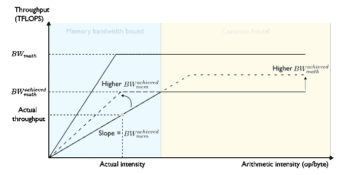

图 11 —— 资源利用率未达到最佳状态的 roofline model

最后，让我们以一个现实生活中的真实算法优化案例来总结。在 2.2 版本之前，FlashAttention在解码阶段的效率很低，性能表现相当糟糕。以前的数据加载（data loading）实现方式使内核在解码阶段利用内存带宽的效率大大降低。更糟糕的是，对带宽的利用程度实际上会随着 batch sizes 的增大而进一步降低；因此，由于内存限制，需要较小 batches 的较长序列其性能受到的影响最大。FlashAttention 团队解决了这一问题（主要是因为在从 KV 缓存加载数据时，没有对序列长度这一维度进行并行化操作），并发布了经过优化的用于推理过程解码阶段的内核（kernel） —— FlashDecoding ，为处理较长序列的输入这种情况带来了显著的延迟降低([13])。

# 05 **Summary**

在本文中，我们了解了四种可能影响模型延迟的性能瓶颈类型。确定造成模型延迟的主要因素至关重要，因为每种因素类型都需要制定针对性的优化策略。

为简单起见，本文没有考虑分布式环境。在这种情况下，实际的硬件操作要么受到计算能力的限制，要么受到内存带宽的限制。内核的算术强度决定了其属于哪种性能瓶颈。在算术强度较低、内存带宽受限的情况下，可达到的最大吞吐量与算术强度成线性关系。相比之下，在计算能力受限的情况下，吞吐量被硬件的峰值浮点计算能力（peak hardware FLOPS）所限制。这基本上取决于影响算术强度的因素，我们可能有机会通过增加算术强度来提升最大吞吐量，最理想情况下甚至可以达到计算能力受限制的性能水平。然而，提高算术强度可能会对延迟产生不利影响。

在下一篇博客文章中，我们将运用这些新知识来更详细地研究 Transformer 解码器块的算术强度。敬请关注！

Thanks for reading!

——

**Pierre Lienhart**

GenAI solution architect @AWS - Opinions and errors are my own.

本系列往期文章：

[LLM 推理优化探微 (3) ：如何有效控](http://mp.weixin.qq.com/s?__biz=MzkzMTI3MTg5MQ==&mid=2247484822&idx=1&sn=140234050dbfbdf0041cee035f7f4b3f&chksm=c26cc02af51b493c32b6c701eb8a6202d068dd749afb099ff79e9e7eefbf8fa3ba0251586790&scene=21#wechat_redirect)制 KV 缓存的内存占用，优化推理速度？

[LLM 推理优化探微 (2) ：Tran](http://mp.weixin.qq.com/s?__biz=MzkzMTI3MTg5MQ==&mid=2247484746&idx=1&sn=d38ed0e53d81d91ba7c0b0cdc997e3ec&chksm=c26cc0f6f51b49e098886fce2f12547e40707c6803123ea723dab3c284ba7a33115672e29580&scene=21#wechat_redirect)sformer 模型 KV 缓存技术详解

[LLM 推理优化探微 (1) ：Tr](http://mp.weixin.qq.com/s?__biz=MzkzMTI3MTg5MQ==&mid=2247484741&idx=1&sn=54edcfd01767f64d4ebb798f49692aba&chksm=c26cc0f9f51b49ef78ba2ea312ac23b41272d77162638efe02d3a864e3e07bcf936276252e28&scene=21#wechat_redirect)ansformer 解码器的推理过程详解

**END**

**参考资料**

[1]: Making Deep Learning Go Brrrr From First Principles (He, 2022) https://horace.io/brrr_intro.html

[2]: NVIDIA H100 product specifications https://www.nvidia.com/en-us/data-center/h100/

[3]: LLM.int8(): 8-bit Matrix Multiplication for Transformers at Scale (Dettmers et al., 2022) https://arxiv.org/abs/2208.07339 + GitHub repository https://github.com/TimDettmers/bitsandbytes

[4]: SmoothQuant: Accurate and Efficient Post-Training Quantization for Large Language Models (Xiao et al., 2022) https://arxiv.org/abs/2211.10438 + GitHub repository https://github.com/mit-han-lab/smoothquant

[5]: GPTQ: Accurate Post-Training Quantization for Generative Pre-trained Transformers (Frantar et al., 2022) https://arxiv.org/abs/2210.17323  + GitHub repository https://github.com/IST-DASLab/gptq

[6]: AWQ: Activation-aware Weight Quantization for LLM Compression and Acceleration (Lin et al., 2023) https://arxiv.org/abs/2306.00978 + GitHub repository https://github.com/mit-han-lab/llm-awq

[7]: FlashAttention: Fast and Memory-Efficient Exact Attention with IO-Awareness (Dao et al., 2022) https://arxiv.org/abs/2205.14135, FlashAttention-2: Faster Attention with Better Parallelism and Work Partitioning (Dao, 2023) https://arxiv.org/abs/2307.08691 + GitHub repository https://github.com/Dao-AILab/flash-attention.

[8]: Deploying Deep Neural Networks with NVIDIA TensorRT (Gray et al., 2017) https://developer.nvidia.com/blog/deploying-deep-learning-nvidia-tensorrt/

[9]: Efficiently Scaling Transformer Inference (Pope et al., 2022)  https://arxiv.org/abs/2211.05102

[10]: Megatron-LM: Training Multi-Billion Parameter Language Models Using Model Parallelism Shoeybi et al., 2019) https://arxiv.org/abs/1909.08053

[11]: Blog post — Accelerating PyTorch with CUDA Graphs (Ngyuen et al., 2021) https://pytorch.org/blog/accelerating-pytorch-with-cuda-graphs/

[12]: Roofline: an insightful visual performance model for multicore architectures (Williams et al., 2009) https://dl.acm.org/doi/10.1145/1498765.1498785

[13]: Blog post — Flash-Decoding for long-context inference (Dao et al., 2023) https://pytorch.org/blog/flash-decoding/#using-flash-decoding

**本文经原作者授权，由 Baihai ID**P 编译。如需转载译文，请联系获取授权。

**原文链接：**

https://medium.com/@plienhar/llm-inference-series-5-dissecting-model-performance-6144aa93168f