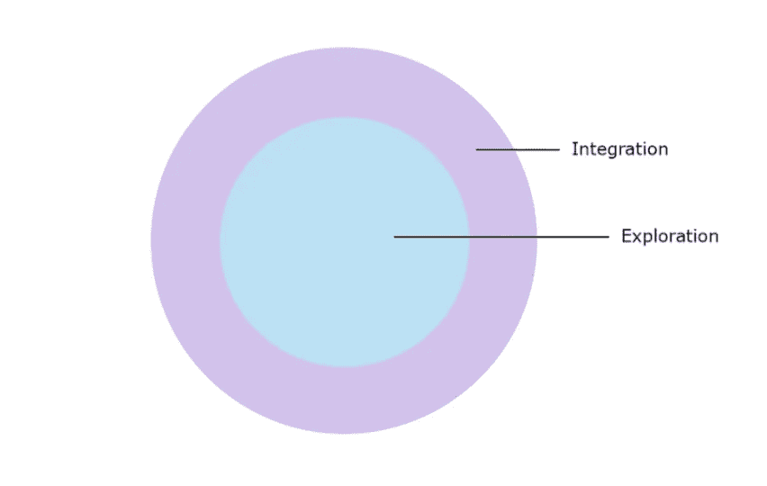
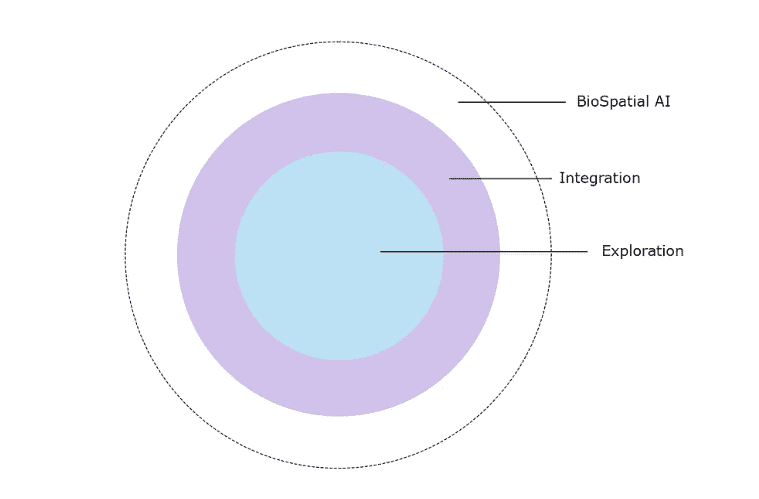

# 生成式 AI 的下一阶段将走向何方？

> 来源：[https://agijuejin.feishu.cn/docx/UkiPdvNBcoRDdYxWu32cZK7Unce](https://agijuejin.feishu.cn/docx/UkiPdvNBcoRDdYxWu32cZK7Unce)

---

**原文链接🔗：h****ttps://mp.weixin.qq.com/s/eQz**muIpAofoAzMJDzXhUgw

作者：Paul DelSignore 💐

**欢迎关注：****Baihai IDP**

---

**编者按：**最近，随着 ChatGPT 的出现，很多人认为人工智能领域进入了大探索时代。然而这仅仅只是生成式 AI 发展的第一幕。

我们今天要给大家带来的这篇文章认为，生成式 AI 已经进入第二幕，即整合时代，不同系统和企业之间将出现广泛合作，以定制解决方案将 AI 能力深度嵌入各行各业。

文章详细阐述了第二幕的几个特征：(1)科技巨头纷纷与 AI 初创公司建立合作伙伴关系；(2)将生成式 AI 无缝嵌入已有产品成为主流；(3)内容公司与模型公司达成授权协议；(4)AI 与设备、系统集成；(5)初创公司通过 API 为大公司提供服务。

生成式 AI 正在重塑软件世界，小公司的长期生存面临挑战，开源仍然至关重要。未来第三幕可能是物联网与 AI、合成生物学的深度融合。我们有理由相信未来会出现更多惊喜。

作者 |  Paul DelSignore

生成式人工智能的历史可追溯至 20 世纪 60 年代，但直到 2022 年，才迎来生成式人工智能大觉醒之年。

# 01 **第一幕：探索**

我还记得 2022 年 4 月我第一次看到 DALLE-2 时的情景，那就像是一种顿悟，我知道有大事将要发生了。我开始使用 GPT-3 和当时的一些人工智写作工具。

然后在 8 月，开源图像大模型 Stable Diffusion 发布，突然间，图像工具的数量呈现爆炸式增长。

到 2022 年 12 月，一款利用 Stable Diffusion 的手机拍照应用 Lensa AI 在短短一个月内就实现了全球近 2000 万次的下载记录。

2022 年，ChatGPT 的公开发布让人工智能推向了新高潮，这标志着该技术突破性地进入了主流市场。ChatGPT在短短几个月内用户数量就达到了 1 亿。

ChatGPT 的成功让其他行业开始思索大模型可能带来的颠覆性变化，成为人工智能创新的催化剂。突然间，每个人都在尝试使用生成式人工智能，几乎每天都有新工具发布。

举几个例子，比如大语言模型（GPT-4、PaLM2、Claude、LLaMA 等）、图像、视频和代码模型的创新，以及 AutoGPT 和AI智能体的新实验范例等等。

关于 ChatGPT 发布以来的大量创新，我也许可以写一**本书**，但如果要我用一个词来概括，那就是：探索

# 02 **第二幕：整合**

最近，红杉（Sequoia）的一篇文章([1])，伊桑-莫利克（Ethan Mollick）的一篇文章([2])等都表明，变革之风正盛，我们正处于 Gen AI 故事的第二幕。

我**也注**意到了这种变化。人工智能正在走向成熟，而且正在产生一种捆绑效应（bundling effect）。我想用以下标题来定义第二幕：整合

将其称为新阶段并不意味着“探索”阶段已经结束，远非如此。在未来几年里，我们将继续看到令人惊叹的创新水平。

**G**en AI 的时间轴并不是一个阶段结束，另一个新的阶段接着开始，而是一个嵌套的阶段。我们在接近整合时代的同时，仍将迎来创新时代。

# 03 **整合时代**

整合时代始于生成式AI人工智能军备竞赛元年。

大型科技公司纷纷建立合作伙伴关系，以确保自己在竞争中占据主导地位和主要优势。这其中包括微软 + OpenAI、亚马逊 + Anthropic 和谷歌 + Nvidia。

由**于 Gen AI 是一**种功能、一种超级能力，而不是一种特定的应用或软件，因此现有的科技公司都拥有一个完美的战略来确保自己的立足点，即：将生成式AI融入一切。

这个战略很简单，将人工智能的精华嵌入消费者和企业已经在使用的工具和产品中。因此，如果你想在人工智能的帮助下写作，你不需要一个新的人工智能写作应用程序，因为它已经包含在微软的 Word 工具中了。

对于微软来说，他们的计划是将人工智能嵌入到一切中，包括他们的 365 Office 工具套件、必应搜索引擎、基于网络的应用程序和 Xbox 游戏机，以及最重要的，他们的 Windows 操作系统。

对于谷歌来说，他们的计划是相同的。谷歌搜索将由他们日益强大的LLM（如PaLM和Genesis）提供支持，谷歌 Workspace 将服务于商业用途，AI将赋能包括电子商务、导航和图像捕捉在内的每个移动应用。

在图像和图形方面，尽管Midjourney和Stable Diffusion在探索时代占据了主导地位，但Adobe现已通过Firefly v2赶上，并在其所有应用程序和创意工具套件中整合了一系列令人印象深刻的生成式AI功能。

亚马逊作为云计算提供商，现在也是 LLM 提供商，通过 Bedrock 提供模型即服务（model-as-a-service，MaaS）。

Meta将继续构建新的沉浸式技术，并通过AI增强其社交应用体验，而我们甚至还不清楚苹果一旦加入这场游戏会做些什么。AppleGPT很可能会成为 AI 个人助理，超越包括ChatGPT在内的所有其他chatbot。为什么呢？因为它将被整合进苹果生态系统——iPhone、电脑和其他设备中。

整合时代意味着生成式AI进入软件领域，就像为家庭供电一样。它将成为系统的一部分，成为我们已有的用户体验的一部分。

# 04 **初创公司面临的挑战**

虽然我们将继续看到初创公司在 Discord 频道、Github repos 和社交媒体上的惊人创新，但小公司与 Gen AI 玩长期游戏将变得越来越困难。

至少，他们需要“缴税“，因为大型科技公司拥有LLM，他们拥有铁路和电网。

毫无疑问，这就是为什么大多数大型科技公司（Meta除外）反对开源LLM的原因。不要相信关于安全问题的谎言。

这就是为什么开源必须继续成为生成式AI的一个充满活力的组成部分。创新需要公司在不受专有 LLM 公司限制的情况下进行实验和创新。

# 05 **合作推动定制化**

随着生成式AI进入下一个阶段，系统和这些公司之间的合作将增加，以便为工业和商业的各种应用提供整合AI能力的定制解决方案。

那看起来会是什么样的？

+   随着多模态体验的增加，我们可能会看到专注于某一细分市场的公司与其他公司合作。最近的一个例子是Canva + Runway。

+   像Anthropic或OpenAI这样的LLM公司将寻找高质量的内容进行训练。内容公司将会对模型公司进行授权或合作。最近的一个例子是AP将内容授权给OpenAI([3])。

+   随着设备开始变得智能并融入AI，预计LLM将开始与设备连接。最近的一个例子是使用LLM进行视觉引导的自动驾驶([4])。

+   像Pika Labs或Midjourney这样的公司将通过API为大公司提供服务集成。最近的一个例子是Google将Adobe的Firefly用于图像生成。

# 06 **未来行动展望**

如果让我预测 "第三幕 "会是什么样子，我会说，我们将看到人工智能在物理世界中越来越多地出现。

**集成时代主要是人工智能与软件 (AI+Software) 的融合，而生物空间时代将**是人工智能与物理和生物的融合(AI + Physical + Biology)。

第三幕将是由人工智能物联网（AIoT）和不断涌现的合成生物学驱动的的物联网融合时代。我们还没有一个合适的词来形容它，所以我称之为 "生物空间时代"。我相信会有更好的词出现。

# 07 **最后的思考**

**生成式人工智能已进入第二幕**，其特点是不同系统和企业协作的融合，协同为各行各业的各种应用提供量身定制的人工智能能力，并将其深度融入到到应用解决方案中。

作为一个谨慎的技术乐观主义者，我深知进步将伴随着许多挑战。随着生成式人工智能进一步深入我们的工具和生活，围绕人工智能伦理、数据隐私和安全的合理担忧也将变得突出。

Thanks for reading!

**END**

**参考资料**

[1] https://www.sequoiacap.com/article/generative-ai-act-two/

[2] https://www.tandfonline.com/doi/full/10.1080/08956308.2023.2213102

[3] https://apnews.com/article/openai-chatgpt-associated-press-ap-f86f84c5bcc2f3b98074b38521f5f75a

[4] https://news.ycombinator.com/item?id=37710865

**本文经原作者授权，由Baihai I**DP编译。如需转载译文，请联系获取授权。

**原文链接：**

https://medium.com/the-generator/the-next-phase-of-generative-ai-984b109915ed