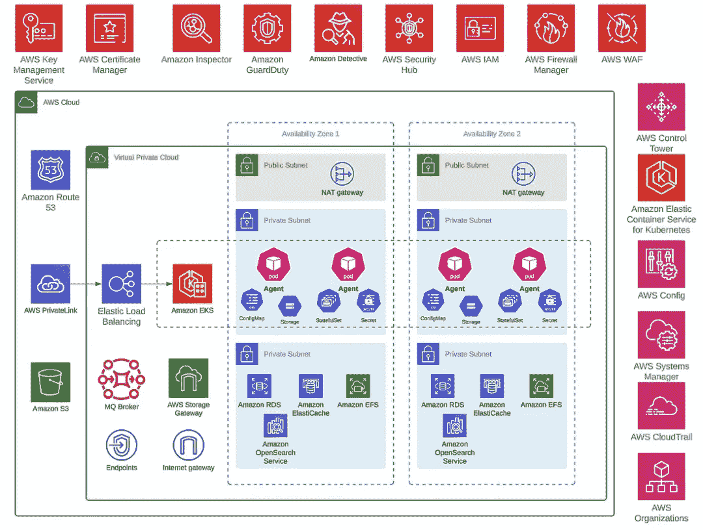
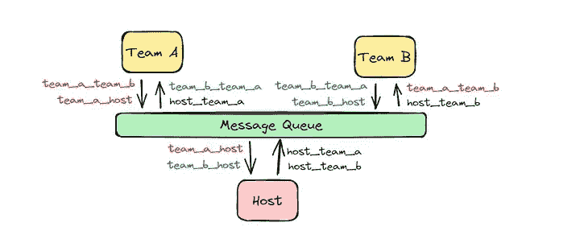

# 从工程师视角看 “Multi-Agent as a Service (MAaaS)”

> 来源：[https://agijuejin.feishu.cn/docx/S3dGdYYy7okNeYxjiX9cxAtTnPr](https://agijuejin.feishu.cn/docx/S3dGdYYy7okNeYxjiX9cxAtTnPr)

原文链接🔗：https://mp.weixin.qq.com/s/BqdKl631NDZXa0sO2E62Mw

作者：Sam Rajaei & Guanyi Li 🕶

欢迎关注：Baihai IDP

---

编者按：目前 AI Agents 在各行各业的应用前景广阔，越来越多的企业开始尝试部署 AI Agents ，然而如何在企业生产环境中有效部署和管理 AI Agents，是工程师们面临的一大挑战。你是否曾面临这样的困惑：如何确保 AI Agents 在生产环境中稳定可靠地运行？如何应对突发的高并发请求？当 AI Agents 出现"幻觉"或系统崩溃时，又该如何快速恢复？

本文提出了 "Multi-Agent-as-a-Service(MAaaS)" 这一概念，认为可以借鉴云应用的最佳实践（best-practices）来设计、部署和管理 AI Agents 系统。MAaaS 框架涵盖了从系统架构到监控管理的各个方面，包括明确的职责划分、RESTful 接口设计、独立的数据存储、容器化部署、自动化测试等关键策略。

我们相信，随着对 MAaaS 概念的不断探索和完善，Multi-Agent 系统有望在各个行业中引发变革，为 AI 应用开辟新的道路。

作者 🎨 | Sam Rajaei & Guanyi Li

编译 🌺 | 岳扬

关于 AI Agents（能够基于特定指令和对上下文的理解独立完成任务的自主系统([1])）的讨论([2])一直不绝于耳。其讨论热度几乎可与大语言模型（LLMs）相媲美。本文将从一线工程师、系统架构师以及平台可靠性工程师（SREs）的视角出发，探讨 AI Agents，介绍 Multi-Agents-as-a-Service 这一概念，以及他们如何在未来的生产环境中与 AI Agents “打交道”。

## 01 Context：AI Agents 能解决什么问题？

在探讨 AI Agents 能解决的问题时，我们发现它们在以下任务场景表现出色 —— 模仿人类交流方式可以更有效执行的任务，比如需要理解自然语言、情感识别、个性化服务或者需要与人类用户进行互动的任务。

1. 在电子商务领域，借助 LLM-based RAG 或 Text-to-SQL 等技术， AI Agents 能够根据公司规定准确回答用户的问题，从而为客户提供更加个性化的购物体验，有望颠覆传统的电商模式。

1. 客户服务领域也是 AI Agents 的理想应用场景。很多人都有过为了一些简单的问题（比如订单状态没有更新）长时间排队等待客服的经历。一些初创公司（例如 Decagon([3])）正通过 AI Agents 来解决这些效率低下的问题。

1. 也十分适合根据个人需求提供产品或内容的定制化领域，Wix([4]) 就是一个典型案例。面向无需编写代码或只需编写少量代码的网站搭建需求，Wix 开发了一个聊天机器人，它能够通过问答与用户互动，根据用户的描述和需求来搭建网站。

“人类只需设定目标（`goals`），而 AI Agents 会独立决策，选择达到目标所需的最优行为规划。”([5])

基于 LLMs 的 AI Agents 在模拟人类的自然对话和执行简单的商业流程操作等方面表现较好，往往能够提供既高效又令人满意的服务。

## 02 工程师们关于 AI Agents & Enterprise Production Environments 的观点

在思考了 AI Agents 的诸多优势后，你是否曾好奇过它们如何在企业生产环境中运行？什么样的架构模式和基础设施组件能够最好地支持它们的正常运行？当遇到不可避免的错误，如 Agents 出现幻觉([6])、系统崩溃，或（可能更加糟糕）在执行重要任务时进行了错误的推理和规划，我们该怎么办？

如果我们是一名工程师，必须审慎思考这些问题。更重要的是，我们还需探讨一个根本性的问题：我们该如何界定 Multi-Agent 平台首次部署成功的标准？

为了寻找答案，我们可以借鉴软件工程领域的另一个分支——可靠性工程（Reliability Engineering）中的一个概念：服务质量目标（Service Level Objectives, `SLOs`）。`SLOs` 是衡量服务性能与可靠性的关键指标，简单来说，`SLOs` 规定了“成功”操作与总操作的 acceptable ratio（译者注：可以接受的或合理的比例，如果这个比例高于某个预先设定的阈值，那么服务的性能就被认为是可接受的。反之，如果低于这个阈值，则可能需要采取优化措施。），以及这些操作对用户体验的影响。这些目标将帮助我们设定 AI Agents 及其支持的工作流所需达到的服务要求和预期水平。

那么，`SLO` 与我们讨论的 AI Agents 有什么关系呢？

我们在讨论 AI Agents 的性能时，可以将其简化为两个核心目标 —— “可用性（Availability）”和“准确性（Accuracy）”，并且识别出一些更具体的、有助于实现这些目标的 `SLOs`：

1. 可用性：描述的是 Agents 或平台对请求（`requests`）给出成功响应（例如 `HTTP 200` 状态码）的比例。从以往来看，底层服务器的正常运行时间和 `ping` 命令的成功率是衡量可用性的重要指标。然而，在微服务架构盛行的今天，这种传统的衡量方式可能变得不那么重要了。现在的平台系统更倾向于通过响应用户请求成功的次数与响应用户请求失败的次数来准确反映系统的可用性。此外，延迟（`Latency`）([7])和吞吐量（`Throughput`）也是与之相关的指标。

1. 准确性：这一点与 AI Agents 快速且稳定地响应用户的请求不同，它更侧重于 Agents 在无人验证其工作准确性的情况下，能否从业务角度正确执行任务并返回准确数据。传统系统也会监测数据准确性和质量的 `SLOs`。

衡量上述 AI Agents 的性能目标是否达到时，通常需要实时地收集和提交应用程序内部的各种性能指标数据，可以按照固定的时间间隔（比如每 10 分钟一次）收集、提交，或者是对特定事件（如用户请求、上游调用等）做出响应时收集、提交。例如，可以用 `Synthetic`([8]) probing（译者注：通过模拟或合成的方式来探测系统，通常是为了测试系统在处理现实情况时的性能。例如，在测试一个网站或服务器的响应时间时，可以用它来模拟用户发起的请求，然后测量服务器对这些请求的响应时间和成功率。）来模拟用户请求，触发相关事件，并监控相关数据。此处我们要探讨的关键问题是：那些设计相对简单、行为可预测的传统系统，其输出总是确定的、可预测的，因此，对其进行监控、探测和评估通常比较直接。但对于复杂多变的 GenAI Agents，情况却未必如此。

请注意，本文主要关注两个目标中的第一个——可用性。包括确定验收标准，这些验收标准确保系统在运行时能够保持稳定，不受外部因素的影响，以便帮助 Agents 顺利处理用户的 `query` 。如果想要更深入了解准确性（例如为 AI Agents 设定合理的任务范围、优化 few-shot 方法和评估框架的性能）的相关内容，这篇文章([9])可作为入门学习资料。

现在，回到工程师在部署 AI Agents 时为确保基础架构的可靠性而需要做好的事情。为了达成服务质量目标（`SLOs`）并打造一个可靠而安全的平台，工程师应当重点关注以下几个因素：

+ Scalability：当请求量突然增加时，系统能否有效应对？

+ Cost-Effectiveness：大语言模型（LLM）的使用成本高昂，如何监控和控制成本？

+ High Availability：如何确保系统始终可用且响应迅速？AI Agents 是否具备自我修复功能，并能够从错误（`errors`）或系统崩溃（`crashes`）中恢复正常？

+ Security：如何确保数据在静态存储过程中和传输过程中的安全🔐，如何完成安全审计、漏洞挖掘等工作？

+ Compliance & Regulatory：这是人工智能领域的一个重大议题，我们必须遵守哪些相关的数据隐私法规和其他特定行业标准？

+ Observability：如何实时监控 AI Agents 的业务流程、运行状态和资源利用率，以便在问题影响用户体验之前识别并解决？

是不是听起来很耳熟？似乎 AI Agents 与 Web 应用、微服务架构和云基础设施所面临的挑战非常相似。

那么，现在该怎么办？我们提出了一个用于 AI Agents 开发和维护的框架，该框架遵循了多年来在一系列工程和软件学科中形成的最佳实践（best-practices）。

## 03 Multi-Agent-as-a-Service (MAaaS)

这次，让我们借鉴云应用领域（cloud-based applications）的最佳实践，重新思考如何在生产系统中设计 AI Agents：

+ 明确的职责范围：每个 Agents 都应该有一个定义明确且职责范围较小的工作领域，并明确其功能界限。通过这种模块化方法，AI Agents 能够更准确的执行任务，且更易于管理和不依赖其他组件独立扩展。

+ `RESTful` 接口风格和服务间使用异步通信方式：使用 `RESTful` API 进行用户与 AI Agents 之间的通信，并利用消息代理（message brokers）进行异步通信。这种方法让 AI Agents 之间的交互更加松散，从而提高了系统的可扩展性（scalability）和容错能力（fault tolerance）。

+ 每个 AI Agent 的数据独立存储：每个 Agent 都应该有自己的数据存储空间，每个 Agent 的数据应该是封闭的，不会与其他 Agent 的数据混淆或混合。必要时使用分布式数据存储解决方案，使每个 Agent 更加独立和易于管理。

+ 使用容器化技术和容器编排来管理和部署应用程序：使用容器（如 `Docker` ）来打包和部署 AI Agents，确保它们在不同的环境中保持一致性，简化了 Agents 的部署（deployment）和扩展（scaling）（译者注：即增加或减少 Agents 实例的数量）过程。借助容器编排平台（如 `Kubernetes` ）来管理 Agents 服务的整个生命周期，包括部署、扩展和日常运维。

+ 自动化测试和 `CI/CD` 流程：实施自动化测试（包括单元测试（`unit`）、集成测试（`integration`）、契约测试（`contract`）和端到端测试（`end-to-end`）），以确保对 AI Agents 进行可靠的代码变更管理。使用 `CI` 工具在代码提交时自动构建和测试 AI Agents 。建立 `CD` pipelines，无缝地将更新后的代码（changes）部署到生产环境，减少停机时间并确保快速迭代。

+ 可观测性（`Observability`）：为 AI Agents 及其支持的基础设施实施强大的可观测工具，如 `metrics`（译者注：可量化的指标，用于衡量系统性能、资源使用情况、响应时间等。）、`tracing`（译者注：跟踪和记录系统内部操作的详细信息，包括请求如何从一个服务流向另一个服务等信息。）和 `logging`（译者注：通常记录错误、警告和信息性消息，以便在出现问题时进行回溯和分析），以建立一个能够实时显示平台可靠性的工具或界面。计算每个 Agent 及其处理的所有请求流的 `SLOs` 和 error budgets（译者注：在 `SLOs` 中允许的错误次数或错误率）。通过模拟用户请求和高效地处理系统警告和故障，可以在 Agents 产生的问题对大量终端用户造成影响之前及时发现并解决。

通过应用前文提到的这些原则，我们就可以构建一个强大的、可靠的 AI Agents 框架，并提出 “Multi-Agent as a Service”（MAaaS） 这一概念。这种方法利用了云应用的最佳实践，重新定义了 AI Agents 的设计、部署和管理方式。

Image by the author

AI Agents 能够在业务运营中扮演着比较关键的角色。然而，Agents 需要一个强大的基础设施支撑着它的运行，不能独立于这些环境之外，确保它能够满足生产环境中的预期需求，基础设施中的关键组件包括：

+ `SOA` 架构（Service-Oriented Architecture）：在设计 AI Agents 时，将其设计成可以轻松集成到现有系统中的 services（译者注：可以独立运行，也可以作为更大的系统或应用程序的一部分，可以选择使用云服务商的云服务，按需使用。）。

+ `API` 网关：使用 `API` 网关来管理和保护客户端与 Agents 之间的流量。

+ 弹性基础设施：利用可以根据需求弹性扩展或缩减资源的云基础设施。

+ 云服务提供商托管的云服务：使用云服务提供商托管的服务（如数据库服务、向量存储服务、消息传递服务和机器学习服务）来减少运维成本。

+ 集中监测（Centralized Monitoring）：使用集中监测解决方案（如 `CloudWatch`、`Prometheus`、`Grafana`）来追踪 AI Agents 的运行状况和性能情况。

为了突出前文所提 Multi-Agent 系统的优点，我们将展示一个简单的 Multi-Agent 系统示例：一个辩论平台。

## 04 Example: Multi-Agent 辩论模拟系统

为了生动演示 MAaaS 的运作方式，我们打造了一个 Multi-Agent 辩论模拟系统。辩论的主题是“AI 对就业市场的影响（AI’s impact on the job market）”。这个辩论系统包含三个 Agent：

+ 支持 AI 对就业有益的 A 队

+ 持有相反观点的 B 队

+ 负责管理辩论过程的主持人，辩论将在八轮之后或两队之间的讨论开始变得没有太多意义时结束。

我们使用 `PhiData`([10]) 来构建 AI Agents ，并通过 AWS Elastic Kubernetes Service（`EKS`） 进行部署，以实现高可用性。Agent 的活动通过 AWS `CloudWatch` 进行监控，EKS 的 service discovery 功能（译者注：分布式系统中自动发现服务的机制，用于简化服务的发现和交互过程。）可确保 Agents 之间的通信顺畅。Agents 之间的对话历史记录被存储在数据库中，以便在出现故障时，任何备用的 Agents 都能无缝地继续讨论。这种遇到故障及时恢复的弹性通过一个消息队列得到了增强，只有当消息被消费者完全处理并确认后，消息队列才会将这个消息标记为已处理，从而确保消息不会丢失或重复处理。为了保持对话的流畅性，每个 AI Agents 目前被限制为只有一个实例运行，尽管 Kubernetes 能够确保在 `Pod` 下线时系统仍然运行正常。

Image by the author

为了方便用户在本地环境中试用该系统，我们编写了一个在 MiniKube 环境中部署该系统的 YAML 文件。在这个简化版本的系统中，我们省略了 `postgres` 数据库，每个 Agents 都暂时将其对话历史记录存储在内存中。这一调整使得该系统更加轻便，更适合本地部署，同时还保留了其核心功能。你需要首先在操作系统上安装 `MiniKube`([11])、`Ollama`([12]) 和 `kubectl`([13])。

将上述内容保存到名为 `deploy.ymland` 的文件中，然后运行：

开始辩论（`minikube` 在 Linux 系统和 Windows 系统上的使用方式略有不同）：

获取辩论记录：

删除系统资源：

这些 Agents 接着进行了一场精彩的辩论（见文末附录中的辩论记录）。

## 05 Conclusion

对 Multi-Agent 系统的兴趣为创新和提高效率带来了无限可能。通过应用云原生的一些原则和最佳实践，我们可以构建可扩展、成本效益高、安全且高可用性的 Multi-Agent 系统。MAaaS 模式不仅与现代软件工程原则相契合，还为更复杂且适合生产环境的人工智能应用开辟了道路。随着我们对这些概念的不断探索和完善，Multi-Agent 系统在各个行业中引发变革的可能性变得越来越大。

## Appendix: Debate Output

### debate_team_a states

Thank you, honorable moderator! As Team A, I'm thrilled to present our argument that Artificial Intelligence (AI) positively impacts the job market.

# AI and the Job Market: Debate Transcript

## Team A Opening Statement

Firstly, AI creates new job categories and industries. According to a McKinsey report, by 2030, AI could create around 140 million jobs globally, which is roughly equivalent to the entire workforce of the United States today. New roles like AI developer, data scientist, and machine learning engineer have already emerged, offering exciting opportunities for individuals to upskill and reskill.

Secondly, AI augmentation enhances existing jobs by automating repetitive and mundane tasks, freeing humans to focus on high-value activities that require creativity, empathy, and problem-solving skills. A study by the World Economic Forum found that 75% of employees in the future will need to develop skills such as complex problem-solving, emotional intelligence, and creativity.

Thirdly, AI increases productivity and drives economic growth. According to a report by Accenture, organizations that adopt AI can expect an average increase of 13.7% in profitability. This is because AI enables businesses to make data-driven decisions, optimize processes, and improve customer experiences.

For instance, the healthcare industry has seen significant improvements with AI-powered diagnostic tools and personalized medicine. A study by Deloitte found that AI adoption in healthcare can lead to a 10% reduction in treatment costs and a 15% increase in patient satisfaction.

Lastly, AI fosters innovation and encourages entrepreneurship. Startups like Zoom, Slack, and Airbnb have revolutionized industries with AI-powered solutions. According to a report by CB Insights, AI has been a key driver of startup success, with over 50% of unicorns (startups valued at $1 billion or more) incorporating AI into their business models.

In conclusion, AI is not a job-killer but a job-enhancer that creates new opportunities, enhances existing roles, drives productivity, and fosters innovation. By embracing AI, we can unlock the potential for economic growth, job creation, and a brighter future for all. Thank you!

## Team B Opening Statement

Thank you, honorable moderator! As Team B, I'm here to present our argument that Artificial Intelligence (AI) negatively impacts the job market.

While it's true that AI creates some new job categories, we must acknowledge that these roles often require specialized skills and are not accessible to everyone. Moreover, many existing jobs are at risk of being automated, leaving workers without a safety net. A report by the International Labour Organization found that up to 20% of the global workforce is at high risk of automation.

Furthermore, AI's tendency to automate repetitive tasks can lead to job displacement and unemployment. According to a study by the University of Oxford, nearly half of all US jobs are at risk of being automated by the 2030s. This will disproportionately affect low-skilled workers, exacerbating income inequality.

Additionally, AI's impact on productivity growth is overstated. A report by the Federal Reserve Bank of San Francisco found that while AI may lead to short-term gains in productivity, its long-term effects are more nuanced and may even lead to decreased productivity as workers adapt to new job requirements.

To illustrate our point, let's look at the retail industry. While some jobs have been created in e-commerce logistics and customer service, many traditional retail roles have disappeared due to AI-powered automation. A study by the National Retail Federation found that 75% of retailers reported an increase in online shopping during the pandemic, leading to store closures and job losses.

In conclusion, while AI has its benefits, we must acknowledge its darker side: job displacement, increased income inequality, and economic disruption. As we move forward with AI adoption, it's crucial that we prioritize upskilling programs, retraining initiatives, and social safety nets to support workers who will be affected by this technological shift. Thank you!

## Team A Rebuttal

Honorable moderator, thank you for the opportunity to present our argument in favor of Artificial Intelligence (AI) positively impacting the job market.

While it's true that AI may displace some jobs, we must recognize its potential to create new ones and augment existing roles. According to a report by Gartner, AI is expected to create over 500,000 new jobs by 2022, primarily in areas like data science, machine learning engineering, and AI development.

Furthermore, AI's automation capabilities can actually enhance productivity and efficiency, freeing up workers to focus on higher-value tasks that require human skills. A study by the McKinsey Global Institute found that AI could boost global GDP by 1.2% to 2.8% by 2030, primarily due to increased productivity.

Moreover, AI's impact on job displacement is often overstated. While some jobs may be automated, many new roles will emerge in industries like healthcare, finance, and education, which require human skills and empathy. A report by the World Economic Forum predicts that by 2025, 75% of employees in emerging technologies like AI, robotics, and blockchain will need reskilling or upskilling.

To illustrate our point, let's look at the banking industry. While some jobs have been automated due to AI-powered chatbots and robo-advisors, many new roles have emerged in areas like data science, risk management, and cybersecurity. A study by Deloitte found that 77% of financial institutions reported increased productivity and efficiency due to AI adoption.

In conclusion, while AI presents challenges, its potential benefits far outweigh the drawbacks. By investing in education and training programs, we can ensure workers are equipped to take advantage of the new job opportunities AI creates. Furthermore, policymakers must prioritize social safety nets and retraining initiatives to support those affected by technological change. Thank you!

## Team B Rebuttal

Honorable moderator, I'd like to respectfully disagree with my opponent's assertion that AI positively impacts the job market. In fact, I firmly believe that AI leads to job displacement, increases economic inequality, and causes economic disruption.

Firstly, while AI may create new jobs in areas like data science and machine learning engineering, it will also displace many existing jobs that are routine, repetitive, or can be automated. According to a report by the McKinsey Global Institute, up to 800 million jobs could be lost worldwide due to automation by 2030.

Secondly, AI's impact on job displacement is not limited to just low-skilled workers. Many middle-class jobs will also be at risk of being replaced or significantly altered, exacerbating economic inequality. A study by the Economic Policy Institute found that between 2009 and 2017, wage growth for the top 10% of earners in the US increased by 24%, while wages for the bottom 90% grew by only 5%.

Thirdly, AI's automation capabilities can indeed boost productivity, but they also risk causing economic disruption. As machines take over routine tasks, businesses may struggle to adapt and innovate, leading to job losses and business failures. A report by the International Monetary Fund found that up to 10% of small and medium-sized enterprises (SMEs) in developed economies could disappear due to automation.

Finally, let's not forget about the human impact of AI-driven job displacement. According to a study by the Oxford Martin Programme on Technology and Employment, up to 47% of US workers are at high risk of being replaced by machines. This will lead to significant social and economic disruption, particularly for those who are already disadvantaged or marginalized.

To illustrate our point, let's look at the retail industry. While some jobs have been automated due to AI-powered chatbots and self-checkout lanes, many more will be displaced as e-commerce continues to grow. A study by the National Retail Federation found that up to 10% of US retail workers could lose their jobs due to automation.

In conclusion, while AI may create new job opportunities, its potential risks far outweigh its benefits. It is crucial that policymakers prioritize social safety nets and retraining initiatives to support those affected by technological change. We must also invest in education and training programs that prepare workers for the rapidly changing job market. Thank you!

### debate_team_a states

I understand your concerns about AI's impact on the job market, but I strongly disagree with the notion that AI is a net negative for employment. In fact, I firmly believe that AI has the potential to create new job opportunities, improve efficiency, and foster innovation.

Firstly, while it's true that AI may displace some jobs, it will also create entirely new ones that we can't yet imagine. According to a report by Gartner, by 2025, artificial intelligence will create more than 500,000 new jobs in the United States alone. Additionally, many existing jobs will be augmented by AI, making them more efficient and productive.

Secondly, rather than exacerbating economic inequality, AI has the potential to help bridge the gap between the rich and the poor. A study by the World Economic Forum found that 65% of workers believe that AI will increase job opportunities for people with lower-skilled jobs. Furthermore, AI can help small businesses grow and thrive, creating new opportunities for entrepreneurs and employees.

Thirdly, while it's true that AI may cause some economic disruption, history has shown that technological advancements have always led to new opportunities and growth. A report by the International Institute for Applied Systems Analysis found that automation could lead to a 10% increase in GDP growth rate in developed economies by 2030.

Finally, let's not forget about the human impact of AI-driven job displacement. Rather than being a negative force, AI can be harnessed to create more meaningful and fulfilling work for humans. According to a study by Deloitte, 67% of workers believe that AI will enable them to focus on higher-value tasks that require human skills like creativity, empathy, and problem-solving.

To illustrate the positive impact of AI, let's look at the healthcare industry. AI-powered diagnostic tools are already being used to improve patient outcomes and reduce costs. A study by the American Medical Association found that AI could help reduce hospital readmissions by 20% and lower treatment costs by 15%.

In conclusion, while AI may pose some challenges for the job market, its potential benefits far outweigh its drawbacks. By investing in education and training programs, social safety nets, and retraining initiatives, we can ensure that workers are prepared to thrive in an AI-driven economy. Thank you!

### debate_team_b states

I understand your points and appreciate the data you've provided to support them. However, I'd like to respectfully disagree with some of your assertions.

Firstly, while it's true that AI may create new jobs, I'm concerned about the pace at which these new opportunities are being created versus the rate at which existing jobs are being displaced. A report by the McKinsey Global Institute found that up to 800 million jobs could be lost worldwide due to automation by 2030. This is a significant concern, as many of those jobs may not be replaced in the same numbers.

Secondly, regarding economic inequality, while AI has the potential to create opportunities for lower-skilled workers, I'm worried about the widening gap between the haves and have-nots. A study by the International Monetary Fund found that the top 1% of earners in the United States have seen their share of national income grow from 11% in 1989 to over 20% today.

Thirdly, while AI-driven innovation can lead to economic growth, I'm concerned about the uneven distribution of these benefits. A report by the Organization for Economic Cooperation and Development found that between 2008 and 2017, the top 10% of earners in the United States saw their real income grow by over 20%, while the bottom 90% experienced little to no growth.

Finally, I understand your point about AI enabling humans to focus on higher-value tasks. However, many workers may not have the skills or resources to adapt to these new roles. A study by the World Economic Forum found that up to 75% of employees will need significant retraining by 2025 due to automation.

To illustrate the challenges posed by AI, let's consider the example of the manufacturing industry. While AI has improved efficiency and productivity in some sectors, it has also led to widespread job losses and changes in the nature of work. A report by the McKinsey Global Institute found that up to 40% of current manufacturing jobs could be automated.

In conclusion, while AI does have the potential to create new opportunities and improve efficiency, I believe we need to carefully consider its impact on the job market, economic inequality, and social disruption. We must invest in education and training programs, as well as social safety nets and retraining initiatives, to ensure that workers are prepared for an AI-driven economy. Thank you!

### debate_team_a states

I understand your concerns about the potential downsides of AI on the job market, economic inequality, and social disruption. You've presented some compelling data and examples to support your points.

However, I'd like to offer a more balanced perspective. While it's true that AI may displace some jobs, history has shown us that new technologies have always created as many or more jobs than they've destroyed. According to the World Bank, the rise of automation in the 19th century led to job losses in agriculture and manual labor, but it also enabled the creation of new industries like manufacturing and services.

Regarding economic inequality, I agree that AI has exacerbated existing issues. However, I believe that targeted policies, such as progressive taxation, social safety nets, and investment in education and training programs, can help mitigate these effects.

In terms of uneven distribution of benefits, I acknowledge that AI-driven innovation has disproportionately benefited those who are already well-off. However, this is not unique to AI – many technological advancements have followed a similar pattern. What's important is that we recognize the issue and implement policies to address it.

Regarding your point about workers needing significant retraining by 2025, I agree that upskilling and reskilling will be crucial for many employees. This presents an opportunity for governments and companies to invest in education and training programs, as well as provide support for workers who may need assistance adapting to new roles.

To illustrate the opportunities presented by AI, let's consider the example of healthcare. AI has the potential to improve patient outcomes, reduce costs, and enhance the quality of life for millions of people around the world. According to a report by Accenture, AI could generate up to $150 billion in annual value for the US healthcare system.

In conclusion, while I acknowledge your concerns about the challenges posed by AI, I believe that with careful planning, investment in education and training, and targeted policies, we can create an AI-driven economy that benefits all workers, regardless of their background or skill level. Thank you!

### debate_team_b states

I appreciate your thoughtful response and willingness to engage in a nuanced discussion about the impact of AI on the job market. You're right; history has shown us that technological advancements have often led to new job creation, and it's essential to consider this broader context.

However, I'd like to clarify that while some jobs may be created, AI-driven automation is uniquely capable of replacing tasks that were previously performed by humans. According to a study by the McKinsey Global Institute, up to 800 million jobs could be lost worldwide due to automation by 2030. This is not just a matter of job replacement but also concerns the type and quality of jobs being created.

Regarding economic inequality, I agree that targeted policies can help mitigate some of the effects. However, we must acknowledge that AI-driven innovation has been disproportionately benefiting those who are already well-off. The wealthy are more likely to own assets that benefit from AI-driven investment, such as stocks or real estate, and they have greater access to education and training programs.

Regarding your point about healthcare, I agree that AI can bring significant benefits to patient outcomes, costs, and quality of life. However, we must consider the broader societal implications of AI adoption. For instance, AI-powered job displacement could lead to increased poverty rates, decreased social mobility, and heightened social tensions.

Ultimately, while I acknowledge your optimism about the potential for AI-driven innovation, I believe it's crucial to address the challenges and risks associated with widespread AI adoption. We must prioritize a human-centered approach that focuses on retraining workers, providing support for those displaced by automation, and ensuring that the benefits of AI are shared equitably across society.

Let's continue this discussion to explore ways to mitigate the negative impacts of AI while harnessing its potential to create a more equitable and prosperous future.

## host response: Decision: End

Reason: The current message from Team B presents a comprehensive and nuanced response that addresses the concerns raised by Team A, providing concrete examples and statistics to support their arguments. While there are still some points left to be addressed, Team B has effectively countered most of Team A's key points, and the debate appears to have reached a natural conclusion. Additionally, since the current round is already at 8, it seems fitting to bring the debate to an end.

## Winning Decision: Team A

Reason: While both teams presented strong arguments, Team A effectively addressed the potential drawbacks of AI adoption by offering concrete solutions to mitigate its negative impacts on job markets and economic inequality. Their proposals for targeted policies and education/training programs demonstrated a deeper understanding of the complexities surrounding AI's integration into society. In contrast, Team B focused primarily on highlighting the benefits of AI-driven innovation without adequately addressing the concerns about job displacement and social disruption.

Thanks for reading!

Hope you have enjoyed and learned new things from this blog!

**Sam Rajaei**

Engineering VP, Founder, AI/ML Author, Lifelong learner | Newsletter: https://www.linkedin.com/newsletters/last-week-in-genai-7140321867323596800/

**Guanyi Li**

https://www.linkedin.com/in/guanyi-li-91662016/

**END**

**🔗文中链接🔗**

[1]https://medium.com/binome/designing-llm-based-agents-key-principles-part-1-7e8c6fe3ddaf
[2]https://www.deeplearning.ai/the-batch/issue-245/
[3]https://decagon.ai/
[4]https://www.wix.com/
[5]https://aws.amazon.com/what-is/ai-agents/
[6]https://www.ibm.com/topics/ai-hallucinations
[7]https://sre.google/workbook/implementing-slos/#:~:text=A%20latency%20SLO%20can%20capture,for%20different%20types%20of%20services.
[8]https://www.dynatrace.com/news/blog/what-is-synthetic-testing/
[9]https://blog.langchain.dev/planning-for-agents/
[10]https://www.phidata.com/
[11]https://minikube.sigs.k8s.io/docs/start/?arch=%2Fmacos%2Farm64%2Fstable%2Fbinary+download
[12]https://ollama.com/download
[13]https://kubernetes.io/docs/tasks/tools/#kubectl

**本文经原作者授权，由 Baihai ID**P 编译。如需转载译文，请联系获取授权。

**原文链接：**

https://towardsdatascience.com/multi-agent-as-a-service-a-senior-engineers-overview-fc759f5bbcfa
