# LLM的「母语」是什么？

> 来源：[https://agijuejin.feishu.cn/docx/FbaZdqUOWoO9ZhxnMCoc3VhWnVe](https://agijuejin.feishu.cn/docx/FbaZdqUOWoO9ZhxnMCoc3VhWnVe)

> 作者：新智元

> 原文：https://mp.weixin.qq.com/s/bAARdg8UGrVbNuJ16I9HYg

---

> 【新智元导读】 在以英语为主的语料库上训练的多语言LLM，是否使用英语作为内部语言？对此，来自EPFL的研究人员针对Llama 2家族进行了一系列实验。

大语言模型的「母语」是什么？

我们的第一反应很可能是：英语。

但事实果真如此吗？尤其是对于能够听说读写多种语言的LLM来说。

对此，来自EPFL（洛桑联邦理工学院）的研究人员发表了下面这篇工作来一探究竟：

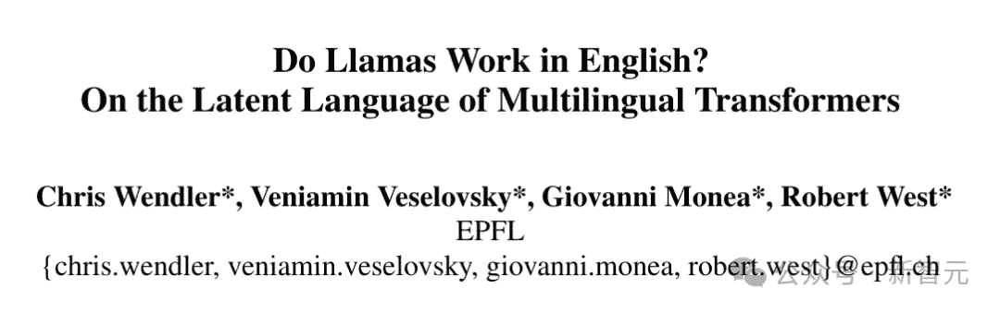

论文地址：https://arxiv.org/pdf/2402.10588

项目地址：https://github.com/epfl-dlab/llm-latent-language

作者以Llama2为对象，向我们展示了具有多语言能力的Transformer，是如何思考问题的。

**像「羊驼」这种在英语区下长大的娃，他的「多语言」到**底是本质属性，还是仅仅套了个翻译的壳？

这对于人们理解LLM的运行机制至关重要。

要探究大模型的内心世界，虽然听起来有点复杂，但实际上一点也不简单。

研究人员在这里化繁为简，使用特定的提示来保证输出的唯一性，同时把Llama-2-7B的32层输出全部提取出来——一层一层一层的剥开她的心。

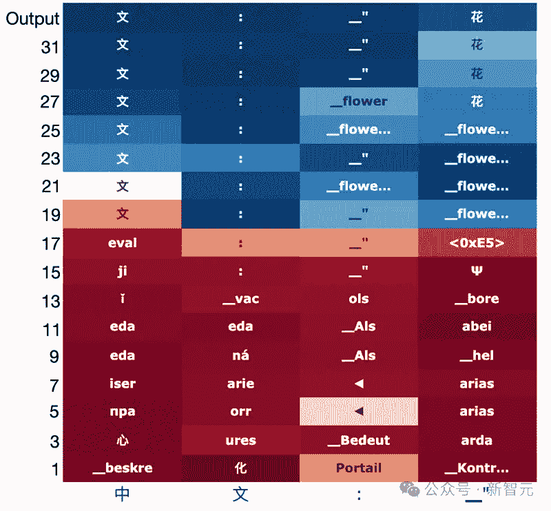

于是，我们能在上图清楚地看到，羊驼在得到中文翻译（「花」）时的整个推理过程。

Transformer将输入token进行逐层映射，最终预测出下一个token，中间那些我们大概能理解或者不能理解的字符串，就是LLM使用的「内部语言」。

显然，在中间层的「思考」环节，羊驼用的是偏向于英语的某种神秘文字。

这里需要强调一下，这是羊驼的自发行为，因为提示中压根就没有一点英语！

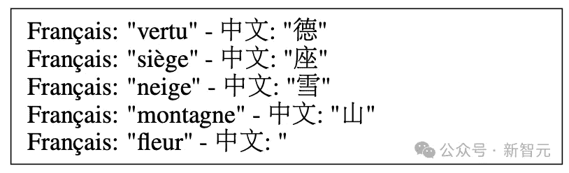

比如上图是其中的一个实验，构建了法语翻译中文的提示，且限制了正确答案只需1个token（花）。

而下图的统计显示：在Llama2的大部分前向传递中，正确中文token（蓝色）的概率远低于英文翻译（橙色）的概率。中文只在最后两层中占据主导地位。

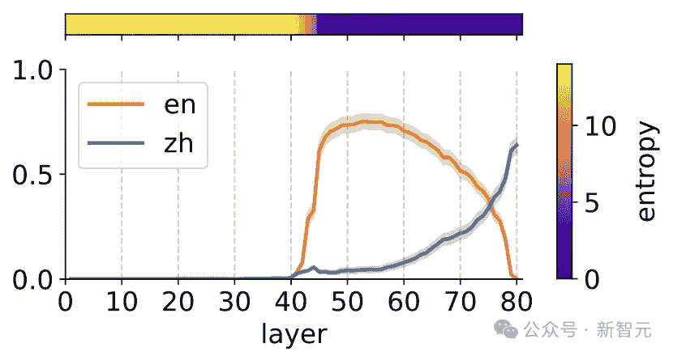

为了方便大家观察，作者还将嵌入在高维空间中的路径的可视化（实际是8192个维度，这里使用2D展示）。

从输入到输出，轨迹以红色开始，以紫色结束。我们可以看到，这些路径基本都是先绕道英语，然后才返回正确的中文。

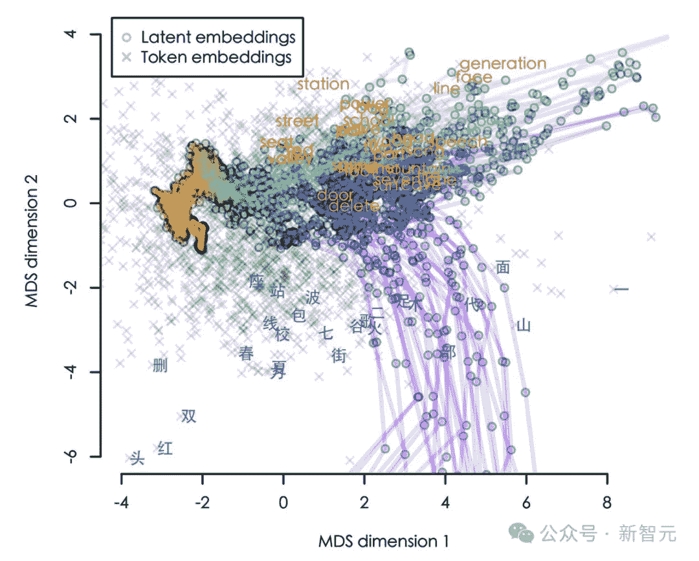

不过，这是否确实表明Llama2先用英文进行推理，然后将再其翻译成中文？

作者表示，比这更微妙一点。那些看起来像英语的中间嵌入实际上对应于抽象概念，而不是具体的英文token。

所以，一方面，Llama2内部的「通用语」不是英语，而是概念；

但另一方面， 这些神秘字符又显然是偏向于英语的概念 。

因此，在语义上，而非纯粹的词汇意义上，英语确实可以被视为羊驼的「母语」。

**网友：我早就发现了 **

有网友表示：恕我直言，不仅仅是羊驼系列，基本上所有LLM都是这样。

「对于以英语为母语的人来说，这可能会令人惊讶，但对于其他人来说，这种倾向性是可见的，只不过有时多，有时少。」

「有时我会想LLM为什么要这样回答，然后我意识到这个答案在英语中更有意义。」

「这在诗歌中更是显而易见的。LLM写诗很漂亮，但通常没有押韵.——如果你把它翻译成英语，就押韵了。」

另一位网友表示，这是大模型带来的偏见，要小心了。

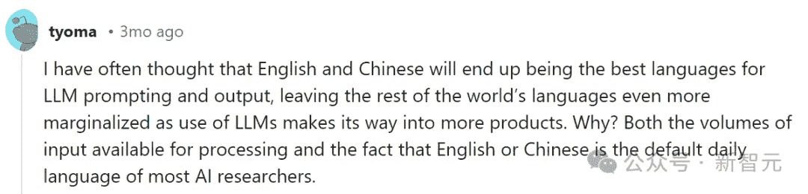

「英语和中文最终将成为LLM提示和输出的最佳语言，而随着LLM的应用范围越来越广泛，世界其他语言将更加边缘化。」

## **模型表达空间的探索**

当嵌入逐层转换时，它们会经历3个阶段：

> 1. 输入空间：模型消除分词器带来的影响。

> 2. 概念空间：嵌入进入一个抽象的概念空间中。

> 3. 输出空间：概念被映射回原本的表达形式。

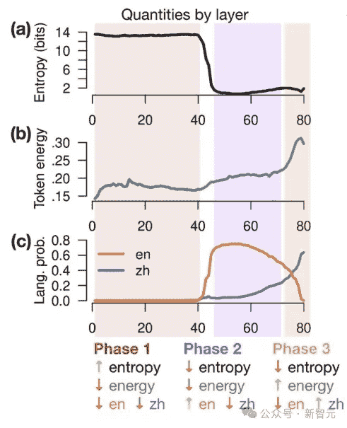

### **模型 **

实验专注于Llama-2系列语言模型。Llama-2系列模型在多语言语料库上进行训练，语料库主要由英语主导（占89.70%）。

不过考虑到总体训练数据的大小（2万亿个token），即使是一小部分非英语训练数据，绝对值仍然很大（德语占0.17%=3.4B，中文占0.13%=2.6B）。

Llama-2有7B/13B/70B三种尺寸，分别为32/40/80层，嵌入维度d=4096/5120/8192，词汇表V包含32,000个token。实验中使用8位量化探究这三种不同大小的模型。

### **实验 **

实验的目标是探索Llama-2的内部状态，是否与特定的自然语言相对应，这需要从token分布映射到语言。

为了规避许多token在语言方面上模棱两可的问题，研究人员构造了特殊的提示，限制token输出的唯一性，并且可以明确地归因于某一种语言。

**翻译任务**

将前面的非英语（例如法语）单词翻译成中文，示例如下，向模型展示四个单词，并带有正确的翻译，后跟第五个没有翻译的单词，让模型预测下一个token：

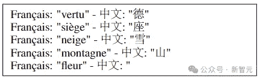

**重复任务**

要求模型简单地重复最后一个单词，提示如下：

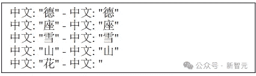

**完形填空任务**

作为一项稍微困难的任务，模型需要预测句子中缺失的单词。给定一个目标单词，通过GPT-4构建一个以该单词开头的英语句子，屏蔽目标单词，并将该句子翻译成其他语言。英语示例如下：

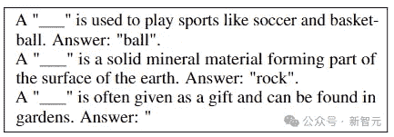

**单词选择**

为了实现明确的语言归属，研究人员为每种语言构建了一组封闭的单词。扫描Llama-2的词汇表，寻找具有单token英文翻译的单token中文单词（主要是名词）。

这样一来，Llama-2预测下一个中文单词的正确概率就可以直接从下一个token概率中读出。

保险起见，作者还在德语、法语和俄语上进行了相同的实验，总共测试了139个中文、104个德语、56个法语和115个俄语单词。三个任务的测试结果如下：

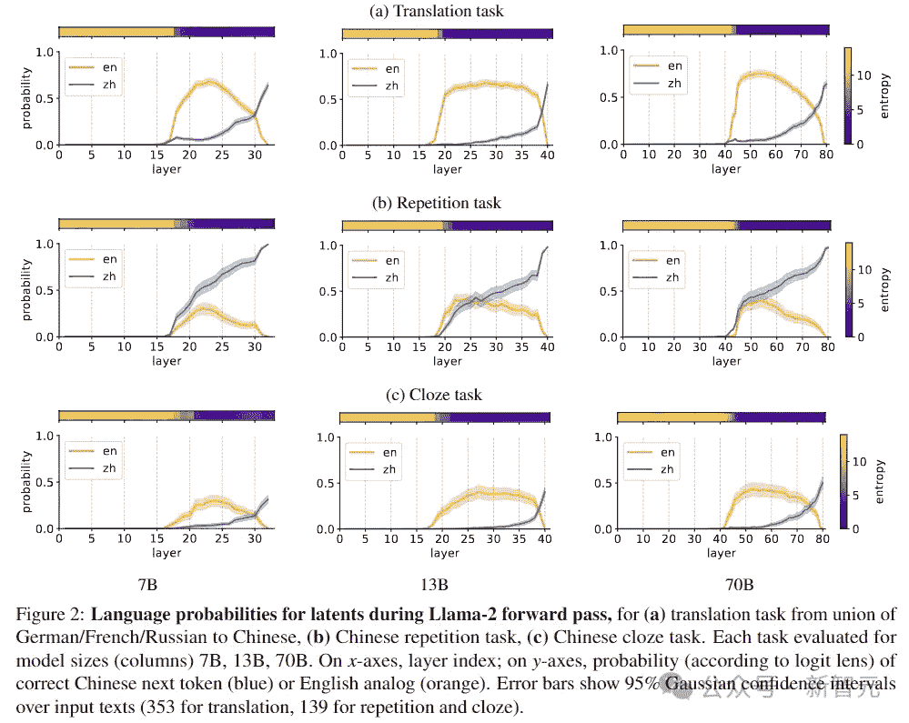

上图表示Llama-2前向传递期间，每一层输出是英语还是中文的概率，三个任务分别为：（a）从德语/法语/俄语到中文的翻译任务，（b）中文重复任务，（c）中文完形填空任务。

误差线显示输入文本的95%高斯置信区间（翻译任务为353，重复任务和完形填空为139）。

### **8192D太空漫游**

自回归Transformer是以增量方式求解的，每一层通过添加残差来修改前一层产生的潜在向量，这一过程在几何上可以描述为通过d维欧几里得空间的路径。

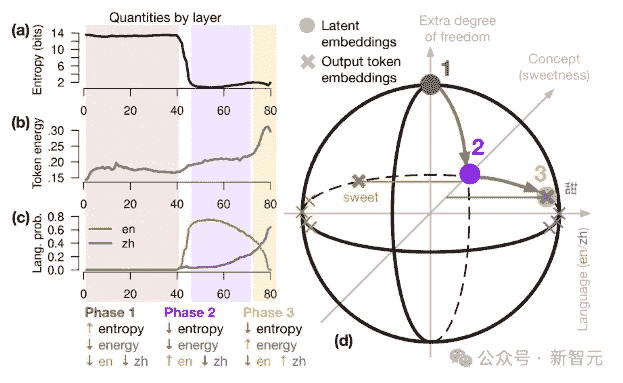

为了建立直觉，首先考虑一个假设的极端情况，即token位于整个d维空间的适当子空间中。

如果latent embedding（h）具有与token子空间正交的分量，则表示预测中包含与h无关的信息。

研究人员采用h和token嵌入之间的均方余弦，来表示h的能量有多少转化为logit分数。为了可解释性，这里通过token嵌入本身的均方余弦进行归一化，得到h的平方token能量：

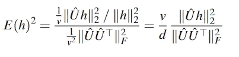

在上面的球形示意图中，所有嵌入都位于原点周围的球体上。token嵌入位于赤道上，主要沿x轴分布，x轴捕获语言（左英文，右中文），y轴捕捉概念，z轴提供了额外的自由度，可用于存储有关上下文、语言等的信息。Transformer正向传递沿球体表面移动。

在第1阶段，latent embedding从北极开始，与输出token和概念嵌入正交。

阶段2旋转到概念空间中，英语token占据主导。

最后，第3阶段沿赤道旋转到目标语言的半球，产生输出token。

参考资料：https://arxiv.org/abs/2402.10588