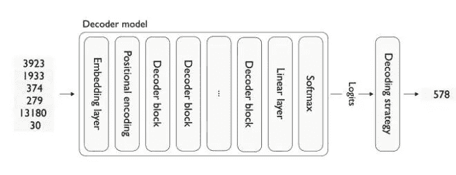
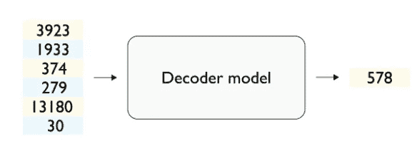
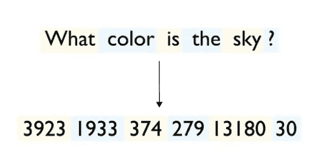
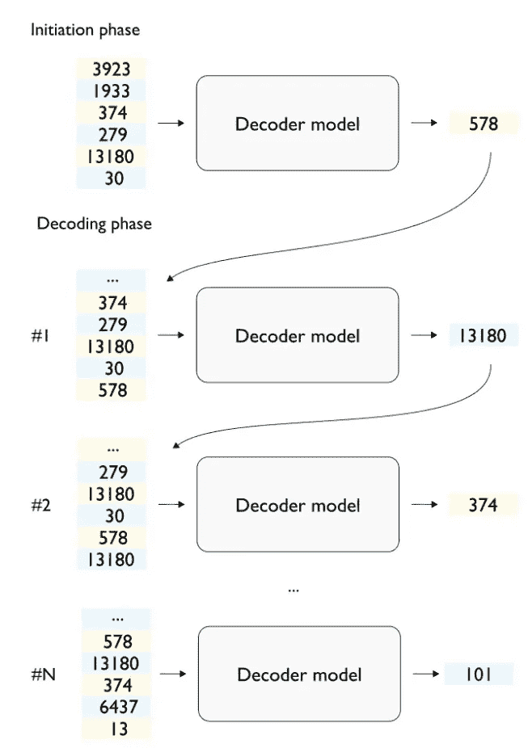
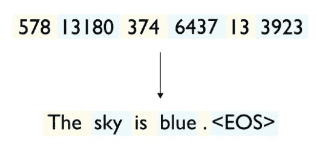
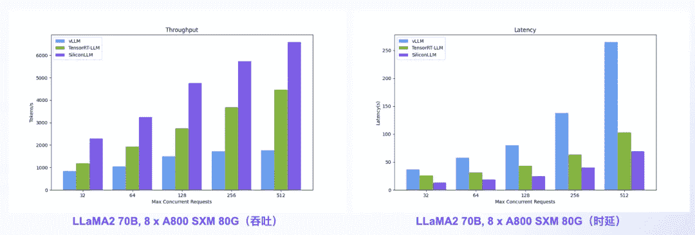
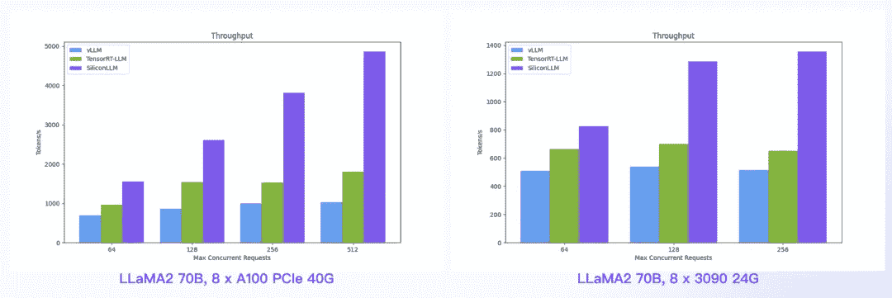
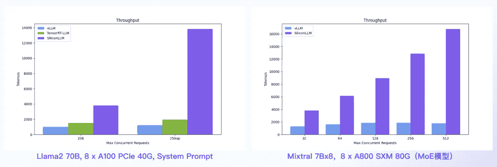

# LLM推理入门指南①：文本生成的初始化与解码阶段

> 来源：[https://agijuejin.feishu.cn/docx/XhMBdDmiFo7tZAxxoVIctLlFntb](https://agijuejin.feishu.cn/docx/XhMBdDmiFo7tZAxxoVIctLlFntb)

> 作者：Pierre Lienhart

> 翻译：宛子琳、杨婷 | OneFlow

> 原文：https://mp.weixin.qq.com/s/D9KPNI3CJ88l5_5vipjV3w

随着生成式AI的火热发展，高企的语言大模型（LLM）推理性能和成本成为阻碍其大规模应用的关键挑战。

LLM推理是指使用仅解码器Transformer模型生成词元，而大多数挑战及其 相关的解决方法都来自这种特定的架构和用例 。 本系列文章将深入探讨LLM推理的不同 层面及其挑战，同时，其中提供的有价值见解也适用于Transformer编码器模型的推理。

通过本系列内容的学习，希望帮助读者了解与LLM推理密切相关的术语，比如键-值（KV）缓存、内存带宽限制（memory-bandwidth bound）等，以便理解推理优化（量化、融合kernel、模型架构修改等）和配置（批处理大小、使用哪种GPU等）所涉及的各种技术，并最终将它们与关键的性能指标（时延、吞吐量和成本）联系起来。

希望读者建立起一个见解深刻的心智模型，从而能够在配置和优化LLM serving解决方案时做出明智且迅速的决策。 本文是该系列的第1篇文章，主要关注文本生成的两个阶段： 初始化阶段和生成（或解码）阶段。

在阅读本系列文章之前，读者需对Transformer架构以及在著名的《Attention Is All You Need 》论文中介绍的缩放点积 注意力 （SDPA）机制有基本了解，但无需深入了解注意力机制背后的动机因素。

本文作者为AWS的GenAI解决方案架构师Pierre Lienhart。 以下内容由OneFlow编译发布，转载请联系授 权。 原文： https://medium.com/@plienhar/llm-inference-series-2-the-two-phase-process-behind-llms-responses-1ff1ff021cd5 ）

---

本文回顾了Transformer架构以及使用基于Transformer的解码器进行文本生成的基础知识。更重要的是**，我将构建起**整个**LLM推理系列中要使**用的词汇表，并使用粗体标记出个人认为重要的术语。读者将主要了解文本生成的两个阶段： 初始化阶段 和 生成（或解码）阶段 。

首先，我们来回顾一下Transformer。为简单起见，我们假设一次只处理一个序列（即批处理大小为1）。在下图中，我描述了一个简单的基于Transformer的解码器（图1）的主要层，用于从一系列输入词元中生成输出词元。

图1—Transformer 解码器 模型概要

需要注意的是，解码器本身并不会输出词元，而是输出logit（其数量与词汇表大小相同）。输出logit的最后一层通常被称为语言模型头（Language Model Head）或LM头。将logit转换为词元是通过一种通常被称为 （词元）搜索策略（(token) search strategy） 、 生成策略（generation strategy） 或 解码策略（decoding strategy） 的启发式算法来完成的。常见的解码策略如下：

+   贪婪解码（Greedy decoding），简单来说就是选择具有最大logit的词元，在此之前可能会使用重复惩罚（repetition penalty）等方式，对logit进行一些调整。

+   采样解码（Sampling decoding），将logit看作多项分布，然后从中采样。换句话说，我们通过随机采样从词汇表中选择一个词元。在采样过程中，可以先采用温度调节（temperature scaling）、top-k和top-p等常见方式，对从中采样的分布进行调整。

+   更复杂的启发式算法，如束搜索（beam search）、对比解码（contrastive decoding）¹等。

简单**起见，我们**假设**解码策略是**模型的一部分（见图2）。这种心智模型（mental model）在提供LLM serving解决方案方面十分有用，这些接受词元序列作为输入，并返回相应输出词元的实体通常被称为 执行引擎 或 推理引擎 。

图2—一个高度简化的Transformer解码器模型

如果要生成多个词元呢？使用基于Transformer**的解码器，从一个输入文**本序列（通常称为 提示（**prompt） ）中生成文本（**通常名为 完成（completion） ）通常包含以下步骤：

1.  将模型权重加载到GPU

1.  在CPU上对提示进行分词，并将词元张量传输到GPU（见图3）

图3—分词步骤

3. 利用神经网络运行经过分词的提示，生成完成的第一个词元。

这一单步骤阶段通常被称为“初始化阶段”。在下一篇文章中，这一阶段也经常被称为“预填充阶段”。

4. 将生成的词元添加到输入词元序列，然后将其用作新的输入，以生成完成的下一个词元。然后，重复这一过程，直到生成停止序列（例如单个序列结束（EOS）词元），或达到预先配置的最大序列长度（见图4）。

> 这一多步骤 **阶段 **通常被称为 **生成阶段 **、 **解码阶段 **、 **自回归阶段 **甚至是 **增量阶段 **(incremental phase) 。

步骤3和步骤4如下图所示（图4）。

图4—词元生成过程的初始阶段和解码阶段

1.  将完成的词元传输到CPU，并进行逆词元化（detokenization）以获取生成的文本（见图5）。

图5—逆词元化步骤

**注意： **最近出现的旨在实现更低时延的先进技术（如推测性采样²或前瞻解码³）并不完全遵循上述简单算法。

这种情况可能会让人感到失望、困惑，或二者兼具。你可能会疑惑：初始化阶段和解码阶段究竟有何不同？从这个角度来看，这两者之间的区别似乎只是人为设定的。确实，感觉上初始化阶段与while循环的初始化步骤类似。实际上，我们在这两个阶段做的事是一样的：在每次迭代中，我们都会对一个词元序列进行前向传播，这个序列每次都会增加一个词元。

你的想法可能是正确的。对于在硬件上计算的方式来说，这两个阶段确实没有任何区别，因此在这方面，这两个阶段并没有什么特别之处。

然而，正如我们将在下一篇文章中看到的，这种设置涉及大量冗余计算，在许多情况下效率并不高。对于这种情况，将我们不想重新计算的内容进行缓存处理是最显而易见的方式。这种优化方式即为“KV缓存”，并由此引出了我一直在暗示的关键差异。下一篇文章将对此进行深入探讨。

[1]: A Contrastive Framework for Neural Text Generation (Su et al., 2022)

[2]: Fast Inference from Transformers via Speculative Decoding (Leviathan et al., 2022)

[3]: Breaking the Sequential Dependency of LLM Inference Using Lookahead Decoding (Fu et al. 2023)

【语言大模型推理最高 加速11 倍】 SiliconLLM是由硅基流动开发的高效、易用、可扩展的LLM推理加速引擎，旨在为用户提供开箱即用的推理加速能力，显著降低大模型部署成本，加速生成式AI产品落地。（技术合作、交流请添加🛰️：SiliconFlow01）

**Si**liconLLM的吞**吐最**高提升近 4 倍，时延最高降低近 4 倍

**数据中心+PCIe ****：S**ili**conLLM****的吞**吐最高提升近 5 倍； 消费卡场景 ：SiliconLLM的吞吐最高提升近 3 倍

**Sy **ste**m Prom****pt场**景 ：SiliconLLM的吞吐最高提升 11 倍； MoE模型 ：推理 SiliconLLM的吞吐最高提升近 10 倍

其他人都在看

+   [800+页免费“大模型”电子书](http://mp.weixin.qq.com/s?__biz=MzU5ODY2MTk3Nw==&mid=2247493221&idx=1&sn=0c75b8115f4d4a27c8a5d6505a0a4986&chksm=fe426853c935e145d21abd30e0ceb29486c9e306032dfcb3d071ce34d171425c11341a57d7bf&scene=21#wechat_redirect)

+    [语言大模型的推理技巧](http://mp.weixin.qq.com/s?__biz=MzU5ODY2MTk3Nw==&mid=2247493108&idx=1&sn=b254dff8281096bf6f5462489e94658a&chksm=fe426bc2c935e2d404fb803985241ea05109aa9d7925a1876304a51c322fa5e6e57dd41e2e66&scene=21#wechat_redirect)

+   [语言大模型的推理演算](http://mp.weixin.qq.com/s?__biz=MzU5ODY2MTk3Nw==&mid=2247491309&idx=1&sn=407fefb7ec76a2c9fdfe1ae960f7de4d&chksm=fe4190dbc93619cd0b9bfecb979e142a125fd8548d323dd9bdc2cbeb619400202e6e1affced0&scene=21#wechat_redirect)

+   [语言大模型推理加速指南](http://mp.weixin.qq.com/s?__biz=MzU5ODY2MTk3Nw==&mid=2247493321&idx=1&sn=ffc39c67080fefb01f1790e285a5085b&chksm=fe4268ffc935e1e9c8aeb5a095f08868a5eb8df90c1f46eb1e07044ec34ae6404d14b8b5926b&scene=21#wechat_redirect)

+   GenAI的“关键一跃”：推理与知识

+   迈向100倍加速：全栈Transformer推理优化

+   Mistral AI:LLM推理的吞吐、时延及成本空间

试用OneDiff: github.com/siliconflow/onediff