# LLM推理入门指南②：深入解析KV缓存

> 来源：[https://agijuejin.feishu.cn/docx/BhoMdc97VoQLgHxDhTzcjDXcnTe](https://agijuejin.feishu.cn/docx/BhoMdc97VoQLgHxDhTzcjDXcnTe)

> 作者：Pierre Lienhart

> 翻译：宛子琳、杨婷 | OneFlow

> 原文：https://mp.weixin.qq.com/s/WxbMFoSrKl0xqsUkzPLJHw

在 [本系列 ](http://mp.weixin.qq.com/s?__biz=MzU5ODY2MTk3Nw==&mid=2247493485&idx=1&sn=ef41fe4edc151c41eb059622e09ad6f6&chksm=fe42695bc935e04d71e024bd6c7bf48da8e9bed189fd83e58f6b1cf52f07c626e2090a631f9d&scene=21#wechat_redirect)文章《 LLM推理入门指南①：文本生成的初始化与解码阶段 》中，作者对Transformer解码器的文本生成算法进行了高层次概述，着重介绍了两个阶段：单步初始化阶段，即提示的处理阶段，和逐个生成补全词元的多步生成阶段。

本文进一步探讨了LLM推理的挑战 —— 第一大挑战是，注意力层（也称为自注意力层）与总序列长度（提示词元和生成补全词元）的计算成本呈二次方扩展的问题。幸运的是，生成步骤之间的许多计算是冗余的，从而能够缓存适当的结果并减少计算需求。

这种缓存方案也就是KV缓存，是LLM推理过程中的一种常用优化方式，使得（自）注意力机制的计算需求在总序列长度（提示 + 生成的完成部分）上线性扩展，而不是呈二次方扩展。更具体地说，KV缓存通过在生成过程中计算出的键和值张量存储（“缓存”）在GPU内存中，从而在每个生成步骤中节省了对过去词元键和值张量的重新计算。

KV缓存是一种折衷方案：以内存换取计算。本文后半部分将介绍KV缓存可以增长到多大，会带来哪些挑战，并介绍解决这些挑战的最常见应对策略。

（ 本文作者为AWS的GenAI解决方案架构师Pierre Lienhart。以下内容 由OneFlow编译发布，转载请联系授权。原文： https://medium.com/@plienhar/llm-inference-series-3-kv-caching-unveiled-048152e461c8 ）

---

## **1 **简要回顾Transformer注意力层

首先，我们来回顾一下vanilla Transformer（图1）中多头注意力（MHA）层的一些事实。

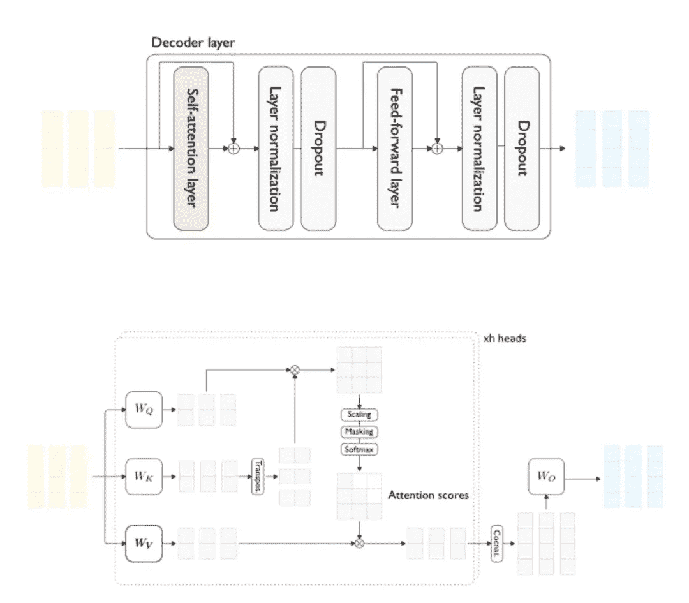

图1：Transformer解码器层的详细视图（上）和一个输入序列长度为3的双头（自）注意力层（下）

为简单起见，假设我们只处理长度为t的单个序列（即批处理大小为1）：

+   在整个过程中，输入序列（提示）中的每个词元都由一个密集向量表示（图1的浅黄色部分）。

+

+   注意力层的输入是一个密集向量序列，每个输入词元都对应一个向量，这些向量由前一个解码器块生成。

+

+   对于每个输入向量，注意力层生成一个具有相同维度的单个密集向量（图1的浅蓝色部分）。

现在，考虑单个注意力头的情况：

+   首先，我们通过三种不同的投影（图1最左侧的浅灰色向量）为每个输入向量生成三个较低维度的密集向量：查询（query）、键（key）和值（value）。共有t个查询向量、t个键向量和t个值向量。

+   对于每个查询，我们生成一个输出向量，该向量等于值的线性组合，该线性组合的系数即为注意力分数。换句话说，对于每个查询，相应的输出向量是值的注意力加权平均值。对于给定查询，注意力分数是由该查询与每个键的点积得出的。这样我们就为序列中的每个词元生成了一个表示，其中包含来自其他词元的信息，意味着我们创建了每个词元的上下文表示。

+   然而，在自回归解码的上下文中，我们无法使用所有可能的值来构建给定查询的输出表示。实际上，在计算与特定词元相关的查询的输出时，我们不能使用序列中后续出现的词元的值向量。这一限制通过掩码（masking）来实现，将被禁止的值向量的注意力分数设置为零，即被禁止的词元的注意力分数设置为零。

最后，将每个注意力头的输出连接，并使用最后一个线性变换进行转换，以产生最终输出。

## **2 ****注意力计算的二次方扩展**

我们看一下计算注意力分数所需的浮点运算数（FLOPs）。对于一个给定的注意力头，对于批处理大小为b，总长度为t的每个序列（包括提示和生成的补全部分），注意力分数矩阵是通过将形状为(t, d_head)的查询张量与形状为(d_head, t)的转置键张量相乘而创建的。

一个矩阵乘法所需的FLOPs是多少？ 将形状为(n, p)的矩阵与另一个形状为(n, m)的矩阵相乘大致需要 2.m.n.p 次操作。在这种情况下，单头单序列的注意力分数计算大约需要 2.d_head.t^2 FLOPs。因此，总体上注意力分数计算需要 2.b.n_layers.n_head.d_head.t^2=2.b.n_layers.d_model.t^2 FLOPs。现在，t 的二次方扩展变得清晰可见。

从具体数字来看，以Meta的Llama2–7B为例，n_layers=32 且 d_model=4096 。

**注意： **使用值张量乘以掩码注意力分数矩阵所需的FLOPs与上述计算量相同。

那么涉及模型权重的矩阵乘法呢？通过类似的分析，可以证明其计算复杂度为 O(b.n_layers.d_model^2.t)，即计算需求与总序列长度 t 呈线性增长。

**下面我们通过一个例子来理解二次方扩展的严重性。** 如果要生成第1001个词元，模型必须执行比生成第101个词元多100倍的FLOPs。 这种计算量的指数级增长显然很快会变得难以承受。幸运的是，由于掩码的使用，实际上在生成步骤之间可以节省大量计算。

## **3 ****掩码在生成阶段引发了冗余计算 **

现在来到问题的关键。由于掩码技术的使用，对于给定词元，输出表示仅使用先前词元的表示生成。由于先前的词元在迭代过程中保持不变，因此对于该特定词元的输出表示对于所有后续迭代也将是相同的，因此意味着存在冗余计算。

我们以上一篇博文中的词元序列为例（其特性为每个单词即为一个词元）。假设我们刚刚从输入序列“ What color is the sky? The sky ”中生成了“ is ”。在过去的迭代中，“sky ”是输入序列的最后一个词元，因此与该词元相关联的输出表示是使用序列中所有词元的表示生成的，即“ What”、“ color”、“ is”、“ the”、“ sky”、“?”、“ The ”和“sky ”的值向量。

下一次迭代的输入序列将是“ What color is the sky? The sky is ”，但由于使用了掩码，从“sky”的视角来看，它似乎仍然是“ What color is the sky? The sky ”的输入序列。因此，“sky”生成的输出表示将与上一次迭代相同。

现在看一个图示（见图2），使用图1中的图表。启动步骤应该处理长度为1的输入序列。冗余计算的部分在浅红色和浅紫色中突出显示。浅紫色元素对应冗余计算的键和值。

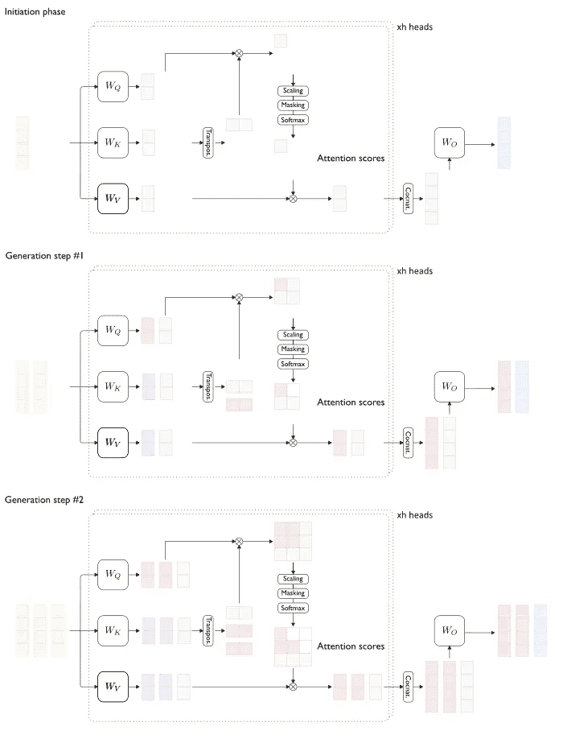

图2 — 生成阶段注意力层中的冗余计算

回到我们的例子，对于使用“ What color is the sky? The sky is ”作为输入的新迭代，我们在先前生成步骤中尚未计算的唯一表示是输入序列中的最后一个词元“ is ”。

更具体地说，我们需要什么来完成这一过程？

+   “is”的查询向量。

+   “What”、“ color”、“ is”、“ the”、“ sky”、“?”、“The ”、“sky ”和“ is ”的键向量，用于计算注意力分数。

+   “What”、“ color”、“ is”、“ the”、“ sky”、“?”、“The ”、“sky ”和“ is ”的值向量，用于计算输出。

关于键和值向量，它们已经在先前的迭代中为所有词元计算过，除了“ is ”。因此，我们可以保存（即缓存）并重复使用先前迭代中的键和值向量。这种优化简称为KV缓存。之后，计算“ is ”的输出表示就会变得非常简单：

1.  计算“is”的查询、键和值。

1.  从缓存中获取“ What”、“ color”、“ is”、“ the”、“ sky”、“?”、“The ”和“sky ”的键和值向量，并将它们与我们刚刚为“is”计算的键和值向量连接起来。

1.  使用“is”的查询和所有键来计算注意力分数。

1.  使用注意力分数和所有值来计算“is”的输出向量。

从我们的输入来看，只要可以使用它们的键和值向量，实际上就不再需要先前的词元。当我们进行KV缓存时，模型的实际输入是最后生成的词元（而不是整个序列）和KV缓存。下图是在生成阶段运行注意力层的示例。

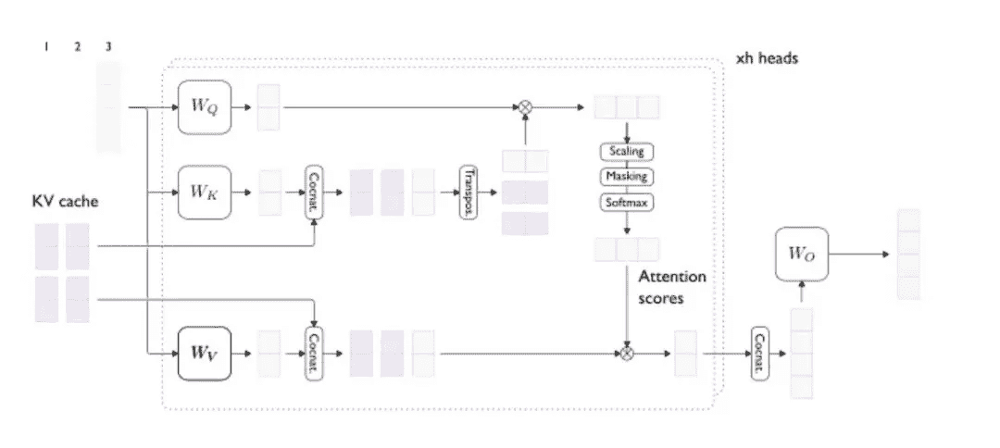

图3 ：启用KV缓存 的生成步骤

回到 先前博文 中的两个阶段：

+   初始化阶段实际上不受KV缓存策略的影响，因为没有之前的步骤。

+   然而，对于解码阶段，情况现在看起来完全不同了。我们不再使用整个序列作为输入，而是只用最后生成的词元（和KV缓存）。

在注意力阶段，注意力层现在一次处理所有提示的词元，而不是在解码步骤中一次只处理一个词元。在文献（ https://arxiv.org/abs/1911.02150 ）中，第一种设置称为批量注意力（batched attention，有时被误导性地称为并行注意力），而第二种称为增量注意力（incremental attention）。

当使用KV缓存时，初始化阶段实际上是计算并（预）填充KV缓存的所有输入词元的键和值，因此通常被称为预填充阶段。在实践中，“预填充（pre-fill）”和“初始化（initiation）”这两个术语可以互换，从现在开始我们将更倾向于使用前者。

初始化和生成阶段之间的这种新差异并不仅仅体现在概念上。现在，在每个生成步骤中，除权重矩阵之外，我们还必须从内存中获取一个不断增长的缓存，然后只处理每个序列的单个词元。需要注意的是，在初始化阶段和解码阶段，使用针对每个阶段优化的GPU kernel的性能，比带KV缓存的相同GPU kernel的性能好（例如，自发布2.2.0版本起，广泛采用的Flash-Attention算法的参考实现在启用KV缓存时，为解码阶段提供了专用内核（flash_attn_with_kvcache)，也称为Flash-Decoding。）

## **4 **KV缓存实现了注意力的线性扩展

现在注**意力是如何扩展的呢？转置后的键**张量形状仍为(t, d_head)。然而，查询张量现在形状为(d_head, 1)。因此，单头单序列的注意力分数计算需要2.d_head.t个FLOPs，因此注意力计算共需要2.b.n_layers.d_model.t个FLOPs。现在 注意力与总序列长度呈线性增长！

我们是否已经解决了二次方扩展问题？如果你丢弃了缓存并需要重新计算，情况就不一样了。举个例子，想象一下你开发了一个聊天机器人应用 （ https://newsletter.pragmaticengineer.com/p/scaling-chatgpt ），并在每轮对话之间保留缓存在内存中。现在，有一个用户已经空闲了相当长的一段时间。由于GPU内存有限，你执行了一个丢弃旧对话的缓存逐出策略。不幸的是，该用户恢复了对话，因此你必须重新计算整个历史的缓存。这种重新计算会产生与总对话长度成二次方关系的计算成本。

上面的例子表明， **（KV）缓存是一种折衷 **，并非一劳永逸。具体而言，我们用更多的内存占用和数据传输来换取计算量的减少。后文将提到这一点，缓存的内存占用成本可能相当大。

重新考虑聊天机器人的例子，设计一个高效的缓存驱逐策略非常具有挑战性，因为它需要权衡两个高成本的选项：要么消耗更多的稀缺资源（GPU内存和带宽），要么付出二次方级的计算量。

## **5 ****KV缓存的实际例子**

在实践中会是什么样呢？我们可以启用或禁用KV缓存吗？让我们以HuggingFace的Transformer库为例。所有专用于文本生成的模型类（即XXXForCausalLM类）都实现了一个generate方法，该方法被用作入口点。该方法接受许多配置参数，主要用于控制词元搜索策略。KV缓存由use_cache布尔参数控制（默认值为True）。

再深入一层，看看模型的forward方法（例如，根据LlamaForCausalLM.forward的文档），如期找到了use_cache布尔参数。启用KV缓存后，我们有两个输入：上一个生成的词元和KV缓存，它们分别通过参数input_ids和past_key_values进行传递。新的KV值（即作为当前迭代的一部分计算得出的值）作为forward方法输出的一部分返回，以便在下一次迭代中使用。

这些返回的KV值是什么样的？我们可以进行一些张量计算。启用KV缓存后，forward方法返回一个张量对的列表（一个键张量对，一个值张量对）。这些张量对的数量与模型中的解码器块数量相同（通常称为解码器层，记为n_layers）。对于批处理中每个序列的每个词元，每个注意力头部都有一个维度为d_head的键/值向量，因此每个键/值张量的形状为(batch_size, seq_length, n_heads, d_head)。

就以Meta的Llama2–7B为例，n_layers=32，n_heads=32，d_head=128。我们将在后文详细讨论KV缓存的大小，但现在我们已经对它可能达到的规模有了初步了解。

## **6 ****KV缓存带来的新问题**

如上所述，KV缓存是一种权衡，并引出了我们将在接下来要探讨的新问题：

+   KV缓存也可能会消耗大量的GPU内存。不幸的是，即使加载相对较小的LLM，GPU内存也是有限的。因此，当增加总序列长度（上下文窗口大小）或一次处理的序列数量（即吞吐量）时，KV缓存成为了主要的技术障碍，从而提高了成本效率。

+   与我们需要从内存中搬运的数据量相比，KV缓存大大减少了我们在单个生成步骤中执行的操作量：我们获取大型权重矩阵和不断增长的KV缓存，只是为了执行微不足道的矩阵到向量的操作。不幸的是，在现在的硬件上，我们最终花费的时间更多地用于数据加载，而不是实际的数值计算，这显然导致了GPU计算能力的低效利用。换句话说，我们的GPU利用率较低，因此成本效率低下。

## **7 ****KV缓存可以增长到多大？**

这个问题相当简单：对于批次中每个序列的每个词元，我们需要为每个注意力层的每个注意力头存储两个大小为 d_head 的向量张量（一个键张量和一个值张量）。每个张量参数所需的空间取决于精度：完整精度（FP32）为4字节/参数，半精度（BF16、FP16）为2字节/参数，8位数据类型（INT8、FP8）为1字节/参数，依此类推。

假设b为批处理大小，t为总序列长度（提示 + 完成部分），n_layers为解码器块/注意力层的数量，n_heads为每个注意力层的注意力头数量，d_head为注意力层的隐藏维度，p_a为精度。多头注意力（MHA）模型的KV缓存每个词元的内存消耗（以字节为单位）如下图所示：

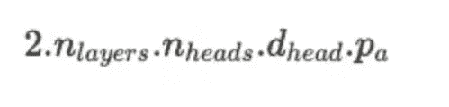

注意：提醒一下，在MHA模型中，n_heads.d_head=d_model，但我们不会用它来简化上述公式。

因此，KV缓存的总大小（以字节为单位）为：

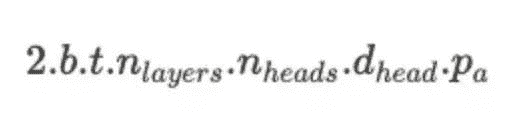

KV缓存面临的第一个挑战是：它随着批处理大小以及总序列长度呈线性增长。由于它随着总序列长度的增长而增长，因此，KV缓存的大小实际上并没有上限，而GPU内存显然是有限的。更糟糕的是，由于无法事先知道总序列长度，因此，KV缓存的内存需求是未知的，这使得内存管理变得尤具挑战性。

我们来看一下一些流行的MHA模型的数据（表1），即Meta的Llama-2 [1]和OPT [2]、MosaicML的MPT [3]以及BigScience的BLOOM [4]：

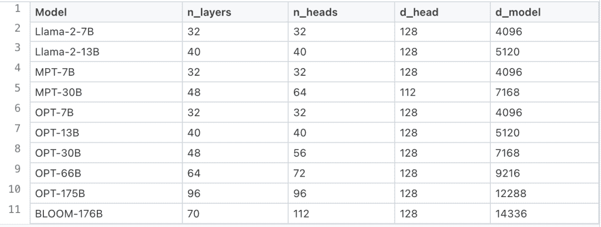

表1：流行的多头注意力（MHA）模型的规格

假设参数以半精度（FP16、BF16）存储，并选择一个较小的模型（Llama-2–7B）和一个较大的模型（BLOOM-176B）。对于Llama-2–7B（对应BLOOM-176B），KV缓存的内存消耗约为每词元0.5MB（相应地每词元4MB）。

让我们专注于使用半精度的Llama-2–7B。加载模型权重消耗约14GB的内存，与为28k词元缓存键和值的内存相同。例如，28k词元可以对应于长度为512的56个序列的批处理，这并不算特别极端。

根据上述数字，我们可以发现KV缓存内存消耗可能会变得非常大，甚至超过加载大序列模型权重所需的内存量。

现在让我们将这些数字与常见的NVIDIA数据中心GPU的内存容量进行比较（见表2）：

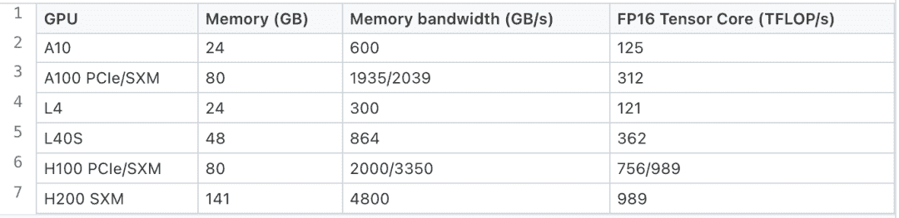

表2：用于训练和/或为LLM提供服务的常用NVIDIA数据中心GPU的规格

让我们选择成本效益较高的A10 GPU，坚持使用Llama-2–7B，计算最大的KV缓存容量。一旦加载了模型权重，剩余的内存为24-2x7=10 GB，用于KV缓存，即总容量约为20k词元，包括提示在内，这显然不能够在处理或生成长序列时服务大量并发请求。

现在我们明白了，KV缓存阻止了我们处理或生成非常长的序列（即长上下文窗口的障碍），或处理大批量数据，因此限制了硬件效率的最大化。

从这个角度来看，将处理能力最大化意味着尽可能为KV缓存腾出更多空间，这可以通过以下方式实现：

+   减少模型权重内存占用（权重量化）

+   减少KV缓存内存占用（见下文）

+   通过将模型分片到多个GPU上池化来自多个设备的内存，以网络通信为代价（模型并行化），或者使用其他类型的存储，如CPU内存或磁盘（offloading）

由于模型权重和不断增长的KV缓存必须在每次前向传播中加载，解码步骤涉及非常大的数据传输，正如我们将在接下来的文章中将看到的，实际上受到内存带宽的限制，即我们实际上花费的时间更多用于数据传输而不是执行有意义的工作——计算。在这种模式下，只有通过增加内存带宽（即更好的硬件），或者减少数据传输，才能改善时延。较小的模型权重和KV缓存可以释放出更多的内存以处理更多序列，从而增加吞吐量（或最大序列长度）。

在这方面，减小内存占用的策略是一箭三雕的，因为能够使我们提高硬件利用率和成本效益，同时减少时延并增加吞吐量。

PS：为什么输入词元也要收费？（表3）

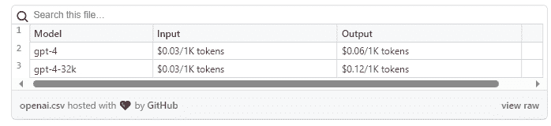

表3：OpenAI费率示例（截至2024年12月1日）

此时，你应该能够理解为什么会对输入和输出词元都收费了。因为一旦输入提示被处理，即在预填充阶段结束时，我们就已经消耗了GPU内存（用于存储每个输入词元的键和值张量）和计算量（通过模型传递提示词元）。

让我们看一些真实数据。假设一个P个参数的模型进行前向传递的总词元为每词元约2.P个FLOPs [5]，使用Llama-2-7B处理一个提示则需要大约0.5 MB/词元的GPU内存（见上文），以及大约14 GFLOPs/词元的GPU计算资源。对于一个包含1000个词元的提示（略少于两页纸的长度），这就需要大约500MB的内存和14TFLOPs的计算资源，而我们甚至还没有生成任何输出。

现在，通过采用上述公式并逐个检查其各项，我们来看看可以减少KV缓存内存占用的所有方法：

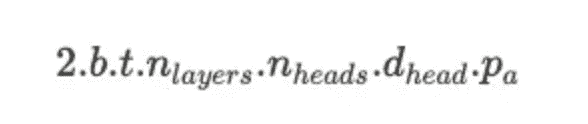

## **8 ****减少批大小？**

在多数情况下，我们并不想减少批大小。虽然减少批大小可以减少KV缓存的内存占用，降低时延，但这也会降低硬件利用率，导致成本效率降低。接下来，我们将看到相反的情况：即尽可能地增加批次大小。

## **9 ****减少对总序列长度的依赖？**

不将序列中所有词元的键和值都存储起来的一个可能的原因是：我们明确选择在每次迭代中重新计算缺失的键和值，因为与使用GPU内存相比（例如，在自回归阶段，我们受到内存带宽的限制），投入算力更为值得。据我所知，这在实践中并不常见，所以我们不会进一步深入研究这个方向。

另一方面，我们可以不去存储模型几乎不关注或很少关注的词元的键和值。对于这种情况，有可能是因为模型经过训练，不需要关注整个序列（例如，Mistral AI的Mistral-7B），或者作为在内存消耗和模型准确性之间的妥协的一部分。下面是详细解释。

Mistral-7B[6]等模型经过训练，不需要关注整个序列。Mistral-7B的注意力层实际上通过关注最后（4096个）相邻的词元来构建词元表示。这种注意力机制的变体被称为滑动窗口注意力（SWA）或局部注意力。通过设计，局部注意力保证我们在KV缓存中永远不会存储超过窗口大小（例如4096）的张量对。

另一种方法是利用注意力层在序列中分配注意力的模式。事实上，我们已经知道，注意力模块倾向于不成比例地持续将更多注意力集中在序列中的少数几个词元上（图1）。相比之下，许多词元对输出的影响非常小，那么为什么要费力去存储它们的键和值呢？

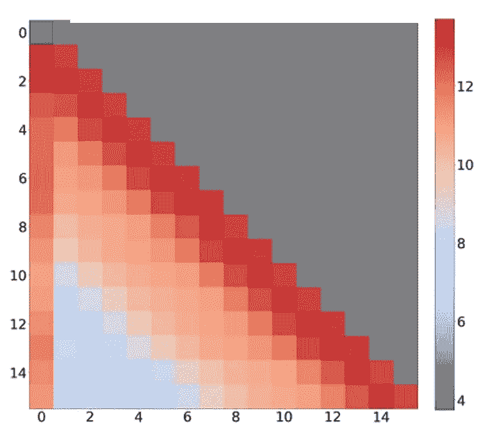

StreamingLLM论文中的注意力（热度）图示：不断地将大量注意力分配给了第一个词元和最后的相邻词元（局部注意力）。

通过丢弃这些词元，我们事实上将相应的注意力分数设为零，并用一个更稀疏的注意力矩阵近似注意力矩阵。一个成功的近似会最小化近似误差，从而减少对模型准确性的影响（例如，使用困惑度来衡量）。

让我们来看看过去几个月出现的一些方法，这些方法可以在不需要重新训练或微调的情况下立即应用：StreamingLLM框架、H2O（Heavy-Hitter Oracle）、Scissorhands和FastGen。据我所知，目前还没有任何流行的LLM推理框架支持这些方法。

针对使用有限长度上下文窗口训练的模型，StreamingLLM框架[7]基于一个观察结果，即初始词元聚集了大量注意力。因此，该框架通过仅保留最初的位置词元（sink tokens）和最后相邻的词元（局部注意力）来构建了一个滑动窗口缓存。因此，StreamingLLM的KV缓存具有固定长度，既有一个固定部分（通常为1到4个词元），又有一个滑动部分。

类似的H2O[8]和Scissorhands[9]方法旨在通过设置最大缓存词元数量（预算），并在达到缓存预算时丢弃词元来压缩KV缓存。H2O算法一次仅丢弃一个词元，而Scissorhands则根据目标压缩比例（例如，减少30%的KV缓存）丢弃尽可能多的词元。

这两种方法都基于这样一个观察：在给定步骤中具有影响力的词元（“pivotal tokens”或“heavy hitters”）在未来步骤中仍然具有影响力（Scissorhands的作者称之为“重要性假设的持续”）。换句话说，我们可以确信被丢弃的低影响力词元在未来生成步骤中仍然相对被忽略，因此可以安全丢弃。

这两种算法的关键方面显然是缓存淘汰策略。Scissorhands简单地保留最近的词元和在历史窗口内具有最高注意力分数的词元。而H2O则丢弃累计注意力分数最低的词元，因此只保留那些在迭代过程中始终具有高注意力分数的词元。这两个团队都已证明，他们的算法最高可以减少80%的KV缓存，并且几乎不会影响模型的准确性。

FastGen方法[10]（不要与无关的DeepSpeed-FastGen混淆）仍然基于注意力模式，但采用了另一种方法。它没有设置缓存预算，而是为注意力矩阵设置了最大近似误差，以专注于保持模型的准确性。

FastGen可以分为两步：首先，在预填充阶段结束时对模型的注意力层进行剖析，以确定一组压缩策略，这些策略可以满足误差目标。与其他方法一样，它假设已识别的注意力模式将在未来的生成步骤中保持不变。压缩策略包括：保留特殊词元、保留标点符号词元、保留最后相邻词元（局部注意力）等（见下图）。如果误差目标过于严格，无法达到，则FastGen会退回到常规的KV缓存。然后，在每个生成步骤，所选择的压缩策略将被应用于KV缓存。

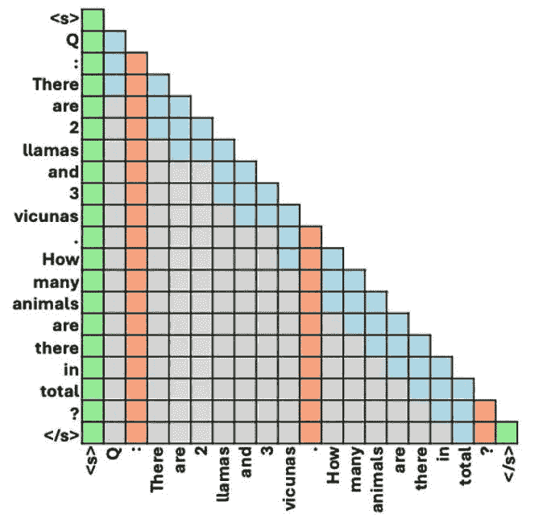

FastGen论文中的一组压缩策略示例：特殊词元（绿色）+ 标点词元（橙色）+ 局部注意力（蓝色）。灰色为废弃词元。

注意，与其他方法不同，FastGen针对每个提示构建了一个定制的压缩策略。FastGen的作者表明，在给定的KV缓存压缩比下，他们比H2O和Scissorhands更有效地保留了模型的准确性。

无论如何，摆脱对不可预测的总序列长度的依赖都是一件好事，因为这样可以为每个序列分配内存预算，从而极大地简化内存管理。由于数据传输是导致时延的主要原因，因此，我们不再需要一个随序列长度线性增长的KV缓存，这将带来令人瞩目的加速效果（特别是对于更长的序列长度）。

## **10 ****减少层数？**

减少层数带来的收获并不多。通常，较小的模型层数较少，所以如果较小的模型在你的使用案例中表现良好，那就选择它吧。

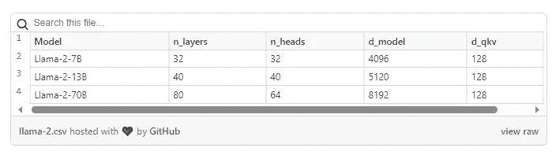

Llama-2模型的型号规格

## **11 ****减少注意力头的数量如何？**

对于给定的模型架构，模型大小主要受控于层数和头数，减少注意力头的数量可能意味着选择一个更小的模型。

然而，如果仔细观察，我们会发现只需要减少键头和值头的数量，查询头的数量不会影响KV缓存的大小。这正是多查询注意力（MQA)[11]和分组查询注意力（GQA）[12]架构的核心思想。这些多头注意力（MHA）变体的唯一目的是减小KV缓存的大小。

MQA于2019年首次推出。在MQA中，所有查询头共享相同的单一键和值头。换句话说，所有查询头都使用相同的键计算它们的注意力分数，并且所有头的输出都使用相同的值计算（但注意力分数不同）。

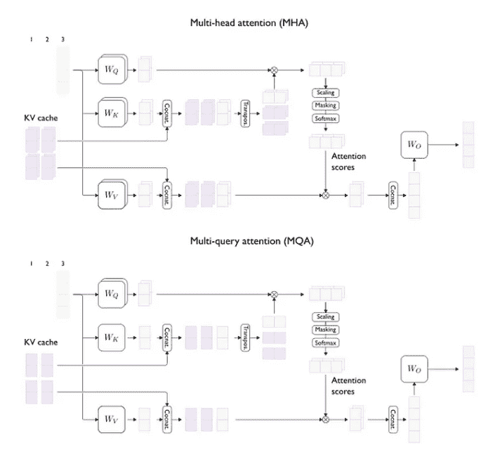

多头注意力（上）与多查询注意力（下）（两个注意力头）

然而，对于更大的模型而言，彻底剥离所有头相对更为激进。例如，相比从32减少到1，将头数从64减少到1在模型的表征能力上是一个更大的削减。分组查询注意力（GQA）为此提供了一种中间解决方案：不再让所有查询头共享相同的唯一KV头，而是将它们分成g组查询头，同一组的查询头共享相同的唯一KV头。换句话说，分组查询注意力将KV头的数量从n_heads减少到1<g<n_heads，而不是将头数从n_heads减少到1个KV头。

在这个视角下，多头注意力（MHA）和多查询注意力（MQA）都是分组查询注意力（GQA）的特殊情况（分别对应于g=1和 g=n_heads）。分组查询注意力（QGA）能更顺畅地在模型准确性/KV缓存大小（与时延和吞吐量有关）和MHA以及MQA这两个极端用例间进行权衡。

考虑到这个新参数g，KV缓存大小公式变为：

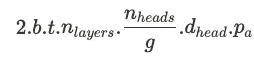

在实践中，MQA/GQA架构主要由Google Research的PaLM [13]、TII的Falcon[14]模型、Meta的Llama-2[1]（仅限70B）和Mistral AI的Mistral-7B[7]实施。

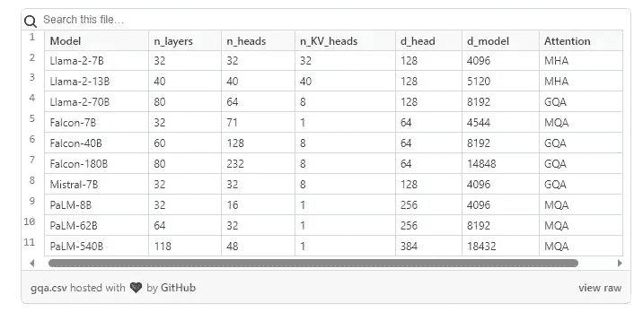

使用MQA或GQA的模型系列

## **12 ****注意力头的隐藏维度？**

再次强调，如果不选择其他模型，这里就不会有太多收获。在某些模型家族中，无论模型的大小如何，注意力头的隐藏维度都可能保持不变(如Llama-2、Falcon)。因此，可能无法通过简单地选择较小的模型尺寸来降低注意力头的隐藏维度。

## **13 ****使用每个参数更少的字节 **？

对KV缓存进行量化确实可以大幅减小其大小。然而从定义上看，AWQ[15]或GPTQ[16]等仅对权重进行量化的算法是不起作用的。只有像LLM.int8()[17]或SmoothQuant [18]等同时对权重和“激活”（即除权重外的任何内容）进行量化的算法才能产生量化的KV缓存。

注意，同时对权重和激活进行量化的量化算法之一的目的是。以更低精度执行计算密集型的矩阵乘法。这样做可以提高性能，尤其是在像训练期间这样计算受限的情况下。但正如我们将在接下来的文章中看到的，推理的自回归阶段实际上受到内存带宽的限制，所以能够更快地计算并不会带来太多价值。由于推理受到内存带宽的限制，我们实际上只关心减少内存占用，因为这意味着更少的数据传输量。

从这个角度来看，LLM.int8()或SmoothQuant等量化算法可能过于复杂：在将缓存张量移动到GPU内存之前对其进行量化，然后在从GPU内存获取它们后，对相同的张量进行去量化（以增加额外计算开销为代价）应该就已经足够了。

一些LLM推理系统已经包含了这样的KV缓存量化功能。例如，FlexGen[19]以4位数据格式量化及存储KV缓存和模型权重。NVIDIA的TensorRT-LLM能够以8位数据格式（INT8或FP8）量化KV缓存。流行的vLLM框架也自0.3.0版本起支持KV缓存（FP8）的量化。由于量化是在每次迭代时动态执行的，因此不需要校准步骤。

## **14 ****高效内存管理的重要性**

迄今为止，我们默认没有任何内存浪费：即所有预留的内存都用于存储词元，并且所有可用的内存都能被预留。然而，在实际操作中，简单的内存管理策略可能导致大量内存被浪费（《PagedAttention》论文[20]指出，实际的有效内存利用率可能只有20%，即浪费了80%的内存！）：

+   由于请求的总序列长度事先不确定，我们可能会预留连续的内存块，以容纳最大的序列长度。这种分配中的一部分几乎肯定永远不会被使用，但也无法被其他请求利用，最终被浪费（即内部内存碎片化）。

+   即使序列长度事先已知，由于内存逐渐被消耗，但内存块被保留到请求的整个生命周期，较短的请求仍然无法使用尚未使用的内存块。

+   如果我们采用生成多个序列的解码策略，如束搜索，多个候选序列实际上可能会部分共享它们的KV缓存。如果我们没有考虑到这一点，那么我们将不可避免地浪费内存，因为我们会存储本来可以共享的重复KV条目。

这些缺点正是如今流行的PagedAttention算法旨在解决的。PagedAttention分配了固定大小且相对较小的内存块，称为块。每个块可以包含固定数量的词元，并且必要时可以在不同的请求之间共享。按需分配和小型的块大小缓解了内部内存碎片化问题，而相同大小的块则消除了外部内存碎片化问题。

总体而言，PagedAttention几乎实现了KV缓存内存的零浪费（不到4%的浪费[21]）。以前被浪费的内存现在可以用来容纳更多的请求，从而提高吞吐量。PagedAttention刚推出时的吞吐量改善数据非常惊人，因为当时的内存浪费水平很高。

PagedAttention最初由vLLM推理系统实现，但现在受到了所有主要推理框架的支持（例如，HuggingFace的TGI、NVIDIA的TensorRT-LLM、LMDeploy的TurboMind等）。

PagedAttention未涵盖的另一个可能的优化是，在请求之间重复使用键值缓存。这适用于提示共享公共前缀的情况，主要发生在对话和智能体等多轮使用案例中或使用提示模板时（见图4）。

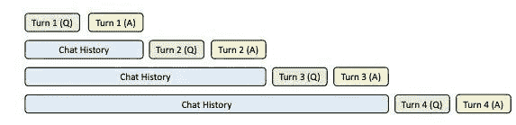

SGLang论文的KV缓存共享示例（多轮聊天），总共四次生成请求。蓝色框代表可共享的提示部分。

能够在请求之间重复使用KV缓存将显著提高时延（尤其是首词元时延）和吞吐量（通过大幅减少具有共享前缀的并发请求的内存占用）。

LMSYS SGLang论文[22]提出的RadixAttention技术是实现这种KV缓存重用的用例之一。

RadixAttention算法不会在完成生成请求后丢弃KV缓存，而是将其保留在GPU内存中，并向专用数据结构（radix tree）添加一个新条目，将词元序列映射到它们的KV缓存张量。收到新请求时，调度器使用radix tree进行前缀匹配。如果有缓存命中，则调度器重用缓存的KV张量来满足请求。

由于GPU内存有限，不能永远保留缓存的KV张量。因此，RadixAttention算法包括了一个逐出策略（例如最近最少使用（LRU）逐出策略）。最佳缓存重利用可能与先来先服务（first-come-first-serve）等调度不兼容。因此，RadixAttention附带了一个修改后的调度器，它优先处理与缓存前缀匹配的请求（缓存感知调度）。

注意：PagedAttention和RadixAttention的命名带有误导性，与人们想象的不同，它们并不是模型注意力层的优化（如FlashAttention），而是在模型服务器级别进行操作（有助于部署应用以更好地管理主机上的KV缓存）。

## **15 ****如果GPU内存不足，为什么不“简单地”使用多个GP**U或者将负载转移到CPU内存甚至磁盘上？

这是两种不同但有效的方法。

首先是将计算任务卸载（offloading）到更丰富但速度较慢的存储介质（CPU内存和磁盘）。并非所有推理框架都支持此功能，比如HuggingFace Accelerate、DeepSpeed-Inference以及更先进的FlexGen。由于涉及使用速度较慢的存储介质，卸载操作会带来严重的时延，因此不适用于对时延比较敏感的用例。卸载系统通常用于面向吞吐量的用例，如离线批处理。

使用多个GPU（对于较大的模型不可避免）时，可以利用聚合内存容量和内存带宽，将模型分片到多个设备以减轻内存压力。

如果选择流水并行[23]，模型和KV缓存都会沿着层维度分片。如果选择张量并行[24]（在推理中更常见），KV缓存会沿着头维度分片。需要注意的是，在这种设置下，MQA变得相当低效：由于无法将单个头分片到多个设备上，KV缓存必须在所有设备上复制，从而失去了MQA的好处。对于实现MQA的模型，一种替代方法是将KV缓存沿批大小维度分片[25]。

在任何情况下，上述案例都假设了单个主机，我们仍然受限于能够使用的最大多GPU实例的存储容量。据我所知，目前没有推理框架支持多主机模型并行。如果我们能够在多个主机上分片模型和KV缓存，那么可用内存量和我们能够处理的最大序列长度几乎就没有限制了。这正是《Infinite-LLM》论文[26]试图解决的问题，它通过引入一种新的分布式注意力算法（DistAttention）并调整Ray框架来构建一个多主机分布式KV缓存管理和调度系统（DistKV-LLM）。

## **16 ****总结**

本文中指出注意力分数的计算在总序列长度上呈二次方扩展。然而，由于在注意力计算中进行了掩码处理，在每个生成步骤中，我们实际上可以避免重新计算过去词元的键和值，而只需计算最后生成的词元。每次计算新的键和值时，我们的确可以将它们缓存到GPU内存中以供未来重复使用，因此节省了重新计算它们时所需的浮点运算次数。

掩码的主要优点是将（自）注意力机制的FLOPs需求从与总序列长度呈二次方扩展变为线性扩展。

此外，我们了解了选择KV缓存会带来的额外挑战。多头注意力（MHA）模型的KV缓存确实会消耗大量GPU内存，每词元约1MB，并且很容易变得比模型权重还要大。

考虑到GPU内存的有限性，KV缓存的内存压力激发了许多不同方向的创新：包括新型注意力架构（如MQA、GQA、SWA）、缓存压缩策略（如H2O、Scissorhands、FastGen）、高效的内存管理（如PagedAttention、RadixAttention），以及量化和存储容量扩展（如负载系统、单主机和多主机模型并行）。

在接下来的文章中，我们将明白减少KV缓存大小的重要性，不仅因为GPU内存有限，还因为数据移动量实际上是导致每个自回归步骤产生时延的主要原因，最终增加了整个生成过程的时延。

在本系列下一篇文章中，我们将探讨可能影响模型时延和吞吐量的瓶颈类型。

**参考文献 ****（请上下滑动） **

[1]: Llama 2: Open Foundation and Fine-Tuned Chat Models (Touvron et al., 2023)

[2]: OPT: Open Pre-trained Transformer Language Models (Zhang et al., 2022)

[3]: Release blog posts for: MPT-7B (May 2023) and MPT-30B (June 2023)

[4]: BLOOM: A 176B-Parameter Open-Access Multilingual Language Model (BigScience, 2023)

[5]: Scaling Laws for Neural Language Models (Kaplan et al., 2020)

[6]: Mistral 7B (Jiang et al., 2023)

[7]: Efficient Streaming Language Models with Attention Sinks (Xiao et al., 2023) + GitHub repository

[8]: H_2O: Heavy-Hitter Oracle for Efficient Generative Inference of Large Language Models (Zhang et al., 2023) + GitHub repository

[9]: Scissorhands: Exploiting the Persistence of Importance Hypothesis for LLM KV Cache Compression at Test Time (Liu et al. 2023)

[10]: Model Tells You What to Discard: Adaptive KV Cache Compression for LLMs (Ge et al., 2023)

[11]: Fast Transformer Decoding: One Write-Head is All You Need (Shazeer, 2019)

[12]: GQA: Training Generalized Multi-Query Transformer Models from Multi-Head Checkpoints (Ainslie et al., 2023)

[13]: PaLM: Scaling Language Modeling with Pathways (Chowdhery et al., 2022)

[14]: The Falcon Series of Open Language Models (Almazrouei et al., 2023)

[15]: AWQ: Activation-aware Weight Quantization for LLM Compression and Acceleration (Lin et al., 2023) + GitHub repository

[16]: GPTQ: Accurate Post-Training Quantization for Generative Pre-trained Transformers (Frantar et al., 2022) + GitHub repository

[17]: LLM.int8(): 8-bit Matrix Multiplication for Transformers at Scale (Dettmers et al., 2022) + GitHub repository

[18]: SmoothQuant: Accurate and Efficient Post-Training Quantization for Large Language Models (Xiao et al., 2022) + GitHub repository

[19]: FlexGen: High-Throughput Generative Inference of Large Language Models with a Single GPU (Sheng et al., 2023) + GitHub repository

[20] Efficient Memory Management for Large Language Model Serving with PagedAttention (Kwon et al., 2023) + GitHub repository

[21] vLLM: Easy, Fast, and Cheap LLM Serving with PagedAttention (Kwon et al. 2023)

[22] Efficiently Programming Large Language Models using SGLang (Zheng et al., 2023) + Blog post

[23]: GPipe: Efficient Training of Giant Neural Networks using Pipeline Parallelism (Huang et al., 2018)

[24]: Efficient Large-Scale Language Model Training on GPU Clusters Using Megatron-LM (Narayanan et al., 2021)

[25]: Efficiently Scaling Transformer Inference (Pope et al., 2022)

[26]: Infinite-LLM: Efficient LLM Service for Long Context with DistAttention and Distributed KVCache (Lin et al., 2024)

【语言大模型推理最高 加速11 倍】 SiliconLLM是由硅基流动开发的高效、易用、可扩展的LLM推理加速引擎，旨在为用户提供开箱即用的推理加速能力，显著降低大模型部署成本，加速生成式AI产品落地。（技术合作、交流请添加🛰️：SiliconFlow01）

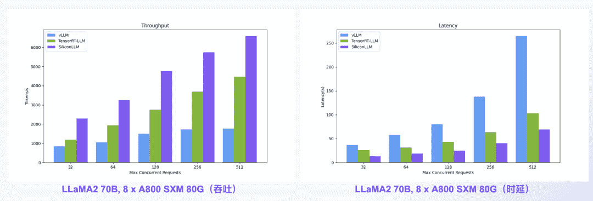

**Si**liconLLM的吞**吐最**高提升近 4 倍，时延最高降低近 4 倍

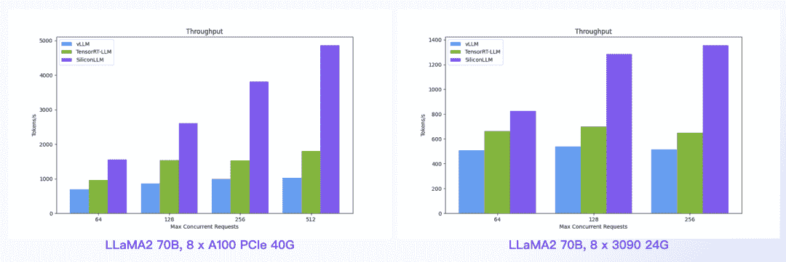

**数据中心+PCIe ****：S**ili**conLLM****的吞**吐最高提升近 5 倍； 消费卡场景 ：SiliconLLM的吞吐最高提升近 3 倍

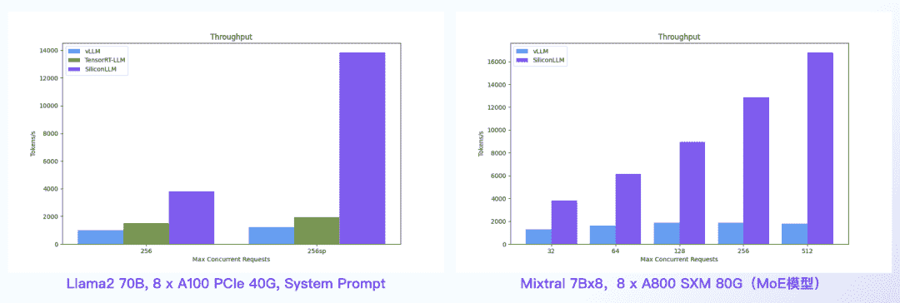

**Sy **ste**m Prom****pt场**景 ：SiliconLLM的吞吐最高提升 11 倍； MoE模型 ：推理 SiliconLLM的吞吐最高提升近 10 倍

其他人都在看

+   [800+页免费“大模型”电子书](http://mp.weixin.qq.com/s?__biz=MzU5ODY2MTk3Nw==&mid=2247493221&idx=1&sn=0c75b8115f4d4a27c8a5d6505a0a4986&chksm=fe426853c935e145d21abd30e0ceb29486c9e306032dfcb3d071ce34d171425c11341a57d7bf&scene=21#wechat_redirect)

+   [语言大模型推理加速指南](http://mp.weixin.qq.com/s?__biz=MzU5ODY2MTk3Nw==&mid=2247493321&idx=1&sn=ffc39c67080fefb01f1790e285a5085b&chksm=fe4268ffc935e1e9c8aeb5a095f08868a5eb8df90c1f46eb1e07044ec34ae6404d14b8b5926b&scene=21#wechat_redirect)

+   [混合输入矩阵乘法的性能优化](http://mp.weixin.qq.com/s?__biz=MzU5ODY2MTk3Nw==&mid=2247493533&idx=1&sn=a5d770b9100932baf3aff06a65e945e3&chksm=fe4269abc935e0bdae8377b3bcb7699e19ee781f2d496d3106a6609b7dca661f36c4928d1d77&scene=21#wechat_redirect)

+   强化学习之父：通往AGI的另一种可能

+   好久不见！OneFlow 1.0全新版本上线

+   LLM推理入门指南：文本生成的初始化与解码

+    OneDiff加速“图生生”，电商AI图像处理新范式