# Mamba-2: 与Transformer表现相当,速度提高了2-8倍

> 来源：[https://agijuejin.feishu.cn/docx/I0MTdTNvToFomFxpDZ1c7cnWnIf](https://agijuejin.feishu.cn/docx/I0MTdTNvToFomFxpDZ1c7cnWnIf)

> 作者：YYDL 深度图学习与大模型LLM

> 原文：https://mp.weixin.qq.com/s/GJfZj0ns2qcOHgmVlLntrw

> 深度图学习与大模型LLM(小编):

> 大家好**,**今天为大家介绍一篇Mamba最新研究论文（2024/05/31）。本文提出了一个新框架Structured State Space Duality (SSD),通过结构化矩阵的视角,统一了State Space Model (SSM)和注意力机制。 基于该框架设计的Mamba-2,其核心是对Mamba中SSM进行了改进,在与Transformer表现相当的同时,速度提高了2-8倍 。（之前基于Mamaba的工作是不是都可以有一个2.0的版本了？笑死！

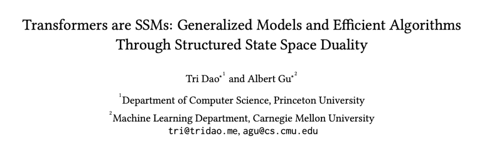

### ** 1. 基本信息  **

论文题目:Transformers are SSMs: Generalized Models and Efficient Algorithms Through Structured State Space Duality

**作者:Tri Dao, Albe**rt Gu(按照last name排序)

作者研究单位:

+   Department of Computer Science, Princeton University

+   Machine Learning Department, Carnegie Mellon University

+   论文代码:https://github.com/state-spaces/mamba

### ** 2. 研究背景  **

我们都知道Transformer注意力机制存在问题:训练时间随序列长度呈二次关系增长,自回归生成需要线性增长的cache。

与之相比,structured state-space models (SSMs)这一系的模型训练时间与序列长度呈线性关系,生成时状态大小为常数。

如Mamba等工作,在小规模语言建模任务上已达到甚至超过Transformer的性能。但SSM的发展与Transformer相关的工作割裂比较严重,在理论理解和优化实现上都比较困难。

本文在SSM和self-attention变体之间建立了理论联系 。

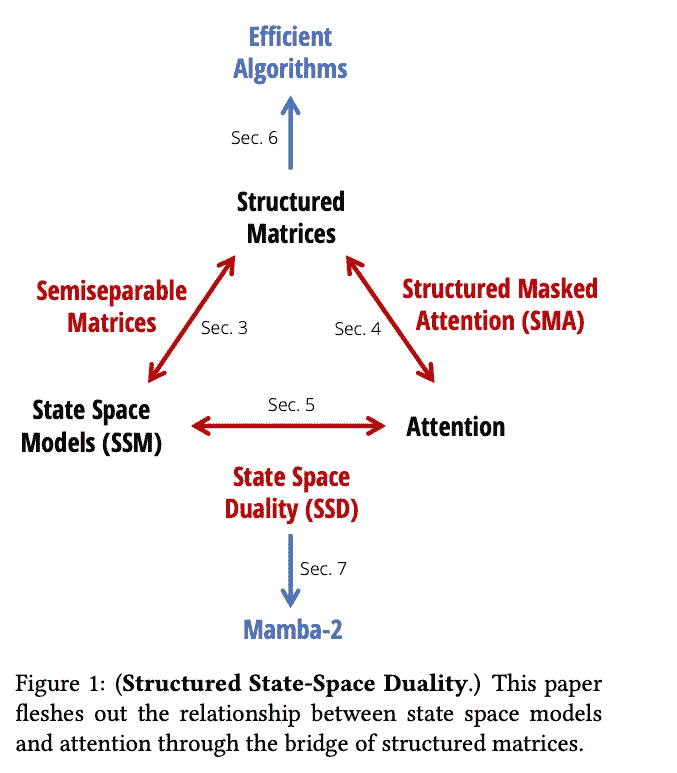

### ** 3. 主要内容  **

（论文有52页，下面内容可能有偏差，请以原文为主）

本文提出structured state space duality (SSD)框架，在结构化SSM和注意力变体之间建立了联系。

作者提出了两种广义序列模型表示方法：矩阵变换和张量收缩，分别揭示了对偶性的不同视角。下面是三个主要的理论的结果：

1.  证**明了SSM与semiseparable矩阵的等价**性(第3节)。这一关联是整个框架的核心,也表明了SSM的新性质和算法。 本文的中心观点是,不同的SSM计算方法可以重新理解为在结构化矩阵上的矩阵乘法算法的不同 。

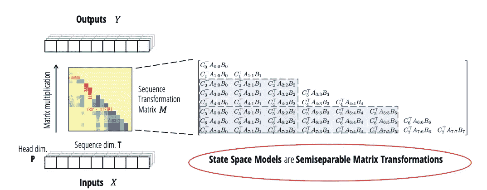

> 深度图学习与大模型LLM(小编):

> Semiseparable矩阵是一类特殊的结构化矩阵, 一个(下)三角矩阵  称为  -semiseparable的,如果其严格下三角部分(即下三角部分去掉对角线)的任意子矩阵的秩不超过  。这里的  称为semis**eparable矩阵的阶或秩。Semisepar**able矩阵的一个重要性质是,虽然完整矩阵有  个元素,但其SSS表示只需  的参数,且在这个表示上可以实现矩阵乘法等基本操作的近似线性时间算法。本文的一个核心结果(定理3.5)就是证明了: state space model变换  与semiseparable矩阵乘法是等价的 。因此,计算state space model的不同算法,本质上对应着semiseparable矩阵乘法的不同算法。这个联系既揭示了state space model的新性质,也启发了新的计算state space model的高效算法。

1.  大幅改进了linear attention的理论(第4节)。首先通过张量收缩给出简洁证明,然后将其推广到新的structured masked attention (SMA)。

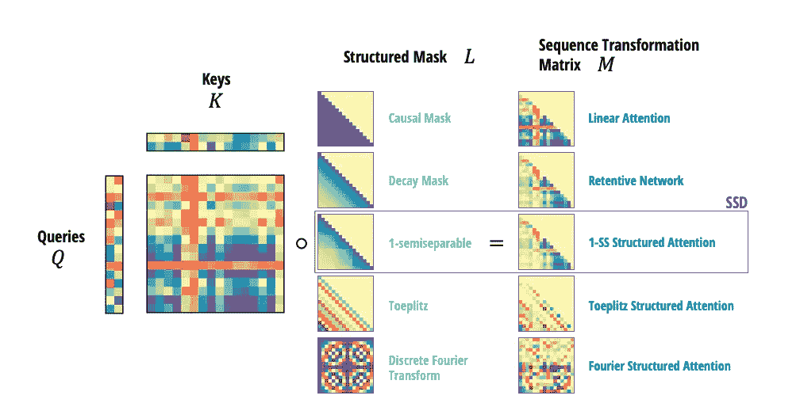

1.  将SSM和SMA联系起来,证明它们有很大交集,是彼此的对偶,同时具有类SSM的线性形式和类注意力的二次形式(第5节)。还证明了具有快速递归形式的kernel注意力方法必为SSM。

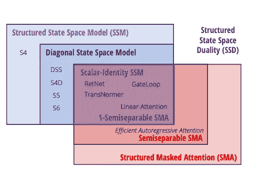

除了理论价值,该框架还为理解和改进序列模型提出了新的观点:

1.  **最重**要的是揭示了计算SSM的新的高效易实现算法(第6节)。 本文介绍的新SSD算法基于semiseparable矩阵的分块分解,利用了线性SSM递归和二次对偶形式的优点,在所有主要效率维度(如训练和推理计算、内存使用、现代硬件上的矩阵乘法单元利用)上取得了最优权衡 。专门实现的SSD比Mamba优化的selective scan快2-8倍,同时允许更大(是Mamba的8倍甚至更高)的递归状态,几乎不减速。与优化的softmax注意力实现相比,SSD在序列长度2K时性能相当,在16K时快6倍。

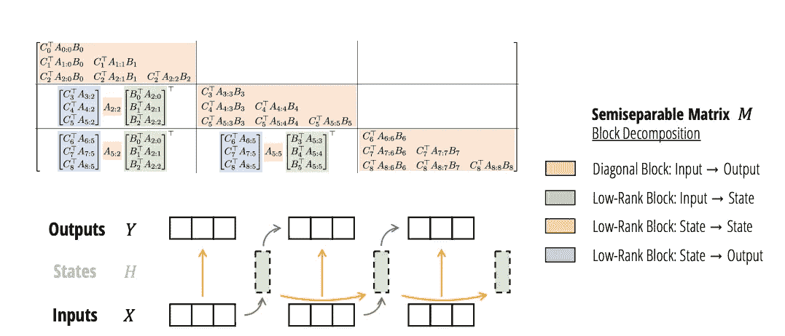

1.  将注意力中的一些设计引入SSM,进一步改进了架构设计(第7节)。例如,**引**入了类似multi-head attention (MHA)的概念到SSM。 Mamba架构被证明是multi-input SSM (MIS),类似于multi-value attention (MVA) ,文中还比较了不同head结构的Mamba变体。

+   此外,这些思想被用于轻微修改Mamba模块,以支持tensor parallelism(类似Megatron)。主要包括引入grouped-value attention (GVA)头部结构,以及将数据相关映射并行化到模块开头。

+   修改后的并行Mamba模块,再加上用SSD作为内部SSM层,即得到了Mamba-2架构。在与Mamba相同设置下,研究了Mamba-2的Chinchilla scaling law,发现其在困惑度和实际运行时间上都优于Mamba和Transformer++。此外,在The Pile上训练了一系列不同规模的Mamba-2模型,在标准下游评估任务上与Mamba和开源Transformer相当或更优。如在The Pile上训练300B token的2.7B参数Mamba-2,优于Mamba-2.8B、Pythia-2.8B,甚至Pythia-6.9B。

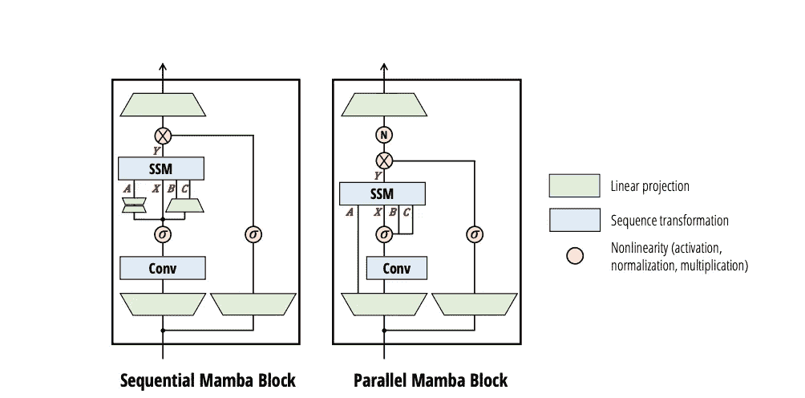

1.  SSD框架将SSM和Transformer联系起来,使得可以利用为Transformer开发系统优化类工作(第8节)。例如:

+   Tensor Parallelism (TP)是重要的并行技术,通过将每层划分到同一节点的多GPU来训练大型Transformer。 Mamba-2同样可以设置成TP,每个模块的同步点减少了一半。

+   本文描述了如何通过在设备间传递递归状态,用sequence parallelism来训练一般SSM和Mamba-2。

+   对**包含不同长度样本的微调, Transform**er需要复杂技术来移除padding token并在可变长度序列上执行注意力。 本文提出如何高效地用可变序列长度训练Mamba-2,无需padding token。

第9节在语言建模、训练效率和一个困难的多查询关联召回任务上经验性验证了Mamba-2。最后,第10节提供了扩展的相关工作,并讨论了该框架可能开启的潜在研究方向。

### ** 4. 实验发现  **

1.  **在**多查询关联召回(MQAR)任务上(图8), Mamba-2明显优于Mamba-1和vanilla attention,随状态大小N增加(从16到64和256),MQAR性能持续提高 ,更大的状态允许记忆更多信息(键-值对)。

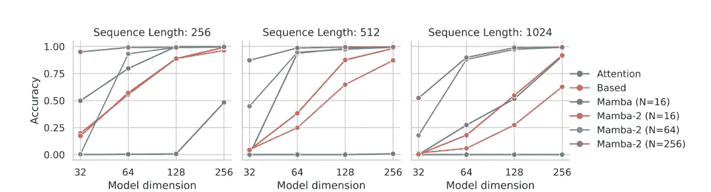

1.  **在The Pile数据集的语言建模任务中(图9), Mamba-2在Chinchilla scaling **law下的性能与Mamba和强Transformer++配方相当或更优,相比baseline Transformer,在性能(困惑度)、理论FLOP和实际运行时间上都占优 。

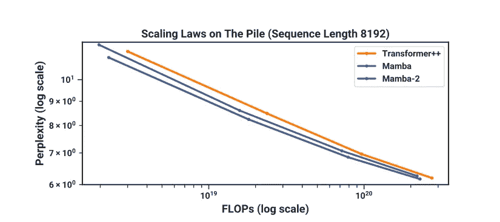

1.  **在一系列流行的zero-shot下游评估**任务上(表1), 每个规模下Mamba-2都优于Mamba,通常与两倍大小的Pythia性能相当 。如在The Pile上以相同tokenizer、数据集和训练长度(300B tokens)训练的2.7B Mamba-2,优于Mamba-2.8B、Pythia-2.8B,甚至Pythia-6.9B。

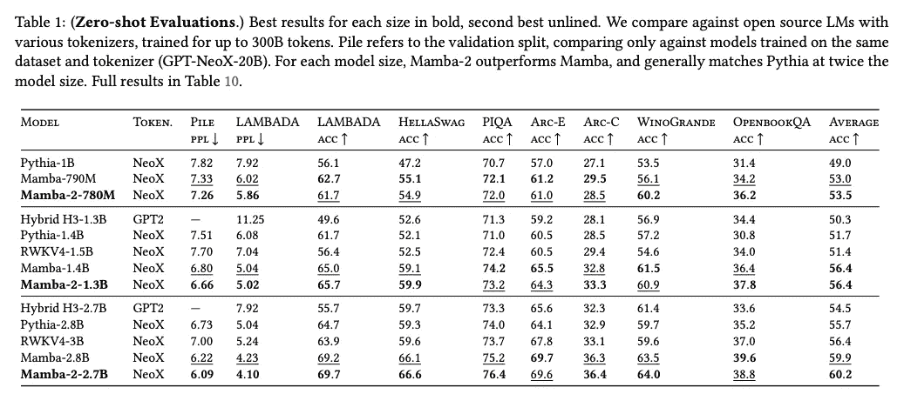

1.  速度基准测试(图10)显示, **得**益于对矩阵乘法的重新表述,SSD算法可利用GPU上专门的矩阵乘法单元,速度比Mamba的fused scan快2-8倍 。由于序列长度线性扩展,从序列长度2K开始SSD就比FlashAttention-2更快。

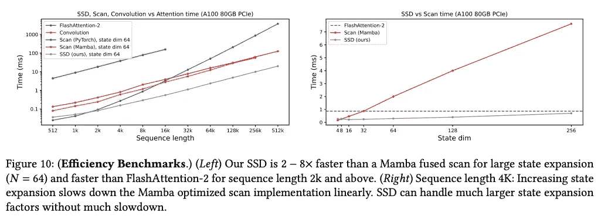

1.  **消融实验(第9.4节)验证了Mamba-2模块设计的改进,包括 并行映射生成(****A,B,C,X)可节省参数,在更大规模上更适合tensor **parallelism;额外normalization层有助于提高性能和训练稳定性 。multi-head结构的消融显示, 尽管状态大小受控,不同模式(MVA、MQA/MKA、MHA)间下游性能差异明显,MVA模式表现最好 。kernel近似方法的消融发现,尝试的方法似乎并未优于简单的逐点非线性激活函数  。

### ** 5. 结论  **

本文提出了一个基于结构化矩阵的理论框架,该框架不仅揭示了最近SSM(如Mamba)在语言建模上与Transformer表现相当的原因,而且提供了新思路来改进SSM(可能还有Transformer),将两边在算法和系统上的进展联系起来。作为示范,该框架指导设计了处于SSM和结构化注意力交叉点的新架构Mamba-2。

利用每个视角的思想,本文还讨论了SSD框架可能的扩展方向:

1.  SSM方面,SSD可被描述为一个具有SISO维度和scalar-identity结构的选择性(time-varying)SSM。未来可探索更一般、非因果的Mamba变体,以及通过分析矩阵变换结构来刻画softmax注意力和次二次模型差距的方法。

1.  结构化矩阵方面,高效(次二次)矩阵序列变换恰好对应于具有结构化矩阵的mixer。semiseparable矩阵在科学计算文献中有深入研究,融合这些思想可能是进一步改进SSM的有前景方向。聚焦矩阵mixer视角可能会带来序列模型更多有成效的发展。

1.  (线性)注意力方面,SSD与标准注意力相比,主要有两点不同:一是不使用softmax激活,二是将logits矩阵乘以输入相关的1-semiseparable掩码。因此这个掩码可视为取代了Transformer中的softmax和启发式位置编码。更广泛地,SMA是linear attention的强有力推广,可能产生出具有不同性质的其他高效注意力变体。此外,注意力文献中的许多其他技术,可望转移到SSM。

1.  相关模型方面,最近涌现出大量与Mamba和Mamba-2非常相似的工作,包括RetNet、TransN**ormerLLM、GateLoop、GLA、HGRN、Griffin、Jamba、xLST**M、RWKV/Eagle等。 SSD目前不能推广到标准softmax注意力或任何不具有有限特征映射  的注意力核变换。与一般注意力相比,SSD的优势在于可控的状态扩展因子N,而不是整个历史的二次缓存 。并发工作已开始研究这些表示之间的权衡,如在复制和上下文学习任务上。Mamba-2在其中一些能力上(如MQAR结果)有显著改进,但还有更多有待理解的地方。

论文代码和预训练的检查点已开源在 https://github.com/state-spaces/mamba.