# 你好世界！LLM开启人形机器人新纪元

> 来源：[https://agijuejin.feishu.cn/docx/VILqdG90OoW3Pqxv1MUcnlthn7q](https://agijuejin.feishu.cn/docx/VILqdG90OoW3Pqxv1MUcnlthn7q)

> 作者：新智元

> 原文：https://mp.weixin.qq.com/s/XbAI-rueAHDxMdB4pxTLyw

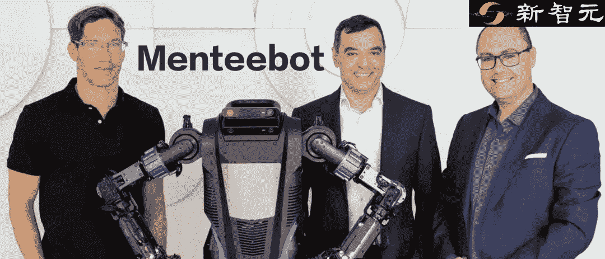

---

> 【新智元导读】 由业内大佬Amnon Shashua创立的Mentee Robotics，突然放出大招，将AI的能力嵌入到机器人的各个层面，实现了与世界的动态交互。

前段时间，由业内大佬Amnon Shashua创立的Mentee Robotics，在憋了两年之后，突然放出大招！

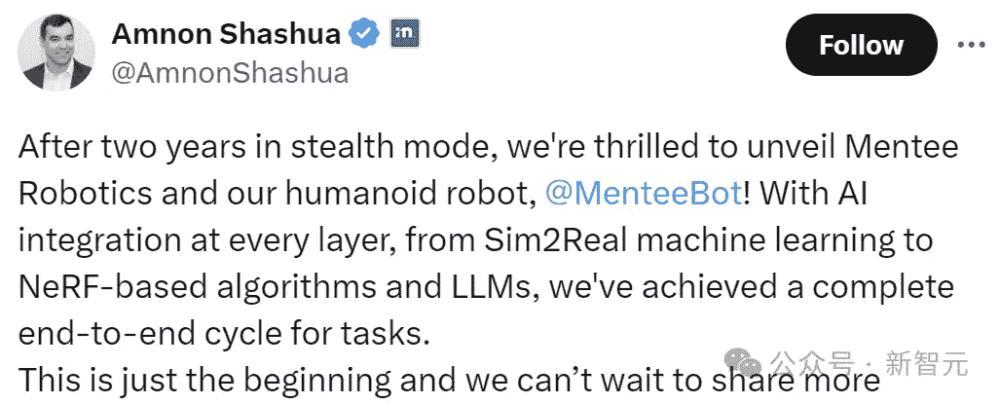

这是一款名为Menteebot的人形机器人，将AI的能力嵌入到机器人的各个层面，实现了与世界的动态交互。

Menteebot集成了尖端的Sim2Real学习（以获得逼真的步态和手部运动）、基于NeRF的实时3D映射和定位（用于复杂环境中的动态导航），以及大型语言模型（帮助认知世界和执行高级任务）。

Menteebot实现了从口头命令，到复杂任务完成的完整端到端循环，包括导航、运动、场景理解、对象检测和定位、抓取以及自然语言理解。

比如在下面的例子中，Menteebot的手臂和手呈现出全方位的运动和足够的准确性，可以执行递盘子这种精细的任务。

完美复刻人类的「灵巧手」：

先进的Sim2Real学习技术让Menteebot的动作非常敏捷，可以像人类一样朝任何方向行走、奔跑、原地转弯等。

来几个并步，扎个马步，都不在话下：

Menteebot在搬运重物时会自动调整步态，如同人类一般。

——辛苦了小老弟，交给我吧：

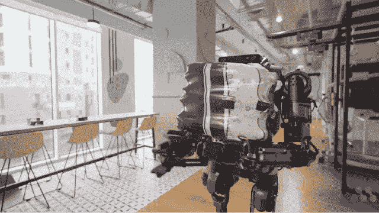

此外，Menteebot的名字还有另一个含义：

**you can mentor **（通过口头指示和视觉模仿即时学习新任务）。

它可以直接接受用户的语音指令，使用LLM来解释命令并「思考」完成任务所需的步骤。

然后，使用基于NeRF的算法，实时构建环境的认知3D地图，完成有关对象和项目的语义信息，并在地图中定位自身，同时规划动态路径以避开障碍物。

最后，它利用在Sim2Real中学到的知识，在路径上执行计划步骤，——简单来说，就是在模拟器中训练，在现实世界中实现。

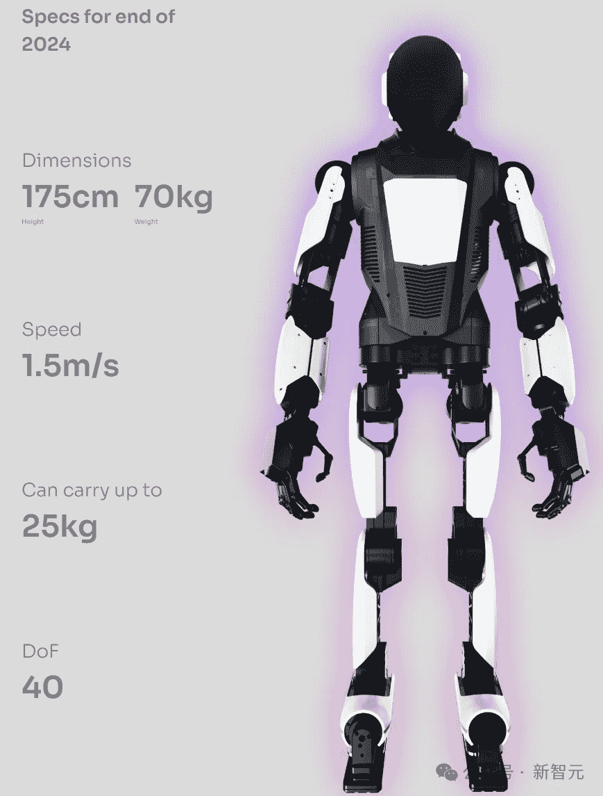

上图是Menteebot成品的效果图和各项参数，它将被设计为两种类型：

命比较好的机器人会成为家庭助理，负责餐桌布置、餐桌清理、衣物处理等家务工作；

而命不好的就会进厂打工，干一些重活。

尽管Menteebot目前仍处于原型阶段，但有大佬的背书，我们可以期待在不久之后见到更加惊艳的效果。

Amnon Shashua

Mentee Robotics的创始人Amnon Shashua，1993年在麻省理工学院（MIT）获得大脑和认知科学博士学位，1996年之后一直在耶路撒冷希伯来大学（The Hebrew University of Jerusalem）计算机科学系任教。

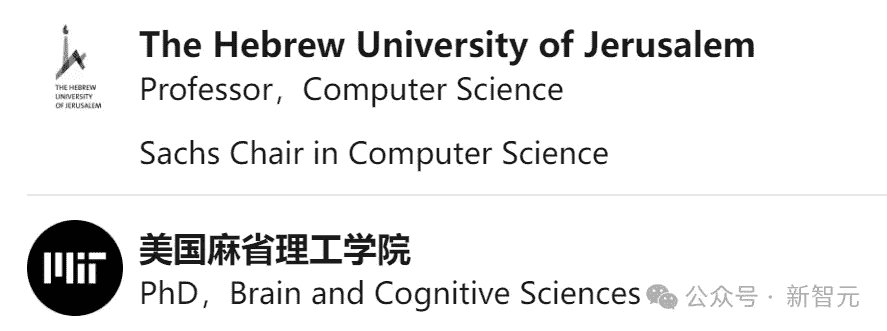

除了学术大佬之外，Amnon Shashua还是多家著名科技公司的创始人：

> 自动驾驶技术公司Mobileye的总裁兼首席执行官；

> 视觉设备公司OrCam的联合创始人；

> ONE ZERO数字银行的创始人和所有者；

> 人工智能公司AI21 Labs的联创、董事长。

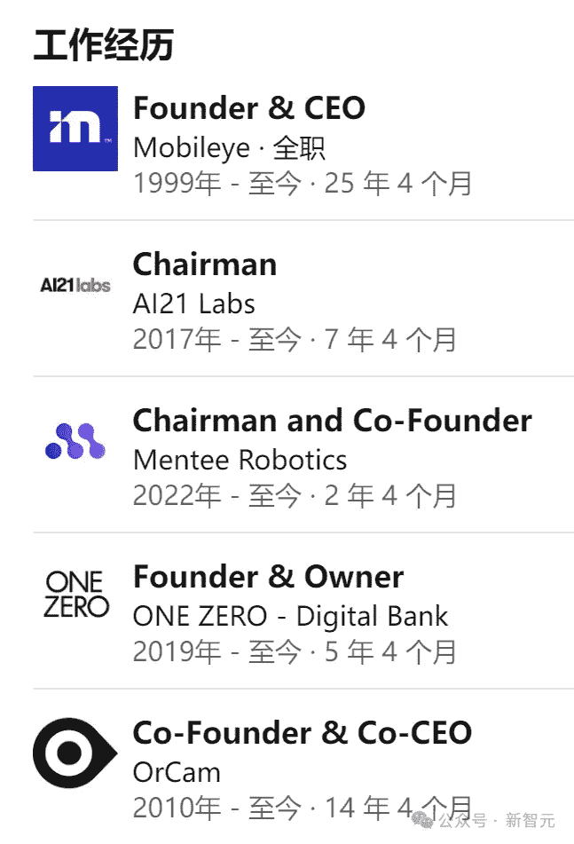

除Shashua之外，Mentee Robotics的创始团队还包括前Facebook AI研究总监Lior Wolf，和耶路撒冷希伯来大学教授、现任Mobileye首席技术官的Shai Shalev-Shwartz。

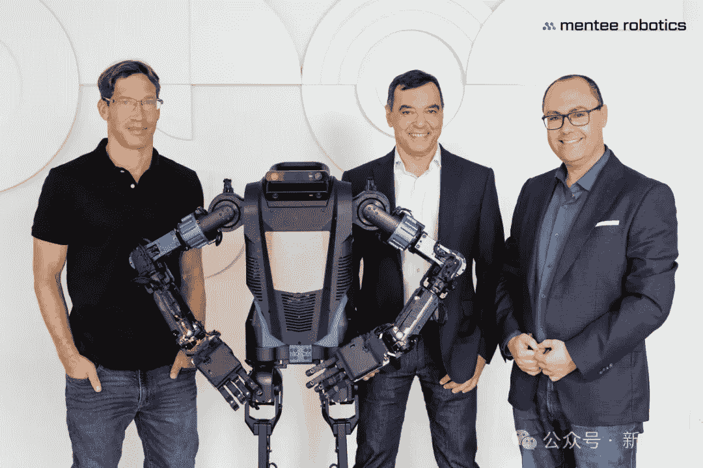

到目前为止，团队已经筹集了1700万美元，由Ahren Innovation Capital领投。

也许，新的纪元已经开启，就如Amnon Shashua所言：

> We are on the cusp of a convergence of computer vision, natural language understanding, strong and detailed simulators, and methodologies for transferring from simulation to the real world.

>

> 我们正处于将计算机视觉、自然语言理解、强大而详细的模拟器、以及从模拟转移到现实世界的方法相融合的风口浪尖。

** LLM开启机器人新纪元**

最近几个月，越来越多的项目使用大语言模型，来创建以前似乎不可能的机器人应用程序。

在LLM的加持之下，机器人可以处理自然语言命令，并完成需要复杂推理的任务。

### **感知和推理 **

创建机器人系统的经典方法需要复杂的工程，来创建规划和推理模块。

另外，用户界面的设计也很困难，因为人们可以用不同的方式说出相同的指令。

——而LLM，包括视觉语言模型（VLM）的出现，完美解决了这些问题。

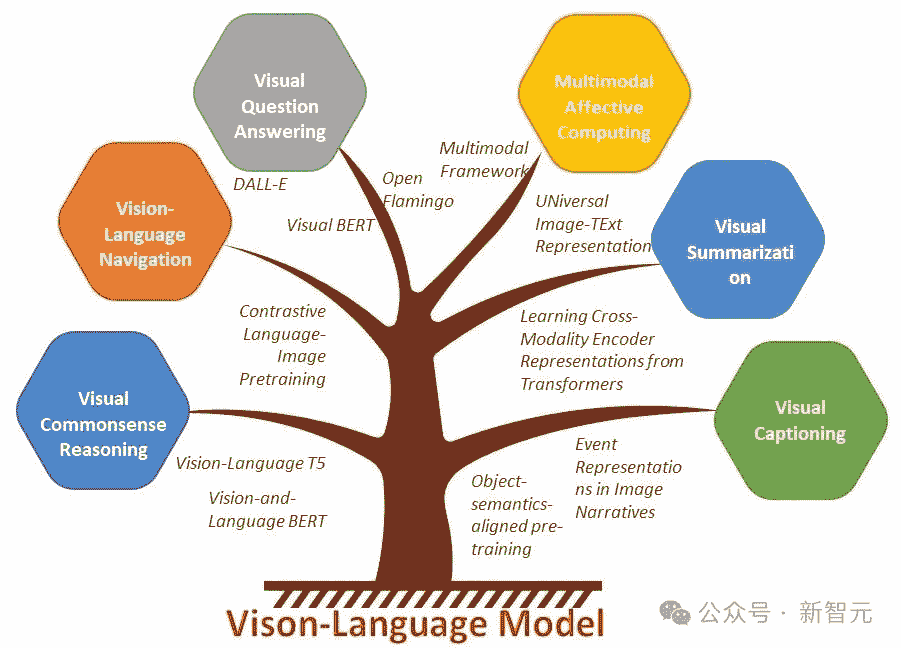

朝这个方向迈出的第一步的是Google Research的SayCan项目。

SayCan使用LLM的语义知识来帮助机器人进行推理，并确定哪些动作序列可以帮助完成任务。

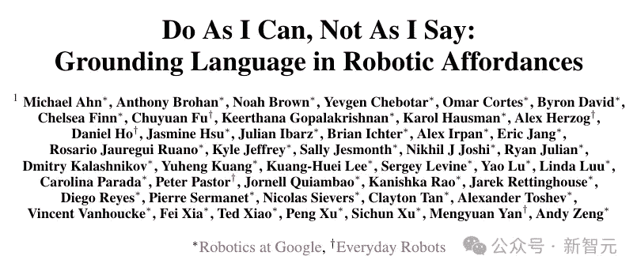

论文地址：https://arxiv.org/pdf/2204.01691.pdf

在论文中，Google Research与Everyday Robots合作开发了新的方法：利用先进的语言模型知识，使物理代理（如机器人）能够遵循高级文本指令，同时将LLM建立在特定现实世界环境可行的任务中。

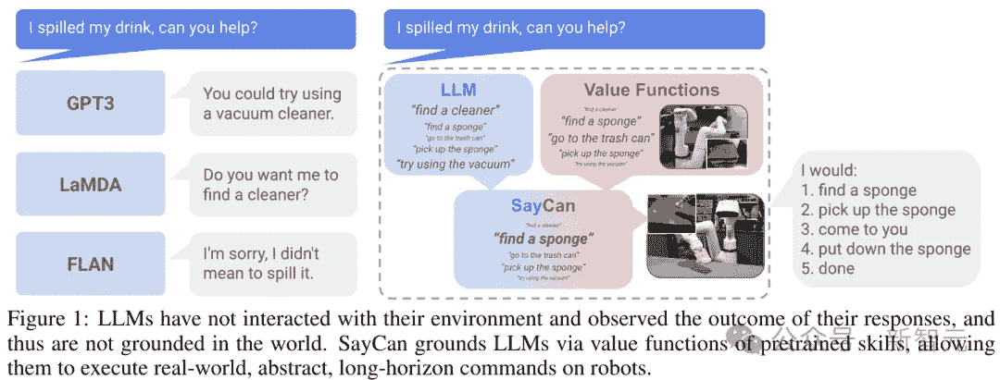

实验中，研究人员将机器人放置在真实的厨房，用自然语言发出指令。对于时间扩展的复杂和抽象任务，SayCan可以给出高度可解释的结果。

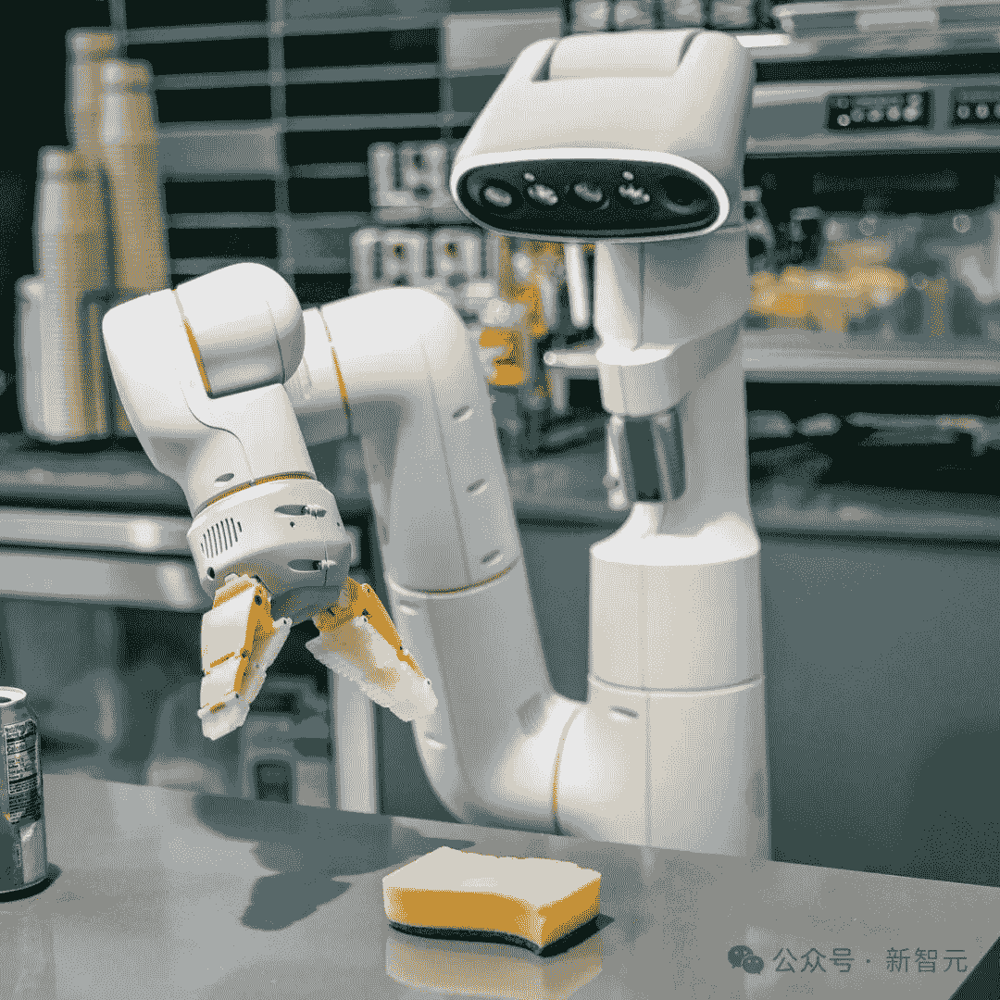

人工智能和机器人研究科学家Chris Paxton表示，使用LLM和VLM使感知和推理更加容易，这让很多机器人任务看起来比以前更可行。

### **串联现有功能**

经典机器人系统的一大局限性是需要明确的指令。

而LLM能够将松散定义的指令，映射到机器人技能范围内的特定任务序列。许多前沿模型甚至可以在不需要训练的情况下完成这些任务。

Paxton表示，通过LLM，机器人可以将不同的技能串在一起，并推理出如何使用这些技能。

像GPT-4V这样的新视觉语言模型，将在未来与机器人系统相结合，发挥广泛的应用。

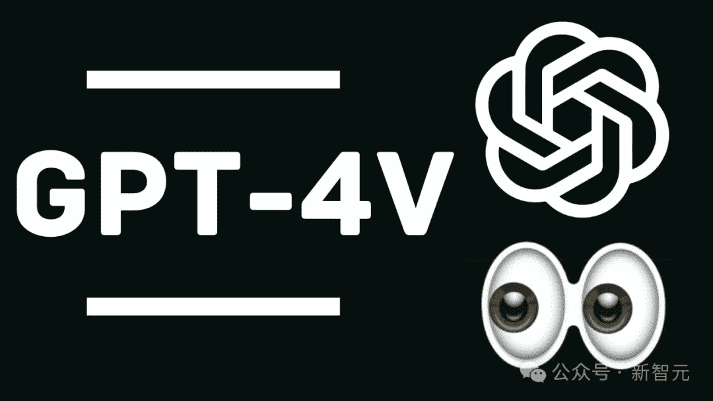

一个例子是GenEM，由多伦多大学、Google DeepMind和Hoku Labs联合开发。

GenEM使用GPT-4对环境进行推理，并根据机器人的可负担性确定它应该从事什么样的行为。

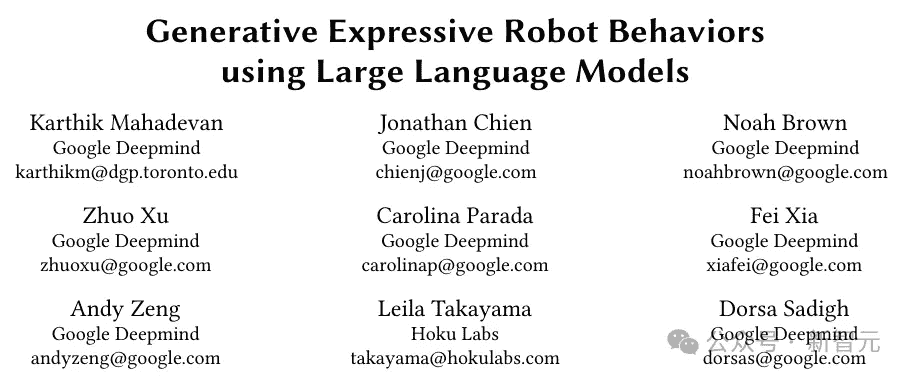

论文地址：https://arxiv.org/pdf/2401.14673v2.pdf

它可以利用LLM训练数据中包含的大量知识以及上下文学习能力，并能够将操作映射到机器人的API调用。

例如，LLM知道向人们点头致意是一个礼貌的行为，就可以操作机器人上下移动头部。

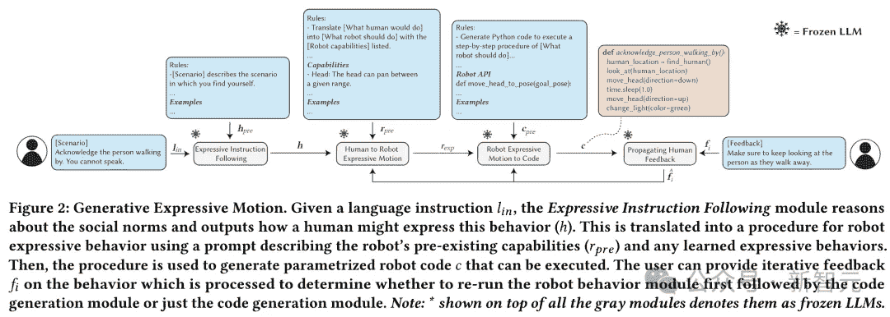

另一个项目是OK-Robot，一个由Meta和纽约大学创建的系统：

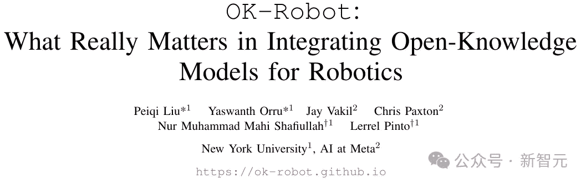

论文地址：https://arxiv.org/pdf/2401.12202.pdf

它将VLM与运动规划和对象操作模块相结合，能够在机器人从未见过的环境中执行拾取和放下操作。

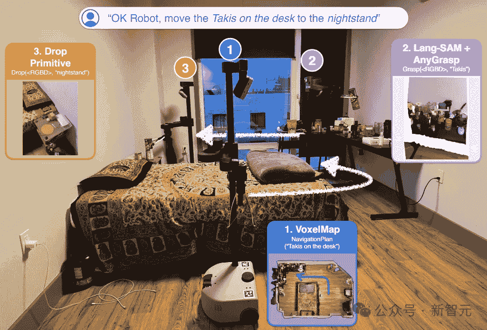

随着语言模型能力的不断增强，一些机器人初创公司抓住机遇，重新点燃了市场的希望。

比如，与OpenAI合作的Figure：

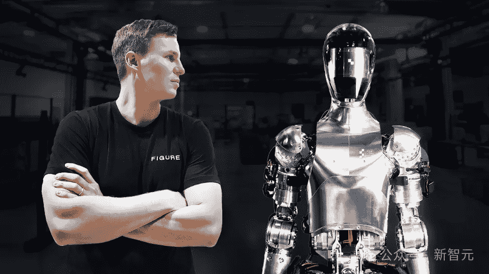

不过话又说回来，大模型可以作为机器人的大脑，但真正办事的还得是身体，人形机器人这一套工程的门槛还是挺高的。

另外，对于当前的模型来说，数据可能是最重要的，完善机器人相关的数据集也是任重而道远。

### **专用基础模型**

使用LLM的另一种方法是为机器人开发专门的基础模型。这些模型通常建立在预训练模型中包含的大量知识之上，并针对机器人操作定制架构。

在这方面最重要的项目之一是谷歌的RT-2，这是一种视觉语言动作（VLA）模型，它将感知数据和语言指令作为输入，并直接将动作命令输出到机器人。

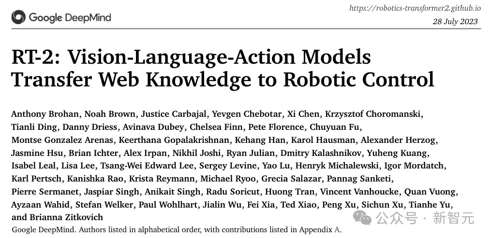

论文地址：https://robotics-transformer2.github.io/assets/rt2.pdf

Google DeepMind最近又将版本升级到了RT-X-2，可以适应不同类型的机器人形态，并且可以执行训练数据中未包含的任务。

DeepMind与斯坦福大学合作开发的RT-Sketch，可以将粗略的草图转化为机器人的行动计划。

论文地址：https://arxiv.org/pdf/2310.08864.pdf

Paxton表示，这是另一个令人兴奋的方向，它基于端到端的学习，你只需拿一个摄像头，机器人就会弄清楚它需要做什么。

另外，机器人的基础模型也进入了商业领域。

今年3月，Covariant宣布推出RFM-1，这是一个80亿参数的模型，基于文本、图像、视频、机器人动作和一系列数值传感器读数进行训练。

Covariant希望能够通过这样一个基础模型，解决不同类型机器人的许多任务。

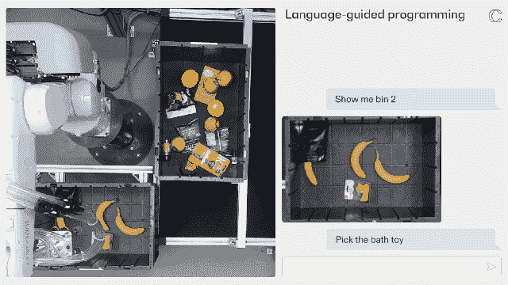

在Nvidia GTC上宣布的Project GR00T也是一种通用基础模型，它使人形机器人能够将文本、语音、视频甚至现场演示作为输入，并对其进行处理以采取特定的一般操作。

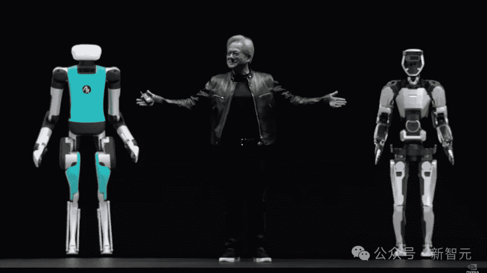

当前，语言模型仍然有很多未开发的潜力，并将继续帮助机器人研究人员在基本问题上取得进展。

随着LLM的不断进步，我们可以期待更多的科幻场景一步步走进我们的生活。

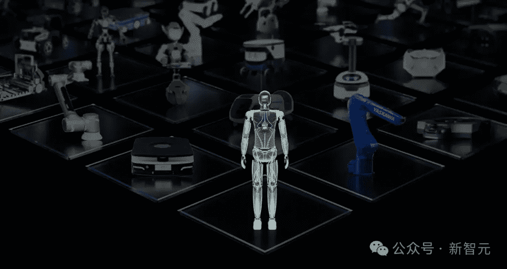

参考资料：

https://x.com/AmnonShashua/status/1780611499133685889

https://venturebeat.com/ai/how-llms-are-ushering-in-a-new-era-of-robotics/