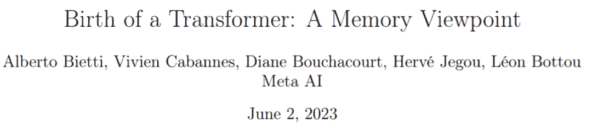
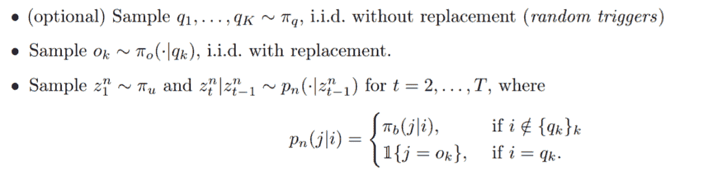
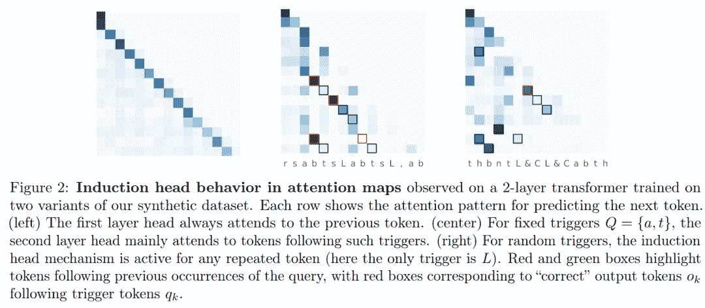
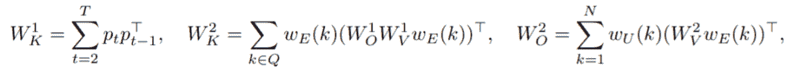
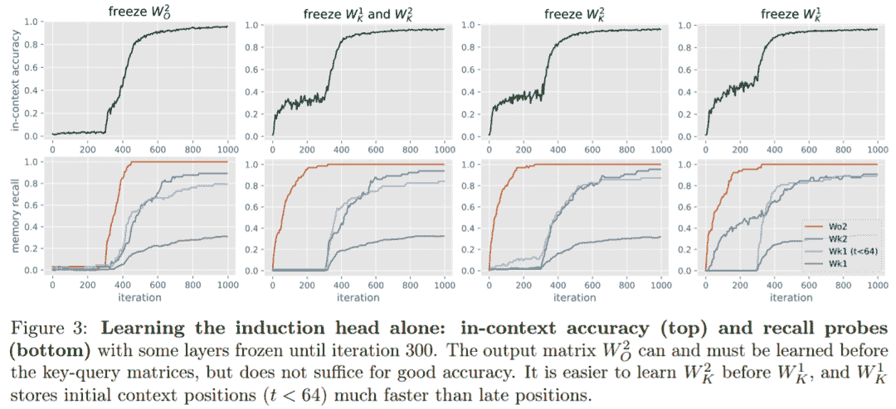
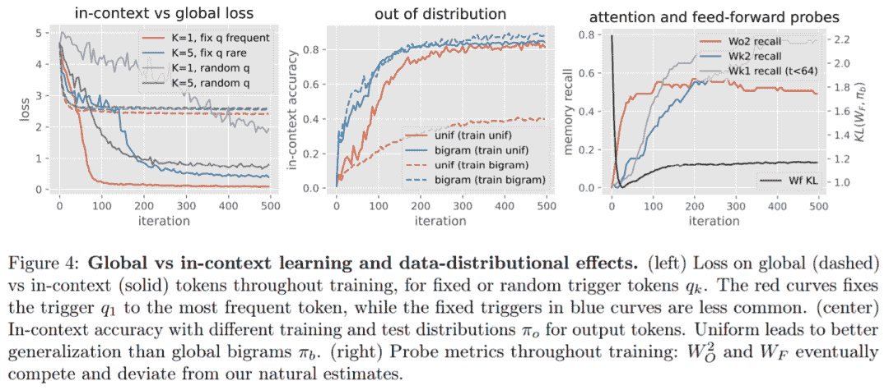

# 基于Transformer的大模型是如何运行的？Meta从全局和上下文学习揭秘

> 来源：[https://agijuejin.feishu.cn/docx/Ur3wdpfmdorDD6xB11VcxuTBnWe](https://agijuejin.feishu.cn/docx/Ur3wdpfmdorDD6xB11VcxuTBnWe)

> 作者：机器之心

> 原文：https://www.jiqizhixin.com/articles/2023-06-22-2

> 本文旨在更好地理解基于 Transformer 的大型语言模型（LLM）的内部机制，以提高它们的可靠性和可解释性。

随着大型语言模型（LLM）在使用和部署方面的不断增加，打开黑箱并了解它们的内部工作原理变得越来越重要。更好地理解这些模型是如何做出决策的，这对改进模型和减轻其故障（如幻觉或推理错误）至关重要。

众所周知，最近 LLM 成功的一个重要因素是它们能够从上下文中学习和推理。LLM 对这些上下文的学习能力通常归功于 Transformer 架构，特别是自注意力块的使用，其能够仔细选择输入序列，进而推理出可信的下一个 token。此外，预测可能需要全局知识，如语法规则或一般事实，这些可能不会出现在上下文中，需要存储在模型中。

我们不禁会疑问，为什么基于 Transformer 的模型非常擅长使用它们的上下文来预测新的 token，这种能力是如何在训练中产生的？带着这些问题，来自 Meta AI 的研究者进行了深入的研究。他们通过研究合成设置下 Transformer 的学习机制，揭示了其全局和上下文学习的平衡，并将权重矩阵解释为联想记忆，为理解和优化 Transformer 提供了基础。

论文地址：https://arxiv.org/pdf/2306.00802.pdf

首先要了解的是在训练过程中 Transformer 是如何发现这些能力的。为此，该研究引入了一个合成数据集，该数据集由二元语言模型生成的序列组成。然后，模型需要依靠上下文学习来对特定的二元序列进行良好的预测，而全局二元可以根据当前 token 的全局统计数据进行猜测。虽然单层的 Transformer 无法可靠地预测上下文二元，但该研究发现通过开发感应头（induction head）机制的双层 Transformer 取得了成功，即拥有两个注意力头的 circuit，其允许 Transformer 从上下文 [・・・, a, b,・・・, a] 中预测 b，并且在 Transformer 语言模型中似乎无处不在。这种感应头（induction head）机制在 Transformer 语言模型中是普遍存在的，并且取得了成功。

更进一步的，为了更好的了解上下文机制是怎样出现在训练过程中的，该研究在随机初始化时冻结了一些层（包括嵌入和值矩阵）来进一步简化模型架构。这样一来研究重点转移到注意力和前馈机制，同时避免了学习表征的困难。与此同时，这种简化还为单个权重矩阵引入了一个自然模型作为联想记忆。自然模型可以通过它们的外积存储输入 - 输出或键 - 值对嵌入。随机高维嵌入由于其接近正交性而特别适合这种观点。

总结而言，该研究的贡献可概括为：

+   本文引入了一种新的合成设置来研究全局和上下文学习：序列遵循二元语言模型，其中一些二元在序列中变化，而另一些不会。

+   本文将 Transformer 的权重矩阵视为学习存储特定嵌入对的联想记忆，并以此为任务推导出一个简化但更可解释的模型。

+   本文对训练动态进行了细致的实证研究：首先学习全局二元，然后以自上而下的方式学习适当的记忆，形成感应头。

+   本文给出了训练动力学的理论见解，展示了如何通过在噪声输入中找到信号，在种群损失上进行一些自上而下的梯度步骤来恢复所需的联想记忆。

# 方法介绍

接着该研究介绍了合成数据设置，这样能够仔细研究感应头机制在训练过程中的发展以及 Transformer 如何学习利用上下文信息的。

双元数据模型：模型序列由一个通用的双元语言模型（即马尔可夫链）组成，每个序列的生成方式如下：

下图 2 可视化了测试序列上的注意力图，这表明该模型已经学习了感应头机制。

接着该研究介绍了 Transformer 联想记忆观点：因为几乎正交的嵌入，权重矩阵表现为联想记忆，将成对的嵌入存储为其外积的加权和。研究引入了一个具有固定随机嵌入的简化 Transformer 模型，将用这种想法产生对学习动力学的精确理解。

此外，该研究提出了一个有用的观点，将 Transformer 中的模型权重视为高维嵌入向量的联想记忆。感应头机制可以通过以下外积矩阵作为记忆来获得，而其他所有权重则固定为随机初始化状态：

# 实验

图 3 研究了在迭代 300 次之前冻结不同层对训练动态的影响。

全局 vs 上下文学习。从图 4（左 / 右）可以看出，当联合训练所有层时，全局二元统计的学习速度往往比感应头更快，这可以从早期迭代中的 loss 和 KL 的快速下降中看出。

此外，从图 4（左）中看到，数据分布的变化会对上下文机制的学习速度产生重大影响。该研究观察到以下情况可能会使上下文学习减慢：(i) 较少数量的触发器 K， (ii) 仅使用少有的固定触发器，以及 (iii) 使用随机触发器而不是固定触发器。

该研究还在图 4（中间）中显示，在训练时将输出 token 分布更改为二元分布会降低准确率，这表明，使用更多样化的训练分布可以产生具有更好泛化准确率的模型，并且只需少量的额外训练成本。

更多研究内容，请参考原论文。