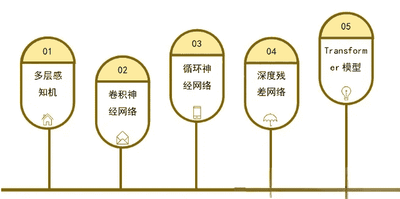
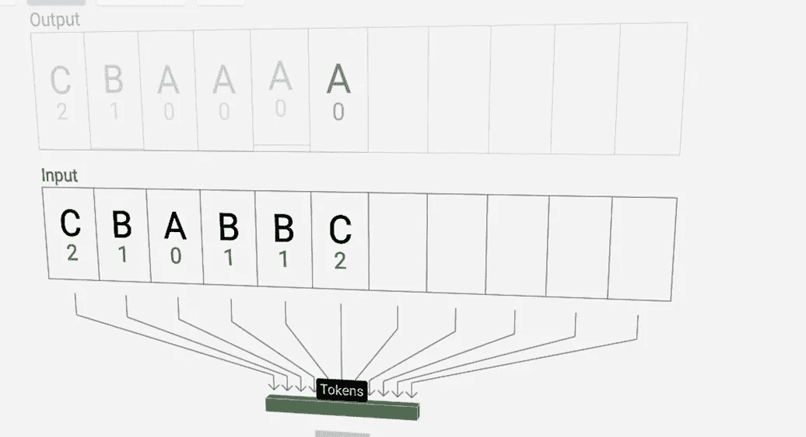
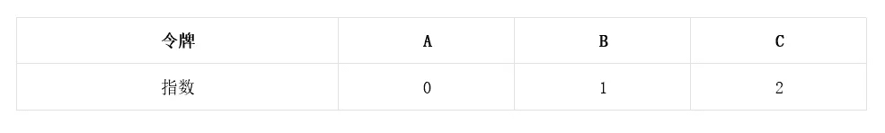
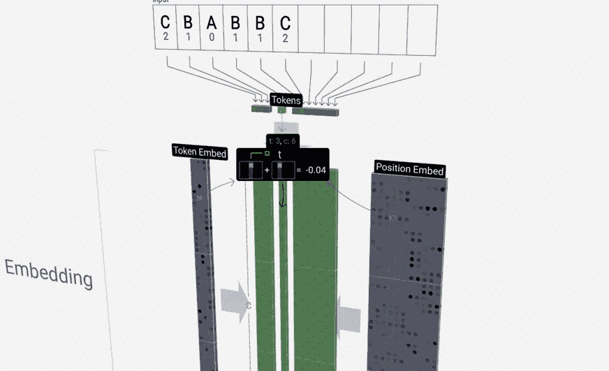
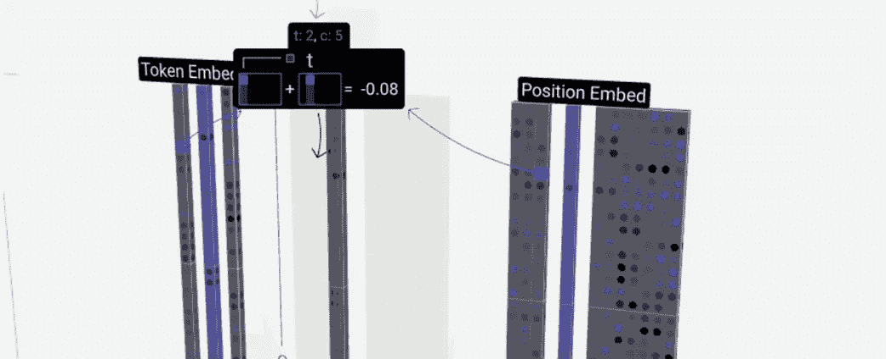
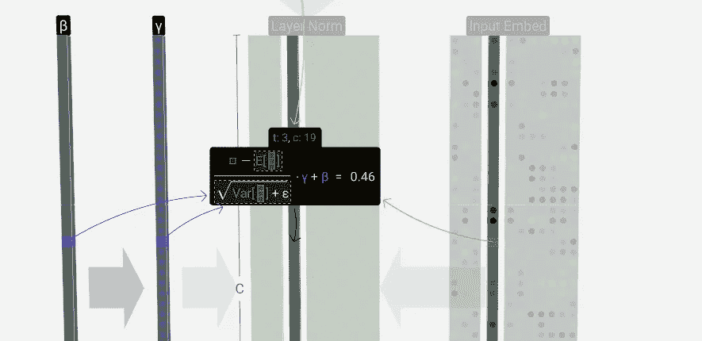
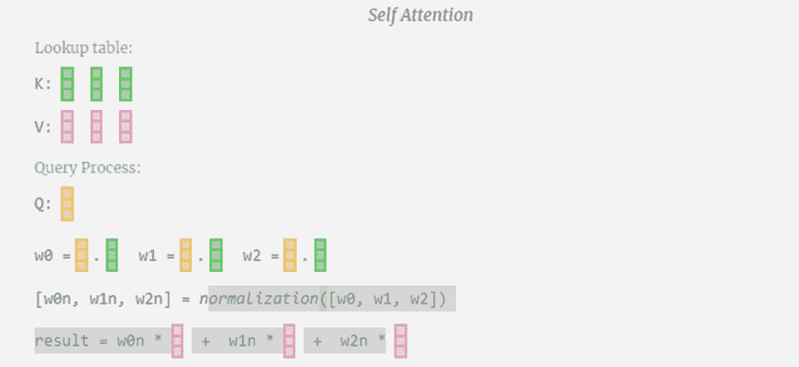

# Transformer的诞生和崛起

> 来源：[https://agijuejin.feishu.cn/docx/IBLwdbQzlo913nxsaNMcec4SnYb](https://agijuejin.feishu.cn/docx/IBLwdbQzlo913nxsaNMcec4SnYb)

> 作者：wy | 神州问学

> 原文：https://mp.weixin.qq.com/s/9epmLY3xUHOLW_PLd2kQvw

> 智能问答与文本生成：Transformer模型的超能力

# **一、引言**

NLP（自然语言处理）作为人工智能领域的一个重要分支，致力于使计算机能够理解和处理人类语言。随着互联网的发展和信息时代的到来，NLP的应用场景日益广泛，从机器翻译、智能问答到情感分析等，都离不开NLP技术的支持。然而，传统的NLP方法在处理复杂语言现象时存在诸多局限性，如无法准确理解语义、无法捕捉长距离依赖等。

Transformer模型的出现，为NLP领域带来了革命性的变革。它摒弃了传统的循环神经网络（RNN）架构，转而采用自注意力机制，使得模型在处理长序列时能够更有效地捕捉依赖关系。

自2017年诞生以来，Transformer模型迅速崛起，成为NLP领域的主流模型之一。基于Transformer架构的BERT、GPT等模型在各项NLP任务上取得了显著的性能提升，推动了NLP技术的快速发展。

# 二、简单理解Transformer

传统的方法(RNN)在处理文本时，遵循着逐词处理的模式，就像阅读书籍时，一个词一个词往后读取信息。然而，Transformer模型打破了这一传统，它能够同时处理一句话或一段话中的所有词语，无需像RNN（循环神经网络）那样，每个时间步（t步骤）的计算都必须依赖于前一个时间步（t-1步骤）的结果。

Transformer模型特别擅长于识别并关注句子中不同的重要部分。就像我们在阅读文章时，会自然而然地关注章节标题、关键词或句子中的核心信息一样，Transformer也能通过其注意力机制来聚焦这些关键信息。

尽管Transformer能够一次性处理整个句子中的所有词语，但它无法直接捕获序列中单词的位置信息。为了弥补这一缺陷，Transformer引入了位置编码的概念，这样模型就能够知道每个单词在句子中的具体位置，从而保留了语言的顺序性。

三. Transformer原理

Transformer模型整体架构由一个堆叠的编码器和一个堆叠的解码器组成。编码器负责将输入序列转换为语义表示，解码器则利用这些表示生成目标序列。在训练过程中，解码器通过逐步生成序列的方式，结合编码器的输出和先前生成的部分序列，来预测下一个词或符号。

Transformer编码器（Encoder）

Transformer的编码器负责将输入序列转换为一系列高级抽象的表示，其中包含了输入序列的语义信息和特征。编码器由多层堆叠的相同模块组成，每个模块本身又包含两个主要的子层：

Self-Attention层：

在每个编码器模块中，首先执行的是self-attention操作。这一操作允许模型在每个位置上将输入序列的所有其他位置作为上下文，动态地计算出该位置的表示。具体来说，对于每个位置，通过计算Query、Key和Value向量的线性变换，然后计算它们之间的注意力权重，最终通过加权和来生成该位置的输出表示。

全连接前馈网络：

在经过self-attention层后，每个位置的表示会被送入一个两层的全连接前馈神经网络。这一网络对位置特定的表示进行非线性变换和映射，从而增强模型对每个位置特征的建模能力。

**数据解析**

就如同任何其他模型，我们在做任何事情之前，首先要做的就是要对数据进行处理。比如说我们要获取以下6个字母的序列"CBABBBC"。

我们将每个字母称为一个标记，模型的不同标记集合构成了它的词汇表：

从该表中，每个标记都被分配一个数字，即其标记索引。现在我们可以将这个数字序列输入到模型中。

**位置嵌入(Embedding)**

我们将左侧（Token Embed）作为标记嵌入矩阵，将右侧（Position Embed）作为位置嵌入矩阵

我们之前看到了如何使用简单的查找表将标记映射到整数序列。这些整数（即标记索引）是我们第一次也是唯一一次在模型中看到整数。从现在开始，我们使用浮点数（十进制数）。

让我们看一下如何使用第 4 个标记（索引 3）来生成输入嵌入的第 4 列向量。

我们使用标记索引B = 1来选择左边标记嵌入矩阵的第2列。注意，这里我们使用的是基于0的索引，所以第一列位于索引0。

这将生成一个大小为C = 48的列向量，我们称之为标记嵌入。然后选择右边的位置嵌入矩阵的第四列，也会生成一个大小为48的列向量

然后将这两个列向量相加，产生另一个大小为C = 48，我们将其描述为位置嵌入。

我们看到，对输入序列中的所有标记运行此过程会产生一个大小为T x C的矩阵。T代表时间，也就是说，你可以将序列中较晚的标记视为时间较晚的标记。C代表通道，但也被称为“特征”或“维度”或“嵌入大小”。这个长度C是模型的几个“超参数”之一，由设计者在模型大小和性能之间进行权衡而选择。

层归一化(Layer Norm)

输入嵌入矩阵式我们第一个 Transformer 块的输入。Transformer 模块的第一步是将层归一化应用于该矩阵。此操作分别对矩阵的每一列中的值进行归一化。

我们还是先关注第四列（t=3）

我们的目的是使列中的平均值等于 0，标准差等于 1。为此，我们找到该列的这两个量（平均值 (μ)和标准差 (σ)），然后减去平均值并除以标准差。在这里使用的符号是 E[x] 表示平均值，Var[x] 表示方差（长度为C的列）。方差就是标准差的平方。epsilon 项（ε = 1×10 -5）用于防止除以零。

在聚合层中计算并存储这些值，因为我们将它们应用于列中的所有值。

最后，一旦我们有了标准化值，我们就将列中的每个元素乘以学习到的 权重（γ），然后添加偏差（β）值，从而得到我们的标准化值。

我们对输入嵌入矩阵中每一列进行这个操作 ，然后传递到自注意力层。

自注意力层（Self Attention）

自注意力层是Transformer和GPT等模型的核心部分。在这一阶段，输入嵌入矩阵中的列（即嵌入向量）会“互相交流”。在此之前以及在其他所有阶段中，这些列（嵌入向量）都可以被视为独立的。

自注意力层由多个“头”（heads）组成，这些头允许模型并行关注输入序列中的不同位置。现在，我们将专注于其中一个头来解释其工作原理。

在自注意力层中，每个头都会独立地计算注意力权重，这些权重决定了在生成某个位置的输出时，应该给予输入序列中其他位置多大的关注。这个过程涉及三个关键组件：查询（Query）、键（Key）和值（Value），它们都是从输入嵌入矩阵中通过线性变换得到的。

查询（Query，查询向量）：用于与键（Key）进行比较，以确定对值（Value）的关注程度。

键（Key，key向量）：用于与查询（Query）进行比较，以产生注意力权重。

值（Value，值向量）：包含实际的信息，将被用于生成输出。注意力权重将决定在生成输出时，应如何加权这些值。

通过计算查询与所有键的点积，并应用softmax函数，可以得到一个注意力权重分布。这个分布表示了在生成当前位置的输出时，对输入序列中每个位置的关注程度。然后，这个注意力权重分布将被用于对值进行加权求和，从而得到当前位置的输出。

对于自注意力机制，我们不会返回单个条目，而是返回条目的某个加权组合。为了找到该权重，我们取 Q 向量和 K 向量中的每一个向量的点积。我们对该权重进行归一化，最后将其与相应的 V 向量相乘，然后将它们全部相加。

Transformer解码器（Decoder）

Transformer的解码器接受编码器生成的固定长度的向量表示，并将其转换为目标序列。解码器同样由多层堆叠的模块组成，每个模块包含三个主要的子层：

Self-Attention层：

与编码器的self-attention层类似，但在解码器中，这一层通常是掩码的，以确保在预测每个位置时只依赖已生成的部分序列，避免信息泄漏。

编码器-解码器Attention层：

解码器的每个位置通过将编码器的输出作为Query，自身当前位置的表示作为Key和Value，利用编码器的全局信息来进行上下文理解。

**全连接前馈网络：**

与编码器类似，解码器每个位置都有一个两层的全连接前馈网络，用于增强解码器对每个位置特定特征的建模能力。

解码器也使用残差连接和层归一化来提升模型的训练效果和稳定性。

# 四、Transformer模型的特点与优势

**1. 并行计算能力**

传统的RNN模型在处理序列数据时，需要按照序列的顺序逐步进行计算，这限制了其并行计算的能力。而Transformer模型则通过自注意力机制，使得模型在计算每个位置的输出时，都可以并行地考虑整个序列的信息，从而大大提高了模型的计算效率。

**2. 长距离依赖捕捉**

RNN模型在处理长序列时，由于梯度消失和梯度爆炸的问题，往往难以有效地捕捉长距离依赖关系。而Transformer模型的自注意力机制在计算注意力权重时，会考虑整个输入序列的信息，因此能够很好地捕捉长距离依赖关系。这一特点使得Transformer模型在处理如机器翻译、文本摘要等需要关注长距离依赖关系的任务时，表现出色。

**3. 灵活性与通用性**

Transformer模型采用了统一的架构来处理不同的NLP任务，只需通过调整输入和输出的形式，就可以适应各种任务的需求。此外，由于Transformer模型的编码器和解码器都是堆叠了多个相同的层，因此可以灵活地调整模型的深度，以适应不同的任务复杂度。这种灵活性和通用性使得Transformer模型成为了一个通用的NLP框架。

**4. 高效的训练与推理速度**

Transformer模型的计算过程高度并行化，使得模型在训练和推理时都具有很高的效率。同时，由于Transformer模型采用了自注意力机制，避免了RNN的循环结构，因此在计算过程中减少了不必要的计算量，进一步提高了模型的训练和推理速度。

**5. 多头注意力机制**

Transformer模型中的多头注意力机制使得模型能够同时关注输入序列的多个不同方面，从而得到更加全面和丰富的特征表示。这种机制不仅提高了模型的表示能力，还使得模型在处理复杂NLP任务时更加灵活和有效。

# 五、Transformer在NLP领域的崛起

**1、机器翻译**

Transformer模型最初的设计就是为了解决机器翻译问题，它显著提高了机器翻译的性能。基于Transformer的模型，如Google的神经网络机器翻译（GNMT）系统，已经在实际应用中取得了与人类翻译相近甚至更好的效果。

**2、文本生成**

Transformer模型中的解码器部分可以作为一个强大的文本生成器。通过给定一个初始的输入或上下文，解码器可以生成连贯且富有意义的文本。这种能力使得Transformer模型在文本摘要、对话系统、文本创作等任务中表现出色。

# **六、总结**

Transformer凭借其独特的自注意力机制和高效的并行计算能力，实现了对传统序列模型的革命性突破。它不仅解决了长期以来的依赖问题，还大幅提升了模型训练的效率与性能。从机器翻译到文本生成，从语音识别到图像处理，Transformer的广泛应用已经证明了其强大的泛化能力和适应性。我们甚至可以说Transformer是AI的“宇宙起源”，开启了人工智能的全新时代，它将继续引领着人工智能领域向更高、更远的目标迈进。