# LLM Serving 有效吞吐量的最大化实现

> 来源：https://agijuejin.feishu.cn/docx/O7y6dvFqkoZcNDx5hlucpIrVnTd
> 作者：Yinmin Zhong, Junda Chen, Shengyu Liu, Yibo Zhu, Xin Jin, Hao Zhang
> 翻译：张雪聃、杨婷、宛子琳 | OneFlow编译
> 原文：https://mp.weixin.qq.com/s/P4lqf8rLHbx_GDByQ6iKHA

如今的LLM应用具有多样化的时延要求。例如，聊天机器人可能需要快速的初始响应（例如，少于0.2秒），但在解码速度上只需要匹配人类阅读速度，而代码补全则需要快速的端到端生成时间，以实现实时代码建议。

本文说明了优化`throughput`的现有serving系统，在时延标准下并不是最优选择。作者主张使用`goodput`，即符合服务等级目标（`SLO`）的每秒完成请求数量，作为衡量LLM serving性能的改进指标，以考虑成本和用户满意度。

为优化有效吞吐量，作者引入了`prefill-decode disaggregation`，也就是将预填充从解码中分离到不同的GPU。他们还构建了一个系统原型`DistServe`，能够实现高达4.48倍的吞吐量或`SLO`严格（tighter）10.2倍，同时保持在严格的时延约束内。`DistServe`正在集成到`vLLM`中。

（以下内容由OneFlow编译发布，转载请联系授权。原文：https://hao-ai-lab.github.io/blogs/distserve/）

---

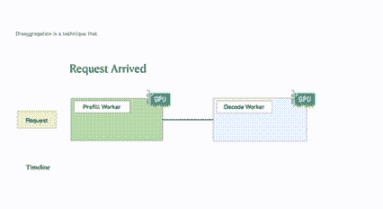

单次请求通过LLM Serving引擎并使用预填充（prefill）和解码（decode）解耦示意图

## 1 背景：吞吐量与有效吞吐量

LLM正在改变整个行业在其服务中采用AI技术的方式，但LLM serving的成本却仍然很高。为降低serving成本，目前许多公司专注于最大化整体LLM serving系统的整体`throughput`，即每秒服务的请求数量（或rps），作为最小化每个请求的成本（$/req）的代理。几乎所有流行的LLM serving引擎都把吞吐量作为比较性能的主要指标，如`vLLM`和`TensorRT-LLM`。

实际上，下游应用程序有不同类型，可能对用户体验有不同的时延要求，因此需要满足不同的`SLO`。LLM服务中最广泛使用的`SLO`包括：

+ 首词元时间（`TTFT`）：LLM为用户输出第一个生成词元所需的时间。
+ 每个词元输出时间（`TPOT`）：衡量两个连续生成的词元之间的平均时延。

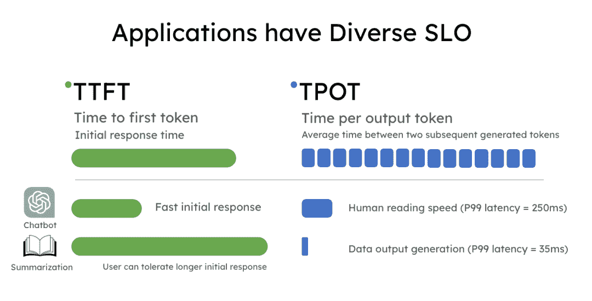

图0：应用程序有多样化的`SLO`。

吞吐量衡量的是所有用户和请求中完成的请求或词元的数量，因此忽略了这些时延要求。我们引入了有效吞吐量（`goodput`），即每秒完成请求的遵守`SLO`（`TTFT`和`TPOT`要求）的数量，并展示了它是一个更优指标，因为它捕获了在`SLO`达成下的请求吞吐量——因此既考虑了成本又考虑了服务质量。

为了简要说明有效吞吐量，可以假设一个应用要求至少90%的请求`TTFT < 200ms`以及`TPOT < 50ms`，我们得到以下定义：

有效吞吐量（`P90 TTFT < 200ms`和`P90 TPOT < 50ms`）= 当至少90%的请求同时满足`TTFT < 200ms`和`TPOT < 50ms`时，系统可以承受的每秒最大请求速率。

图1展示了一个简单案例，一个具有高吞吐量的应用，其有效吞吐量可能很低。该应用的吞吐量为每秒10个请求。但由于时延限制，只有3个请求符合`SLO`约束，得到有效吞吐量为每秒3个请求。可以想象，这个serving系统吞吐量高但有效吞吐量低，用户仍然会遭受服务质量低下的困扰。

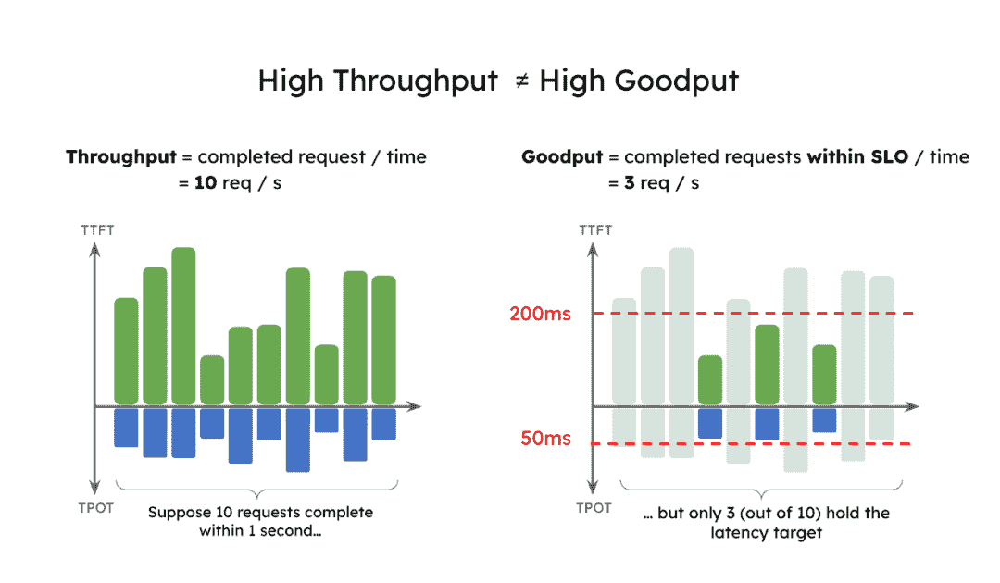

图1：高吞吐量≠高有效吞吐量。优化吞吐量的系统在某些`SLO`约束下可能具有很低的有效吞吐量。

让我们来总结下本小节引入的术语：

+ 有效吞吐量（`goodput`）：衡量LLM serving系统有效性的指标，同时考虑成本和用户满意度。它被定义为系统在满足指定`SLO`的同时，每秒可以保持的最大请求速率。
+ 吞吐量（`throughput`）：LLM serving系统每秒处理的完成请求数量。
+ 服务等级目标（`SLO`）：LLM serving系统必须满足的一组目标，以提供满意的用户体验。常见的`SLO`包括首词元时间（`TTFT`）、每个词元输出时间（`TPOT`）、端到端时延（`E2E`）和指数移动平均（`EMA`）时延。
+ 预填充：LLM推理的第一阶段，消化所有输入词元，填充`KV Cache`，并生成第一个输出词元。
+ 解码：逐个生成词元直到终止的后续阶段。
+ 首词元时间（`TTFT`）：LLM serving系统生成响应用户请求的第一个词元所需的时间。
+ 每个输出词元时间（`TPOT`）：LLM serving系统对用户请求生成后续词元的平均时间。

## 2 为什么现有系统无法实现高有效吞吐量？

### LLM请求是如何被处理的？

在深入讨论之前，让我们回顾一下LLM serving中请求的生命周期。图2显示了这一过程。当一个请求进入LLM推理引擎时，系统首先会取用户输入生成第一个词元（预填充），然后逐个自回归地生成输出（解码）。一个请求通常由一个预填充步骤和多个解码步骤组成，直到终止。

LLM serving系统通常将预填充和解码一起批处理，用一种称为`iteration-level scheduling`或`continuous batching`的技术，以便GPU处理尽可能大的批大小，运行一次迭代，并为所有这些请求生成一个词元。这种技术有效地提高了整体吞吐量（每秒词元数），并且被广泛应用于流行的serving系统，如`vLLM`和`TensorRT-LLM`。

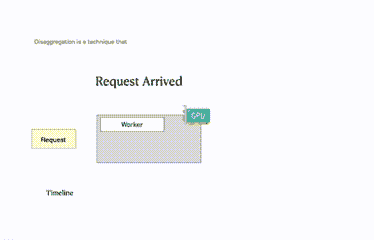

图2：传统LLM serving系统中请求的处理方式。

然而，计算中的预填充和解码阶段各具独特属性。预填充对计算资源的需求量极大，哪怕是小批次的预填充任务，甚至单个较长的预填充任务，都足以使GPU的计算能力达到饱和。与此相对，解码任务则需要更大的批大小才能充分利用计算资源，并且更容易受到GPU内存带宽限制的影响。

由于这两个阶段的计算模式和`SLO`截然不同，将它们合并处理并不是实现高有效吞吐量的最佳策略。原因如下：

+ 合并预填充和解码会导致它们之间相互干扰。
+ 合并预填充和解码会耦合它们的资源分配和并行策略。

接下来，我们将进一步阐释这些问题。

### 合并预填充和解码导致的干扰

图3以简化形式展示了预填充和解码之间的干扰情况。在图的最左侧，我们将这两个请求在单个GPU上进行批处理。可以看到，连续批处理显著增加了解码任务（`R1`）的时延，并略微增加了预填充任务（`R2`）的时延。在图的右侧，我们展示了一个稳定的传入请求流。此时，处于解码阶段的请求在每次预填充请求进入系统时都会“卡住”，因此意外地增加了解码任务的时延。

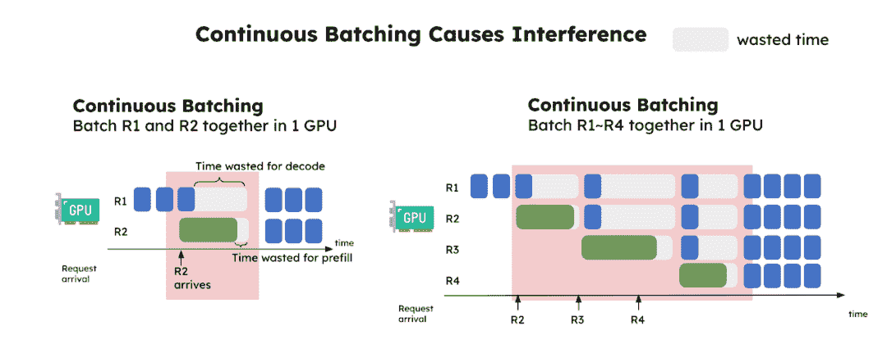

图3：连续批处理引发的干扰。

如图4所示，由于这种干扰，为同时满足`TTFT`和`TPOT`的`SLO`，系统必须过度配置资源以满足时延目标，尤其是在`SLO`要求严格的情况下。

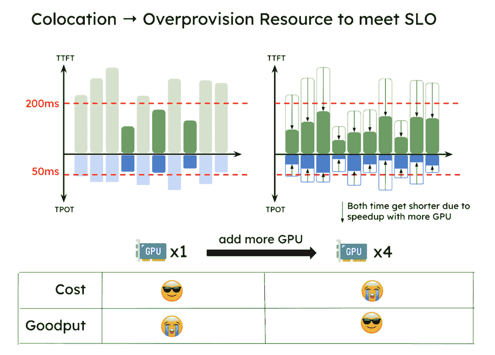

图4：为满足`SLO`目标，合并预填充和解码的系统必须过度配置资源。

### 资源分配与并行策略紧密耦合

此外，由于合并，预填充和解码计算的并行策略（张量、流水线或数据并行）本质上是耦合的。如前所述，由于它们的计算模式和时延目标截然不同，预填充和解码阶段的最优并行策略通常也不同。例如，当实时吞吐量（`TTFT`）要求严格而总吞吐量（`TPOT`）要求宽松时，预填充阶段更倾向于使用张量并行（`TP`）来满足严格的时延目标，而解码阶段则更倾向于数据或流水线并行以提高吞吐量。接下来，我们将探讨解决这些问题的新方法。

## 3 解耦预填充和解码阶段

背后的逻辑很简单：将预填充和解码解耦到不同的GPU中，并为每个阶段定制并行策略。这自然解决了上述两个问题：

1. 预填充和解码之间没有干扰，使得两个阶段都能更快地达到各自的`SLO`。
1. 资源分配和并行策略解耦，从而为预填充和解码量身定制优化策略。

图5展示了请求在这种解耦系统中被处理的方式。当一个请求进入系统时，它首先被发送到一个预填充工作器，并完成其预填充阶段。然后，系统将其中间状态（主要是`KV Cache`）迁移到一个解码工作器，并且进行多个解码步骤以生成后续词元。一旦完成生成，请求就离开了系统。

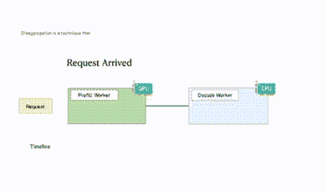

图5：当预填充/解码被解耦时，请求的处理方式。

让我们通过一个简单的实验来看看为什么解耦是有用的。我们按照`Poisson arrival`，使用输入长度为512、输出长度为64的合成工作负载，在单个`A100-80GB` GPU上运行一个13B参数的LLM。我们逐渐增加请求率（x轴），并测量两个时延（`P90 TTFT`和`P90 TPOT`，y轴）的变化，如图6所示。

假设我们将`P90 TTFT`的SLO设定为0.4秒，`P90 TPOT`设定为0.04秒（图6中的水平线）。我们观察到现有系统可以使用1个GPU，在`TTFT`时延约束内支持大约3RPS（请求率），而对于`TPOT`，则可以维持在1.6 RPS（图6a）。由于我们需要同时满足这两个约束，现有合并系统的有效吞吐量变为：`Goodput(合并) = min(3, 1.6) = 1.6 RPS`（每GPU）。

可见解耦后的性能显著提升。如图6所示，如果各自仅处理一个阶段，预填充工作器和解码工作器都能达到比之前更高的RPS。一个预填充工作器大约能够达到5.6 RPS，而一个解码工作器大约能够达到10 RPS。更为关键的是，现在我们可以灵活配置，将两个预填充工作器(2P)与一个解码工作器(1D)进行配对（记为`2P1D`），总共使用3个GPU。因此有效吞吐量变为：

`Goodput(2P1D) = min(5.6 x 2, 10) = 10 reqs/s / 3 GPUs ≈ 3.3 reqs/s (per GPU)`

该实验表明，在没有使用任何并行策略的情况下，这种简单的解耦能产生2倍的有效吞吐量。

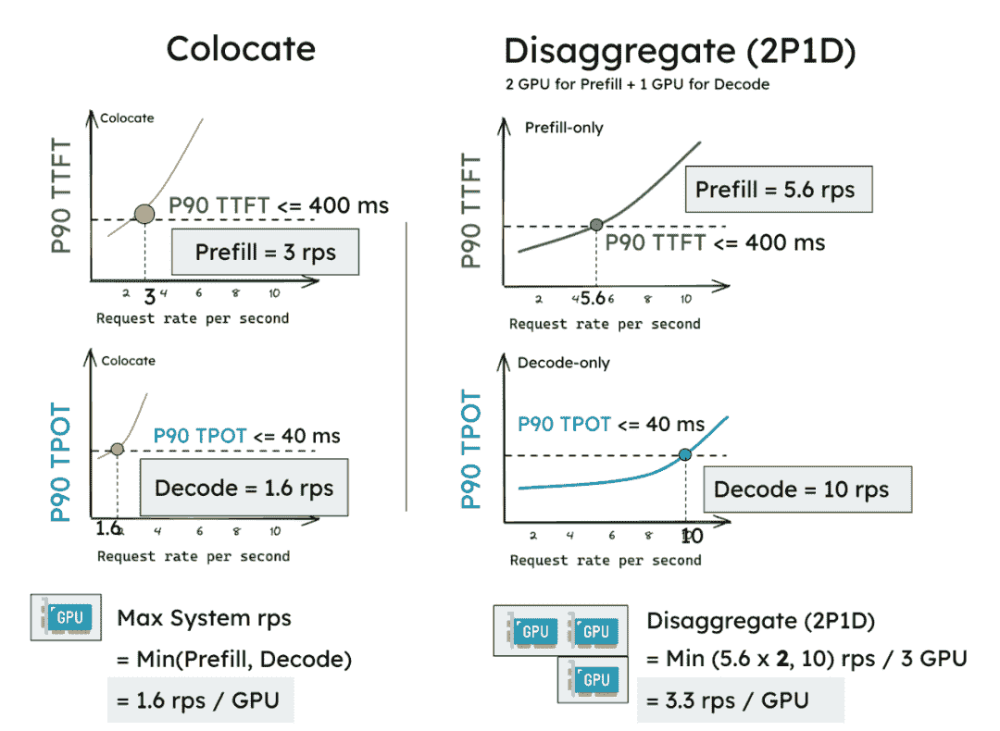

图6：合并处理(a)的灵活性比解耦（b）差，后者为预填充分配了2个GPU，为解码分配了1个GPU（计为`2P1D`）。

实际上，除了为每个阶段分配不同的资源外，解耦预填充和解码还能让我们为每个阶段选择最佳的并行策略，以优化有效吞吐量（称为“量身定制的并行策略”），我们在论文中详细研究了这一点。

### KV Cache传输

解耦造成了在预填充和解码GPU之间传输中间状态（即`KV Cache`）的成本。在LLM推理中，`KV Cache`看似是一个巨大的内存开销，而在GPU之间传输`KV Cache`则像是一种瓶颈。然而，我们展示的情况恰恰相反：通过适当的放置（`placement`），`KV Cache`传输开销可以有效地最小化，甚至低于一个解码步数的时间，这要归功于现在的高速网络，如`NVLink`和`PCI-e 5.0`。

为了更直观，假设我们有8通道`PCIe 5.0 x16`（每个链路64GB/s）作为GPU之间的节点内网络。给定一个2048词元的请求，当提供`OPT-175B`的请求时，传输的`KV Cache`预计如下：

`2048 token *（4.5 MB/token）/（64GB/s * 8）= 17.6 ms`

该时延小于`OPT-175B`的单个解码步数时间（在`A100`上约为30-50ms）。对于更大的模型、更长的序列或更先进的网络（例如，带宽为600GB/s的`A100-NVLink`），如图7所示，与单个解码步数相比，与`KV Cache`传输相关的比较性计算开销变得不那么显著。总之，通过精心放置预填充和解码工作器来利用高带宽网络，可以有效地隐藏`KV Cache`传输开销，这在我们的论文中有详细讨论。

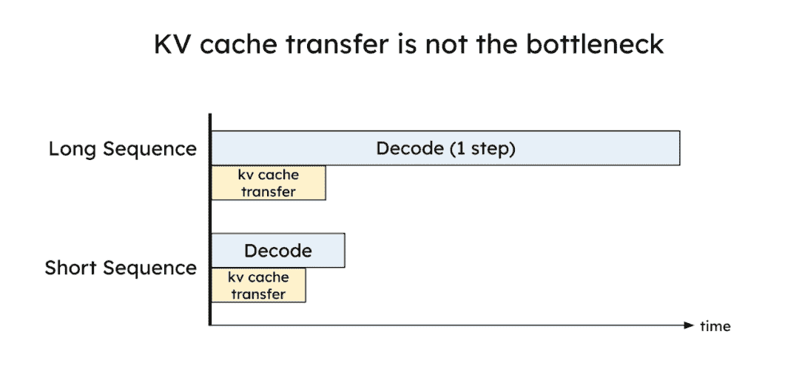

图7：`KV cache`传输开销可以有效地最小化，直至低于解码步数的时间。

### DistServe：评估解耦的有效性

我们在名为`DistServe`的系统原型中实现了这一技术，并将其与现有系统在三个具有不同时延约束的工作负载和数据集上进行了比较：聊天机器人、代码补全和摘要生成，如下表所示。

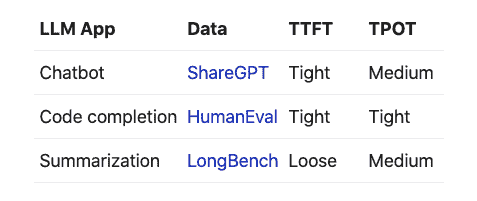

表8：我们评估中的工作负载和时延要求。

图9展示了`DistServe`与`vLLM`的比较结果：

+ 聊天机器人：`DistServe`的吞吐量比`vLLM`高2.0倍至3.41倍。
+ 代码补全：`DistServe`的吞吐量比`vLLM`高3.2倍，其SLO比`vLLM`严格1.5倍。作为一个实时编码助手，代码补全任务所要求的`TTFT`比聊天机器人更低，这导致两个系统最终都受到`TTFT`要求的限制。然而，通过消除解码作业的干扰并为预填充定制张量并行性，`DistServe`减少了预填充作业的平均时延，从而满足了更多请求的`TTFT`要求。
+ 总结：`DistServe`的吞吐量比`vLLM`高4.48倍，其SLO比`vLLM`严格10.2倍。正如预期的那样，由于`vLLM`将预填充和解码合并在一起，其解码的降速幅度更大，无法满足`TPOT`的要求。请查看我们的技术报告获取更详细的实验结果。

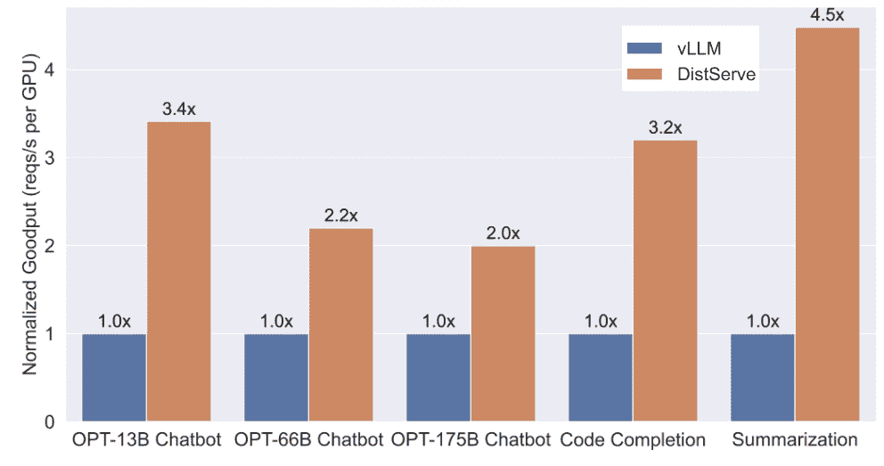

图8：在各种数据集上评估`DistServe`与`vLLM`的性能。

### 解耦与分块预填充

本节将预填充-解耦与动态分割（`dynamic splitfuse`）或称分块预填充（`chunked prefill`）和捎带确认（`piggybacking`）的最新方法进行比较，并讨论它们各自的优缺点。

动态分割的关键是将较长的预填充分成更小的块（`chunk`），从而通过将预填充块与多个解码任务组合形成批处理，并充分调动GPU，这个过程称为捎带确认（`piggybacking`）。块大小是根据工作负载有意选择的，以便这种方法在所有步数上都能充分利用GPU，从而提高整体的系统效率。然而，它可能会增加`TTFT`和`TPOT`，进而在时延约束下减少吞吐量。这是由于动态分割无法完全解耦预填充和解码操作，导致资源争用以及`TTFT`与`TPOT`之间的妥协。

对于`TTFT`，分块预填充会导致预填充的计算开销（因此`TTFT`较高），不管块大小如何。

首先，选择明显低于GPU饱和点的块大小会延长预填充任务的执行时间。例如，假设GPU在预填充长度为512时饱和，将块大小设置为256将使所有超过512的预填充的`TTFT`翻倍。

其次，即使块大小被优化到几乎最大化GPU使用率，分块预填充也会显著增加预填充任务的内存访问量，因为需要将`KV Cache`从GPU的`HBM`加载到`SRM`以用于每个后续块。对于更长的预填充，这种情况更会加剧，导致`KV Cache`加载操作呈二次增长，而不是线性增长，由于解码词元槽的限制，附带的机会也会减少。至于`TPOT`，正如之前所言，将预填充和解码在批次中合并实际上会降低所有这些解码任务的速度。

总之，分块预填充可能有助于最大化整体吞吐量，但当应用程序无法在`TTFT`和`TPOT`之间进行权衡，而是要同时遵守这两者时，解耦就成为更好的选择。

## 4 DistServe的现状

我们正在与`vLLM`社区合作，将所提出的技术整合到`vLLM`生态系统中。

与此同时，`Splitwise`、`TetriInfer`和`DéjàVu`也采用了这种解耦策略，将预填充与解码分开，以实现更好的LLM serving有效吞吐量。我们很高兴看到许多研究人员和公司都用解耦来优化系统吞吐量，我们相信，解耦很快将成为LLM serving引擎的首选。

致谢：感谢`Vikranth Srivatsa`、`Lanxiang Hu`和`Will Lin`为这篇博客提供了独到的见解和反馈。

【语言大模型推理最高 加速11 倍】`SiliconLLM`是由硅基流动开发的高效、易用、可扩展的LLM推理加速引擎，旨在为用户提供开箱即用的推理加速能力，显著降低大模型部署成本，加速生成式AI产品落地。（技术合作、交流请添加🛰️：`SiliconFlow01`）

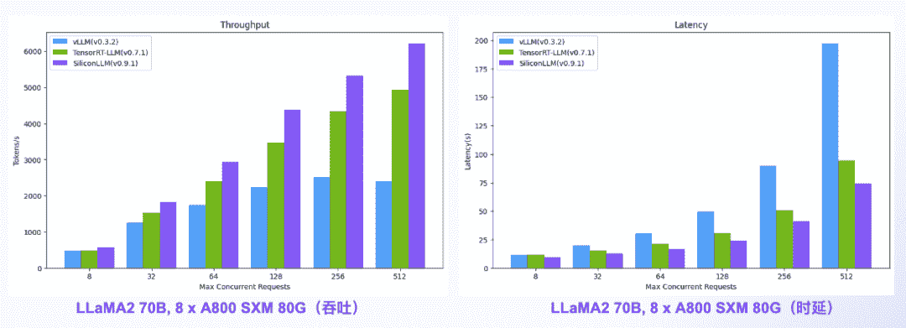

`SiliconLLM`的吞吐最高提升 2.5 倍，时延最高降低 2.7 倍

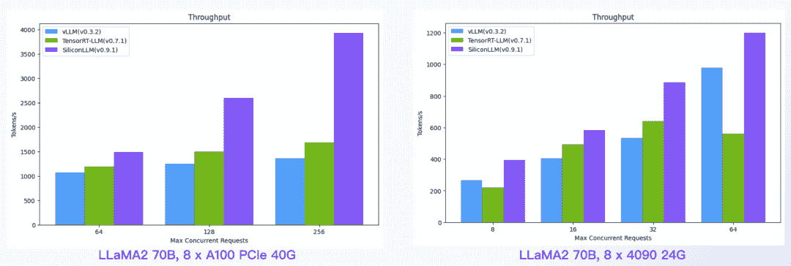

数据中心+PCIe：`SiliconLLM`的吞吐最高提升 2.8 倍；消费卡场景：`SiliconLLM`的吞吐最高提升 1.7 倍

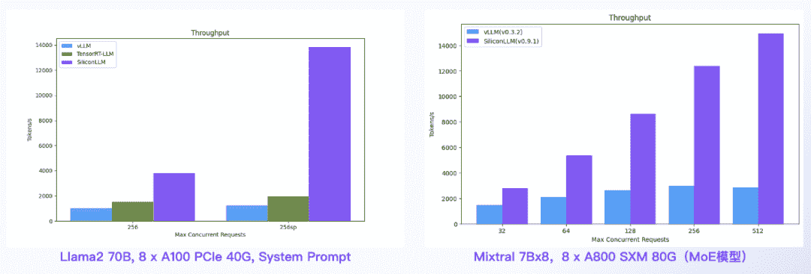

System Prompt场景：`SiliconLLM`的吞吐最高提升 11 倍；MoE模型：推理`SiliconLLM`的吞吐最高提升 5 倍

其他人都在看

+ [800+页免费“大模型”电子书](http://mp.weixin.qq.com/s?__biz=MzU5ODY2MTk3Nw==&mid=2247493221&idx=1&sn=0c75b8115f4d4a27c8a5d6505a0a4986&chksm=fe426853c935e145d21abd30e0ceb29486c9e306032dfcb3d071ce34d171425c11341a57d7bf&scene=21#wechat_redirect)
+ Stable Diffusion XL优化终极指南
+ LLM推理入门指南③：剖析模型性能
+ 2人AI团队被收购；3款AI搜索引擎对比
+ OneDiff 1.0发布！稳定加速SD/SVD模型
+ 生成式AI产业经济学：价值分配与利润结构
+ OneDiff加速无界AI，50s让彩铃变身短视频
