# LLaMA 3：大模型之战的新序幕

> 来源：[https://agijuejin.feishu.cn/docx/FYFLdZHUgoR13cxmokVcC04HnTc](https://agijuejin.feishu.cn/docx/FYFLdZHUgoR13cxmokVcC04HnTc)

> 作者：符尧 | OneFlow

> 翻译：杨婷、宛子琳、张雪聃

> 原文：https://mp.weixin.qq.com/s/PTpNqqH6lOZH5omoq5qqjQ

---

**本文要点概览：**

+   文本数据的扩展可能已经达到了极限，因为易于获取的网络文本资源（如Common Crawl、GitHub、ArXiv等）已基本被充分利用。

+   尽管如此，通过更深入地挖掘互联网资源、搜寻图书馆藏书及使用合成数据，我们仍有望获得新的文本数据，但要实现数据量级的大幅提升却面临重重挑战——这些新增的数据更可能是当前数量级上的增量。

+   规模扩展竞赛的新阶段将转向多模态领域，尤其是统一的视频-语言生成模型，因为仅有视频数据可以实现数量级的增长。

+   然而，坏消息是，视频数据似乎并不能显著提升模型的推理（reasoning）能力，而这一能力是区分模型强弱的首要指标。

+   但好消息是，视频数据能够带来其他性能的显著提升，尤其是增强了模型与现实世界的联系，展现出成为神经世界模型（neural world model）的巨大潜力（与Zelda等硬编码物理引擎不同），这提供了从模拟物理反馈中学习的可能性。

+   从X （ X表示 人类、人工智能和环境反馈） 反馈中扩展强化学习可能是持续提升模型推理能力最有前景的路径。

+   类似于AlphaGo Zero在围棋领域取得的超人类成就，自我对弈和与环境互动可能是超人类生成模型的一个方向。使模型保持在线状态，并从反馈中进行迭代学习（而非一次性的离线优化），有望实现推理能力的持续提升。

+   规模扩展竞赛的第一阶段聚焦于扩展文本数据，在GPT-4达到顶峰，并由LLaMA 3画上句号。接下来的第二阶段将聚焦于统一的视频-语言生成模型建模，以及基于X反馈的迭代强化学习。

（本文 作者为 符 尧是 爱丁堡大学博士生。 本文 由 OneFlow编译发布，转载请联系授权。原文： https://yaofu.notion.site/Apr-2024-Llama-3-Opens-the-Second-Chapter-of-the-Game-of-Scale-efff1c0c185f4008af673b78faf83b61 声明：本文是作者阅读LLaMA 3的发布说明后，对将来工作方向的研究笔记。文中提出的观点可能与现行观点存在差异，欢迎批评指正。）

## **1 ****LLaMA 3的性能如何？**

LLaMA 3的性能相当不错。

在评估基础模型时，我们会关注MMLU、MATH、GPQA和BBH等关键指标，因为这些指标能够衡量模型的高级知识与推理能力。目前的排行榜如下：

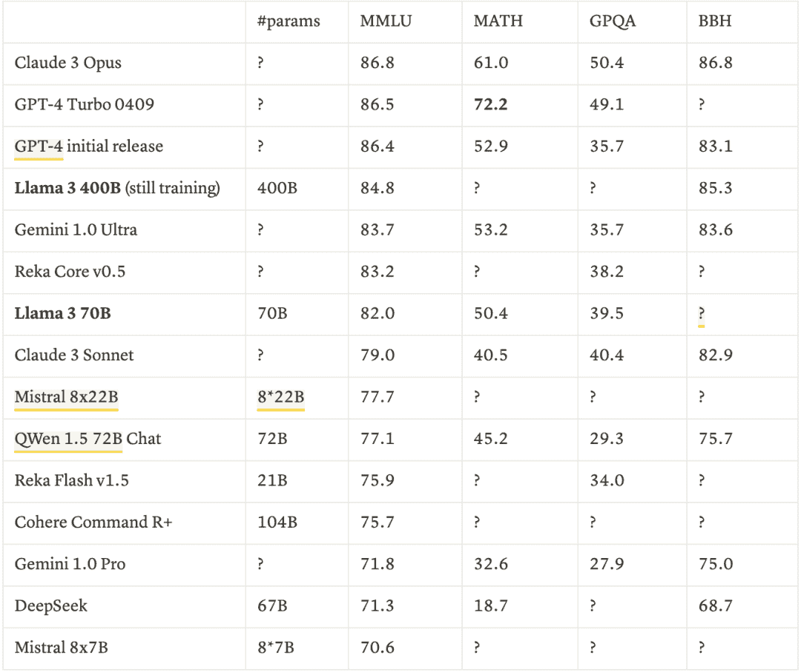

LLaMA 3 70B的一个显著特点是，其性能明显优于其他同级别的70B模型（其MMLU通常在70+左右），并进入了80+ MMLU的前沿模型领域。

LLaMA 3 70B模型之所以能在MMLU上取得如此优异的成绩，可能有以下两个原因：

+   它使用了 15T 的训练词元，这一数量远远超过了其它同类模型。

+   特别是 混合代码与arxiv数据 可能提升了模型的推理能力。

+   它采用了 与基准测试相关的持续预训练数据。 （如 Llemma / MetaMath / Mammoth ）来提升或优化基准测试的表现。

+   然而，当模型得分达到80+之后，尽管并非不可能实现，但要进一步提升MMLU的得分将极具挑战性，因为MMLU数据集本身的难度就相当高。

LLaMA 3  chatbot 版本 的 表现也相当好。

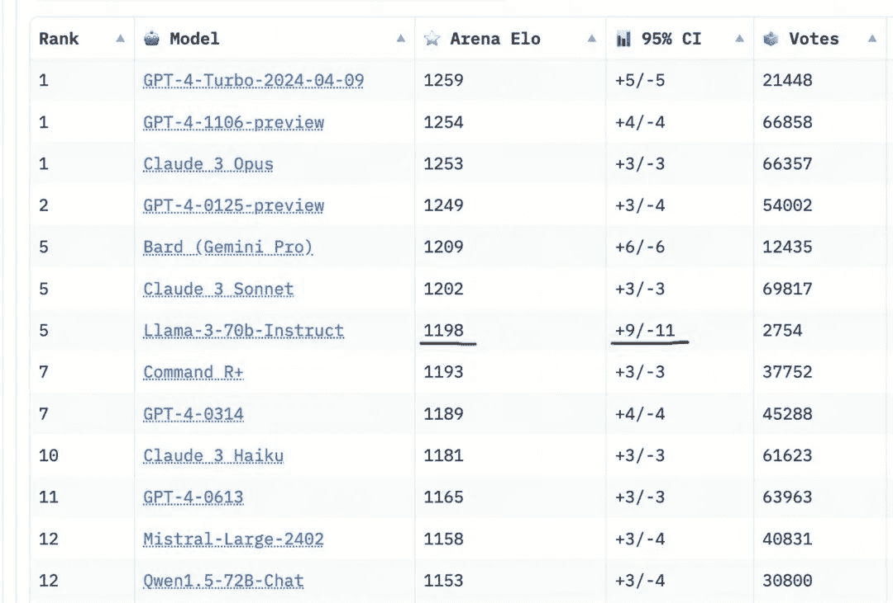

需要注意的是，虽然在LLaMA 3发布后不久，其评分呈明显的上升趋势，初始排名大约在第三位（通过文本的特定模式，我们可以轻易评断LLaMA 3给出的答案），但现在其ELO分数正逐渐下降。尽管如此，其置信区间仍为（+9/-11），远远高于其他模型的(+5/-5)，因此它的排名可能会继续下降。

+   LLaMA 3的初始排名上得到了较少的投票，且排名升降幅度较大。

实际上，完全没有必要对其性能进行夸大或者虚增分数，因为LLaMA 3本身已经是一个非常出色的模型，这样做可能会增加其在公众中的声誉（或许不会），但肯定会损害在专业人士中的声誉。再次强调，LLaMA 3已经是目前最强的开源大模型。

我预计，它最终的ELO分数可能会稳定在GPT-4 0314版本的1180分左右，这与Claude 3 Haiku的性能相当，同样是一个非常好的成绩。

## **2 ****文本数据扩展的极限**

文本数据扩展的极限可能已经到来。因为我们注意到GPT-4 Turbo、Gemini Ultra、Claude 3 Opus和Llama 3 400B的性能都在大致相同的范围内（MMLU约为85）。要继续扩大文本规模，就需要更多的数据，但问题在于，是否能大幅增加文本数据量，超过LLaMA 3的15T词元。

以下是按照新数据潜在规模排名的几个方向：

+   Common Crawl（CC）仅覆盖了 整个互联网数据的一部分 。

+   我们尚未 完成从CC中挖掘和抓取数据 。

+   放宽过滤和去重标准。

+   利用现有模型生成 合成数据 。

+   从图书馆中搜寻更多书籍。

接下来，本文将逐一探讨这些方向。

Common Crawl只是互联网数据的一部分

+   Common Crawl是文本规模扩展最大的不确定因素，因为我们不知道实际的互联网数据有多大。

+   微软、谷歌和Meta等公司可以轻易获取超出CC范围的更多数据。

+   但问题在于，经过去重和质量过滤之后，还能剩多少词元。

**我们仍在从CC中挖掘数据 **

+   这种方法的问题在于，我们能够从现有CC中生成的词元数量受到数据处理流程上限的约束，因此在数据的数量级上可能不会发生变化。

+   新的CC数据随着时间线性增加，但数量级上没有变化。

+   但规模定律（scaling law）表明，数据呈指数级增长会带来性能的线性增长。因此，最终我们可能会在LLaMA 3 15T的数据基础上增加5T的新词元，但我们真正想要的其实是再增加50T词元。

**放宽过滤和去重标准 **

+   原始数据量十分庞大，因为数据质量以及重复的问题，我们并未使用全部数据。 百川智能的报告 展示了过滤对最终词元数量的影响：

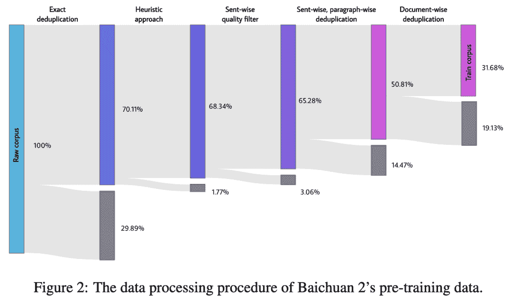

+   如何确定数据质量与去重标准，这个问题有待研究（参见 Shayne等人 ， Muennighoff等人 和 Xue等人 ）。一般来说，标准可能不宜过于宽松。

**使用合成数据 **

+   近 期， Liu等人 针对合成数据进行了很好的总结，重点介绍了推理、工具使用、多模态、多语言和对齐数据的数据来源。

+   核心挑战依然存在：目前大部分数据研究似乎还未能实现量级突破，因此它们主要被用于持续预训练和微调，而非直接用于预训练。

+   唯一的例外是 Phi模型系列 ，因为他们使用GPT-4生成的数据来训练一个更小的模型。不过这种方法的问题在于能否扩展到更大的模型，并打破GPT-4的上限。

**搜寻更多的图书馆藏书**

+   这一方向显然是有希望的，因为图书馆书籍的数据质量绝对是极高的，比网络数据的质量高得多，并且可以显著提高专业知识基准分数，如MMLU。以下是世界上最大的图书馆列表：

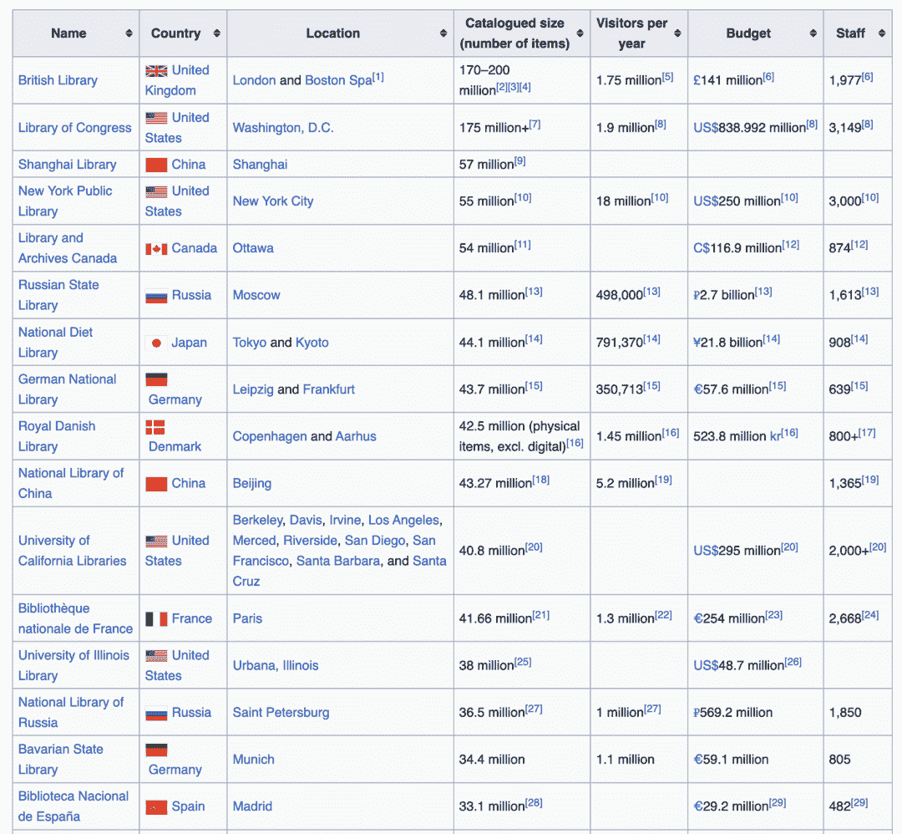

+   但问题不在于技术方面。从这些图书馆购买版权可能会耗费全部的AI投资成本，且其中很大一部分并不对外出售。此外，如果平均每本书有70K词元，那么2亿本书则只有约14T词元，虽然这一数字是现有数量的两倍，但还不够多。

## **3 **扩展规模肯定没错，但接下来该扩展什么呢？

前文已经讨论得出结论，GPT-4级别的前沿模型很可能已经接近文本规模的上限，而进一步扩展文本数据可能会遇到更加艰巨的挑战（但也仍然可能是一种方法）。我们当然希望继续这场狂欢，因为规模扩展是不变的法则，它始终能够生效，但问题在于下一步该扩展什么数据。

视频数据可能不会改善推理能力，但可以提升其他方面

+   一个明确的方向是多模态数据，尤其是视频数据。据推测，YouTube和TikTok的规模可能比文本大几个数量级，这就是新的数量级来源。但这种方法存在一个挑战：多模态数据是否能提升基于文本的推理能力？

+   答案很可能是否定的。接着就是一个现实问题：如果OpenAI下个月发布GPT-5，其MMMU得分从56提高到70，但MMLU仍然保持在86，这意味着什么？公众会作何反应呢？

+   MMMU排行榜 截图

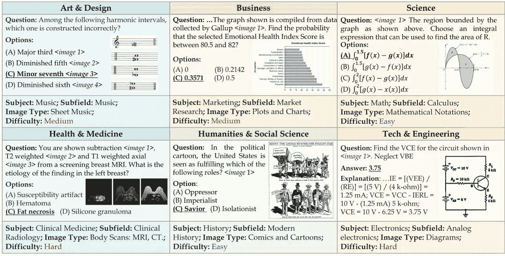

+   然而好消息是，即使视频数据不能提高推理能力，也可以改善其他方面的性能，尤其是接地信息（grounding），从而使模型能够接收来自现实世界的反馈。

要提高推理能力，需要在强化学习中扩大探索和利用的规模

+   具体来说，可能需要扩展：

+   模型探索的时间跨度。例如，将模型在线部署一年并每周更新，而不只是进行单步优化。

+   模型的搜索空间。例如，让模型生成一百万个响应，并从中选择最佳响应，而不是原始InstructGPT的七选一方法。

+   模型的反馈来源。主要指逐渐从人类反馈转向人工智能和环境反馈（因为人类反馈不具备可扩展性，且模型正在变得比其人类标注者更强大），因此需要世界模型。

+   很不幸的是， **许**多现有的研究工作都集中于微小细节的小规模单轮优化，比如在DPO上添加一个损失项。然而，关键在于在线迭代式的大规模探索和利用 。

## **4 ****扩展统一的视频-语言生成模型**

那么，只是扩大视频-语言模型的规模？听起来并不是很难？

目前的情况是，在文本扩展领域，我们拥有十分标准的架构（MoE transformer）、标准的目标（下一个单词预测），以及标准的pipeline（预训练后再对齐），而在视觉/多模态生成模型中，情况却不尽相同。其设计空间比语言模型大得多，我们甚至未能在一些基本问题上达成共识，例如：

+   我们应该像LLaVA目前的做法一样，先在各自的模态上进行训练，然后使用适配器来桥接模态，还是应该直接在所有模态的混合上进行训练？

+   在图像/视频部分，我们应该使用统一的Transformer核心结构，还是一些计算机视觉技术，如UNet和CNN？我们应该对Transformer架构进行哪些修改（如3D位置编码）？如何充分利用混合专家层？

+   增加新的模态至少不应该对现有的模态造成负面影响，然而常见的情况是，增加视觉可能会对语言产生负面影响。如何调和不同模态之间的矛盾？

+   对于视频理解部分，如何进行分词/表示学习？应该考虑使用类似VQ-VAE的离散词元，还是类似Sora的连续时空块？应该使用类似CLIP的对比式目标，还是类似原始VAE的重构式目标？

+   对于视频生成部分，应该像VideoPoet那样是自回归的，还是像Sora那样基于扩散的？如何训练一个可以同时执行扩散式生成和自回归式生成的Transformer模型？

最终的解决方案也许非常简单，只需要修改现有解决方案的一小部分，但要确定这些细小而关键的修改，社区需要对这些问题进行饱和式研究。

## **5 ****通过从X反馈中进行迭代强化学习**

## 生成类似于AlphaZero的智能体

我们已经讨论过用于预训练的新数据可能有限，以及多模态可能不会改进推理能力，为了进一步提高推理能力（毕竟这是语言模型的核心能力），我们将焦点转向了扩展强化学习。

问题又回来了，要扩展什么呢？好消息是，基本上强化学习中的任何维度都可以和应该被扩展。我们首先要讨论一个特定的指标：pass@K，它表示在K次尝试中，模型至少成功一次的概率。DPO的优化基准是pass@2（选择一个好的回答，拒绝一个不好的回答），而InstructGPT的基准是pass@7（从7个候选项中选择最佳的一个回答）。

如果我们将K值扩展到1百万，会发生什么呢？

从AlphaCode论文中，可以看到当扩展K值时，模型的通过率不断提高：

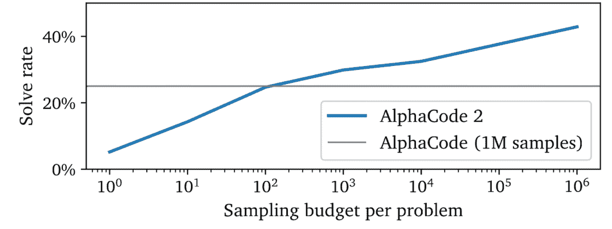

Yuxuan Tong（ https://www.notion.so/Scaling-up-k-in-Pass-k-on-MATH500-5c44436a2cd643b381e74427e7f7b14f?pvs=4 ）在数学上验证了DeepSeek和Mistral在扩展搜索空间K时不断改进的情况：

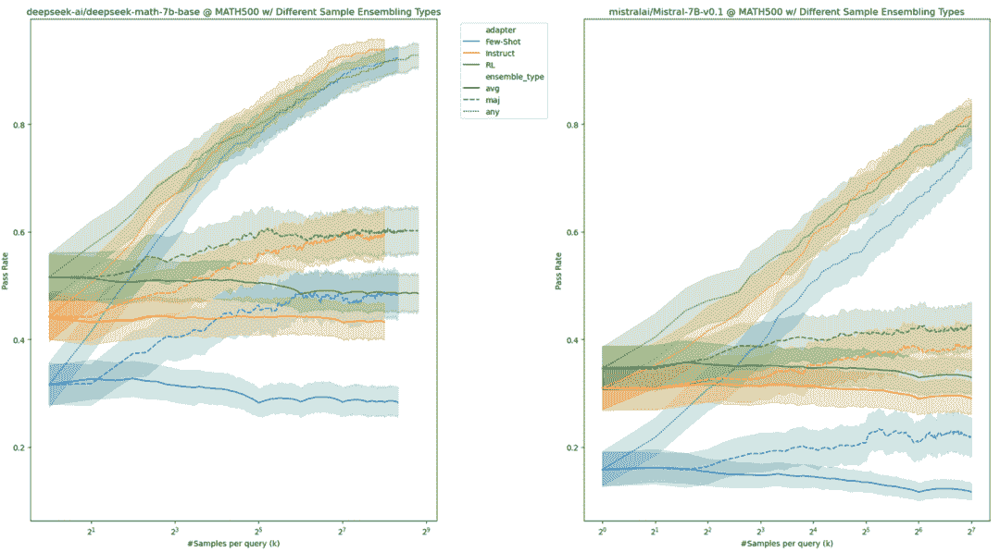

显然，曲线尚未达到饱和状态。

一个直接的问题是，如何从一百万个候选项中选择最佳的一个回答？通过跟踪GPT-4在2023年3月至2024年4月期间的数学性能改进，我们可以来了解其方法：

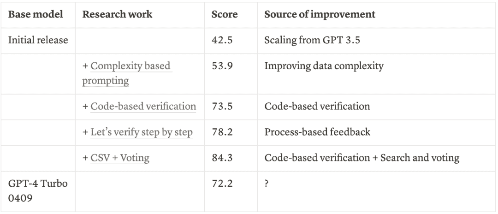

这些改进显示：

+   用基于代码的反馈来验证答案

+   用基于过程的奖励模型来验证答案

+   用专家级注释来生成反馈

值得注意的是，这些改进不是一次性优化的结果，而是通过多轮优化逐步完成的，Anthropic将其称为在线迭代RLHF（ https://arxiv.org/abs/2204.05862 ）：

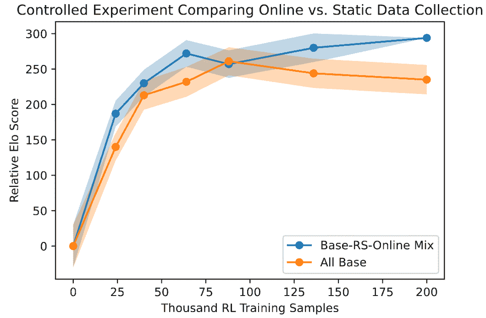

Claude-1的在线迭代RLHF

LLaMA 2的实践也验证了迭代改进的有效性：

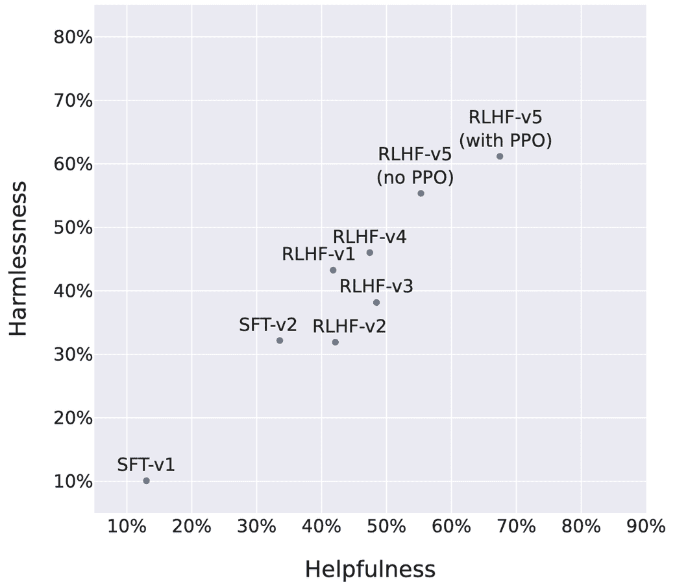

LLaMA 2在多个版本上的迭代改进

以及Shangmin（ https://arxiv.org/abs/2402.04792 ）的在线AI反馈：

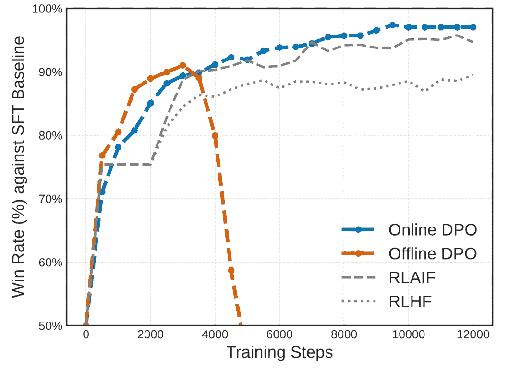

## **6 ****结论：规模扩展竞赛的第二阶段**

实际上，人类接近文本数据的极限这一事实，OpenAI在 2022 年中旬就已经意识到了，当时他们已经完成了GPT-4初始版本的训练。现在是2024年4月，随着LLaMA 3的发布，是时候总结规模扩展之战的第一阶段了，在这一阶段中，大多数前沿模型都与GPT-4达到了同等水平。

2023年，多模态生成模型的竞争已经展开，其中以图像能力为起点。目前，只有Gemini 和Reka 能够理解视频（但不能生成视频），而Sora似乎是唯一能够生成长达一分钟视频的模型（但仅限视频）。此外，只有GPT-4 Turbo、AlphaCode和DeepSeek Math探讨了如何扩展搜索空间和反馈信号，而只有GPT-4和Claude报告了在线迭代RLHF的详尽结果。

大模型规模扩展竞赛的第二篇章现已揭开序幕。

其他人都在看

+   [800+页免费“大模型”电子书](http://mp.weixin.qq.com/s?__biz=MzU5ODY2MTk3Nw==&mid=2247493221&idx=1&sn=0c75b8115f4d4a27c8a5d6505a0a4986&chksm=fe426853c935e145d21abd30e0ceb29486c9e306032dfcb3d071ce34d171425c11341a57d7bf&scene=21#wechat_redirect)

+   [LLM推理的极限速度](http://mp.weixin.qq.com/s?__biz=MzU5ODY2MTk3Nw==&mid=2247493798&idx=1&sn=fd8ebc4a203841b6129ad155ce45623a&chksm=fe426690c935ef8683da29629b1f01ec8ca352a2c7a87bb0a9a9aaf7c46f99679a6be07722d5&scene=21#wechat_redirect)

+   Stable Diffusion XL优化终极指南

+   强化学习之父：通往AGI的另一种可能

+   LLM推理入门指南②：深入解析KV缓存

+    仅需50秒，AI让你的通话彩铃变身短视频

+   OneDiff 1.0发布！稳定加速SD/SVD模型