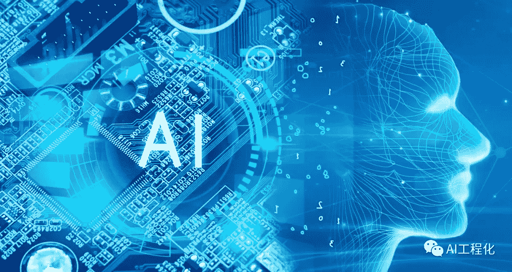
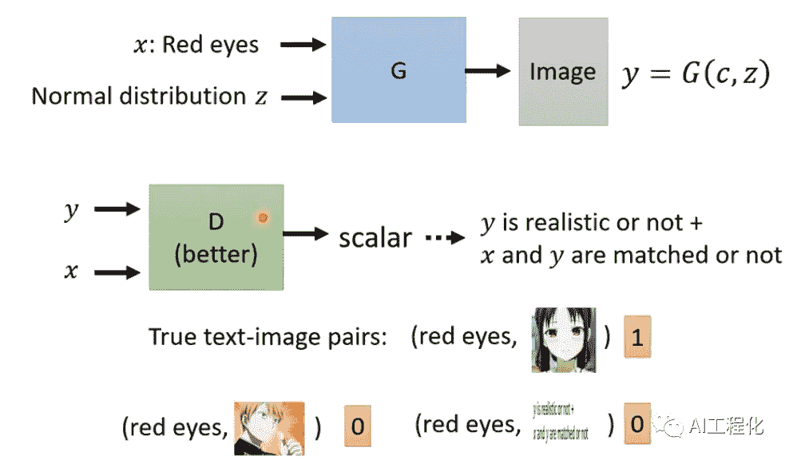
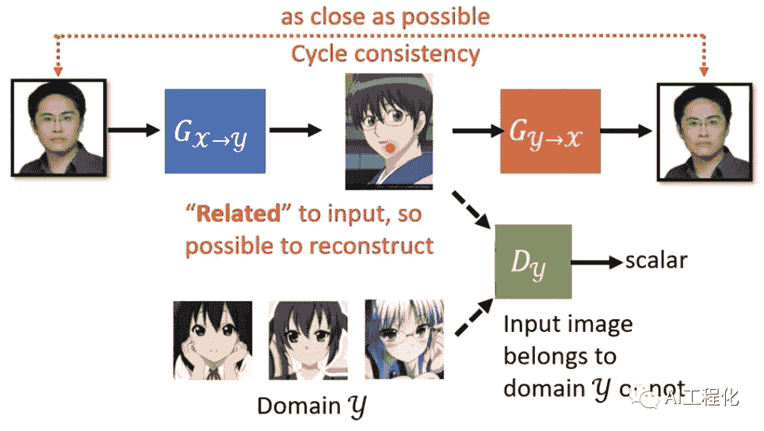
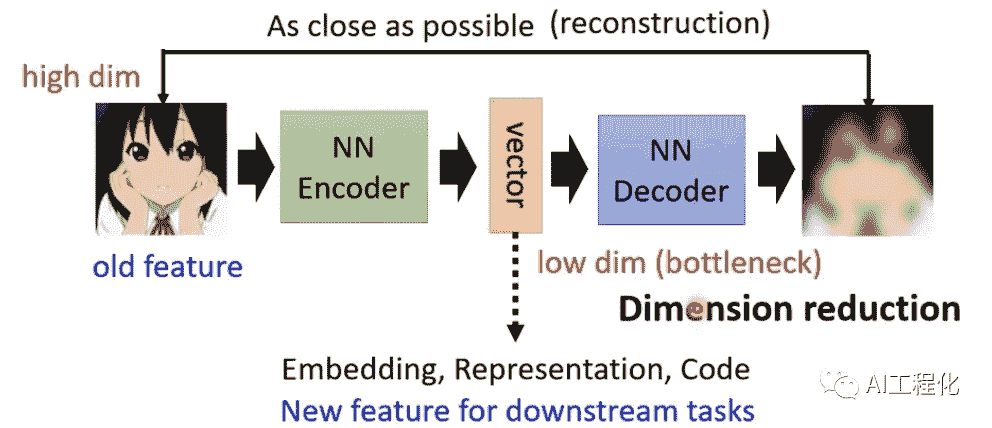
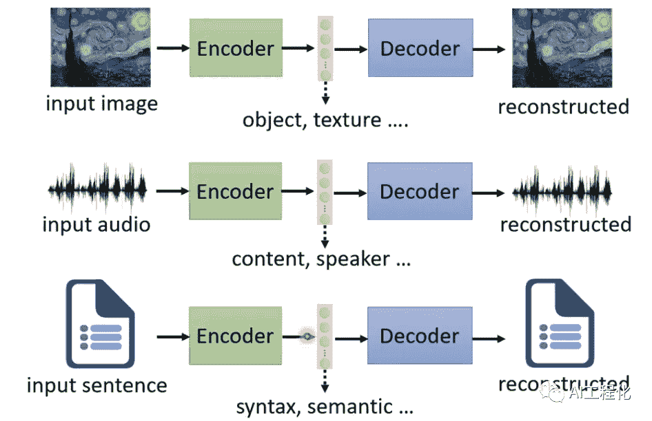
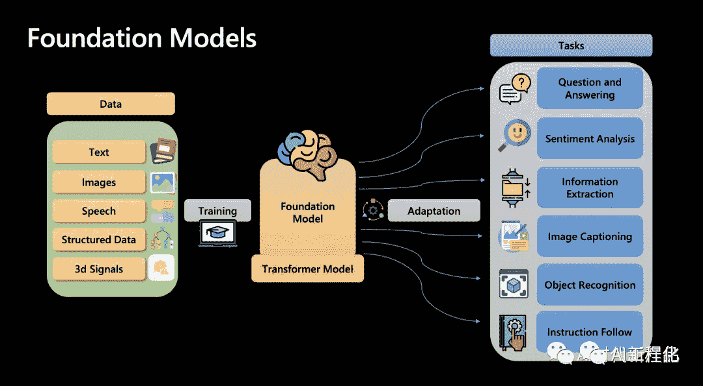
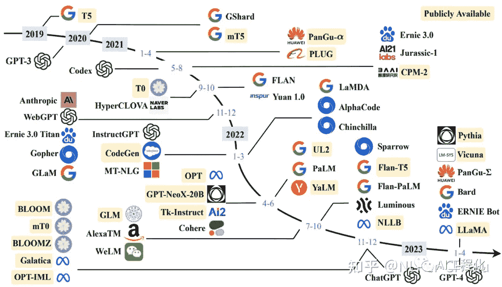

# 一文探秘LLM应用开发

> 来源：[https://agijuejin.feishu.cn/docx/Gd9od4tUcoefhcxmExOcH3YUnKE](https://agijuejin.feishu.cn/docx/Gd9od4tUcoefhcxmExOcH3YUnKE)

> 作者：ully | AI工程化

> 原文：https://mp.weixin.qq.com/s/WGjFWE4RYH7ldEz1_maj5w

本文旨在让无大模型开发背景的工程师或者技术爱好者无痛理解大语言模型应用开发的理论和主流工具，因此会先从与LLM应用开发相关的基础概念谈起，并不刻意追求极致的严谨和完备，而是从直觉和本质入手，结合笔者调研整理及消化理解，帮助大家能够更容易的理解LLM技术全貌，大家可以基于本文衍生展开，结合自己感兴趣的领域深入研究。若有不准确或者错误的地方也希望大家能够留言指正。

本文体系完整，内容丰富，分多次连载 。

> 第一部分 基础概念

> 1.机器学习场景类别

> 2.机器学习类型(LLM相关)

> 3.深度学习的兴起

> 4.基础模型

> 第二部分 应用挑战：

> 1.问题定义与基本思路

> 2.基本流程与相关技术

> 1）embbeding与tokenization

> 2）向量数据库

> 3）finetune（微调）

> 4）模型部署与推理

> 5）prompt

> 6）编排与集成

> a. langchain

> 1.1. models

> 1.2. prompts

> 1.3. memory

> 1.4. indexes

> 1.5. chains

> 1.6. agents

> 1.7. callbacks

> b. llama-index

> 7）预训练

> 场景案例（语义检索系统）

> 常用参考（好工具/好网站/好文章）

# **第一部分 基础概念：**

## **1.机器学习场景类别**

AI2.0时代到来，而AI1.0和AI2.0的区别是什么？基于场景类别来看，可以是很好的判别方法。在过去以alphaGo为代表的1.0时代，人工智能场景多以判别式AI为主。而到了2.0时代，以LLM（large language model）为代表的生成式AI有了大的发展。两者各有特点，关注的问题不同，相对于判别式ai需要大量的标注，模型泛化能力差，看起来不那么AI，而生成式AI的不同于判别式AI的技术特点和场景应用，特别是openAI开发的chatgpt惊艳产品效果，让大众认为这一次的技术不再是简单炒概念，而更接近于AGI（通用人工智能），因此也让AI迎来了新的一轮关注。

+   判别式(Discriminative AI)（分类/回归/识别/定位），传统机器学习应用场景，适合决策分析场景。

+   生成式(Generative AI)（LLM兴起），多模态，泛化性，具有创造力，有智能涌现现象。

> 来自ChatGPT：

> 生成式AI（Generative AI）和判别式AI（Discriminative AI）是两种不同的机器学习方法，它们在许多应用中都发挥着重要作用。下面是这两种方法的对比：

1.  **任务定义 **：

+   生成式AI：生成式模型关注数据的概率分布，它试图学习输入数据和输出标签之间的联合概率分布。这使得生成模型可以生成与训练数据类似的新数据。

+   判别式AI：判别式模型关注条件概率，它试图学习输入数据在给定输出标签下的概率分布。这使得判别模型更擅长在给定输入数据的情况下预测输出标签。

1.  **模型示例 **：

+   生成式AI：生成式对抗网络（GANs）、变分自编码器（VAEs）、隐马尔可夫模型（HMMs）和朴素贝叶斯分类器（Naive Bayes）等。

+   判别式AI：支持向量机（SVMs）、逻辑回归（Logistic Regression）、神经网络（Neural Networks）和决策树（Decision Trees）等。

1.  **优缺点 **：

+   生成式AI：

+   优势：生成式模型可以生成新的数据，适用于无监督学习任务。它们还能够处理丢失或不完整的数据。

+   劣势：生成式模型通常需要更多的计算资源和训练时间。在某些任务中，生成式模型的性能可能不如判别式模型。

+   判别式AI：

+   优势：判别式模型在分类和回归任务中通常具有更好的性能。它们往往需要较少的计算资源和训练时间。

+   劣势：判别式模型无法生成新的数据，且在处理丢失或不完整的数据时可能表现不佳。

1.  **应用场景 **：

+   生成式AI：图像生成、自然语言生成、音频合成、数据增强等。

+   判别式AI：图像分类、文本分类、情感分析、语音识别等。

> 总之，生成式AI和判别式AI在不同的任务和应用场景中各有优势。在选择合适的方法时，需要根据具体问题和需求进行权衡。

## **2.机器学习类型(LLM相关)**

大模型应用涉及到以下三类机器学习方法：

+   无监督学习（机器根据一定规则自己构造label）

+   监督学习（人为标注label）

+   强化学习（基于环境反馈）

其中，预训练阶段采用无监督学习的方法，通过在大量无标注语料（多来自于互联网维基百科，github等等）中学习规律，在这一过程中，其并不是真的无监督，而是通过一些设计，如bert采用的句子填空，gpt采用文字接龙的方式来达到机器自我训练的目的。这一过程可以理解为是一个数据压缩的过程，使得海量的数据被压缩到一个模型中，自然可以理解，语料足够多，模型足够大的时候，那么模型可以蕴含语料中暗藏的逻辑和知识。

不进行监督学习的大模型可以认为是个哑巴，它无法完整特定的任务，需要监督学习的方式，给模型一些例子或者步骤（数据集是需要人工标记的），帮助大模型知道如何输出，怎么样思考，从而应对不同的应用场景，如对话，翻译等，这就是“对齐（alignment）”的概念。

强化学习更多是在这个基础上的再完善，不直接给出正确的答案，而是由模型生成，然后对答案进行打分，从而让大模型能够更好的适应按照用户的喜好来工作。

## **3.深度学习的兴起**

1.为什么要用深度学习？

+   深度学习对特征工程要求更低，强调模型架构的设计。

+   经典机器学习如lr等，模型容量有限，存在模型bias，弹性不足。

+   深度学习模块化更好 ，能够以统一的模式更好得搭建复杂的模型结 构。

+   深度学习久来有之，早期算力不足，限制了他 的发展。

2.tranformer源起

发展轨迹：cnn（无记忆） => rnn（串行，短期记忆） => lstm（较长期记忆） => transformer（位置编码，并行，快）

特点：对位置，上下文编码，能够融会贯通。transformer更利于并行计算，算力的提升，使得tranformer的流行。

尽管如此，当前模型输入仍然有token数量限制。所谓token，本质就是输入被拆分的字符，也可以是一个单词、一个标点符号、一个数字、一个符号等，它和切词方法有关，模型再基于token进行embbeding，模型本身的输入决定了token数量的多少（并不完全一致，目前一些模型的token限制更多是处理架构软硬件性能的考虑）。

> 来自ChatGPT：

> 生成式AI

> 大模型的token数量受多个因素的限制，包括硬件和软件方面的限制。

>

> 硬件方面，大模型需要大量的内存和计算资源来训练和运行。随着模型的规模增 加，所需的内存和计算资源也会相应增加。目前，大多数机器学习任务都需要使用分布式计算集群来训练大型模型。

>

> 软件方面，大模型的token数量也受到一些限制。 例如，在自然语言处理任务中，模型的输入文本需要进行分词处理，将文本转换为token序列，这样模型才能理解和处理文本。 如果输入文本过长，导致token序列过长，那么模型的训练和推理速度都会变慢。 此外，大模型的参数数量也会随着token数量的增加而增加，这会导致模型更难以训练和优化。

>

> 因此，大模型的token数量需要在硬件和软件方面进行平衡，以便在可接受的计算资源和时间内完成训练和推理任务。同时，还需要考虑模型的精度和效果，以确定最优的token数量。

3.对抗生成的思想

对于生成式ai来讲，对抗生成的思想尤为重要，这会很方便理解文字生成和图像生成的内在原理，是StableDiffusion等新图片生成方法的源起。对抗生成可以理解为有两个模型，一个生成模型（generator）和一个生成质量的判别模型（discriminater）。generater可以基于用户的提示词生成图片，discriminater来判定这个图片是否满足要求，在这个过程中用到了标记数据（文字-图片-得分），通过它可以训练出一个discriminater 来判别生成的图片怎么样，而训练的过程就是训练一个generater，它生成的图片能够骗过discriminator，discriminater也再不断迭代，努力不让generater骗过，这样的博弈若干轮，变生成了可以满足需要的generator。而从这里看出，增加参数的随机性，便能提升生成的多样性，现在模型的temperature便是这个概念（参考熵增）。

另外，如何做到无标记数据也能做到，可以参考cycle gan的思想，其本质就是自己给自己做标签，训练一个gennerator将图片变成向量，然后再训练一个generater将向量生成图片，然后计算原图和生成图的相似性，通过这样的循环迭代训练，便能训练出我们需要的模型。再使用时我们只需要按需拿其中一个即可。

从另一个角度讲，模型训练和推理即压缩与解压缩的过程，比如如何将图片压缩到一个高密度的向量（文字），然后再基于高密度向量（文字）生成图片，其他还有文字->语音，文章->总结，总结->文章等。自编码器的思想与cycle gan类似。通过这样的做法可以做到无监督的效果。

这样 的思想在图片生成，风格转 换，翻译等很多生成式场景有应用。

参考李宏毅机器学习课程： https://speech.ee.ntu.edu.tw/~hylee/ml/ml2021-course-data/gan_v10.pdf

## **4.基础模型**

1.常见两类大语言模型:

+   bert模型：完形填空 创造性不好

+   gpt模型：文字接龙 创造性好

2.通俗理解：

通过大量的语料训练，将知识进行压缩，而知识中蕴含着深度的哲学，科学，基本推理逻辑，某种意义上，当有数据足够多，模型参数足够多，就能将这些内容压缩储藏在模型中，最终到涌现的效果(>10B)。

预训练大模型本身不具备特定的任务能力，需要结合实际领域能力进行微调（fine-tune），才能让大模型具备具体的能力。

3.常见开源模型：

+   chatGLM6b/chatGLM13b 清华出品

+   https://github.com/THUDM

+   llama meta出品

+   https://github.com/facebookresearch/llama

+   Vicuna-13B 羊驼 基于llama微调

+   Falcon LLM 阿布扎比政府研究院(TII)出品

+   https://huggingface.co/tiiuae

> 更多大模型

> [张腾飞 译，公众号](https://mp.weixin.qq.com/s/BQOJNwfkApiZnFveMDBQ-w)：分布式实验室 开源大语言模型汇总

可商用大模型：https://github.com/eugeneyan/open-llms

4.大模型评测：

+   国内superClue排行榜:https://www.superclueai.com/

+   UC伯克利排行榜：https://chat.lmsys.org/

+   斯坦福排行榜：https://tatsu-lab.github.io/alpaca_eval/