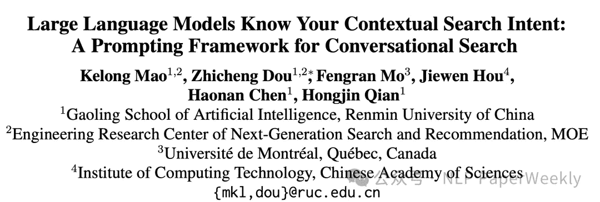
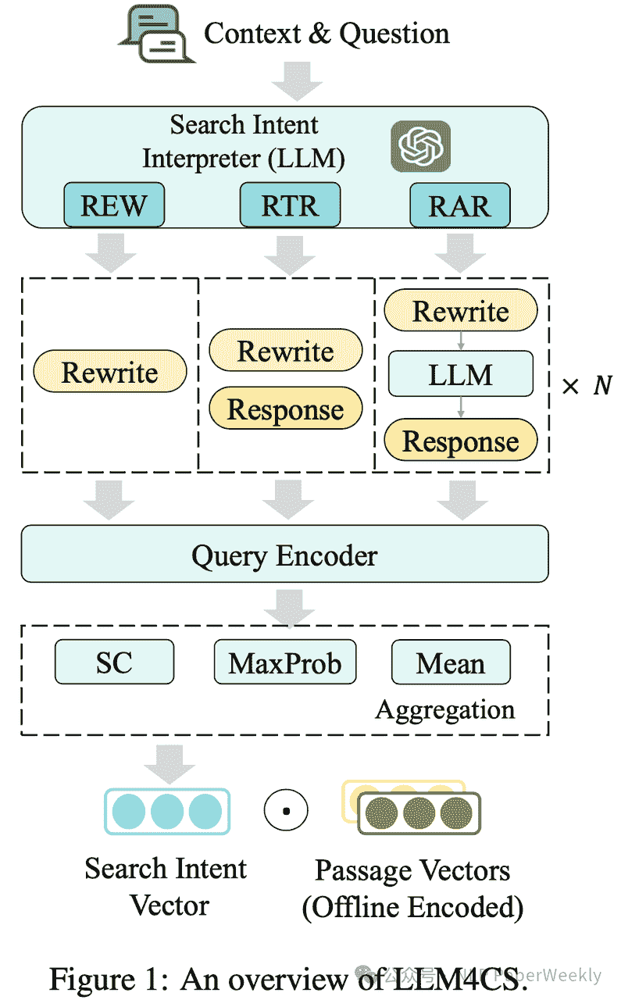
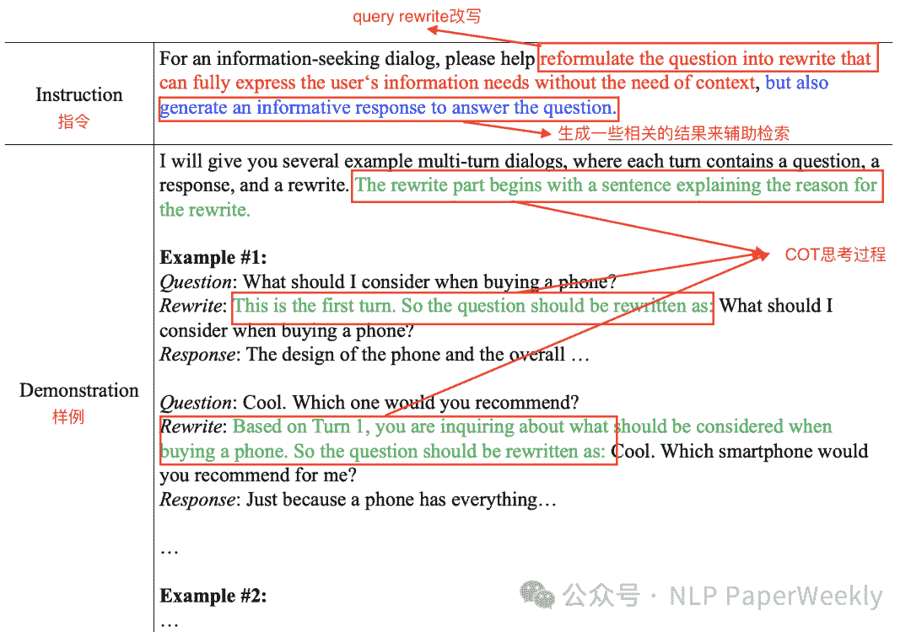
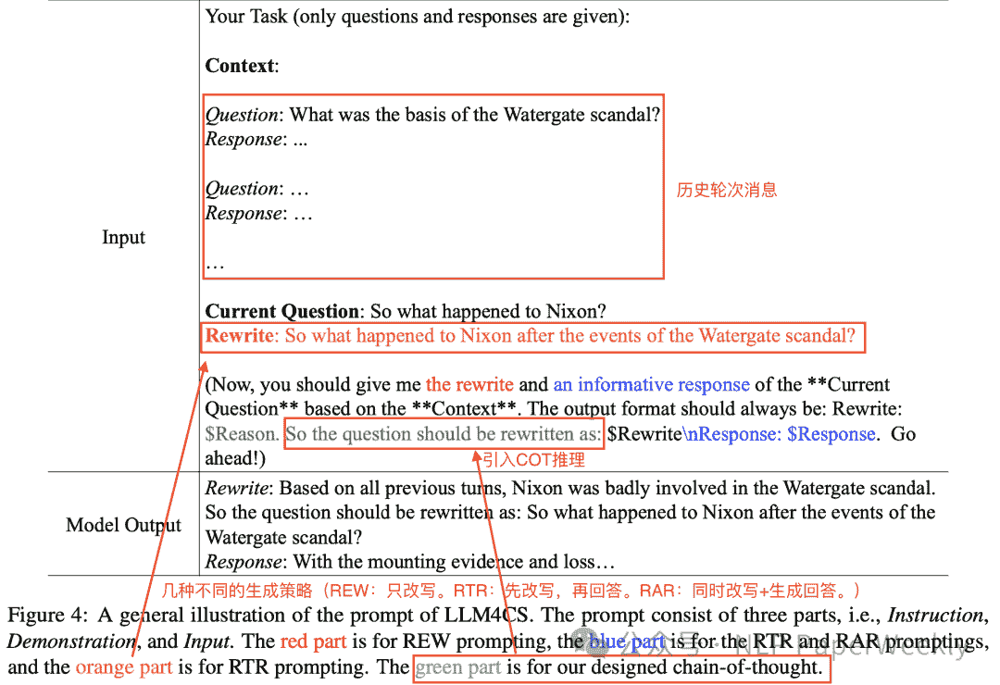
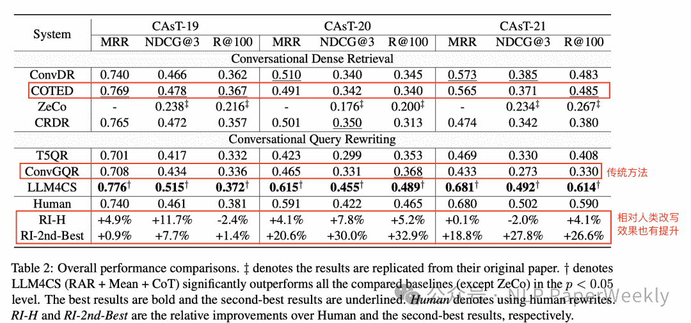
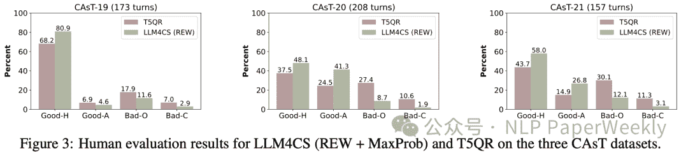
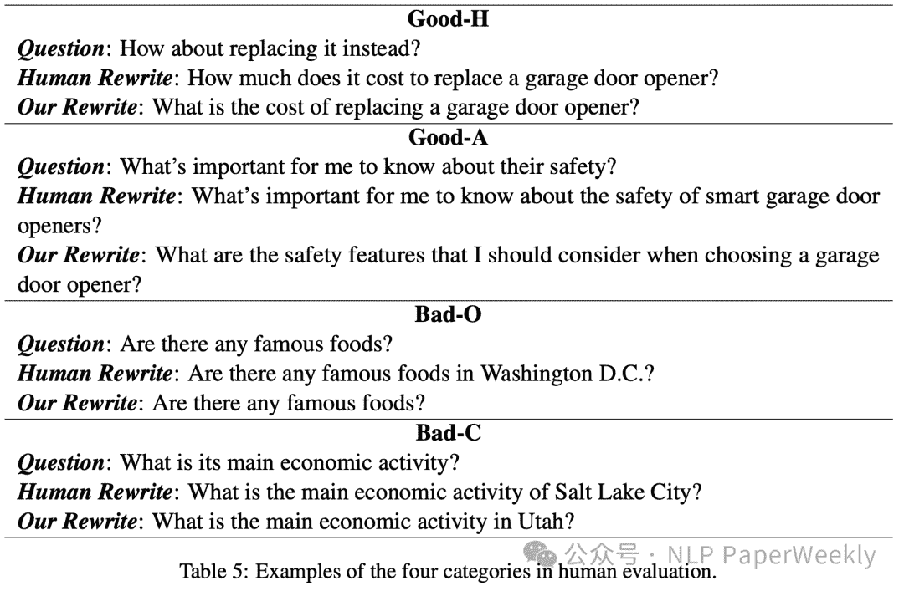
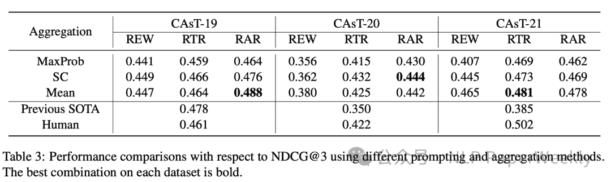
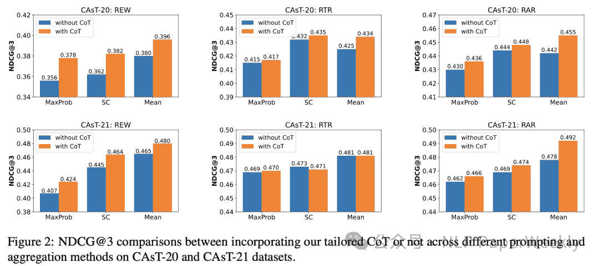

# LLM4CS：一种利用LLM提升多轮会话检索的效果的方案

> 来源：[https://agijuejin.feishu.cn/docx/H7vcdtkT9omEGuxcGyncg6Lzn9b](https://agijuejin.feishu.cn/docx/H7vcdtkT9omEGuxcGyncg6Lzn9b)

> 作者：NLP PaperWeekly

> 原文：https://mp.weixin.qq.com/s/-tbngycbwpvvxv6M13HWtQ

大家好，我是HxShine

今天分享一篇人大的文章，大型语言模型知道您的会话上下文搜索意图（Large Language Models Know Your Contextual Search Intent: A Prompting Framework for Conversational Search）。

在 **会话型搜索 **中，由于会话型搜索场景的多样性和长尾特性，精准地理解用**户的上下文搜索意图一直是一个重要挑战。 现有的基**于有限数据训练的方法在处理真实会话型搜索场景时，仍然表现出不足的有效性和鲁棒性。

本**文提出了一个简单却高效的框架，称之为LLM4CS，其让LLMs作为基于文本的搜索意图解释器，以帮助会话型搜索。 简单来说，L****LM4CS采用了三个步骤来做这件事情：1）**多轮问题重写：结合上下文将当前句子改写成语义完整的句子。2）回复生成：利用LLM生成回复，同时结合回复信息可以辅助提高检索效果。3）语义信息聚合：尝试了不同的语义信息聚合方法提升检索效果。 在包括CAsT-19、CAsT-20和CAsT-21在内的 三个广泛使用的会话型搜索基准上进行的广泛自动评估和人工评估，都展现出了显著的性能。

+   • **Title: **Large Language Models Know Your Contextual Search Intent: A Prompting Framework for Conversational Search

+   • **URL: **https://arxiv.org/abs/2303.06573

+   • **Authors: **Kelong Mao, Zhicheng Dou, Fengran Mo, Jiewen Hou, Haonan Chen, Hongjin Qian

+   • **Code: **https://github.com/LLM4CS/LLM4CS

### **1 Motivation**

+   • **多轮会话过程中，用户意图在不同会话轮次的过程中随时会发生变**化，这给对话过程中的知识检索增加了难度。

+   • 这篇论文试图解决 对话式搜索中用户上下文搜索意图的准确理解问题。 由于对话式搜索场景的多样性和长尾特性，基于有限数据训练的现有方法在处理实际对话式搜索场景时，效果和稳健性仍不尽人意。

+   • **大**型语言模型在文本生成和对话理解方面展现出了惊人的能力，如何将LLM相关能力引入会话型搜索中，提高会话型搜索的效果还有待探索。

### **2 Methods**

该方法简单来说分为三步：

1） **改写： **利用LLM理解能力比较强的特点， 对多轮对话的当前问题进行改写，将语义改写成完整的语义。

2） **回复生成： **直接 **利用LLM生成回复 ****，该回复可能包含与**检索结果相关的content，从而可以 辅助提升检索效果 。

3） **集成： **采用 **多种方法对改写的emb和回复的emb进行融合，生成最**终的搜索意图查询向量，提升最终查询效果。

整个框架的 **目的是将用户的会话查询转换为可以用于检索的搜索意图**向量，然后使用这**个向量去检索相关文档。 通过这种方式， **LLM4CS 框架能够处理会话搜索中的多样性和长尾性问题，提高搜索性能和鲁棒性。

1 Context & Question : 表示当前会话轮次的用户查询（query）和对话上下文（context）。上下文包括之前轮次的用户查询和系统响应。

2 Search Intent Interpreter (LLM) : 这一步对用户问题进行重写，并生成假设性的回复。

+   • REW (Rewriting) : 重写， LLM 生成一个或多个重写的查询。

+   • RTR (Rewriting-Then-Response) : 先重写再响应， LLM 先生成重写的查询，然后基于这些重写生成假设性响应 。

+   • RAR (Rewr**iting-And-Resp**onse) : 重写和响应， LLM 同时生成重写和响应 。

3 Query Encoder : 这是用于将用户查询转换为向量的编码器。

**4 Aggregation **: 聚合，将生成的多个重写和响应聚合成一个集成表示，这里探索多种方式对改写的结果以及回复的结果进行聚合，以稳健地表示用户的真实搜索意图。

+   • **MaxProb **: 最大概率，选择生成概率最高的重写和响应作为最终检索的向量。

+   • SC (Self-Consistency) : 自洽性，选择与所有意图向量聚类中心最相似的意图向量作为最终检索的向量。

+   • **Mean **: 平均值，将所有重写向量和相应的假设性响应向量取平均作为最终检索向量。

**5 向量召回： **意图向量和passage向量点积

+   • Search Intent Vector : 聚合后的搜索意图向量，用于表示用户的搜索意图。

+   • Passage Vectors (Offline Encoded) : 预先编码的段落向量，即文档库中的各个段落。

#### **2.1 改写的提示词：Instruc**tion和Demonstration解析

**说明：**

**Instruction： **说明多轮query rewrite和response生成的指令。

**Demonstration： **给出相关示例，并在示例中引入CoT思考过程。

#### **2.2 改写输入和结果说明**

**说明：**

**Input： **输入包含当前轮问题以及历史多轮对话问题和回复的上下文信息（Context），并给出CoT思考模版。

**Model Output： **输出结果，包含改写结果Rewrite和回复结果Response两个部分，这两部分对后续搜索效果提升有比较大的作用。

### **3 Conclusion**

+   • LLM4CS提示框架能够使用LLMs来精确理解和表示用户**的上下文搜索意图。通过使用提**示框架可以 显著改善会话搜索结果的质量 。

## **二、详细内容**

### **1 实验结果**

**实验说明：**

1.  1. **Human **：表示使用人类生成的改写结果来查询。

1.  2. **RI-H **：表示与人类改写（Human）相比的相对改进百分比。如果这个百分比是正数，意味着 LLM4CS 的性能超过了人类重写；如果是负数，则表示低于人类重写。

1.  3. **RI-2nd-Best **：表示与第二名的最佳结果相比的相对改进百分比。这提供了 LLM4CS 框架与现有最先进方法相比的性能提升情况。

结论： **LLM4CS 在多数情况下都取得了最佳或接近最佳的性能，尤其是在 CAsT**-20 和 CAsT-21 数据集上，它在所有指标上均优于或接近人类重写的性能。

### 2 LLM4CS在多轮问题重写上效果显著优于T5QR方法

**结论： **在多轮问题重写上， **L**LM4CS 生成的查询重写质量高 ，无论是在与人类重写的相似性还是在传达意图的准确性方面。 在大部分情况下，它重写结果要么与人类重写非常接近（Good-H），要么虽然表达不同但依然准确（Good-A）。

**说明：**

+   • **Good-H **：模型的重写与人类重写几乎相同。

+   • **Good-A **：模型的重写虽然与人类重写表达不同，但成功传达了用户的搜索意图。

+   • **Bad-O **：重写遗漏了重要的上下文信息或存在其他类型的错误。

+   • **Bad-C **：重写中存在指代表达错误。

### **3 消融实验**

#### 3.1 不同聚合方法以及不同改写策略的影响

**实验设置：**

1.  1. **三种提示方法 **：REW（仅重写）、RTR（重写后响应）、RAR（重写和响应一起生成）。

1.  2. **三种聚合方法 **：MaxProb（使用最高概率的输出）、SC（自洽性）、Mean（平均值）。

**结论：**

1.  1. 在多数情况下， RAR 提示方法结合 Mean 聚合方法 效果最好，这表明同时生成重写和响应，并通过所有生成内容的平均值得到的信息聚合，对于提高搜索效果有帮助。

1.  2. MaxProb 方法通常不是最佳选择，这表明 依赖单一最高概率输出可能不如考虑多个输出的综合效果好。

1.  3. SC 方法在某些情况下表现不错，但**在其他情况下可能不如 Mean 方法， 这表明选择与所有意**图向量聚类中心最相似的意图向量是一个有用的策略，但可能需要根据具体情况进行选择。

#### **3.2 CoT对整体性能的影响**

**结论：**

1.  1. CoT在各种策略上都有不错的提升 ：表明CoT能有效地引导大型语言模型更准确地理解用户的搜索意图。

1.  2. 在REW上CoT提示方法带来的提升比较大 ：可能意味着在没有额外的假设性响应的情况下， CoT 提供的推理步骤对于指导查询重写更为关键。

1.  3. **在RTR 和 RAR 上CoT提示方法带来的提**升没有那么大 ：对可能是因为在 RTR 和 RAR 方法中， 多个假设性响应本身已经增强了最终搜索意图的表示，从而减少了 CoT 对性能提升的影响。

## 三、总结：LLM4CS框架在会话型搜索中展现出非常显著的性能

本文展示了 大型语言模型在理解和解释会话搜**索**中用户上下文意图方面的强大潜力。 通过LLM4CS框架的应用， 对多轮查询进**行重写并生成假设性响应，而且通过集成表示的方法，增强了模**型对用户真实搜索意图的稳健理解能力。 本文在多个会话型搜索基准上进行的评估，结果展示了LLM4CS框架的优势，这为采用大型语言模型优化会话型搜索提供了有力证据。面对会话型搜索的复杂性和多样性， 本研究的成果标志着我们朝着更加理解用户搜索意图，进一步应用LLMs在会话型搜索中走出了关键一步。

+   • **核心价值: **多轮会话过程中， **用户意图在不同轮次的过程中随时会发生变化**，这给对话过程中的知识检索增加了难度。 LLM4CS框架的提出，为会话式检索提供了一种解决思路。

+   • **亮点: ****LLM4CS其实用了LLM的两个****特性来优化会话检索检索效果。 第一点：**利用LLM多轮会话理解强的特点，先根据多轮会话结果生成重写结果 ，该重写结果可以更好的表达用户语义。 第二点，其还利用LLM内能记住丰富的知识的特点，让LLM生成回复辅助检索优化 ，而这个回复与需要检索的内容可能有比较强的相关性，从而提高会话检索的效果。文章提出的方法在准确性和稳健性方面优于现有方法，并且在广泛的会话搜索基准测试上得到了验证。

+   **👇**关注👸号 NLP PaperWeekly ，对话框输入“ LLM4CS ”，即可领取 上述PDF论文 👇