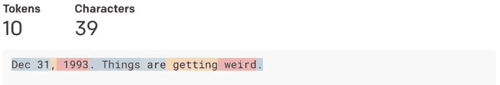
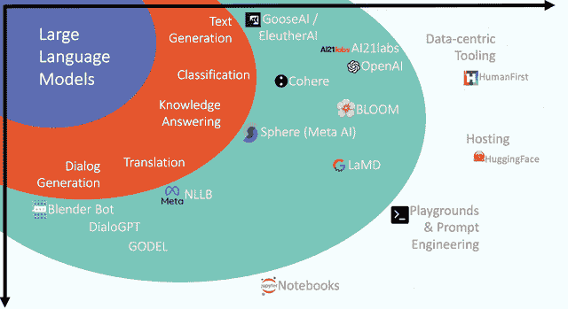
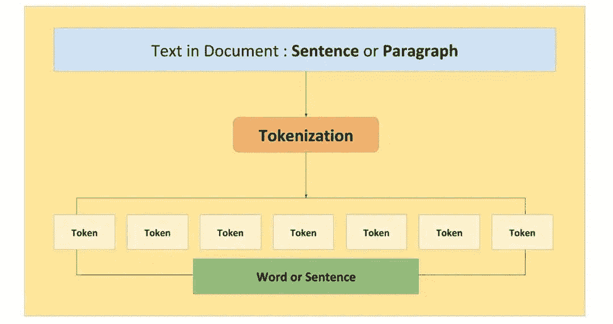
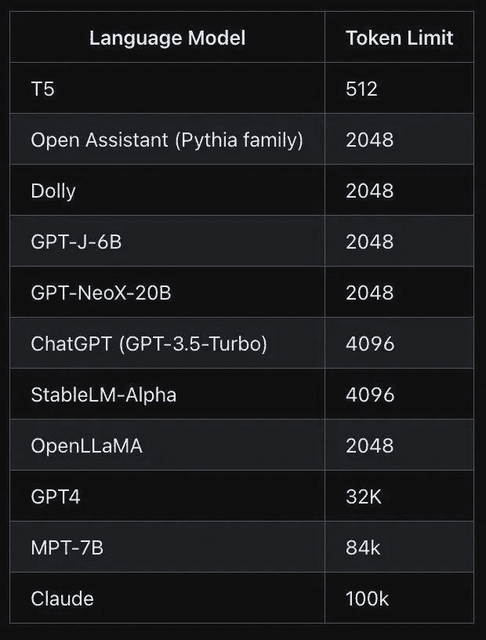
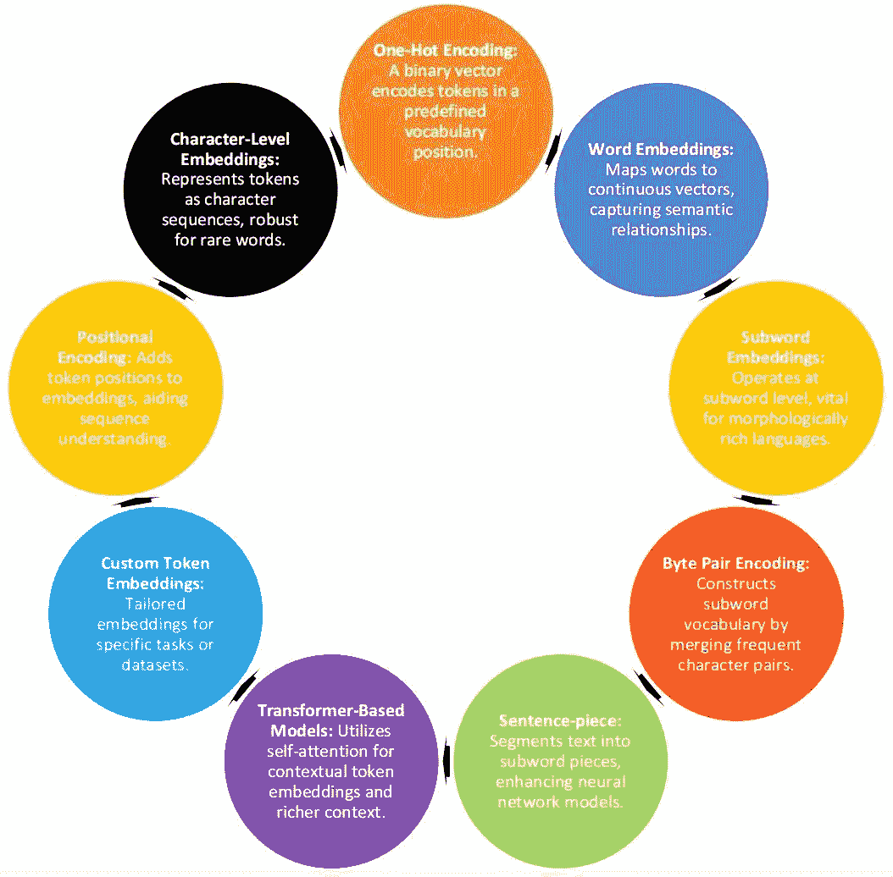
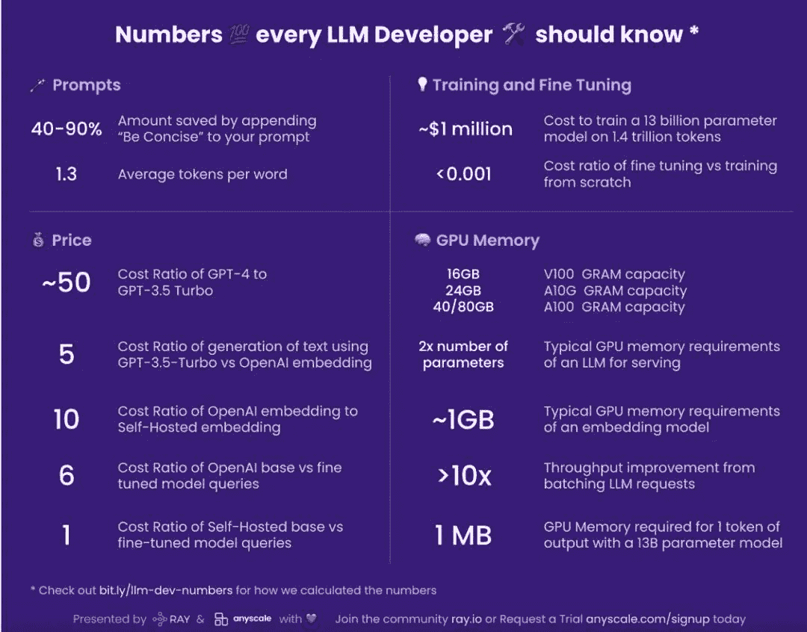

# 解读大模型（LLM）的token

> 来源：[https://agijuejin.feishu.cn/docx/YQpYddZfwov8dgxb5k7c4jyznhh](https://agijuejin.feishu.cn/docx/YQpYddZfwov8dgxb5k7c4jyznhh)

> 作者：半吊子全栈工匠 | 喔家ArchiSelf

> 原文：`https://mp.weixin.qq.com/s/8jJVA7_6XSNo6xyG-OxovA`

当人们谈论大型语言模型的大小时，参数会让我们了解神经网络的结构有多复杂，而token的大小会让我们知道有多少数据用于训练参数。

正像陆奇博士所说的那样，大型语言模型为从文本生成到问题回答的各种任务提供了令人印象深刻的能力，不仅彻底改变了自然语言处理(NLP)领域，而且作为基础模型会改变整个软件生态。

这些模型的一个经常被忽视的关键点是“token”的作用，即模型处理的各个信息单元。大型语言模型(LLM)不能真正理解原始文本，相反，文本被转换为称为token的数字表示形式，然后将这些token提供给模型进行处理。


token 在区块链中代表是通证或者代币，那么token在LLM中代表的是什么呢？

## 1. 什么是token？

在 LLM 中，token代表模型可以理解和生成的最小意义单位，是模型的基础单元。根据所使用的特定标记化方案，token可以表示单词、单词的一部分，甚至只表示字符。token被赋予数值或标识符，并按序列或向量排列，并被输入或从模型中输出，是模型的语言构件。

一般地，token可以被看作是单词的片段，不会精确地从单词的开始或结束处分割，可以包括尾随空格以及子单词，甚至更大的语言单位。token作为原始文本数据和 LLM 可以使用的数字表示之间的桥梁。LLM使用token来确保文本的连贯性和一致性，有效地处理各种任务，如写作、翻译和回答查询。

下面是一些有用的经验法则，可以帮助理解token的长度:

- 1 token ~= 4 chars in English
- 1 token ~= ¾ words
- 100 tokens ~= 75 words

或者

- 1-2 句子 ~= 30 tokens
- 1 段落 ~= 100 tokens
- 1,500 单词 ~= 2048 tokens

在OpenAI 的API 参数中，`max _ tokens` 参数指定模型应该生成一个最大长度为60个令牌的响应。可以通过`https://platform.openai.com/tokenizer` 来观察token 的相关信息。

## 2. token 的特点

我们可以先用OpenAI 的playground 来看一个例子“Dec 31,1993. Things are getting crazy.”



使用 GPT-3 tokenizaer将相同的单词转换为token:


### 2.1 token到数值表示的映射

词汇表将token映射到唯一的数值表示。LLM 使用数字输入，因此词汇表中的每个标记都被赋予一个唯一标识符或索引。这种映射允许 LLM 将文本数据作为数字序列进行处理和操作，从而实现高效的计算和建模。

为了捕获token之间的意义和语义关系，LLM 采用token编码技术。这些技术将token转换成称为嵌入的密集数字表示。嵌入式编码语义和上下文信息，使 LLM 能够理解和生成连贯的和上下文相关的文本。像transformer这样的体系结构使用self-attention机制来学习token之间的依赖关系并生成高质量的嵌入。

### 2.2 token级操作：精确地操作文本

token级别的操作是对文本数据启用细粒度操作。LLM 可以生成token、替换token或掩码token，以有意义的方式修改文本。这些token级操作在各种自然语言处理任务中都有应用，例如机器翻译、情感分析和文本摘要等。

### 2.3 token 设计的局限性

在将文本发送到 LLM 进行生成之前，会对其进行 tokenization 。token是模型查看输入的方式ーー单个字符、单词、单词的一部分或文本或代码的其他部分。每个模型都以不同的方式执行这一步骤，例如，GPT 模型使用字节对编码(BPE)。

token会在tokenizer发生器的词汇表中分配一个 id，这是一个将数字与相应的字符串绑定在一起的数字标识符。例如，“ Matt”在 GPT 中被编码为token编号[13448]，而 “Rickard”被编码为两个标记，“ Rick”，“ ard”带有 `id[8759,446]`，GPT-3拥有1400万字符串组成的词汇表。

token 的设计大概存在着以下的局限性：

+   大小写区分：不同大小写的单词被视为不同的标记。“ hello”是`token[31373]` ，“ Hello”是`[15496]` ，而“ HELLO”有三个`token[13909,3069,46]`。

+   数字分块不一致。数值“380”在 GPT 中标记为单个“380”token。但是“381”表示为两个token[“38”，“1”]。“382”同样是两个token，但“383”是单个token[“383”]。一些四位数字的token有: [“3000”] ，[“3”，“100”] ，[“35”，“00”] ，[“4”，“500”]。这或许就是为什么基于 GPT 的模型并不总是擅长数学计算的原因。

+   尾随的空格。有些token有空格，这将导致提示词和单词补全的有趣行为。例如，带有尾部空格的“once upon a ”被编码为[“once”、“upon”、“a”、“ ”]。然而，“once on a time”被编码为[“once”，“ upon”，“ a”，“ time”]。因为“ time”是带有空格的单个token，所以将空格添加到提示词将影响“ time”成为下一个token的概率。



## 3. token 对LLM 的影响

关于token的数量如何影响模型的响应，常常感到困惑的是，更多的token是否使模型更加详细而具体呢？个人认为，token 对大模型的影响集中在两个方面：

上下文窗口: 这是模型一次可以处理的令牌的最大数量。如果要求模型比上下文窗口生成更多的标记，它将在块中这样做，这可能会失去块之间的一致性。

训练数据token: 模型的培训数据中令牌的数量是模型已经学习的信息量的度量。然而，模型的响是更“一般”还是“详细”与这些象征性的措施没有直接关系。

模型响应的普遍性或特异性更多地取决于它的训练数据、微调和生成响应应时使用的解码策略。大型语言模型中的令牌概念是理解这些模型如何工作以及如何有效使用它们的基础。虽然模型可以处理或已经接受过训练的令牌数量确实影响其性能，但其响应的一般性或详细程度更多地是其训练数据、微调和所使用的解码策略的产物。

对不同数据进行训练的模型往往会产生一般性的响应，而对具体数据进行训练的模型往往会产生更详细的、针对具体情况的响应。例如，对医学文本进行微调的模型可能会对医学提示产生更详细的响应。

解码策略也起着重要的作用。修改模型输出层中使用的`SoftMax`函数的“temperature”可以使模型的输出更加多样化(更高的温度)或者更加确定(更低的温度)。在OpenAI 的API中设置`temperature`的值可以调整确定性和不同输出之间的平衡。

需要记住，每一个语言模型，不管它的大小或者它被训练的数据量如何，只有它被训练的数据、它被接收的微调以及在使用过程中使用的解码策略才可能是最有效的。

为了突破 LLM 的极限，可以尝试不同的训练和微调方法，并使用不同的解码策略。请注意这些模型的优缺点，并始终确保用例与正在使用的模型功能保持一致。



## 4. Token的应用机制——tokenization

将文本划分为不同token的正式过程称为 tokenization。tokenization捕获文本的含义和语法结构，从而需要将文本分割成重要的组成部分。

tokenization是将输入和输出文本分割成更小的单元，由 LLM AI 模型处理的过程。tokenization可以帮助模型处理不同的语言、词汇表和格式，并降低计算和内存成本，还可以通过影响token的意义和语境来影响所生成文本的质量和多样性。根据文本的复杂性和可变性，可以使用不同的方法进行tokenization，比如基于规则的方法、统计方法或神经方法。

OpenAI 以及 Azure OpenAI 为其基于 GPT 的模型使用了一种称为“字节对编码(Byte-Pair Encoding，BPE)”的子词tokenization方法。BPE 是一种将最频繁出现的字符对或字节合并到单个标记中的方法，直到达到一定数量的标记或词汇表大小为止。BPE 可以帮助模型处理罕见或不可见的单词，并创建更紧凑和一致的文本表示。BPE 还允许模型通过组合现有单词或标记来生成新单词或标记。词汇表越大，模型生成的文本就越多样化并富有表现力。但是，词汇 表 越大，模型所需的内存和计算资源就越多。因此，词汇 表 的选择取决于模型的质量和效率之间的权衡。

基于用于与模型交互的token数量以及不同模型的不同速率，大模型的使用成本可能大不相同。例如，截至2023年2月，使用 `Davinci` 的费率为每1000个令牌0.06美元，而使用 `Ada` 的费率为每1000个令牌0.0008美元。这个比率也根据使用的类型而变化，比如playground和搜索等。因此，tokenization是影响运行大模型的成本和性能的一个重要因素。

### 4.1 tokenization 的七种类型

tokenization涉及到将文本分割成有意义的单元，以捕捉其语义和句法结构，可以采用各种tokenization技术，如字级、子字级(例如，使用字节对编码或 `WordPiece`)或字符级。根据特定语言和特定任务的需求，每种技术都有自己的优势和权衡。

+   字节对编码（BPE）：为AI模型构建子词词汇，用于合并出现频繁的字符/子字对。

+   子词级tokenization：为复杂语言和词汇划分单词。将单词拆分成更小的单元，这对于复杂的语言很重要。

+   单词级tokenization：用于语言处理的基本文本tokenization。每个单词都被用作一个不同的token，它很简单，但受到限制。

+   句子片段：用习得的子词片段分割文本，基于所学子单词片段的分段。

+   分词tokenization：采用不同合并方法的子词单元。

+   字节级tokenization：使用字节级token处理文本多样性，将每个字节视为令牌，这对于多语言任务非常重要。

+   混合tokenization：平衡精细细节和可解释性，结合词级和子词级tokenization。

LLM 已经扩展了处理多语言和多模式输入的能力。为了适应这些数据的多样性，已经开发了专门的tokenization方法。通过利用特定语言的token或子词技术，多语言标记在一个模型中处理多种语言。多模态标记将文本与其他模式(如图像或音频)结合起来，使用融合或连接等技术来有效地表示不同的数据源。

### 4.2 tokenization 的重要性

tokenization在 LLM 的效率、灵活性和泛化能力中起着至关重要的作用。通过将文本分解成更小的、可管理的单元，LLM 可以更有效地处理和生成文本，降低计算复杂度和内存需求。此外，tokenization通过适应不同的语言、特定领域的术语，甚至是新兴的文本形式(如互联网俚语或表情符号)提供了灵活性。这种灵活性允许 LLM 处理范围广泛的文本输入，增强了它们在不同领域和用户上下文中的适用性。

tokenization技术的选择涉及到粒度和语义理解之间的权衡。单词级标记捕获单个单词的意义，但可能会遇到词汇表外(OOV)术语或形态学上丰富的语言。子词级tokenization提供了更大的灵活性，并通过将单词分解为子词单元来处理 OOV 术语。然而，在整个句子的语境中正确理解子词标记的意义是一个挑战。tokenization技术的选择取决于特定的任务、语言特征和可用的计算资源。

### 4.3 tokenization面临的挑战: 处理噪声或不规则文本数据

真实世界的文本数据通常包含噪音、不规则性或不一致性。 tokenization在处理拼写错误、缩写、俚语或语法错误的句子时面临挑战。 处理这些噪音数据需要健壮的预处理技术和特定 领 域的tokenization规则调整。 此外，在处理具有复杂编写系统的语言时，tokenization可能会遇到困难，例如标志脚本或没有明确词边界的语言。 解决这些挑战通常涉及专门的tokenization方法或对现有tokenizer的适应。

tokenization是特定于模型的。根据模型的词汇表和tokenization方案，标记可能具有不同的大小和含义。例如，像“ running”和“ ran”这样的单词可以用不同的标记来表示，这会影响模型对时态或动词形式的理解。不同模型训练各自的tokenizer，而且尽管 `LLaMa` 也使用 BPE，但token也与`ChatGPT`不同，这使得预处理和多模态建模变得更加复杂。

## 5. LLM应用中token 的使用

我们需要知道当前任务的token 使用状况，然后，面对大模型的token长度限制，可以尝试一些解决方案

### 5.1 token 的使用状态

这里采用OpenAI 的API ， 使用`langchain` 应用框架来构建简单应用，进而描述当前文本输入的token 使用状态。

```
from langchain.llms import OpenAI
from langchain.callbacks import get_openai_callback
llm = OpenAI(model_name=&quot;text-davinci-002&quot;, n=2, best_of=2)

with get_openai_callback() as cb:
    result = llm(&quot;给我讲个笑话吧&quot;)
    print(cb)
```

对于Agent 类型的应用而言，可以用类似的方法得到各自token的统计数据。

```
from langchain.agents import load_tools
from langchain.agents import initialize_agent
from langchain.agents import AgentType
from langchain.llms import OpenAI

llm = OpenAI(temperature=0)
tools = load_tools([&quot;serpapi&quot;, &quot;llm-math&quot;], llm=llm)
agent = initialize_agent(
    tools, llm, agent=AgentType.ZERO_SHOT_REACT_DESCRIPTION, verbose=True
)
with get_openai_callback() as cb:
    response = agent.run(
        &quot;Who is Olivia Wilde&#x27;s boyfriend? What is his current age raised to the 2023?&quot;
    )
    print(f&quot;Total Tokens: {cb.total_tokens}&quot;)
    print(f&quot;Prompt Tokens: {cb.prompt_tokens}&quot;)
    print(f&quot;Completion Tokens: {cb.completion_tokens}&quot;)
    print(f&quot;Total Cost (USD): ${cb.total_cost}&quot;)
```

### 5.2 LLM中 token 的长度限制与应对

像 `GPT-3/4`，`LLaMA`等这样的大模型有一个最大token 数量限制，超过这个限制，它们就不能接受输入或生成输出。



#### 一般地， 我们可以尝试以下方法来解决token长度限制的问题：

#### 截断

截断涉及删除输入文本的一部分以适应令牌限制。这可以通过删除文本的开头或结尾，或两者的组合来完成。然而，截断可能导致重要信息的丢失，并可能影响所产生的产出的质量和一致性。

#### 抽样

抽样是一种从输入文本中随机选择标记子集的技术。这允许您在输入中保留一些多样性，并且可以帮助生成不同的输出。然而，这种方法(类似于截断)可能会导致上下文信息的丢失，并降低生成输出的质量。

#### 重组

另一种方法是将输入文本分割成符号限制内的较小块或段，并按顺序处理它们。通过这种方式，可以独立处理每个块，并且可以连接输出以获得最终结果。

#### 编解码

编码和解码是常见的自然语言处理技术，它们将文本数据转换为数字表示，反之亦然。这些技术可用于压缩、解压缩、截断或展开文本以适应语言模型的标记限制。这种方法需要额外的预处理步骤，可能会影响生成输出的可读性。

#### 微调

微调允许使用较少的特定任务数据来调整预先训练好的语言模型以适应特定任务或领域。可以利用微调来解决语言模型中的标记限制，方法是训练模型预测一系列文本中的下一个标记，这些文本被分块或分成更小的部分，每个部分都在模型的标记限制范围内。

## 6. token 相关技术的展望

虽然token传统上代表文本单位，但是token的概念正在超越语言要素的范畴。最近的进展探索了其他模式(如图像、音频或视频)的标记，允许 LLM 与这些模式一起处理和生成文本。这种多模式方法为在丰富多样的数据源背景下理解和生成文本提供了新的机会。它使 LLM 能够分析图像标题，生成文本描述，甚至提供详细的音频转录。




tokenization领域是一个动态和不断发展的研究领域。未来的进步可能集中于解决tokenization的局限性，改进 OOV 处理，并适应新兴语言和文本格式的需要。而且，将继续完善tokenization技术，纳入特定领域的知识，并利用上下文信息来增强语义理解。tokenization的不断发展将进一步赋予 LLM 以更高的准确性、效率和适应性来处理和生成文本。

## 7. 小结

Token是支持 LLM 语言处理能力的基本构件。理解token在 LLM 中的作用，以及tokenization方面的挑战和进步，使我们能够充分发挥这些模型的潜力。随着继续探索token的世界，我们将彻底改变机器理解和生成文本的方式，推动自然语言处理的边界，促进各个领域的创新应用。

PS. One more thing，我们在开发大模型应用时应该了解的一些数字如下：



## 参考资料与关联阅读

+ https://python.langchain.com/docs
+ https://blog.langchain.dev/
+ OpenAI: What are tokens and how to count them?，https://help.openai.com/en/articles/4936856-what-are-tokens-and-how-to-count-them
+ Predicting Million-byte Sequences with Multiscale Transformers，https://arxiv.org/pdf/2305.07185.pdf
+ https://learn.microsoft.com/en-us/semantic-kernel/prompt-engineering/tokens
+ https://www.anyscale.com/blog/num-every-llm-developer-should-know
+ [如何构建基于大模型的App](http://mp.weixin.qq.com/s?__biz=MzAwOTcyNzA0OQ==&mid=2658978464&idx=1&sn=8b9c617bced2b5ce012fb1f4aa87c086&chksm=80d35786b7a4de901400ffe4db5061c08df2912b4b49466e91a9f52813f22f3137e41802abc9&scene=21#wechat_redirect)
+ Qcon2023: 大模型时代的技术人成长（简）
+ 论文学习笔记：增强学习应用于OS调度
+ 《深入浅出Embedding》随笔
+ [LLM的工程实践思考](http://mp.weixin.qq.com/s?__biz=MzAwOTcyNzA0OQ==&mid=2658978144&idx=1&sn=e8bff055687f7e7ad17baca58dc26c23&chksm=80d35446b7a4dd507b02832851e2308a276edc328f3e79bca0f3ae931ab27db69aeccd8d7c8d&scene=21#wechat_redirect)
+ [解读大模型的微调](http://mp.weixin.qq.com/s?__biz=MzAwOTcyNzA0OQ==&mid=2658978125&idx=1&sn=b342e9c10734c1f7cd124ebc88aa75a8&chksm=80d3546bb7a4dd7d9c74dabd6046d1ccea01592760a8add3d71b2f75fa68712093a4834e6d88&scene=21#wechat_redirect)
+ [解读ChatGPT中的RLHF](http://mp.weixin.qq.com/s?__biz=MzAwOTcyNzA0OQ==&mid=2658977979&idx=1&sn=4d66d662595d9aba355e0564df545370&chksm=80d3559db7a4dc8b96a5f3ac4d01b53a2601d5e1dcb51789ee3d9974ec9ae5f028c3e469b5a5&scene=21#wechat_redirect)
+ [解读Toolformer](http://mp.weixin.qq.com/s?__biz=MzAwOTcyNzA0OQ==&mid=2658977935&idx=1&sn=9dd162f270f7c17a673291c0f136cf8c&chksm=80d355a9b7a4dcbf3ab824ac6de5c27d94a11455a681ebeb98a211e9b58ff867ddddf33d1c8d&scene=21#wechat_redirect)
+ [解读TaskMatrix.AI](http://mp.weixin.qq.com/s?__biz=MzAwOTcyNzA0OQ==&mid=2658977922&idx=1&sn=2f67513b540485d0177ded24c0807bcc&chksm=80d355a4b7a4dcb2495ab97febd0ac88cd0780e0d8e4b3bbc369250304289e289f71b0a76f0c&scene=21#wechat_redirect)
+ [解读LangChain](http://mp.weixin.qq.com/s?__biz=MzAwOTcyNzA0OQ==&mid=2658978479&idx=1&sn=47d6d226a3ac6cc08980e7562ae09fce&chksm=80d35789b7a4de9f3ba9a3eeb21c6c812b0f7fe43cee47fc38368ed31a1346114a67daa3cd30&scene=21#wechat_redirect)
+ [浅析多模态机器学习](http://mp.weixin.qq.com/s?__biz=MzAwOTcyNzA0OQ==&mid=2658978122&idx=1&sn=baf54b7a1a0758e19bf6a3622a43d8fb&chksm=80d3546cb7a4dd7ab9b857ea75bcc3e361cb68489ff5c43ff4d8ab65b2da838b46621b2936b1&scene=21#wechat_redirect)
+ [Agent 与对象的辨析](http://mp.weixin.qq.com/s?__biz=MzAwOTcyNzA0OQ==&mid=2658977521&idx=1&sn=378ae6e0f2c53d31993515f62e295327&chksm=80d35bd7b7a4d2c174a99a8dc2910c193cc846d145e4351e768131f0a977410d3c9d0e668baa&scene=21#wechat_redirect)
+ [深度学习架构的对比分析](http://mp.weixin.qq.com/s?__biz=MzAwOTcyNzA0OQ==&mid=2658978063&idx=1&sn=f934c531bacfe1bf6c95ccbdababe439&chksm=80d35429b7a4dd3f8df5f8c439bd98420c13d4a115c609a60370a6e09ad7c667c4a8c95418c1&scene=21#wechat_redirect)
+ [老码农眼中的大模型（LLM）](http://mp.weixin.qq.com/s?__biz=MzAwOTcyNzA0OQ==&mid=2658977916&idx=1&sn=d38f03af2b3916251e9a8577d995e065&chksm=80d3555ab7a4dc4c0c919ce0a678adc9f3018d81994dc072e698cfa481665ec8faf788d606be&scene=21#wechat_redirect)
+ [系统学习大模型的20篇论文](http://mp.weixin.qq.com/s?__biz=MzAwOTcyNzA0OQ==&mid=2658978109&idx=1&sn=4d15334a5cccc300a18686b1dd2a2098&chksm=80d3541bb7a4dd0df321e516ad40c8e849dde084328b61259f4b17f5d24280686305a87fa8b5&scene=21#wechat_redirect)
