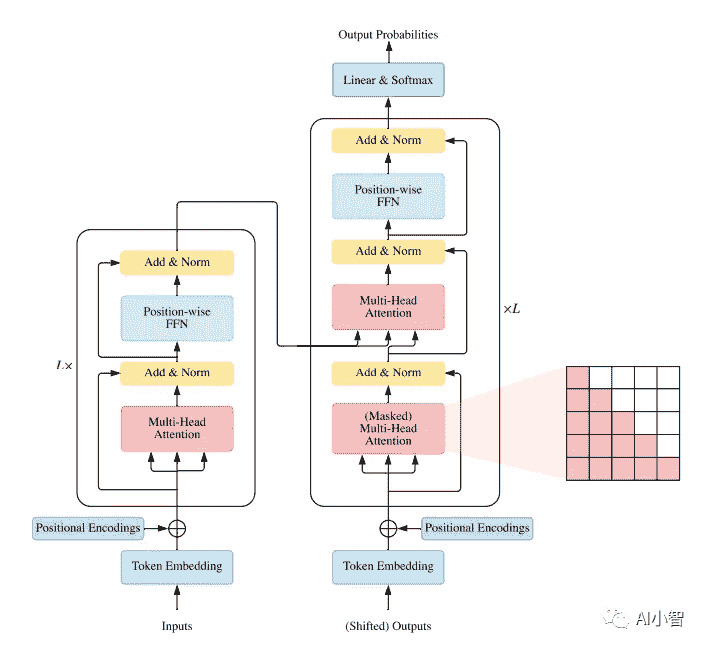
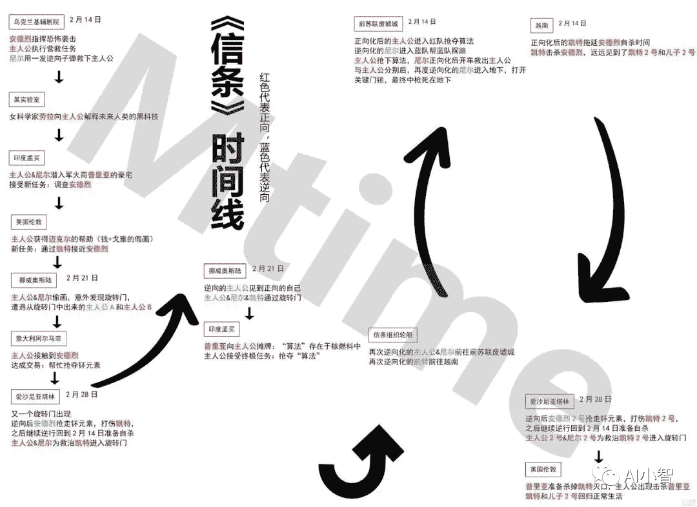
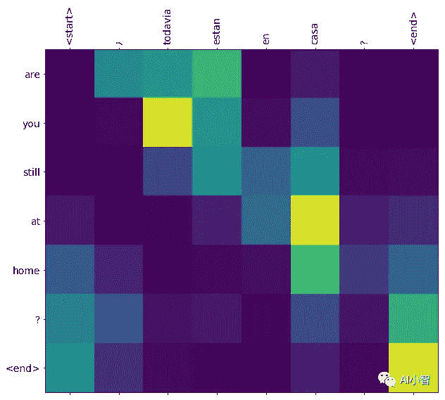

# GPT背后的Transformer模型

> 来源：[https://agijuejin.feishu.cn/docx/MbpodYmnhoikalxEA5uciKDZnye](https://agijuejin.feishu.cn/docx/MbpodYmnhoikalxEA5uciKDZnye)

> 作者：AI小智

> 原文：https://mp.weixin.qq.com/s/b199FAHxvK2sLqHMi87t5A


上次 《解读AI大模型，从了解token开始》 一文中，我从最基础的概念“token”着手，跳过了复杂的算法逻辑，相信已经让大家建立起对AI大模型工作原理的清晰认知。

但如果仅仅只是依靠对文本的编码与数据分析，那人工智能时代应该早就到来了，为什么唯独是GPT模型的诞生开启了人工智能大模型的全盛时代？今天我将带您一探究竟，看看GPT背后的Transformer模型。

## ** **什么是Transformer？



Transformer是一种新颖的神经网络架构，它在2017年由Google的研究人员提出，用于解决机器翻译等自然语言处理的任务。Transformer的特点是，它完全摒弃了传统的循环神经网络（RNN）和卷积神经网络（CNN），而是采用了一种称为自注意力机制（Self-Attention）的方法，来捕捉文本中的长距离依赖关系，提高了模型的效率和准确性。

今天本文将围绕自注意力机制，介绍Transformer 的三个主要概念，位置编码、注意力机制和自注意力机制。

## ** **位置编码(Positional Encodings)

在自然语言处理任务中,词语的顺序尤为重要。以“小明喜欢小红”和“小红喜欢小明”为例,这两句话的词语组成完全一样,仅仅是顺序不同,所表达的意思却南辕北辙。因此,语言模型必须具备把握词语顺序的能力。

然而,Transformer采用的自注意力机制是通过单元之间的相关性来进行文本序列的编码，也就是说模型本身并不能感知词语的顺序信息。为了克服这个困难,Transformer引入了一种称为位置编码(Positional Encoding)的技巧。

位置编码的思路很简单,就是在输入序列中的每个词语后面追加一个位置标记,用不同的数字表示它在句子中的位置。以句子“我爱吃苹果”为例:

```
我 1 爱 2 吃 3 苹果 4
```

这样一来,Transformer模型就可以区分词语的顺序了。这种方法极大地增强了模型处理自然语言的能力。事实上,位置编码使得Transformer可以类比人类大脑处理语言的方式——人脑可以轻松地记住词语出现的时间顺序。Transformer通过位置编码实现了类似的效果。

类比来说，当我们看一篇长篇小说时，当我们想搞清楚核心情节的发生顺序时，我们往往不是翻看原文，而是在阅读中就记录下一条时间线，当发生关键剧情时，将其记录在整个时间线的节点之上。之前大火的电影《信条》，相信很多小伙伴也都是通过时间线的方式才真正搞清楚剧情是如何发展的。



位置编码也好，时间线也罢，其实这部分信息原本就是隐式的存在原始数据之中。我们的标记是将这部分隐式的结构数据显示的表现出来，使得大模型在编解码数据的过程中，把词语在句子中的相对位置纳入进来，进而将这一部分信息嵌入到维度向量中（或者准确说对某些维度产生影响）。

这与人类大脑以时间顺序来认知事物或者组织语言的本能是类似的，而大模型的优势在于拥有更大的存储，因而不需要如同人类大脑一般需要进行关键节点的抽象，只要平等的对每一个词语单元进行位置编码即可。（我在这里做了一点过度简化——最初的作者使用正弦函数来进行位置编码，而不是简单的整数 1、2、3、4——但要点是相同的。）

## ** **注意力机制(Attention)


在Transformer模型中,位置编码为模型提供了词语顺序信息。而注意力机制则让模型能更智能地使用这些信息。

什么是注意力机制呢?简单来说,它就是允许Transformer模型在生成输出时,参考输入序列中的所有词语,并判断哪些词对当前步骤更重要、更相关。以英译法翻译为例,当Transformer要翻译一个英文单词时,它会通过注意力机制快速“扫视”整个英文输入序列,判断应该翻译成什么法文词语。如果输入序列中有多个相关词语,注意力机制会让模型关注最相关的那个,忽略其它不太相关的词语。



标注翻译输入与输出关注度的热力图

从人类行为的角度来看,注意力机制就更容易理解了。当我们阅读一段文字时,基于基因本能以及历史经验，筛选重点关注的目标区域，得到注意力焦点的能力，从而利用有限的注意力资源从大量信息中快速筛选出高价值信息。大模型的注意力机制的形成就是类似的方式，类比大脑，大模型的本能与经验则来源于词嵌入形成的词语向量亲密度。通过观察成千上万的法语和英语句子，模型积累了什么类型的单词是相互依赖的。

具体来说,Transformer中的注意力机制可以分为两步:

+   第一步,计算词语间的相关性。对输入序列中每一对词语,模型计算它们的相关性分数,分数越高表示两者语义上越相关。

+   第二步,生成注意力分布。根据词语间相关性的计算,得到一个注意力分布,它给每个词语赋予一个权重,权重越大表示对当前步骤越重要。

+   最后,模型会依据这个注意力分布,对输入序列进行加权,从而聚焦到相关词语上。这就实现了注意力机制的作用。

相比于RNN等早期序列模型逐步处理输入、无法捕捉长距离依赖的方式,注意力机制实现了全局感知,使Transformer可以并行地看到全部输入,这极大地提升了其建模能力。正因如此,Transformer才可以胜任更难的语言理解任务。

## ** **自注意力机制(Self-Attention)

在Transformer模型中,除了注意力机制,还有一个更加强大的机制叫做自注意力(Self-Attention)。 首先我们说说注意力与自注意力的区别。

可以参考这个例子。比如说一条像蛇的井绳，会快速抓住人的眼球，让人提高警惕，这描述的是注意力。而通过这条井绳出现在水井边，并且一端系在水桶上，我们判断它是一条井绳而不是蛇，则可类比为自注意力。


自注意力机制的核心思想是,允许模型学习词语之间的相关性,也就是词语与词语之间的依赖关系。以句子“我爱吃苹果”为例,通过自注意力,模型会学习到:

+   “我”与“爱”有关

+   “爱”与“吃”有关

+   “吃”与“苹果”有关

然后在处理时,模型会优先关注这些相关词语,而不是简单按照顺序一个字一个字翻译。

人类对一个事物的认知不是仅在于事物本身，往往会结合事物所处的环境，并结合与认知事物相关的其他事物作为一个整体来形成最终的认知。自注意力机制在文本中的应用也一样，主要是通过计算单词间的互相影响，来解决长距离依赖问题。

从认知角度来看,自注意力更贴近人类处理语言的方式。自注意力机制克服了传统序列模型在处理长距离依赖时的局限性。正因如此,自注意力机制成为Transformer模型的“引擎”,可以处理更复杂的语言结构,达到更高的性能。自注意力让Transformer不仅可以并行计算,更可以建模非连续的依赖关系,这对处理语言意义至关重要。

## **总结 **

Transformer模型之所以能够在自然语言处理任务上取得巨大突破,关键在于其三大核心机制:

+   位置编码提供了词语顺序信息

+   注意力机制让模型可以关注关键词语

+   自注意力机制帮助模型学习词语间的依赖关系

这三者相辅相成,使得Transformer模型得以模拟人类语言处理的方式,达到了传统RNN模型难以企及的效果。

未来,如何使Transformer模型更易于训练,并能够真正理解语言的深层语义,而不仅是表面形式,仍将是自然语言处理领域的核心挑战。让我们拭目以待Transformer带来的更多惊喜吧!

**PS ： **A**I小智 **技 术交流群（技术交流、摸鱼、白嫖课程为主）又不定时开放了，感兴趣的朋友，可以在下方公号内回复： 666 ，即可进入。