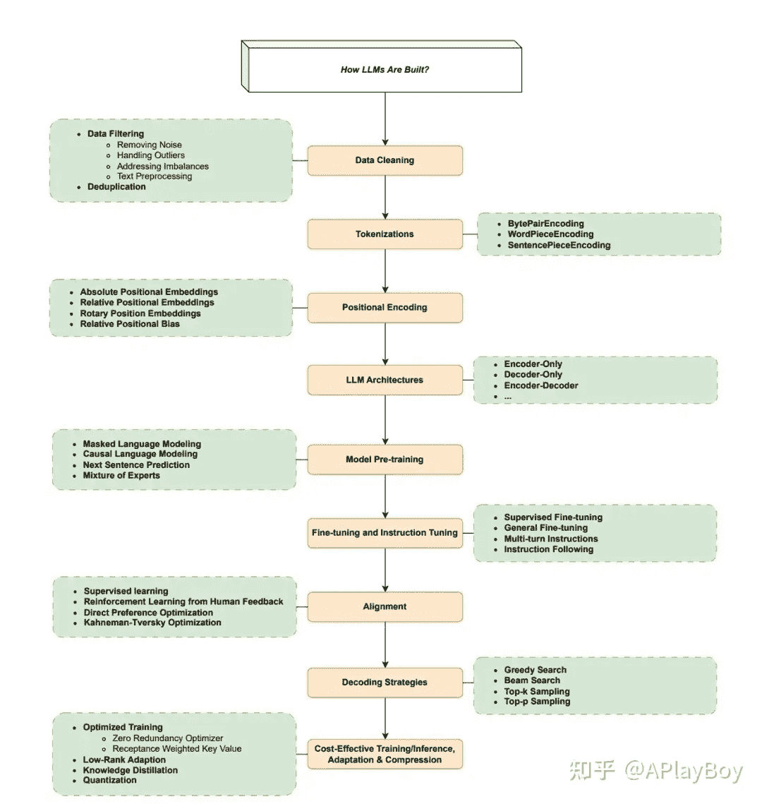
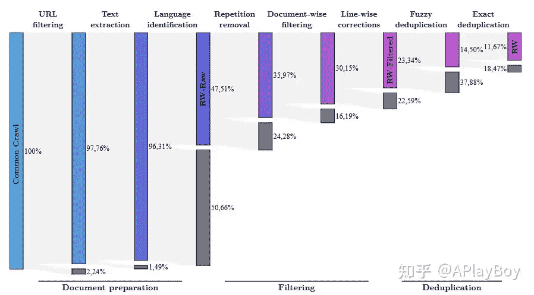
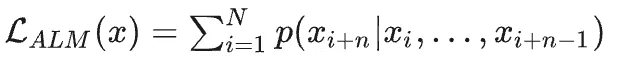
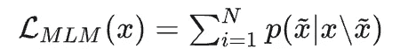
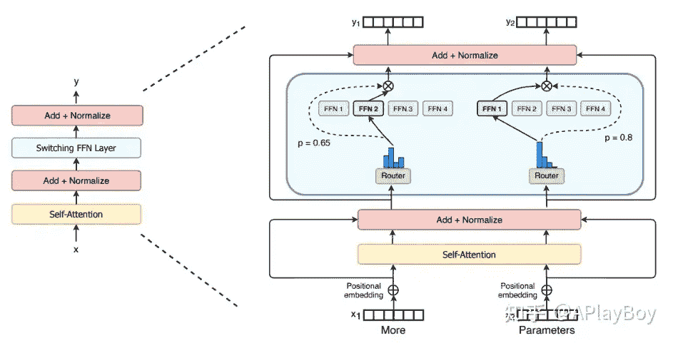
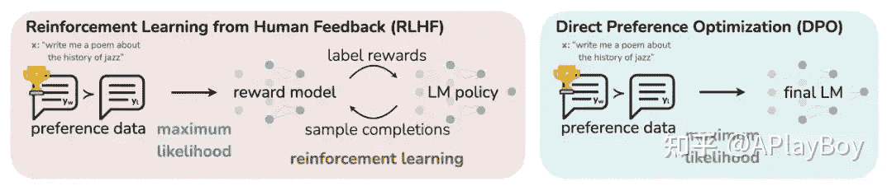
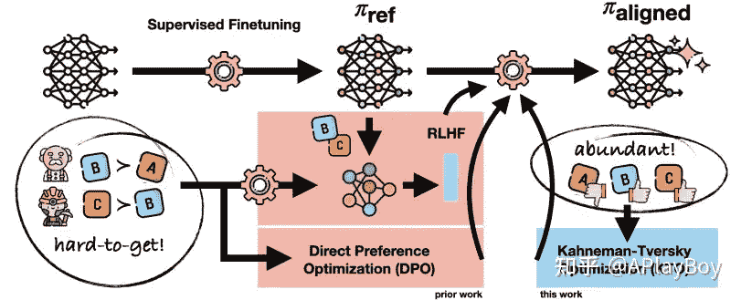
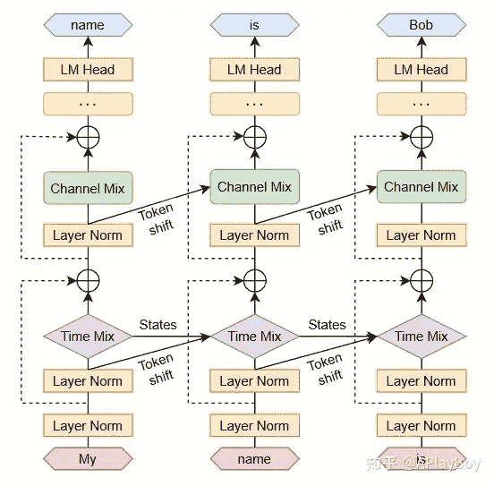
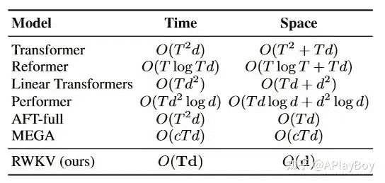

# 一文详解大语言模型的流行架构与训练技术

> 来源：[https://agijuejin.feishu.cn/docx/JTDndMHTpoWPAsxf656ckh2Bntc](https://agijuejin.feishu.cn/docx/JTDndMHTpoWPAsxf656ckh2Bntc)

> 作者：APlayBoy | AI生成未来

> 原文：https://mp.weixin.qq.com/s/I-P_RuErXfJAc9KrzMGlOA

> 知乎原文：https://zhuanlan.zhihu.com/p/691814702

这篇博客全面介绍了大型语言模型（LLMs）的构建流程，从流行架构的选择到实际建模的每个关键步骤。文章首先探讨了LLMs的模型架构，然后详细阐述了数据准备过程，包括数据的收集、清洗和去重，接着是关于如何进行有效标记化的讨论。在模型构建方面，博客详细解释了采用自监督学习方法的预训练过程，以及对模型进行指令微调和对齐的重要性。每个环节都被细致地讲解，使读者能够深入理解LLMs的构建和优化过程。这篇博客为那些对LLMs工作方式感兴趣的读者提供了一个指导。

**训练流程示意 **：

##  **1. 主流的LLM架构 **

+   **常见架构类型 **：最广泛使用的LLM架构包括仅编码器、仅解码器和编码器-解码器。

+   **基础架构 **：大多数LLM架构都基于Transformer（Transformer）作为构建模块。

+   Transformer架构回顾 ：因此，我们也将在这里回顾Transformer架构。

###  **Transformer **

+   **开创性工作 **：Vaswani等人提出Transformer框架，具有里程碑的意义，最初设计用于使用GPU进行有效的并行计算。

+   **核心机制 **：Transformer的核心是（自）注意力机制，相比递归和卷积机制，它能够更有效地利用GPU捕捉长期上下文信息。

+   Transformer语言模型架构 ：最初为机器翻译提出的Transformer语言模型架构，包括一个编码器和一个解码器。编码器由N=6个相同的Transformer层堆叠组成。每层有两个子层：第一个是多头自注意力层，另一个是简单的逐位置全连接前馈网络。解码器由6个相同的层堆叠组成。除了编码器层中的两个子层外，解码器还有第三个子层，它对编码器堆栈的输出执行多头注意力。注意力函数可以描述为将查询和一组键值对映射到一个输出，其中查询、键、值和输出都是向量。输出计算为值的加权和，其中每个值的权重由查询与相应键的兼容性函数计算得出。与执行一个具有dmodel维键、值和查询的单一注意力函数不同，发现将查询、键和值h通过不同的学习线性投影分别映射到dk、dk和dv维是有益的。位置编码被加入以融合有关序列中标记的相对或绝对位置的信息。

###  **仅编码器架构 **

+   **注意力层特点 **：在这个家族的模型中，每个阶段的注意力层都能访问初始句子中的所有词语。

+   **预训练方法 **：这些模型的预训练通常包括以某种方式破坏给定句子（例如，通过掩盖句子中随机的单词），然后让模型找出或重构初始句子。

+   **适用任务 **：编码器模型非常适合需要理解整个序列的任务，如句子分类、命名实体识别和抽取式问答。

+   **代表模型 **：一个突出的仅编码器模型是BERT（Bidirectional Encoder Representations from Transformers。

###  **仅解码器架构 **

+   **注意力层特点 **：对于这些模型，每个阶段的注意力层只能访问句子中该词之前的词语。这些模型有时也被称为自回归模型。

+   **预训练方法 **：这些模型的预训练通常被构建为预测序列中的下一个词（或标记）。

+   **适用任务 **：仅解码器模型最适合涉及文本生成的任务。GPT模型是这一类别的突出例子。

###  **编码器-解码器架构 **

+   **架构特点 **：这些模型使用编码器和解码器，有时被称为序列到序列模型。在每个阶段，编码器的注意力层可以访问初始句子中的所有词语，而解码器的注意力层只访问输入中给定词之前的词语。

+   **预训练目标 **：这些模型通常使用编码器或解码器模型的目标进行预训练，但通常涉及更复杂的内容。例如，一些模型通过用单个掩码特殊词替换文本中的随机文本跨度（可能包含几个词）进行预训练，目标是预测这个掩码词替换的文本。

+   **适用任务 **：编码器-解码器模型最适合涉及基于给定输入生成新句子的任务，如摘要、翻译或生成式问答。

##  **2. 数据清理 **

+   **数据清理的重要性 **：数据质量对于基于其训练的语言模型的性能至关重要。数据清理技术，如过滤和去重，已被证明对模型性能有很大影响。

+   **实例研究 **：作为一个例子，在Falcon40B中，Penedo等人展示了经过适当过滤和去重的网络数据单独可以构建强大的模型，甚至在性能上显著超过在The Pile上训练的最先进模型。尽管进行了广泛过滤，他们仍然从CommonCrawl获取了五万亿个标记。他们还发布了来自REFINEDWEB数据集的6000亿标记的提取物，以及在此基础上训练的1.3/7.5B参数语言模型。

+   **数据精炼过程示意 **：

图：宏观数据精炼的后续阶段剔除了最初在CommonCrawl中的近90%文档。

###  **2.1 数据过滤 **

数据过滤的目的是提高训练数据的质量和训练数据的有效性。常见的数据过滤技术包括:

+   **去除噪声 **：指消除可能影响模型良好泛化能力的无关或噪声数据。例如，可以考虑从训练数据中删除错误信息，以降低模型生成错误回应的可能性。质量过滤的两种主流方法包括：基于分类器的和基于启发式的框架。

+   **处理离群值 **：识别并处理数据中的离群值或异常，以防止它们对模型产生不成比例的影响。

+   **处理数据不平衡 **：平衡数据集中类别或类别的分布，避免偏见，确保公平代表性。这对于负责任的模型训练和评估特别有用。

+   **文本预处理 **：通过去除停用词、标点符号或可能不会显著贡献于模型学习的其他元素，来清洁和标准化文本数据。

+   **处理模糊性 **：解决或排除可能在训练过程中混淆模型的模糊或矛盾数据。这可以帮助模型提供更确定和可靠的答案。

###  **2.2 数据去重 **

+   **去重的意义 **：去重指的是移除数据集中的重复实例或重复出现的相同数据的过程。重复的数据点可能会在模型训练过程中引入偏见，并减少多样性，因为模型可能多次从相同的示例中学习，可能导致对那些特定实例的过拟合。

+   **改善泛化能力 **：去重改善了模型对新的、未见过的数据的泛化能力。

+   **大数据集中的重要性 **：在处理大型数据集时，去重尤其重要，因为重复数据可能无意中放大了某些模式或特征的重要性。这在NLP任务中尤其相关，因为多样化和具有代表性的训练数据对于构建健壮的语言模型至关重要。

+   **具体方法 **：具体的去重方法可能根据数据的性质和特定语言模型的训练需求而有所不同。它可能涉及比较整个数据点或特定特征来识别和消除重复数据。在文档层面，现有工作主要依赖于文档之间高级特征（例如n-gram重叠）的重叠比率来检测重复样本。

##  **3 分词 **

+   **基本概念 **：分词是将文本序列转换成称为标记的更小部分的过程。尽管最简单的分词工具仅基于空格将文本切分成标记，但大多数分词工具依赖于词典。

+   **词典外问题（OOV） **：在这种情况下，词典外（out-of-vocabulary，OOV）问题是一个挑战，因为分词器只能识别其词典中的词汇。

+   **增加词典覆盖率 **：为了增加词典的覆盖率，用于LLMs的流行分词器基于子词，这些子词可以组合形成大量词汇，包括训练数据中未出现的词汇或不同语言的词汇。

+   **流行分词器简介 **：以下将描述三种流行的分词器。

###  3.1 BytePairEncoding（字节对编码）

+   **算法起源 **：BytePairEncoding最初是一种数据压缩算法，使用字节级别的频繁模式来压缩数据。

+   **算法特点 **：该算法主要尝试保持频繁出现的单词的原始形式，并分解不常见的单词。这种简单的范式使得词汇表不会很大，同时也足以代表常见单词。如果训练数据中的后缀或前缀也常见，则频繁单词的形态变化也可以很好地表示。

###  3.2 WordPieceEncoding（词片编码）

+   **应用模型 **：这种算法主要用于众所周知的模型，如BERT和Electra。

+   **训练过程 **：在训练开始时，算法取训练数据中的所有字母表，确保没有任何内容会被标记为UNK（未知）。

+   **算法特点 **：当模型给出一个无法由标记器标记的输入时，会出现这种情况。这种情况多发生在某些字符无法被标记时。与BytePairEncoding类似，它尝试根据频率最大化将所有标记放入词汇表的可能性。

###  3.3 SentencePieceEncoding（句子片编码）

+   **与前两者对比 **：尽管前两种标记器强大且与空白标记相比有许多优势，它们仍然假设单词总是由空格分隔。这个假设并非总是成立，在某些语言中，单词可能会被不需要的空格或甚至是捏造的单词等噪声元素破坏。

+   **解决问题 **：SentencePieceEncoding试图解决这个问题。

##  **4. 位置嵌入 **

###  **4.1 绝对位置嵌入（Absolute Position**al Embeddings, APE）

+   **原理与应用 **：APE用于原始Transformer模型，以保留序列顺序信息。因此，单词的位置信息被添加到编码器和解码器堆栈底部的输入嵌入中。

+   **位置编码的选择 **：位置编码有多种选择，可以是学习的或固定的。在标准Transformer中，使用正弦和余弦函数来实现这一目的。

+   **主要缺点 **：使用APE的主要缺点是限制了特定数量的标记。此外，APE无法考虑标记之间的相对距离。

###  **4.2 相对位置嵌入（Relative Position**al Embeddings, RPE）

+   **方法和实现 **：RPE通过扩展自注意力来考虑输入元素之间的成对链接。RPE在两个层面上被添加到模型中：首先作为键的额外组成部分，然后作为值矩阵的子组成部分。

+   **输入视角 **：这种方法将输入视为一个带标签和有向边的完全连接图。在线性序列的情况下，边可以捕获输入元素之间相对位置差异的信息。

+   **剪辑距离 **：剪辑距离k（  ）指定了相对位置的最大限制。这允许模型对训练数据中未包含的序列长度进行合理预测。

###  **4.3 旋转位置嵌入（Rotary Positio**n Embeddings, RoPE）

+   **解决问题 **：RoPE解决了现有方法的问题。学习的绝对位置编码在句子短时可能缺乏泛化性和意义。此外，当前方法如T5的位置嵌入在构建位置之间的完整注意力矩阵方面面临挑战。

+   **实现方法 **：RoPE使用旋转矩阵来编码单词的绝对位置，并在自注意力中同时包含显式的相对位置细节。

+   **特点 **：RoPE带来了一些有用的特性，如灵活应对句子长度、随着相对距离的增加降低词汇依赖性，以及通过相对位置编码改善线性自注意力的能力。GPT-NeoX-20B、PaLM、CODEGEN和LLaMA等模型在其架构中利用了RoPE。

###  **4.4 相对位置偏置（Relati**ve Positional Bias）

+   **背景与概念 **：这种类型的位置嵌入旨在在推理过程中为比训练中遇到的序列更长的序列提供外推。

+   **实现方法 **：Press等人提出了带线性偏置的注意力（ALiBi）。他们不是简单地将位置嵌入添加到词嵌入中，而是为查询键对的注意力分数引入偏置，根据它们的距离施加比例惩罚。BLOOM模型中利用了ALiBi。

##  **5. 模型预训练 **

预训练是大型语言模型训练流程的第一步，帮助LLMs获得基本的语言理解能力，适用于广泛的语言相关任务。在预训练期间，LLM通常在大量（通常是未标记的）文本上以自监督的方式进行训练。预训练的方法有多种，包括下一句预测，最常见的两种包括下一个标记预测（自回归语言建模）和遮蔽语言建模。

###  **5.1 自回归语言建模 **

+   **定义与方法 **：在这种框架下，给定n个标记的序列  ，模型试图以自回归方式预测下一个标记  （有时是下一序列的标记）。

+   **损失函数 **：这种情况下常用的损失函数是预测标记的对数似然：

+   **适用性 **：由于框架的自回归特性，仅解码器模型更适合学习完成这些任务。

###  **5.2 遮蔽语言建模 **

+   **定义与方法 **：在这种方法中，序列中的一些词被遮蔽，模型训练预测基于周围上下文的遮蔽词。有时也被称为去噪自编码。

+   **训练目标 **：如果将序列x中被遮蔽/损坏的样本表示为  ，该方法的训练目标可以表示为：

###  5.3 专家混合（Mixture of Experts, MoE）

+   **最近趋势 **：MoE近来在LLM领域也变得非常流行，它允许模型以较少的计算进行预训练，意味着可以在相同的计算预算下显著扩大模型或数据集的规模。

+   主要元素：

+   **稀疏MoE层 **：代替密集前馈网络（FFN）层使用，拥有一定数量的“专家”（例如8个），每个- 专家都是一个神经网络。实践中，专家通常是FFN，但也可以是更复杂的网络。

+   **门控网络或路由器 **：决定哪些标记发送给哪个专家。一个标记可以发送给多个专家。路由标记至专家的决策至关重要，路由器由学习的参数组成，并与网络的其余部分同时进行预训练。

+   **图示说明 **：下图展示了MoE中使用的Switch Transformer编码器块。

图：Switch Transformer编码器块示意图。它们用稀疏Switch FFN层（浅蓝色）替换了Transformer中的密集前馈网络（FFN）层。

##  **6. 微调和指令微调 **

微调和指令微调是大型语言模型训练流程中的重要步骤，这些技术展示了微调和指令微调在提高LLMs性能、提升模型适应特定任务和遵循指令的能力方面的关键作用。

###  **6.1 微调 **

+   **概念与应用 **：早期语言模型如BERT使用自监督学习，但无法执行特定任务。为使基础模型实用，需要使用带标签的数据针对特定任务进行微调（监督式微调，SFT）。例如，在BERT原论文中，模型被微调以适应11种不同任务。

+   **微调的影响 **：尽管最新的LLMs不再需要微调即可使用，但它们仍可从特定任务或数据的微调中受益。如GPT-3.5 Turbo在特定任务数据微调后，性能可超过GPT-4。

###  **6.2 指令微调 **

+   **目的与方法 **：为使LLMs的响应符合通过提示给出的指令期望，进行指令微调非常重要。这被称为指令微调。例如，Natural Instructions数据集包含任务定义、正/负示例或需避免事项等组件。

+   **效果与比较 **：通常，经过指令微调的模型性能优于它们基于的原始基础模型。例如，InstructGPT在大多数基准测试上优于GPT-3。

###  6.3 Self-Instruct方法

+   **框架与实现 **：Wang等人提出的Self-Instruct方法，通过引导自身生成来提高预训练语言模型的指令遵循能力。其流程包括从语言模型生成指令、输入和输出样本，然后过滤掉无效或相似的样本，用于微调原始模型。

##  **7. 对齐 **

###  **7.1 对齐 **

AI对齐是指引导AI系统朝向人类的目标、偏好和原则的过程。预训练的LLMs，虽然针对词预测，但经常会展现出非预期行为，如生成有毒、有害、误导性和带有偏见的内容。

###  **7.2 指令微调 **

指令微调是使LLMs更接近对齐的一步。然而，在许多情况下，还需要进一步的步骤来改善模型的对齐，避免非预期行为。最新研究表明，除SFT外的进一步对齐主要改善至少7B参数的模型。对于较小的模型，SFT已足够。以下是最流行的对齐方法：

###  **7.3 RLHF和RLAIF **

+   **RLHF **：基于人类反馈的强化学习（RLHF）使用奖励模型从人类反馈中学习对齐。经调整后的奖励模型能够根据人类给出的对齐偏好评分不同输出，并将反馈用于进一步调整LLM。

+   **RLAIF **：基于AI反馈的强化学习（RLAIF）将预训练且良好对齐的模型直接连接到LLM，帮助它从更大和更对齐的模型中学习。

###  **7.4 DPO **

+   方法与效果：Rafailov等人提出的DPO方法针对RLHF的复杂性和不稳定性提出了新的解决方案。他们使用奖励函数和最优策略之间的映射，表明可以通过单阶段的策略训练精确优化受限奖励最大化问题，本质上在人类偏好数据上解决分类问题。DPO方法稳定、高效、计算轻量，无需拟合奖励模型、在微调期间采样或进行大量超参数调整。DPO微调在控制生成情感和提高摘要响应质量方面超过了RLHF。

图：DPO优化人类偏好，避免强化学习。现有方法首先对人类反馈数据集中的提示和对响应对的人类偏好进行奖励模型拟合，然后使用RL找到最大化学习奖励的策略。相比之下，DPO直接针对最佳满足偏好的策略进行优化，具有简单的分类目标，无需显式奖励函数或RL。

###  **7.5 KTO **

+   方法与优势：Ethayarajh等人提出的Kahneman-Tversky优化（KTO）方法，不需要成对偏好数据，只需（x,y）和知识判断y是可取还是不可取。KTO对齐的模型在1B到30B的规模上表现良好，尽管没有使用成对偏好。KTO更适用于现实世界，因为所需数据类型更加丰富。例如，每家零售公司都有大量客户互动数据以及这些互动是成功（例如，购买）还是失败（例如，未购买）。但他们几乎没有反事实数据（即，如何将不成功的客户互动  转变为成功的  ）。

图：LLM对齐涉及监督微调，然后优化以人为中心的损失（HALO）。然而，现有方法需要的成对偏好数据难以获取。相比之下，KTO使用一种更加丰富的数据类型，使其在现实世界中更易于使用。

##  **8. 解码策略 **

解码是指使用预训练的LLMs进行文本生成的过程。在处理输入提示后，标记器将文本中的每个标记转换为相应的标记ID。语言模型随后使用这些ID预测下一个最可能的标记或标记序列。最后，模型产生逻辑值，通过softmax函数转换为概率。已经开发了多种解码策略，包括Greedy Search、Beam Search以及Top-K和Top-P (Nucleus sampling)等采样技术。

###  8.1 Greedy Search

+   **方法 **：Greedy Search在每一步选择最可能的标记作为序列中的下一个标记，舍弃所有其他选择。

+   **特点与局限 **：这是一种简单的方法，但可能会丢失时间上的连贯性和一致性。Greedy Search只考虑每一步最可能的标记，忽视了对整体序列的影响。虽然快速，但它可能错过更好的序列，这些序列可能会出现在稍不那么可能的后续标记中。

###  8.2 Beam Search

+   **方法 **：与只考虑下一个最可能标记的Greedy Search不同，Beam Search在每一步考虑了N个最可能的标记，其中N是束的数量。

+   **特点 **：例如，对于束大小为2且最大长度为5的情况，Beam Search需要跟踪 个可能的序列。因此，它比Greedy Search更耗费计算资源。

###  **8.3 Top-K采样 **

+   **方法 **：Top-K采样使用语言模型生成的概率分布，从k个最可能的选项中随机选择一个标记。

+   **实现与随机性 **：假设有6个标记（A, B, C, D, E, F），k=2，且P(A)=30%，P(B)=20%，P(C)等于P(D)、P(E)和P(F)的12.5%。在Top-K采样中，C、D、E、F被忽略，模型输出A的概率为60%，B的概率为40%。这种方法在选择过程中引入了随机性，同时优先考虑最可能的标记。<scripttpe = "math/tex;mode=display"> 温度参数T影响softmax函数生成的概率，使得最可能的标记更具影响力。低温度设置显著改变概率分布，高温度优先考虑概率较高的标记。

###  **8.4 Top-P采样 **

+   **方法与特点 **：Top-P采样（也称为Nucleus采样）采用与Top-K不同的方法。它选择一个截断值p，使得选定标记的概率之和超过p，形成一个“核心”，从中随机选择下一个标记。这种方法在Top-K标记不具有大概率质量的情况下可能更好。

+   **变化性与多样性 **：与Top-K不同，Nucleus采样中包含的标记数量不固定，这种变化性通常导致更多样化和创造性的输出，使Nucleus采样在文本生成任务中受欢迎。

##  9. 费效比优化训练/推理/适应/压缩

在这部分中，我们回顾了一些用于更经济、更高效计算地训练和使用LLMs的流行方法。

###  **9.1 优化训练 **

为了更经济、更高效地训练LLMs，已经开发了许多框架。这些优化训练框架有助于更经济高效地训练和使用LLMs，降低成本的同时保持或提升性能。这里我们介绍一些主要的框架。

**ZeRO**

+   **概述 **：Rajbhandari等人开发了Zero Redundancy Optimizer（ZeRO），旨在优化内存，显著提高LLMs的训练速度，同时增加可以高效训练的模型大小。

+   **优势 **：ZeRO消除了数据和模型并行训练中的内存冗余，同时保持了低通信量和高计算粒度。它允许按比例扩大模型大小以适应设备数量，保持高效率。

**RWKV**

+   **概述 **：Peng等人提出了Receptance Weighted Key Value（RWKV），结合了Transformers的高效并行训练和RNNs的高效推理。

+   **技术细节 **：RWKV利用线性注意力机制，可以作为Transformer或RNN进行构建，在训练期间实现并行计算，在推理期间保持恒定的计算和内存复杂度。

+   **架构及时间复杂度比较 **：

RWKV架构

RWKV与不同Transformers的时间复杂度比较

###  **9.2 低秩适应（LoRA） **

+   **概述 **：低秩适应是一种流行且轻量级的训练技术，显著减少了可训练参数的数量，基于关键洞察：针对特定任务微调的权重与初始预训练权重之间的差异通常表现为“低内在秩”。

+   **实现与优势 **：使用LoRA训练更快、更节省内存，产生更小的模型权重，易于存储和共享。LoRA基于低秩矩阵可以表示为两个较小矩阵的乘积这一事实，通过专注于更新这两个较小矩阵而非整个原始权重矩阵，显著提高了计算效率。

+   **技术细节 **：对于预训练的权重矩阵  ，LoRA通过低秩分解约束其更新：  ，其中  ，  ，且秩  。在训练期间，  被冻结，而  和  包含可训练参数。

+   **重参数化示意 **：

图：LoRA的重参数化过程。

###  **9.3 知识蒸馏 **

+   **概述 **：知识蒸馏是从更大模型中学习的过程，通过将多个模型的知识蒸馏到一个更小的模型中，创建可在边缘设备上使用的更小模型。

+   **蒸馏方法 **：知识蒸馏通常包括响应蒸馏、特征蒸馏和API蒸馏。响应蒸馏专注于教师模型的输出，教导学生模型执行类似的操作；特征蒸馏使用中间层，以便为学生模型创建更好的内部表示；API蒸馏是使用API训练更小的模型，类似于响应蒸馏。

+   **蒸馏框架示意 **：

图：具有学生和教师的通用知识蒸馏框架。

###  **9.4 量化 **

量化是减少模型大小和提升运算速度的关键技术。在深度学习的核心，是一系列应用于具有特定精度的模型权重的数学函数。降低权重的精度可以用于减小模型大小，并使其运算更快。例如，与Int-8操作相比，Float-32操作更慢。量化可以在不同阶段应用。

**主要量化方法：**

+   **分类 **：模型量化的主要方法可分为训练后量化和量化感知训练。

+   **训练后量化 **：关注于量化训练好的模型，有两种著名方法：动态和静态。动态训练后量化在运行时计算量化范围，与静态相比较慢。

+   **量化感知训练 **：在训练过程中加入量化标准，训练和优化一个量化模型。这种方法确保最终模型具有良好性能，且不需要在训练后进行量化。

##  **结束语 **

到这里关于LLMs的流行架构与训练技术的介绍就要接近尾声了， 这个博客是大语言模型教程系列的第六篇，之后会陆续把大语言模型相关的知识点做更多的整理，在本次大语言模型的探索之旅的尾声，感谢每位朋友的陪伴，我是@APlayBoy，期待与您一起在AI的世界里不断成长！

请加小助理 加入AIGC技术交流群

**备注公司/学校+昵称+研究方向**

**往期推荐**

+   [超](http://mp.weixin.qq.com/s?__biz=Mzg3Njk3NDkyNQ==&mid=2247499680&idx=1&sn=6717556ef8f0228e12f95afa7f37cafc&chksm=cf28b982f85f3094c9b672629036848f2ca38eddf04e8610eec2c8134b546eaed24e31190ded&scene=21#wechat_redirect)越ControlNet+IP-Adapter和FreeControl！Ctrl-X：可控文生图新框架（加州大学&英伟达）

+   [当前 inpainting/outpainting 最优解：P](http://mp.weixin.qq.com/s?__biz=Mzg3Njk3NDkyNQ==&mid=2247496291&idx=2&sn=d82a1b2fb10a2ef1e383a969fb4d6a94&chksm=cf28b441f85f3d574225ad3ad1d5f4f0bd9a22a2b46723e0e14713ca06e1f1f9f689a98eec8a&scene=21#wechat_redirect)owerPaint + BrushNet

+   [北大联合快手AI团队推出新框架Video](http://mp.weixin.qq.com/s?__biz=Mzg3Njk3NDkyNQ==&mid=2247499551&idx=1&sn=2b1034778ba74c6457c58e29915f3664&chksm=cf28b93df85f302be47a057e53a1fb5f0d290074b40f26e364539af33162530fac472ad94ad7&scene=21#wechat_redirect)Tetris实现跟随复杂指令的文生视频！

+   值得细读的8个视觉大模型生成式预训练方法