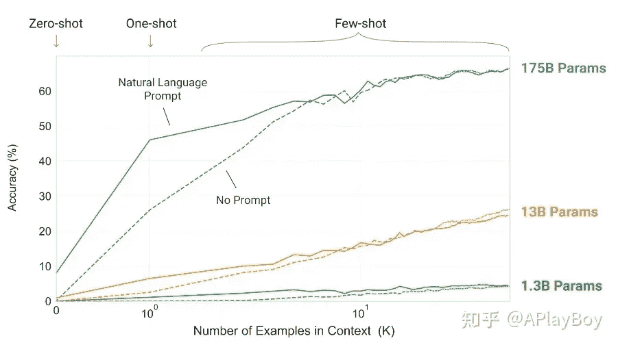
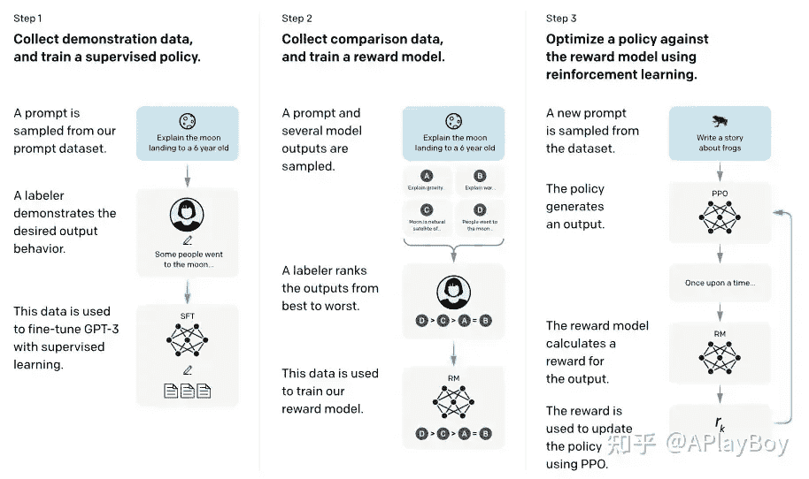
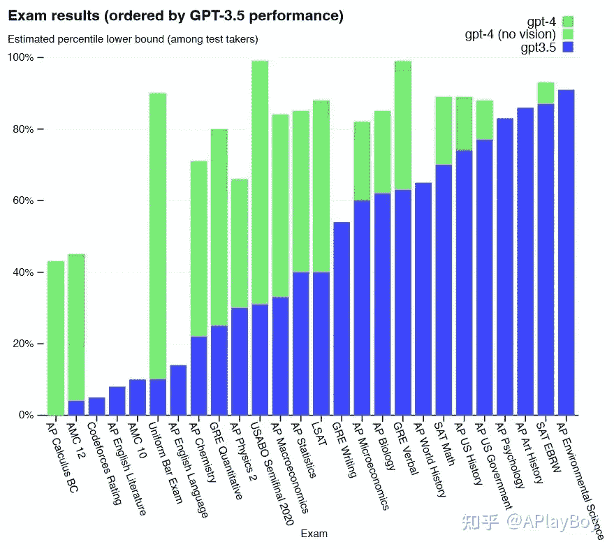

# 大语言模型的前世今生：万字长文完整梳理所有里程碑式大语言模型（LLMs）

> 来源：[https://agijuejin.feishu.cn/docx/MbOAdFaAwoYQbKx9NPlc4neOnrg](https://agijuejin.feishu.cn/docx/MbOAdFaAwoYQbKx9NPlc4neOnrg)

> 作者：APlayBoy | AI生成未来

> 👸号原文：https://mp.weixin.qq.com/s/mZOBAeqVPqnv4j06hnbP4Q

> 知乎原文：https://zhuanlan.zhihu.com/p/691719636

本篇博客全面汇总了大型语言模型（`LLMs`）。从早期的预训练神经语言模型开始，探讨了它们的起源和发展。重点讨论了`Transformer`架构及其三个主要分类：仅编码器`PLMs`、仅解码器`PLM`和编码器-解码器`PLM`。接着，文章聚焦于`GPT`、`LLaMA`和`PaLM`这三大`LLM`家族，阐述了它们的特点和对语言模型领域的贡献。此外，还涉及了其他重要的`LLMs`，展现了该领域的广泛性和多样性。这篇博客不仅是对`LLMs`历史和模型做了完整的梳理，也突出了它们在自然语言处理技术发展中的关键角色。

## 早期预训练神经语言模型

### 模型列表

| Type | Model Name | #Parameters | Release | Base Models | Open Source | #Tokens |

| --- | --- | --- | --- | --- | --- | --- |

| Encoder-Only | `BERT` | 110M, 340M | 2018 | - | ✅ | 137B |

| Encoder-Only | `RoBERTa` | 355M | 2019 | - | ✅ | 2.2T |

| Encoder-Only | `ALBERT` | 12M, 18M, 60M, 235M | 2019 | - | ✅ | 137B |

| Encoder-Only | `DeBERTa` | - | 2020 | - | ✅ | - |

| Encoder-Only | `XLNet` | 110M, 340M | 2019 | - | ✅ | 32.89B |

| Decoder-only | `GPT-1` | 120M | 2018 | - | ✅ | 1.3B |

| Decoder-only | `GPT-2` | 1.5B | 2019 | - | ✅ | 10B |

| Encoder-Decoder | `T5` (Base) | 223M | 2019 | - | ✅ | 156B |

| Encoder-Decoder | `MT5` (Base) | 300M | 2020 | - | ✅ | - |

| Encoder-Decoder | `BART` (Base) | 139M | 2019 | - | ✅ | - |

| GPT Family | `GPT-3` | 125M, 350M, 760M, 1.3B, 2.7B, 6.7B, 13B, 175B | 2020 | - | ❌ | 300B |

| GPT Family | `CODEX` | 12B | 2021 | `GPT` | ✅ | - |

| GPT Family | `WebGPT` | 760M, 13B, 175B | 2021 | `GPT-3` | ❌ | - |

| GPT Family | `GPT-4` | 1.76T | 2023 | - | ❌ | 13T |

| LLaMA Family | `LLaMA1` | 7B, 13B, 33B, 65B | 2023 | - | ✅ | 1T, 1.4T |

| LLaMA Family | `LLaMA2` | 7B, 13B, 34B, 70B | 2023 | - | ✅ | 2T |

| LLaMA Family | `Alpaca` | 7B | 2023 | `LLaMA1` | ✅ | - |

| LLaMA Family | `Vicuna-13B` | 13B | 2023 | `LLaMA1` | ✅ | - |

| LLaMA Family | `Koala` | 13B | 2023 | `LLaMA` | ✅ | - |

| LLaMA Family | `Mistral-7B` | 7.3B | 2023 | - | ✅ | - |

| LLaMA Family | `Code Llama` | 34 | 2023 | `LLaMA2` | ✅ | 500B |

| LLaMA Family | `LongLLaMA` | 3B, 7B | 2023 | `OpenLLaMA` | ✅ | 1T |

| LLaMA Family | `LLaMA-Pro-8B` | 8.3B | 2024 | `LLaMA2-7B` | ✅ | 80B |

| LLaMA Family | `TinyLlama-1.1B` | 1.1B | 2024 | `LLaMA1.1B` | ✅ | 3T |

| PaLM Family | `PaLM` | 8B, 62B, 540B | 2022 | - | ❌ | 780B |

| PaLM Family | `U-PaLM` | 8B, 62B, 540B | 2022 | - | ❌ | 1.3B |

| PaLM Family | `PaLM-2` | 340B | 2023 | - | ✅ | 3.6T |

| PaLM Family | `Med-PaLM` | 540B | 2022 | `PaLM` | ❌ | 780B |

| PaLM Family | `Med-PaLM 2` | - | 2023 | `PaLM 2` | ❌ | - |

| Other Popular LLMs | `FLAN` | 137B | 2021 | `LaMDA-PT` | ✅ | - |

| Other Popular LLMs | `Gopher` | 280B | 2021 | - | ❌ | 300B |

| Other Popular LLMs | `ERNIE 4.0` | 10B | 2023 | - | ❌ | 4TB |

| Other Popular LLMs | `Retro` | 7.5B | 2021 | - | ❌ | 600B |

| Other Popular LLMs | `LaMDA` | 137B | 2022 | - | ❌ | 168B |

| Other Popular LLMs | `ChinChilla` | 70B | 2022 | - | ❌ | 1.4T |

| Other Popular LLMs | `Galactia-120B` | 120B | 2022 | - | - | 450B |

| Other Popular LLMs | `CodeGen` | 16.1B | 2022 | - | ✅ | - |

| Other Popular LLMs | `BLOOM` | 176B | 2022 | - | ✅ | 366B |

| Other Popular LLMs | `Zephyr` | 7.24B | 2023 | `Mistral-7B` | ✅ | 800B |

| Other Popular LLMs | `Grok-0` | 33B | 2023 | - | ❌ | - |

| Other Popular LLMs | `ORCA-2` | 13B | 2023 | `LLaMA2` | - | 2001B |

| Other Popular LLMs | `StartCoder` | 15.5B | 2023 | - | ✅ | 35B |

| Other Popular LLMs | `MPT` | 7B | 2023 | - | ✅ | 1T |

| Other Popular LLMs | `Mixtral-8x7B` | 46.7B | 2023 | - | ✅ | - |

| Other Popular LLMs | `Falcon 180B` | 180B | 2023 | - | ✅ | 3.5T |

| Other Popular LLMs | `Gemini` | 1.8B, 3.25B | 2023 | - | ✅ | - |

| Other Popular LLMs | `DeepSeek-Coder` | 1.3B, 6.7B, 33B | 2024 | - | ✅ | 2T |

| Other Popular LLMs | `DocLLM` | 1B, 7B | 2024 | - | ❌ | 2T |

### 前期研究

神经网络在语言模型领域的应用是逐渐深入和扩展的。最初从简单的模型开始，随后在机器翻译等实际应用中得到验证，最终发展出了更为复杂和强大的模型，如`LSTM`和`GRU`。

+ **早期的神经语言模型**：Bengio等人开发了最早期的神经语言模型（`NLMs`）。这些模型可以与传统的n-gram模型相媲美。接下来，成功地将`NLMs`应用到机器翻译领域。

+ **RNNLM的推广作用**：Mikolov发布了`RNNLM`（一个开源的`NLM`工具包），这极大地推广了`NLMs`的应用。

+ 基于`RNN`的`NLMs`的广泛应用 ：此后，基于循环神经网络（`RNN`）及其变体，如长短期记忆网络（`LSTM`）和门控循环单元（`GRU`）]的`NLMs`，被广泛应用于包括机器翻译、文本生成和文本分类等多种自然语言处理任务。

### Transformer 架构

在`Transformer`架构的帮助下，`NLMs`实现了一次质的飞跃。通过其自注意力机制，`Transformer`不仅解决了`RNN`在并行化处理上的限制，还显著提升了模型处理大规模数据集的能力。这种技术的进步为预训练语言模型（`PLMs`）的发展铺平了道路，使得这些模型能够更加灵活地适应各种不同的下游任务。

+ `Transformer`架构：紧接着，`Transformer`架构的发明成为了神经语言模型发展的另一个重要里程碑。`Transformer`通过应用自注意力机制，能够并行计算句子或文档中每个词的“注意力得分”，这个得分用于模拟每个词对其他词的影响。

+ **优势与应用**：相比于`RNN`，`Transformer`允许更多的并行化操作。这使得我们可以在GPU上有效地对大规模数据进行预训练，构建非常庞大的语言模型。

+ 预训练语言模型（`PLMs`）及其微调 ：这些预训练的语言模型（`PLMs`）可以被用来微调，适应多种下游任务。

### Transformer的早期分类

基于`Transfomer`的早期`PLMs`分类：在早期流行的基于`Transformer`的预训练语言模型（`PLMs`）中，根据它们的神经架构，我们可以将它们分为三个主要类别：仅编码器、仅解码器和编码器-解码器模型。

### 仅编码器`PLMs`

仅编码器模型只包含一个编码器网络。这类模型最初是为了语言理解任务而开发的，比如文本分类，模型需要对输入的文本预测一个类别标签。代表性的仅编码器模型包括`BERT`及其变种，例如`RoBERTa`、`ALBERT`、`DeBERTa`、`XLM`、`XLNet`、`UNILM`等。

#### BERT模型

`BERT`（双向编码器表示的`Transformer`）是最广泛使用的仅编码器语言模型之一。

图1：`Bert`的全面的预训练和微调

+ **组成模块**：

1. **嵌入模块**：将输入文本转换成一系列嵌入向量。

1. `Transformer`编码器堆栈 ：将嵌入向量转换成上下文表示向量。

1. **全连接层**：将表示向量（在最终层）转换为独热向量。

+ **预训练目标**：`BERT`使用两种目标进行预训练：掩蔽语言模型（`MLM`）和下一个句子预测。

+ **微调应用**：预训练的`BERT`模型可以通过添加分类器层进行微调，适用于从文本分类、问答到语言推理的多种语言理解任务。

+ **框架概览**：`BERT`框架的高级概览见图1。

+ **对AI社区的影响**：发布时，`BERT`在各种语言理解任务上大幅提升了水平，激发了AI社区开发了许多基于`BERT`的类似仅编码器语言模型。

#### RoBERTa

`RoBERTa`通过一系列模型设计选择和训练策略，显著提高了`BERT`的鲁棒性。这些改进包括修改关键超参数、取消下一个句子预训练目标、使用更大的小批量和学习率进行训练。

#### ALBERT

`ALBERT`使用了两种参数减少技术来降低内存消耗并加快`BERT`的训练速度：(1) 将嵌入矩阵分割成两个更小的矩阵；(2) 使用分组的重复层。

#### DeBERTa

`DeBERTa`（具有解耦注意力的增强`BERT`）使用两种新技术改进了`BERT`和`RoBERTa`模型。首先是解耦注意力机制，其中每个词用两个向量表示其内容和位置，而词之间的注意力权重是用它们的内容和相对位置的解耦矩阵分别计算的。其次，使用增强的遮蔽解码器在模型预训练中预测遮蔽的`token`，这个解码器引入了绝对位置。此外，`DeBERTa`在微调时使用了一种新的虚拟对抗训练方法以提高模型的泛化能力。

#### ELECTRA

图2：替换`token`检测和`MLM`的对比

`ELECTRA` 使用了一种名为替换`token`检测（`RTD`）的新预训练任务，经验证比`MLM`更有效。与其遮蔽输入，`RTD`通过用来自小生成器网络的合理替代品替换一些`token`来损坏输入。然后，训练一个判别模型来预测损坏输入中的`token`是否被生成的样本所替换。`RTD`之所以比`MLM`更有效率，是因为前者针对所有输入`token`，而不仅仅是被遮蔽的小部分，如图2所示。

#### XLMs的跨语言扩展

图3：跨语言语言模型的预训练。`MLM`（掩码语言模型）的目标与`BERT`相似，但使用连续的文本流而非句子对。`TLM`（翻译语言模型）目标将`MLM`扩展到平行句子对。为了预测一个被掩盖的英语单词，模型可以同时关注英语句子及其法语翻译，并被鼓励将英语和法语的表征进行对齐。

+ `XLMs` 将`BERT`扩展到跨语言模型，使用了两种方法：1. 一种无监督方法，仅依赖单语数据；2. 一种监督方法，利用平行数据和一种新的跨语言模型目标，如图3所示。

+ 当`XLMs`提出时，它们在跨语言分类、无监督和监督机器翻译方面取得了最先进的成果。

### 仅解码器`PLM`

在仅解码器的预训练语言模型中，最广泛使用的是由OpenAI开发的`GPT-1`和`GPT-2`。这些模型为后来更强大的大型语言模型（`LLMs`）打下了基础，比如`GPT-3`和`GPT-4`。

#### GPT-1

图4：`GPT`预训练和微调的概述

`GPT-1`首次展示了通过对仅解码器`Transformer`模型进行生成式预训练（`GPT`），可以在广泛的自然语言任务上取得良好表现。这种预训练是在多样化的未标记文本语料上以自监督学习方式进行的，即预测下一个词/标记。然后在每个特定的下游任务上进行辨别式微调，而这些任务所需的样本数相对较少，如图4所示。`GPT-1`为后续的`GPT`模型铺平了道路，每个后续版本都在架构上进行了改进，从而在各种语言任务上取得更好的性能。

#### GPT-2

+ `GPT-2` 展示了当在包含数百万网页的大型WebText数据集上训练时，语言模型能够在没有任何明确监督的情况下学会执行特定的自然语言任务。

+ `GPT-2`沿用了`GPT-1`的模型设计，并做了一些修改：将层归一化移动到每个子模块的输入处，在最后的自注意力模块后增加了额外的层归一化，修改了初始化过程以适应残差路径上的累积并调整残差层的权重，扩大了词汇量至50,25个，上下文大小从512增加至1024个标记。

### 编码器-解码器`PLM`

Raffle等人展示了几乎所有的NLP任务都可以被视为序列到序列的生成任务。因此，从设计上来说，一个编码器-解码器语言模型是一个统一的模型，它能够执行所有自然语言理解和生成任务。`T5`、`mT5`、`MASS`和`BART`等代表性的编码器-解码器`PLM`表明几乎所有自然语言任务都可以被视为序列到序列的生成任务。

#### T5模型的框架

+ `T5`是一个文本到文本转换`Transformer`（Text-to-Text Transfer `Transformer`, `T5`）模型。它通过引入一个统一框架，在这个框架中，所有NLP任务都被转换为文本到文本的生成任务，从而有效地利用了迁移学习来处理NLP任务。

+ `mT5`是`T5`的多语言版本，它在一个包含101种语言文本的新的基于Common Crawl的数据集上进行预训练。

#### MASS模型的特点

+ `MASS`（遮蔽序列到序列预训练）采用编码器-解码器框架来重构句子片段。编码器接受带有随机遮蔽片段（连续的几个标记）的句子作为输入，解码器预测遮蔽的片段。通过这种方式，`MASS`同时训练编码器和解码器，分别用于语言嵌入和生成。

#### BART模型的训练方式

+ `BART`使用标准的序列到序列翻译模型架构。它通过用任意噪声函数损坏文本，然后学习重构原始文本来进行预训练。

## LLM家族

图5：常见的`LLM`家族

+ 大型语言模型（`LLMs`）的定义 ：主要指基于`Transformer`的预训练语言模型（`PLMs`），包含数十亿至数百亿的参数。

+ **与前述`PLMs`的比较**：与前面评述的`PLMs`相比，`LLMs`在模型规模上要大得多，同时在语言理解和生成能力上也更强，展现出一些小规模模型中不存在的新兴能力。

+ **三大`LLM`家族**：`GPT`、`LLaMA`和`PaLM`，如图5所示。

# GPT家族

## 定义与成员

生成式预训练Transformer（Generative Pre-trained Transformers, `GPT`）是一系列由`OpenAI`开发的仅解码器`Transformer`基础上的语言模型。这个家族包括了`GPT-1`、`GPT-2`、`GPT-3`、`InstructGPT`、`ChatGPT`、`GPT-4`、`CODEX`和`WebGPT`。

## 开源与非开源模型

虽然早期的`GPT`模型如`GPT-1`和`GPT-2`是开源的，但最近的模型如`GPT-3`和`GPT-4`是封闭源代码的，只能通过`API`访问。

## 早期模型回顾

`GPT-1`和`GPT-2`模型已在早期`PLM`小节中讨论。下面将从`GPT-3`开始讨论。

## GPT-3模型

图6：`GPT-3`显示更大的模型越来越有效地利用上下文信息。它展示了在一个简单任务中的上下文学习性能，该任务要求模型从一个单词中删除随机符号，无论是否有自然语言任务描述。

### 参数规模

`GPT-3`是一个拥有1750亿参数的预训练自回归语言模型。

### 大型语言模型的先驱

`GPT-3`被广泛认为是第一个真正意义上的大型语言模型（`LLM`）。它不仅规模远超过之前的`PLMs`，而且首次展现了之前较小规模`PLMs`所没有的新兴能力。

### 在上下文中学习的能力

`GPT-3`展示了在上下文中学习的能力，意味着`GPT-3`可以在没有任何梯度更新或微调的情况下应用于任何下游任务，任务和少量示例仅通过与模型的文本交互来指定。

### 多任务强性能

`GPT-3`在许多`NLP`任务上表现出色，包括翻译、问答和完形填空任务，以及一些需要即时推理或领域适应的任务，如解散单词、在句子中使用新词、三位数算术等。

### 性能与示例数量的关系

图6展示了`GPT-3`的性能随着在上下文提示中示例数量的增加而变化的情况。

## CODEX模型

### 发布与功能

`CODEX`由`OpenAI`在2023年3月发布，是一个通用编程模型，能够解析自然语言并生成相应的代码。

### GPT-3的衍生和微调

`CODEX`是`GPT-3`的衍生产品，针对编程应用进行了微调，其训练数据来自`GitHub`收集的代码语料库。

### 实际应用

`CODEX`支持微软的`GitHub Copilot`服务。

## WebGPT模型

### 衍生与功能

`WebGPT`是`GPT-3`的另一个衍生产品，经过微调，能够使用基于文本的网页浏览器回答开放式问题，帮助用户搜索和浏览网页。

### 训练步骤

1. 模仿人类浏览行为：首先，`WebGPT`学习使用人类演示数据来模仿人类的浏览行为。
2. 学习奖励函数：然后，学习一个奖励函数来预测人类的偏好。
3. 通过强化学习优化：最后，`WebGPT`通过强化学习和拒绝采样来优化这个奖励函数。

## InstructGPT

图7：`RLHF`概述

### 设计初衷

为了使大型语言模型（`LLMs`）能够按照预期遵循人类指令，提出了`InstructGPT`。该模型旨在通过使用人类反馈进行微调，使语言模型与用户在广泛任务上的意图保持一致。

训练过程：

### 收集示范数据集

首先从标注者编写的提示和通过`OpenAI API`提交的提示开始，收集了一组标注者演示所期望的模型行为的数据集。

### GPT-3微调

然后在此数据集上对`GPT-3`进行微调。

使用人类反馈进一步微调：收集一组人类对模型输出进行排名的数据集，利用强化学习进一步微调模型。这种方法被称为“来自人类反馈的强化学习”（`RLHF`），如图7所示。

### InstructGPT的改进

微调后的`InstructGPT`模型在真实性上有所提升，在生成有害输出方面有所减少，同时在公共`NLP`数据集上的性能回退很小。

## ChatGPT的推出

### 发布时间和特性

`ChatGPT`于2022年11月30日推出。`ChatGPT`是一个聊天机器人，使用户能够引导对话来完成广泛的任务，如问答、信息搜索、文本摘要等。

### 技术基础和应用

`ChatGPT`由`GPT-3.5`（及后来的`GPT-4`）驱动，这是`InstructGPT`的兄弟模型，训练有素地遵循提示中的指令并提供详细回应。

## GPT-4模型

图8：`GPT-4` 在学术和专业考试中的表现，与`GPT 3.5` 进行比较。

### 最新进展

`GPT-4`是`GPT`家族中最新且最强大的大型语言模型（`LLM`）。它于2023年3月推出。

### 多模态能力

`GPT-4`是一个多模态`LLM`，可以接受图像和文本作为输入，并生成文本输出。

### 性能表现

尽管在一些最具挑战性的真实世界场景中仍不及人类，`GPT-4`在各种专业和学术基准测试中展现出了与人类相媲美的性能。例如，它在模拟律师资格考试中的得分位于前10%的考生之间，如图8所示。

### 训练与微调方法

与早期的`GPT`模型类似，`GPT-4`首先在大型文本语料库上预训练以预测下一个标记，然后通过`RLHF`（来自人类反馈的强化学习）微调，使模型行为与人类期望的行为更加一致。

# LLaMA家族

## 发布方

`LLaMA`是由`Meta`发布的一系列基础语言模型。

## 开源与授权

与`GPT`模型不同，`LLaMA`模型是开源的，即模型权重在非商业许可下向研究社区开放。

## 快速发展与广泛应用

由于其开源性质，`LLaMA`家族的发展迅速，这些模型被许多研究团队广泛使用，旨在开发更好的开源大型语言模型（`LLMs`）来与封闭源代码的模型竞争，或为关键任务应用开发特定任务的`LLMs`。

## LLaMA模型

### 发布时间与规模

`LLaMA`模型系列的第一组模型于2023年2月发布，参数规模从70亿到650亿不等。

### 预训练数据

这些模型是在数万亿个标记上进行预训练的，这些标记来自公开可用的数据集。

### 架构与创新

`LLaMA`采用了与`GPT-3`类似的`Transformer`架构，但进行了一些小的架构修改，包括：

1. 使用`SwiGLU`激活函数替代`ReLU`。
2. 使用旋转位置嵌入（`rotary positional embeddings`）代替绝对位置嵌入。
3. 使用均方根层归一化（`root-mean-squared layer-normalization`）代替标准层归一化。

### 性能对比

开源的`LLaMA-13B`模型在大多数基准测试中超越了专有的`GPT-3`（`175B`）模型，使其成为`LLM`研究的良好基准。

## LLaMA-2

图9：`llama2-chat`的训练流程

### 发布背景

2023年7月，`Meta`与微软合作发布了`LLaMA-2`系列，其中既包括基础语言模型，也包括为对话而微调的聊天模型，称为`LLaMA-2 Chat`。

### 性能优势

`LLaMA-2 Chat`模型在许多公共基准测试中表现优于其他开源模型。图9展示了`LLaMA-2 Chat`的训练过程。

### 训练流程

#### 预训练

首先使用公开可用的在线数据预训练`LLaMA-2`。

#### 初步微调

然后，通过监督微调构建`LLaMA-2 Chat`的初始版本。

#### 迭代精炼

随后，模型通过`RLHF`、拒绝采样和邻近策略优化（`proximal policy optimization`）进行迭代精炼。

### RLHF阶段的重要性

在`RLHF`阶段，为修正奖励模型而积累的人类反馈至关重要，以防止奖励模型改变过多，这可能会破坏`LLaMA`模型训练的稳定性。

## Alpaca

### 来源与微调

`Alpaca`是从`LLaMA-7B`模型微调而来，使用了52K条遵循指令的演示，这些演示是以自我指导的方式生成的，使用了`GPT-3.5`（`text-davinci-003`）。

### 成本效益

`Alpaca`对于训练特别具有成本效益，尤其适合于学术研究。

### 性能表现

在自我指导评估集上，`Alpaca`的性能与`GPT-3.5`相似，尽管`Alpaca`的模型规模要小得多。

## Vicuna-13B

图10：`Vicuna-13B`与其他几个知名模型在`GPT-4`下的相对响应质量。

### 开发背景

`Vicuna`团队通过对`LLaMA`模型进行微调，利用从`ShareGPT`收集的用户共享对话，开发出了13B聊天模型`Vicuna-13B`。

### 初步评估结果

使用`GPT-4`作为评估器的初步评估显示，`Vicuna-13B`在质量上达到了`OpenAI`的`ChatGPT`和`Google`的`Bard`的90%以上，而且在90%以上的情况下超过了其他模型，如`LLaMA`和`Stanford Alpaca`。

### 性能对比图

图10展示了`Vicuna-13B`与其他一些知名模型（由`GPT-4`评估）的相对响应质量。

### 训练成本优势

`Vicuna-13B`的另一个优势是其相对有限的模型训练计算需求。`Vicuna-13B`的训练成本仅为300美元。

## Guanaco

### 微调方法与特点

`Guanaco`模型和`Alpaca`、`Vicuna`一样，是使用遵循指令的数据微调的`LLaMA`模型。但`Guanaco`的微调通过`QLoRA`技术非常高效，即使是对650亿参数的模型，也可以在单个48GB `GPU`上完成。

### QLoRA技术

`QLoRA`通过冻结的、4位量化的预训练语言模型反向传播梯度到低秩适配器（`LoRA`）。

### 性能对比

最优秀的`Guanaco`模型在`Vicuna`基准测试中胜过所有之前发布的模型，达到了`ChatGPT`性能水平的99.3%，而且只需要在单个`GPU`上微调24小时。

## Koala

### 构建背景

`Koala`是又一个基于`LLaMA`的遵循指令的语言模型，特别关注包含用户输入和由高性能封闭源代码聊天模型（如`ChatGPT`）生成的响应的交互数据。

### 性能评估

根据基于现实世界用户提示的人类评估，`Koala-13B`模型在性能上与最先进的聊天模型相当。

## Mistral-7B

### 模型特点

`Mistral-7B`是一个拥有70亿参数的语言模型，为卓越的性能和效率而设计。

### 性能对比

`Mistral-7B`在所有评估的基准测试中表现优于最佳的开源13B模型（`LLaMA-2-13B`），在推理、数学和代码生成方面优于最佳的开源34B模型（`LLaMA-34B`）。

### 关键技术

该模型利用分组查询注意力（`grouped-query attention`）实现更快的推理，并结合滑动窗口注意力（`sliding window attention`）有效处理任意长度的序列，同时降低了推理成本。

## LLaMA家族的迅速增长

### 基于LLaMA的模型丰富多样

`LLaMA`家族正在迅速增长，许多遵循指令的模型都是基于`LLaMA`或`LLaMA2`构建的，包括`Code LLaMA`、`Gorilla`、`Giraffe`、`Vigogne`、`Tulu 65B`、`Long LLaMA`和`Stable Beluga2`等。

# PaLM家族

## 发展方与首款模型

`PaLM`（`Pathways`语言模型）家族是由谷歌开发的。第一个`PaLM`模型在2022年4月公布，并一直保持私有状态直到2023年3月。它是一个基于5400亿参数的`Transformer LLM`。

## 预训练数据与资源

模型是在一个由7800亿个标记组成的高质量文本语料上预训练的，覆盖了广泛的自然语言任务和用例。`PaLM`在6144个`TPU v4`芯片上使用`Pathways`系统进行预训练，该系统实现了跨多个`TPU Pods`的高效训练。

## 性能和成果

`PaLM`证明了规模扩大的持续益处，通过在数百个语言理解和生成基准测试中实现了最先进的小样本学习结果。`PaLM-540B`不仅在一系列多步推理任务上胜过最先进的微调模型，而且在最近发布的`BIG-bench`基准测试中与人类表现相当。

## U-PaLM模型的持续训练

### 模型规模

`U-PaLM`模型有8B、62B和540B三个规模。

### 持续训练方法

在`PaLM`上使用`UL2R`方法进行持续训练，这是一种用`UL2`的混合去噪目标进行`LLMs`少量步骤训练的方法。

### 计算效率

报告显示，使用此方法可实现约2倍的计算节省。

## Flan-PaLM的指令微调

图11：`Flan-PaLM` 微调包含以上任务类别中的 473 个数据集。

### 微调特点

`Flan-PaLM`是对`U-PaLM`进行指令微调后的结果。与其他指令微调工作相比，`Flan-PaLM`使用了更多的任务、更大的模型规模和链式思考数据进行微调。

### 性能提升

`Flan-PaLM`在性能上显著超过先前的遵循指令模型。例如，`Flan-PaLM-540B`在1.8K任务上进行了指令微调，相比`PaLM-540B`平均提高了9.4%。

### 微调数据

微调数据包括473个数据集、146个任务类别，总共1,836个任务，如图11所示。

## PaLM-2模型的计算效率和多语言能力

### 性能提升

`PaLM-2`是一个相比前身`PaLM`更具计算效率且在多语言和推理能力上表现更佳的`LLM`。

### 训练方法

`PaLM-2`是通过混合目标进行训练的。

### 评估与成果

在英语、多语言和推理任务的广泛评估中，`PaLM-2`在不同模型规模的下游任务中显著提升了模型性能，同时展现了比`PaLM`更快且更高效的推理能力。

## Med-PaLM：面向医疗领域的专用模型

### 模型定位

`Med-PaLM`是一个专门设计用于提供高质量医学问题答案的领域特定`PaLM`。

### 微调方法

`Med-PaLM`是在`PaLM`上使用指令提示微调方法进行微调的，这是一种使用少量示例将`LLMs`调整到新领域的参数高效方法。

### 性能与应用

`Med-PaLM`在许多医疗保健任务上取得了令人鼓舞的结果，尽管其性能仍不及人类医生。

## Med-PaLM 2的进一步改进

### 改进方法

`Med-PaLM 2`通过医学领域微调和合成提示（`ensemble prompting`）改进了`Med-PaLM`。

### 性能提升

在`MedQA`数据集上，`Med-PaLM 2`的得分高达86.5%（这是一个结合了六个现有开放问题答案数据集的基准，涵盖了专业医学考试、研究和消费者查询），比`Med-PaLM`提高了19%以上，创造了新的最先进水平。

# 其他代表性LLM

除了之前讨论的三个大型语言模型家族外，还有一些不属于这些家族的流行`LLMs`，它们同样在性能上取得了显著成就，推动了`LLMs`领域的发展。接下来将简要描述这些`LLMs`，突出它们在各自领域和任务中的重要贡献和创新。

## FLAN模型的指令微调

图12：指导调优与预训练微调和提示方法的比较。

### 研究背景

`Wei`等人探索了一种提高语言模型零样本学习能力的简单方法。他们证明了通过对一系列数据集进行指令微调，可以显著提高模型在未见过任务上的零样本表现。

### 微调过程

他们对一个1370亿参数的预训练语言模型进行指令微调，使用了超过60个通过自然语言指令模板表达的`NLP`数据集。

### 模型命名与性能比较

这个指令微调的模型被称为`FLAN`。图12提供了指令微调与预训练-微调和提示之间的比较。

## Gopher模型的性能分析

图13：具有不同参数数量的 `Gopher` 模型架构细节。

### 模型规模与性能

`Rae`等人展示了基于`Transformer`的语言模型在从数千万到2800亿参数不等的各种规模上的性能分析，其中包括一个叫做`Gopher`的模型。

### 任务评估

这些模型在152个不同的任务上进行了评估，在大多数任务上实现了最先进的性能。不同模型大小的层数、键/值大小等超参数在图13中展示。

## T0模型的开发

### 任务映射系统

`Sanh`等人开发了`T0`，一个系统，用于将任何自然语言任务轻松映射到可读的提示形式。

### 训练和性能

他们将大量有监督的数据集转换为多种不同措辞的提示。这些提示数据集允许对模型执行完全未知任务的能力进行基准测试。然后，开发了一个`T0`编码器-解码器模型来处理文本输入并生成目标响应。该模型在不同任务的`NLP`数据集混合中进行训练。

## ERNIE 3.0的统一框架

图14：`ERNIE 3.0` 的高级模型架构。

### 框架提出

`Sun`等人提出了一个名为`ERNIE 3.0`的统一框架，用于预训练大规模知识增强模型。

### 架构与训练

它融合了自回归网络和自编码网络，使训练后的模型可以通过零样本学习、少样本学习或微调轻松适应自然语言理解和生成任务。他们在一个包含纯文本和大规模知识图的4TB语料库上训练了带有100亿参数的`ERNIE 3.0`。图14展示了`ERNIE 3.0`的模型架构。

## RETRO的增强自回归模型

# 大型语言模型架构与模型汇总

## RETRO：检索增强架构

图15：复古架构。左侧：简化版本，其中长度为 `n = 12` 的序列被分为大小为 `m = 4` 的 `l = 3` 个块。对于每个块，我们检索 `k = 2` 个大小为 `r = 5` 的邻居令牌。检索路径显示在顶部。右侧：`CCA` 运算符中的交互细节。因果关系被保持，因为第一个块的邻居仅影响第一个块的最后一个令牌和第二个块的令牌。

### 模型优化

Borgeaud等人通过在大型语料库中基于前置标记的局部相似性检索文档块，增强了自回归语言模型。

### 性能对比

使用一个2万亿标记的数据库，`Retrieval-Enhanced Transformer`（`RETRO`）在`The Pile`上的表现与`GPT-3`和`Jurassic-1`相当，尽管参数减少了25%。图15展示了`RETRO`结合了冻结的`Bert`检索器、可微编码器和块状交叉注意力机制来预测基于比训练期间消耗的数据量多一个数量级的标记。

## GLaM：混合专家架构

图16：`GLaM` 模型架构。每个`MoE`层（底部块）与一个`Transformer`层（上部块）交替。

### 模型提出

Du等人提出了一系列名为`GLaM`（`Generalist Language Model`）的`LLM`s，它们使用稀疏激活的混合专家架构来扩大模型容量，同时与密集变体相比显著降低训练成本。

### 模型规模与效率

最大的`GLaM`拥有1.2万亿参数，约为`GPT-3`的7倍大。它仅消耗了训练`GPT-3`所需能源的1/3，推理计算需求减半，同时在29个`NLP`任务上的零样本、一样本和少样本性能都更好。图16展示了`GLaM`的高层架构。

## LaMDA：专门用于对话的语言模型

### 模型特点

Thoppilan等人展示了`LaMDA`，这是一系列专门用于对话的基于`Transformer`的神经语言模型，参数多达1370亿，预训练在1.56T字的公共对话数据和网络文本上。

### 微调与改进

他们展示了通过注释数据微调和使模型能够咨询外部知识源，可以显著提高模型在安全性和事实依据方面的挑战。

## OPT：开放预训练Transformer

图17：不同 `OPT` 模型的架构细节。

### 模型系列

Zhang等人提出了`Open Pre-trained Transformers`（`OPT`），一系列仅解码器预训练`Transformer`，参数规模从1.25亿到1750亿不等，共享给研究者。

### 参数展示

`OPT`模型的参数在图17中展示。

## Chinchilla：计算预算下的最优模型大小

### 研究内容

Hoffmann等人研究了给定计算预算下训练`Transformer`语言模型的最优模型大小和标记数量。

### 模型训练与发现

通过训练从7000万到超过160亿参数的400多个语言模型，他们发现对于计算最优训练，模型大小和训练标记数量应该等比例缩放。他们通过训练一个预测的计算最优模型`Chinchilla`（70亿参数，数据增加4%）来测试这一假设。

## Galactica：科学知识存储与推理

### 模型介绍

Taylor等人引入了`Galactica`，一个可以存储、组合和推理科学知识的大型语言模型。

### 训练与表现

`Galactica`在包括论文、参考资料、知识库等在内的大型科学语料库上进行训练，在推理方面表现良好，超越`Chinchilla`和`PaLM 540B`在某些基准测试中的成绩。

## CodeGen：面向程序合成的语言模型

### 模型开发

Nijkamp等人训练并发布了`CODEGEN`系列模型，参数最高达161亿，涵盖自然语言和编程语言数据。

### 训练库与表现

他们开源了训练库`JAXFORMER`，并展示了其在零样本`Python`代码生成任务上与先前最先进水平的竞争性。

### 多步骤程序合成

他们进一步研究了程序合成的多步骤范式，并构建了一个开放基准`Multi-Turn Programming Benchmark`（`MTPB`）。

## AlexaTM：多语言序列到序列模型

### 模型特点

Soltan等人展示了多语言大型序列到序列（`seq2seq`）模型在去噪和因果语言建模（`CLM`）任务上的高效少样本学习能力。

### 训练与性能

他们训练了一个200亿参数的多语言`seq2seq`模型`Alexa Teacher Model`（`AlexaTM 20B`），在1样本摘要任务上实现了最先进性能，超越了更大的540B `PaLM`解码模型。

## Sparrow：信息搜索对话代理

### 模型介绍

Glaese等人介绍了`Sparrow`，一个经过训练以提供更有帮助、正确和无害的信息搜索对话代理。

### 训练方法与评估

他们使用人类反馈的强化学习训练模型，并添加两种新方法以帮助人类评估员判断代理行为。

## Minerva：专注于定量推理的模型

### 模型开发

Lewkowycz等人引入了`Minerva`，这是一个在自然语言数据上预训练，并进一步在技术内容上训练的大型语言模型。

### 应用领域

`Minerva`旨在解决之前`LLM`在定量推理方面的挑战，如解决数学、科学和工程问题。

## MoD：多样化的去噪预训练目标

图18：`Sparrow` 流水线依赖人类参与来持续扩展训练集。

### 研究贡献

Tay等人提出了`Mixture-of-Denoisers`（`MoD`），一种将多种预训练范式结合在一起的预训练目标。

### 训练框架

这种框架被称为`Unifying Language Learning`（`UL2`）。图18展示了`UL2`预训练范式的概览。

## BLOOM：大规模开放访问语言模型

图19：`BLOOM` 架构概述。

### 模型介绍

Scao等人提出了`BLOOM`，这是一个1760亿参数的开放访问语言模型，由数百名研究者合作设计和构建。

### 训练数据与架构

`BLOOM`是一个仅解码器`Transformer`语言模型，训练于`ROOTS`语料库，包括46种自然语言和13种编程语言的数百个来源。图19展示了`BLOOM`架构的概览。

## GLM：双语预训练语言模型

### 模型特点

Zeng等人介绍了`GLM-130B`，一个1300亿参数的双语（英语和中文）预训练语言模型。

### 开源目标

这是尝试开源一个与`GPT-3`（`davinci`）至少同样好的1000亿规模模型，并揭示如此规模的模型如何成功预训练。

## Pythia：公共数据上训练的语言模型

### 模型系列

Biderman等人介绍了`Pythia`，这是一系列在公共数据上以相同顺序训练的16个`LLM`s，参数范围从7000万到120亿。

### 公开访问与工具

他们提供了每个模型的154个检查点的公开访问，以及下载和重建它们确切训练数据加载器的工具，以供进一步研究。

## Orca：模仿推理过程的模型

### 模型开发

Mukherjee等人开发了`Orca`，一个130亿参数的模型，学习模仿大型基础模型的推理过程。

### 学习来源和方法

`Orca`从`GPT-4`获得丰富的信号，包括解释跟踪、逐步思考过程和其他复杂指令，受到`ChatGPT`教师辅导的指导。

## StarCoder：程序合成的语言模型

### 模型介绍

Li等人介绍了`StarCoder`和`StarCoderBase`，它们是拥有155亿参数、`8K`上下文长度的模型，具有填充能力和由多查询注意力支持的快速大批量推理。

### 训练数据与微调

`StarCoderBase`在来自`The Stack`的一万亿标记上进行训练，这是一个包含大量许可`GitHub`仓库的集合。他们在`35B` `Python`标记上对`StarCoderBase`进行微调，创造了`StarCoder`。

### 评估与表现

他们进行了迄今为止最全面的`Code LLM`s评估，表明`StarCoderBase`超越了支持多种编程语言的所有开源`Code LLM`，并在某些方面与`OpenAI`的`code-cushman-001`模型不相上下。

## KOSMOS：多模态大型语言模型

### 模型特点

Huang等人介绍了`KOSMOS-1`，一种可以感知通用模态、在上下文中学习（即少样本）和遵循指令（即零样本）的多模态大型语言模型（`MLLM`）。

### 训练内容与表现

他们从头开始在网络规模的多模态语料库上训练`KOSMOS-1`，包括交错的文本和图像、图像-字幕对和文本数据。实验结果显示`KOSMOS-1`在语言理解、生成甚至是`OCR-free NLP`（直接使用文档图像）、感知-语言任务和视觉任务方面表现出色。

## Gemini：跨模态理解的模型家族

### 模型系列

`Gemini`团队介绍了一系列在图像、音频、视频和文本理解方面表现出色的新型跨模态模型。

### 不同版本

`Gemini`家族包括三个版本：`Ultra`用于高复杂任务，`Pro`用于增强性能和大规模部署，`Nano`用于设备端应用。

### 架构与训练

`Gemini`架构基于`Transformer`解码器，支持`32k`上下文长度（通过使用高效注意力机制）。

## 其他流行的大型语言模型框架和高效开发技术

图20：迄今为止一些最具代表性的大型语言模型（`LLM`）框架的时间线。除了符合我们参数阈值的大型语言模型外，我们还包括了一些具有代表性的工作，这些工作推动了语言模型的极限，并为其成功铺平了道路（例如，标准的`Transformer`、`BERT`、`GPT-1`），以及一些小型语言模型。

### 多样化框架与技术

包括但不限于`Megatron-Turing NLG`、`LongFormer`、`OPT-IML`、`MeTaLM`、`Dromedary`、`Palmyra`、`Camel`、`Yalm`、`MPT`、`ORCA2`、`Gorilla`、`PAL`、`Claude`、`CodeGen 2`、`Zephyr`、`Grok`、`Qwen`、`Mamba`、`Mixtral-8x7B`、`DocLLM`、`DeepSeek-Coder`、`FuseLLM-7B`、`TinyLlama-1.1B` 和 `LLaMA-Pro-8B`。

### 发展与影响

图20提供了一些最具代表性的`LLM`框架的概览，以及那些对`LLM`s成功做出贡献并帮助推动`LLM`s极限的相关工作。

## 结束语

这个博客是大语言模型教程系列的第五篇，现在`LLM`的汇总就要结束了，感谢每位朋友的陪伴，如果对您有帮助，就点个赞呗。您的点赞、关注是我持续分享的动力。我是`@APlayBoy`，期待与您一起在AI的世界里不断成长！

请加小助理 加入`AIGC`技术交流群

### 备注公司/学校+昵称+研究方向

### 往期推荐

[比`SAM`快30倍的`SAM-Lighten`](http://mp.weixin.qq.com/s?__biz=Mzg3Njk3NDkyNQ==&mid=2247489270&idx=1&sn=dd93aad88434ee083e2653b32d6c5cef&chksm=cf2b50d4f85cd9c234a9dd65bc91a4ce67aa49ba54cca9b4759d26aaa38b65ca276763c681e5&scene=21#wechat_redirect)ing来了！推理一张图仅需7毫秒（北航）

清华&VAST提出`CharacterGen`：单张图生成高质量3D角色

从对抗训练到扩散网络：`Diffusion`时代图像修复该何去何从？

[`LLM`和自动驾驶强强联合 | `DriveDream`](http://mp.weixin.qq.com/s?__biz=Mzg3Njk3NDkyNQ==&mid=2247489135&idx=1&sn=a2a8e04ebbfa43a6d9c50d6d15fe30d2&chksm=cf2b504df85cd95bb46db2d6afb79a8e39e9667dd04295e6e32e5d7bc46aceecd8d14cd6ee87&scene=21#wechat_redirect)er-2：自动驾驶定制视频生成世界模型!
