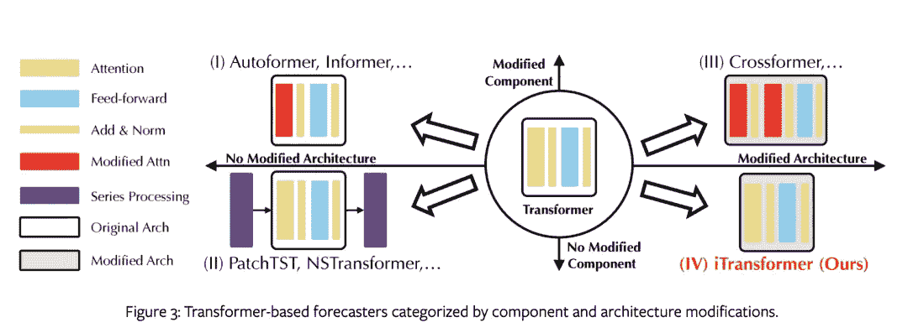
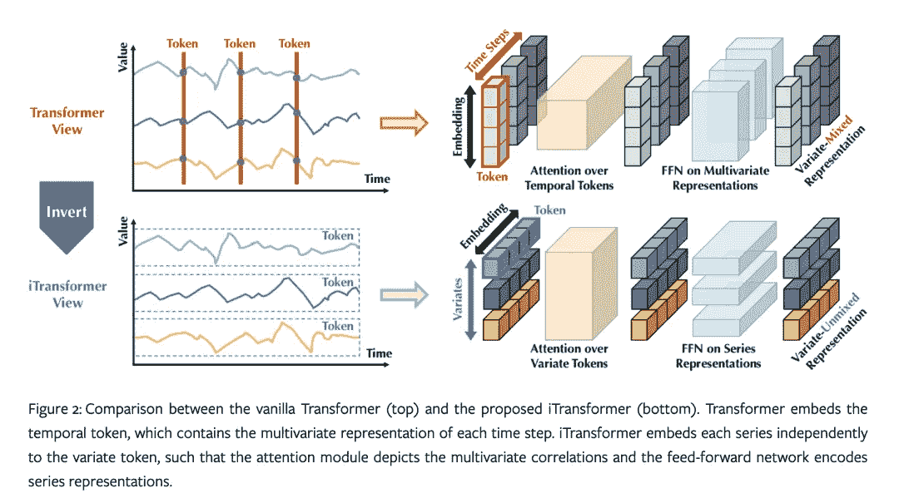
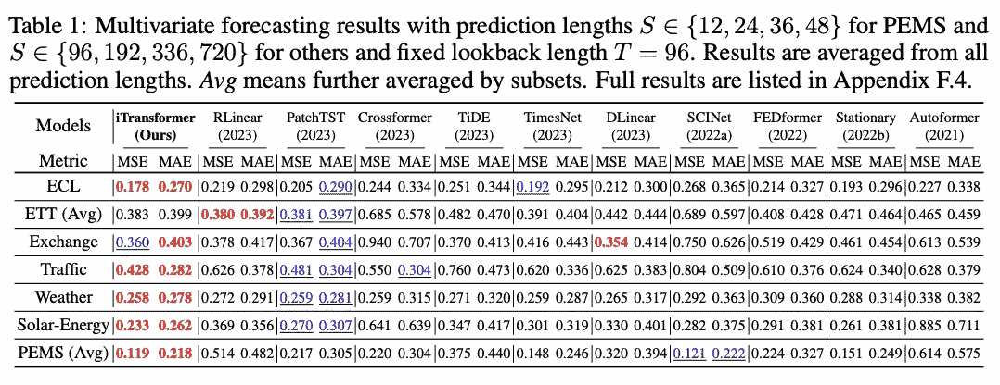
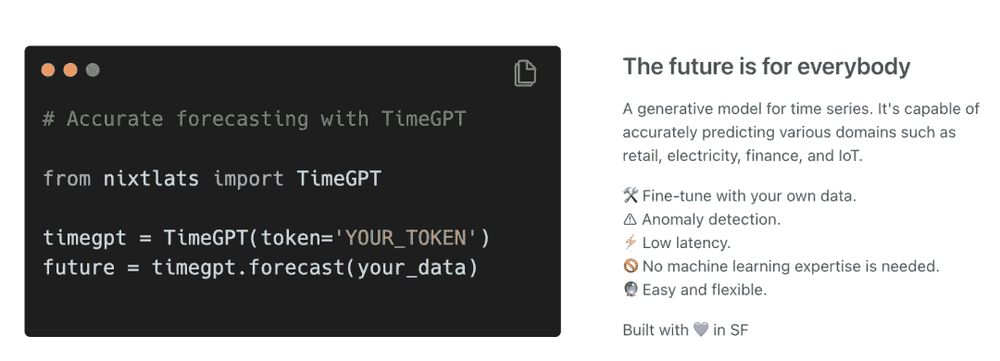
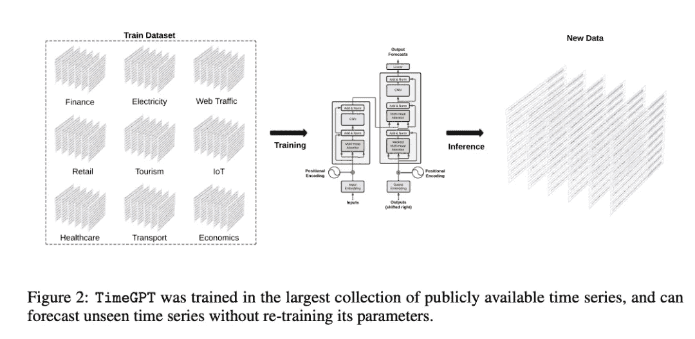
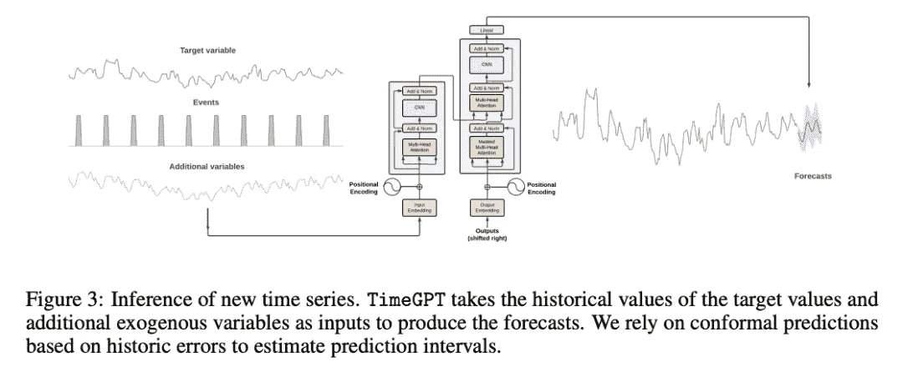
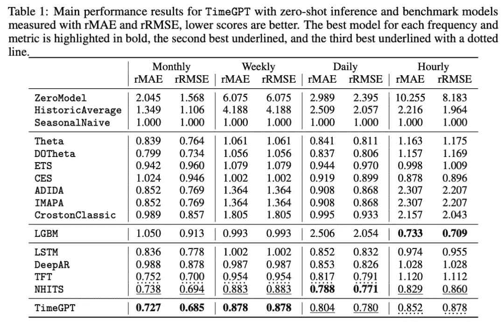
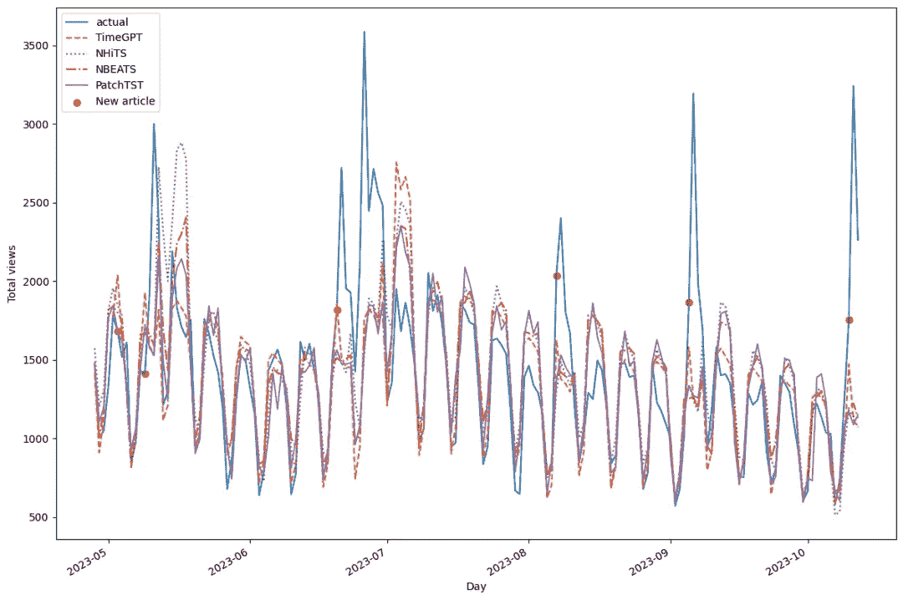
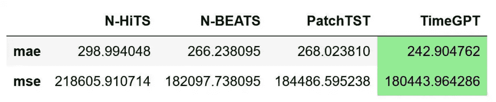

# 大模型能否成为预言家？使用Transformer来进行时序预测可还行？

> 来源：[https://agijuejin.feishu.cn/docx/QJoQdoIGQovbMrxnud4cGpQVnSg](https://agijuejin.feishu.cn/docx/QJoQdoIGQovbMrxnud4cGpQVnSg)

> 作者：ully | AI工程化

> 原文：https://mp.weixin.qq.com/s/i1u0jTJ7oL_3TgzkicR3Sw

大语言模型的成功充分证明了Transformer架构的先进性，越来越多的人希望把它应用到其它领域，而非NLP领域本身，因而也催生了以一套Transformer架构统一各种模态的研究热点。

而在工业界有一个非常常见的场景却鲜有涉及，那就是结构化数据的时序预测类场景，通常认为这种方式利用统计和经典回归类模型就已经足够了，并且确实在过去的研究来看，以Transformer为代表的，在NLP，CV等方面大杀四方的深度学习模型在这方面表现也并不够出色。

但这并不表示学术界和工业界没有在这方面有尝试，甚至可以说，这可能会是下一个爆点。今天我们就围绕这个话题做一些简单介绍。

利用Transformer来进行时序预测，有两个大的方向，一个是针对下游任务训练一个专有任务模型，另一个是做预训练通用大模型。

+   专有任务模型

这类思路起步较早，以N-BEATS、N-HiTS、PatchTST和TimesNet，以及最近清华与蚂蚁金服出的iTransformer为代表，试图通过各种手段来适配时序预测场景。它们大体可以根据是否修改组件和架构分为四类。

第一类是最基本的做法，不改变架构，但改进组件以适应场景，特别是用于时间依赖性建模的注意力模块和长序列的复杂性优化，以autoformer，informer为代表。然而，适配成本较高，性能也备受线性预测器挑战。

第二类是在不改变结构和组件的情况下充分利用Transformer的特性提升模型性能，以PatchTST为代表。它更关注时间序列的固有处理，如平稳化、通道独立性和修补，从而带来持续改进的性能。此外，面对多个变量的独立性和相互作用的日益重要。

第三类在组件和架构均对Transformer进行改造，以CrossFormer为代表。通过改造的注意力机制和架构明确地捕捉到跨时间和跨变量的依赖性。

第四类是仅调整架构，并不改变transfomer原生组件，研究者认为并不是这些组件不好，而是使用方式不当导致的，以itransformer为代表。



值得一提的是，传统的Transformer模型在时间序列预测中存在性能下降和计算爆炸的问题，同时对于具有较大回溯窗口的序列预测也存在挑战。此外，传统的Transformer模型将每个时间步的多个变量嵌入到同一个标记中，可能导致学习到的注意力无意义。作为这一方向最新进展的代表，iTransformer通过不同的嵌入方式和编码方式，能够更 好地处理多元相关性，在没有修改Transformer的任何原生组件的条件下，而是通过全新的倒置视角来实现更好的预测性能，对PatchTST（SOTA）提出了挑战。





https://arxiv.org/pdf/2310.06625v3.pdf

+   **通用时序大模型**

这一思路显然受到了GPT-3这样的通用大语言模型的启发，尝试通过预训练一个大模型，能够在zero-shot下进行时序预测。这一方向听起来非常的时髦，也同时存在巨大的风险，业内对于这样的方式也褒贬不一。其中一个最大的限制就是它很难找到像大语言模型所需要的海量的高质量训练数据。另外，不同领域的问题也很难像语言、图片，视频那样具有泛化性。



这一方向典型代表是TimeGPT，它是由Nixtla提出的，是一个基于Transformer的时间序列模型，采用历史值窗口来进行预测，并添加本地位置编码来丰富输入。该模型通过捕捉过去事件的多样性，进而正确地推断潜在的未来分布。它采用了公开可用的最大时间序列数据集进行训练，包含超过1000亿个数据点。这个训练集涵盖了来自金融、经济、人口统计、医疗保健、天气、物联网传感器数据、能源、网络流量、销售、交通和银行业等广 泛领域的时间序列。由于这种多样化的领域集合，训练数据集包含了具有各种特征的时间序列。和timeGPT同类型的还有 EarthPT， 一个用于地球观测的时间序列基础模型。



https://arxiv.org/pdf/2310.03589.pdf

需要说明的是，TimeGPT并不是直接基于现有的大型语言模型。虽然TimeGPT遵循在大量数据集上训练大型Transformer模型的原则，但其架构专门为用于处理时间序列数据而设计，经过训练后，旨在最小化预测误差。 具体实现方法 论文语焉不详， 有人猜测是利用patch TST或者 NHITS实现。



下表是其论文中提到的性能对比：



另一个直观的性能比较是，利用相同的数据集（marcopeix/time-seriesanalysis/blob/master/data/medium_views_published_holidays.csv），微调TimeGPT与采用N-BEATS, N-HiTS 和 PatchTST 这样的第一类方法训练的模型进行比较。从结果看，经过简单微调的TimeGPT表现比PatchTST更好，获得了第一。





具体实验可参考：https://github.com/marcopeix/time-series-analysis/blob/master/TimeGPT.ipynb

另外，TimeGPT作为一个商业模型，提供了完备的使用文档，可以在其模型上预估和微调自己的时序模型。

```
nixtla_client = NixtlaClient(
    # defaults to os.environ.get(&quot;NIXTLA_API_KEY&quot;)
    api_key = &#x27;my_api_key_provided_by_nixtla&#x27;
)

# df: A pandas dataframe containing the time series data.
# h: The number of steps ahead to forecast.
# freq: The frequency of the time series in Pandas format. See pandas’ available frequencies.
# time_col: Column that identifies the datestamp column.
# target_col: The variable that we want to forecast.
#预测
timegpt_fcst_pred_int_df = nixtla_client.forecast(
    df=df, h=12, level=[80, 90, 99.7], 
    time_col=&#x27;timestamp&#x27;, target_col=&#x27;value&#x27;,
)


#微调
timegpt_fcst_finetune_df = nixtla_client.forecast(
    df=df, h=12, finetune_steps=10,
    time_col=&#x27;timestamp&#x27;, target_col=&#x27;value&#x27;,
)
```

更多可参考：https://docs.nixtla.io/docs/timegpt_quickstart

综上，可以看出目前基于transformer的时序预测领域尚处于早期阶段，两种思路谁更优尚无法判断，能否取代传统机器学习方式也无定论，但可以肯定的是，未来肯定会有更多人关注这一领域，或许随着数据和方法的不断完备，出现一个类似ChatGPT这样的新物种也未尝不可能。

公众号后台回复“进群”入群讨论。