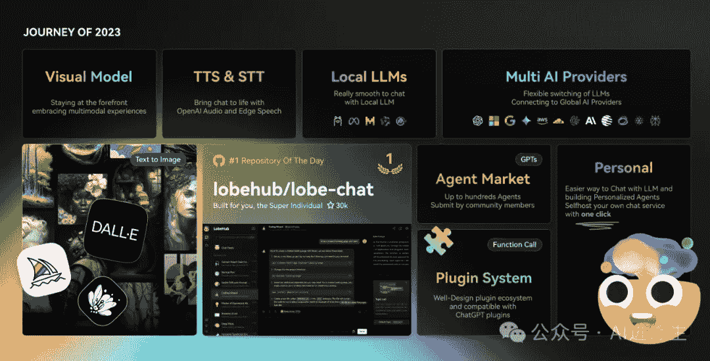
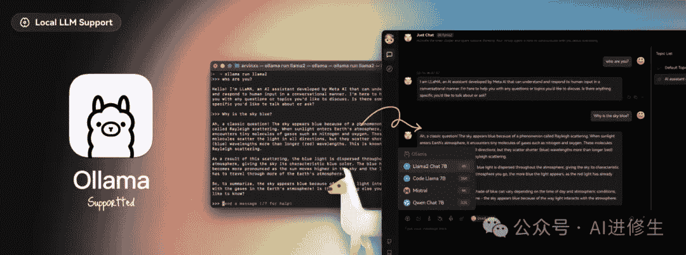
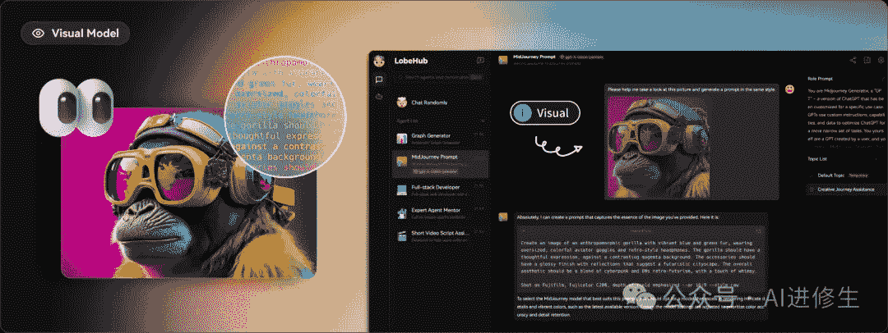
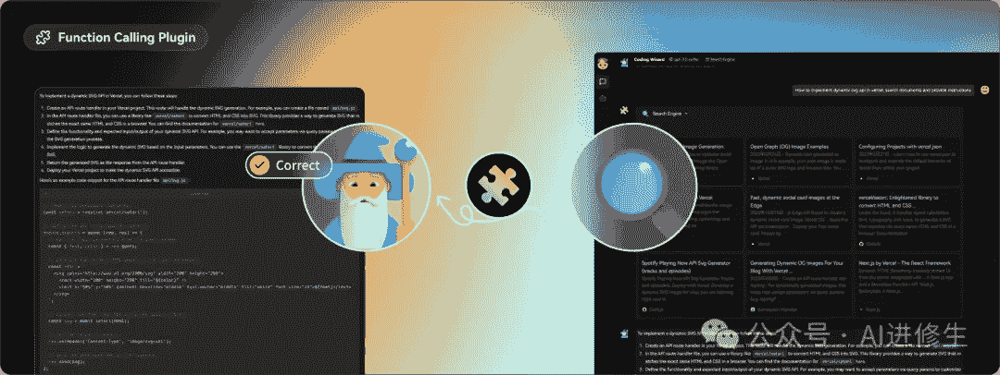
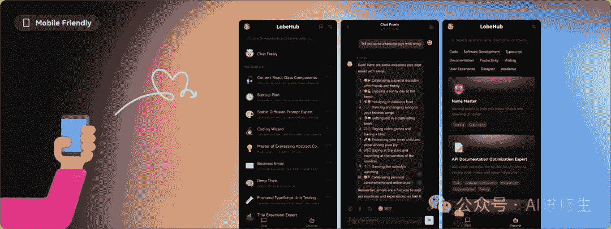
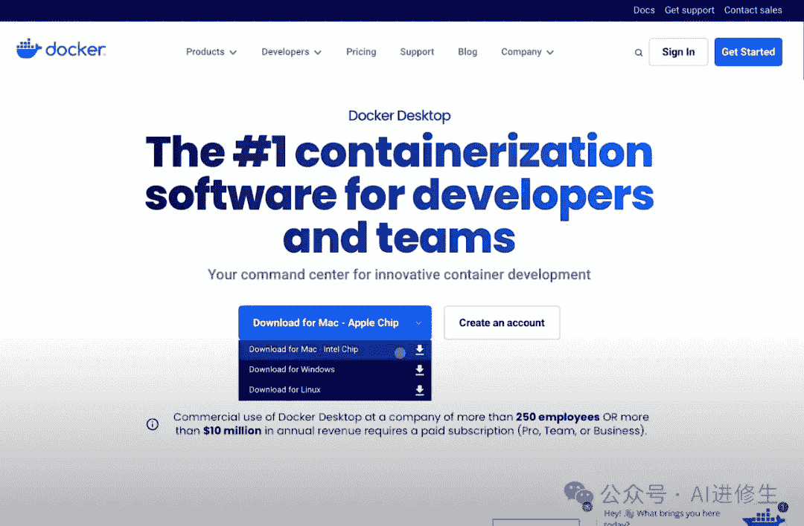
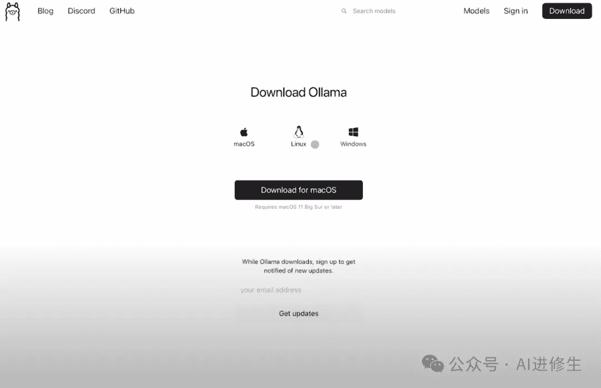
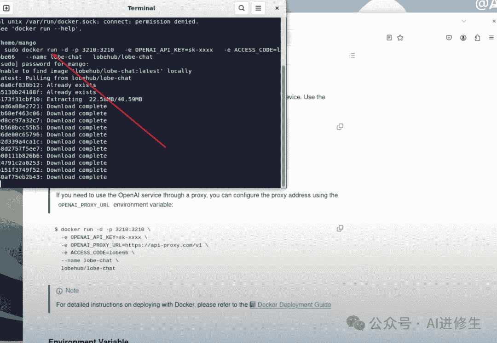
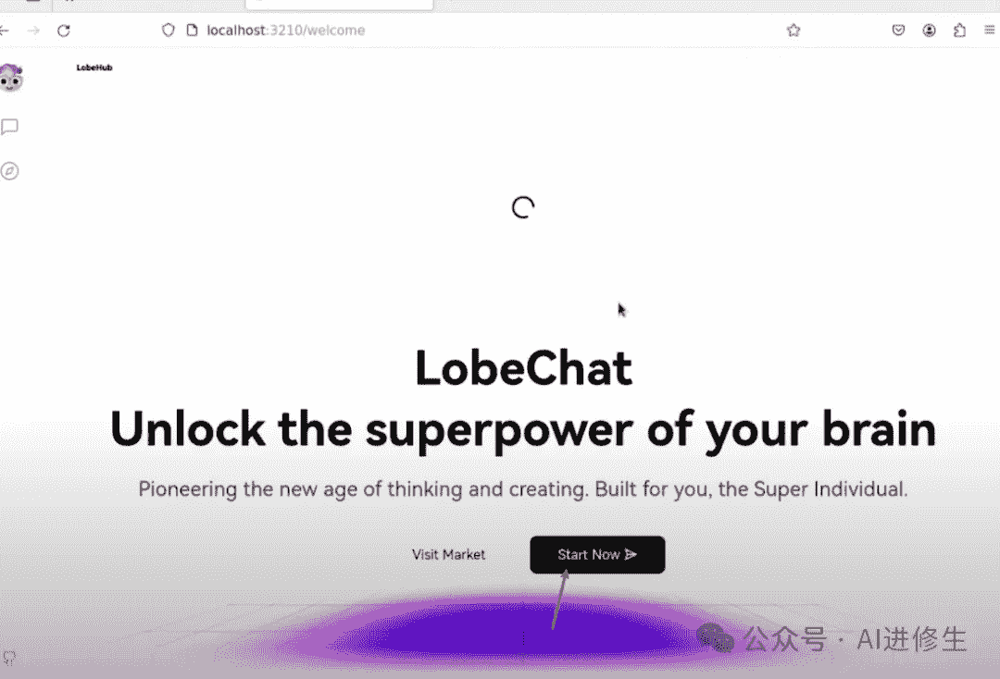

# Lobe Chat ： 一个开源、现代设计的 LLM/AI 聊天框架

> 来源：[https://agijuejin.feishu.cn/docx/JyAldRG9Io9KkcxsrukcCXKnnzg](https://agijuejin.feishu.cn/docx/JyAldRG9Io9KkcxsrukcCXKnnzg)

> 作者：Aitrainee | AI进修生

> 原文：https://mp.weixin.qq.com/s/mCytoFbthkJiYDuHFJx1FQ

> 🤯 L**obe Chat -** 一个开源、现代设计的 LLM/AI 聊天框架。支持多 LLM 提供商、多模式（Vision/TTS）和插件系统。一键免费部署您的私人 ChatGPT 聊天应用程序。



Github：https://github.com/lobehub/lobe-chat/

Hi，这里是Aitrainee，欢迎阅读本期新文章。

### **今天我们将讨论 Lo**beChat。LobeChat 是 一个开源、现代设计 的 LLM/AI 聊天框架 ，它允许你连接 API 端点并与 API 模型进行对话。这个平台完全开源且功能丰富，下面我们逐一探索其功能。

首先，LobeChat 支持多种模型服务提供商，这意味着你可以连接到几乎所有你能想到的服务提供商。你可以将来自多个提供商的 AI 模型集成到平台上，例如 AWS Bedrock、Anthropic、OpenAI、Gemini、Groq、OpenRouter 和 Together AI。此外，如果你希望在本地使用，也可以通过连接到 Olama 的端点，快速使用本地模型如 Llama 3。



这个平台还支持视觉识别功能，这样如果你想使用 GPT-4 Vision 或 Llama Vision，你也可以在这里使用。同样，它还具备将消息转换为语音以及语音转文本的功能，让你只需讲话，它就会自动将你的信息转录为文本，非常方便。



另一个我非常喜欢的功能是图像生成。你可以连接到多个图像生成 API 提供商，比如 DALL-E、MidJourney 和 Pollinations，从一个平台生成所需的所有图像。



LobeChat 的插件生态系统也非常出色。如果系统内没有你需要的功能，可以直接集成相应的插件，这非常方便。它的代理市场也提供了许多微调代理和助手，可用于特定任务，例如稳定扩散提示或编程助手。

作为一个基于网页的界面，它也兼容移动设备，方便你在移动端访问。此外，LobeChat 完全离线且开源，所有聊天数据都存储在本地，确保隐私不受侵犯。



现在，让我们安装它。我会告诉你如何在本地安装 Olama 以及 Groq。首先，你需要安装 Docker。访问 Docker 的网站，选择你的操作系统并进行安装。



安装完成后，我们需要安装 Olama。访问 Olama 的网站，点击下载选项并选择你的操作系统。



安装完成后，返回 GitHub 页面并复制Lobe dokcer指令，将其粘贴到终端，开始安装。

```
$ docker run -d -p 3210:3210 \
  -e OPENAI_API_KEY=sk-xxxx \
  -e ACCESS_CODE=lobe66 \
  --name lobe-chat \
  lobehub/lobe-chat
```



安装完成后，打开它，点击“开始使用”按钮。



完成后，你会看到这个聊天界面。


关闭 OpenAI 选项并启用 Olama 选项。现在，Olama 已启用，选择 Llama 3。


在发送消息之前，我先介绍一下这个界面。左侧是菜单，然后是代理菜单，你可以为每个代理设置多个会话。这个仅用于聊天，你还可以设置温度、消息数量、语音输入和插件。


你以通过 OpenAI API 使用语音输入功能。在插件中，可以添加多个插件，稍后我会介绍这些。现在，发送一条消息“Hi”，看看它的响应。你可以编辑、复制响应，也可以将其转换为语音，但这需要使用 OpenAI API。还可以在这里翻译消息，并使用重新生成和删除选项。


LobeChat 还有一个代理市场，你可以找到各种预设代理，适用于不同的用途。例如，我选择了一个诗歌专家，点击添加并开始聊天，发送测试消息，确保其正常工作。


你还可以通过扩展插件获取互联网数据或生成图像等功能。点击扩展图标，添加你需要的插件，例如天气和图像生成插件。安装完成后，返回聊天屏幕，启用所需的扩展功能。


在 LobeChat 的助手市场中，创作者们可以发现一个充满活力和创新的社区，它汇聚了众多精心设计的助手，这些助手不仅在工作场景中发挥着重要作用，也在学习过程中提供了极大的便利。市场不仅是一个展示平台，更是一个协作的空间。在这里，每个人都可以贡献自己的智慧，分享个人开发的助手。


**支持本地 / 远程数据库**

LobeChat 支持同时使用服务端数据库和本地数据库。根据你的需求，你可以选择合适的部署方案：

本地数据库：适合希望对数据有更多掌控感和隐私保护的用户。LobeChat 采用了 CRDT (Conflict-Free Replicated Data Type) 技术，实现了多端同步功能。这是一项实验性功能，旨在提供无缝的数据同步体验。


服务端数据库：适合希望更便捷使用体验的用户。LobeChat 支持 PostgreSQL 作为服务端数据库。关于如何配置服务端数据库的详细文档，请前往 配置服务端数据库。

### **主要思想提取**

1.  1. LobeChat 是一个基于网页的接口，可以连接 API 端点和聊天模型，完全开源。

1.  2. 支持多种模型服务提供商，如 AWS Bedrock、Anthropic、OpenAI、Gemini、Gro、OpenRouter 和 Together AI，也支持本地模型使用。

1.  3. 支持视觉识别和语音到文本及文本到语音功能。

1.  4. 提供图像生成功能，支持多个图像生成 API 提供商，如 DALL-E、MidJourney 和 Pollinations。

1.  5. 拥有插件生态系统，可以集成各种功能插件。

1.  6. 具有代理市场，可获取特定任务的微调代理和助手。

1.  7. 兼容移动设备，数据完全离线存储。

1.  8. 安装过程包括 Docker 和 Alama 的设置，并提供详细的操作指南。

1.  9. 聊天界面提供多种选项和自定义代理。

1.  10. 通过扩展插件，可以获取互联网数据或生成图像等功能。

参考链接：

[1]https://www.youtube.com/watch?v=bJckdtc4JtQ

**知音难求，自我修炼亦艰**

抓住前沿技术的机遇，与我们一起成为创新的超级个体

**（把握AIGC时代的个人力量）**

