# LLM推理加速，如何解决资源限制与效率挑战

> 来源：[https://agijuejin.feishu.cn/docx/WqvZdw2LaoTCu3xgn2gcCMVgnWd](https://agijuejin.feishu.cn/docx/WqvZdw2LaoTCu3xgn2gcCMVgnWd)

> 作者：Zane | 神州问学

> 原文：https://mp.weixin.qq.com/s/QvN8G_Ap-Frb2S_x95EQNA

> LLM加速推理，GPU资源破局之道。

# **引言**

大型语言模型（LLM）已经在多种领域得到应用，其重要性不言而喻。然而，随着这些模型变得越来越普遍，对GPU资源的需求也随之激增，导致了资源的紧缺。这种紧缺主要源于以下几个方面的原因：

**技术发展需求： **随着人工智能技术的快速发展，特别是在深度学习和大型语言模型领域，对GPU的需求急剧增加。这些模型需要大量的计算资源进行训练和推理，而GPU因其并行处理能力成为首选硬件。

**市场供应限制： **GPU的市场供应受到多种因素的限制，包括生产能力、原材料成本、市场需求等。此外，加密货币挖矿的需求也对GPU的供应造成了压力。

**研发成本回收： **GPU作为高技术含量的产品，其研发和生产成本较高。为了回收成本并实现盈利，GPU的价格也随之上涨。

**国际形势影响： **国际贸易政策和政治形势的变化也可能影响GPU的供应链，进一步加剧资源紧缺的状况。

# **显存碎片化问题**

显存碎片化指的是显存中存在许多零散的小块空闲空间，这些空间无法被利用来分配较大的连续内存块，从而降低了显存的使用效率。由于GPU资源受限，通过高效地使用显存可以相较而言，更好地提升大模型的推理和训练效果。

显存碎片化主要由动态内存分配、多任务运行和不同内存需求造成。在模型推理或训练过程中，程序会频繁申请和释放显存，导致显存中留下许多无法被重新利用的小块空间。在共享的GPU环境中，多个任务可能会同时运行，每个任务都有自己的显存需求，这可能导致显存分配不均，进一步产生碎片。此外，不同的模型或模型的不同部分可能需要不同大小的显存块，使得难以找到合适的连续空间来满足某些大块内存需求。

这种显存碎片化会降低显存的整体使用率，使得实际可用的显存可能不足以支持大模型的运行，从而会增加模型的推理或训练时间，并限制了可以加载到显存中的模型大小，因为大模型需要连续的大块显存空间。这些因素共同影响了大模型推理或训练的效率和可行性。

为了应对这些挑战，业界和学术界正在探索多种解决方案，包括优化模型结构以减少资源需求、改进显存管理策略、使用专用硬件和软件工具来提高GPU利用率等。通过这些努力来缓解GPU资源紧缺的压力，更有效地利用计算资源从而提升大型模型推理的效率和可行性。

# **vLLM加速推理框架简介**

vLLM是一种解决当前GPU资源限制的方案，它是一个快速且易于使用的 LLM 推理和服务库。它在服务吞吐量方面是最先进的框架，同时开创性的使用PagedAttention高效管理注意力键和值内存，并且支持多种量化模型等，不仅如此它还与Hugging Face模型无缝衔接，对分布式推理并行支持兼容OpenAI的API服务器，还支持了上百种开源模型。

vLLM 由加州大学伯克利分校开发，23年期间在Chatbot Arena 和 Vicuna Demo进行了部署。即使像 LMSYS 这样的小型研究团队计算资源有限，也能负担得起 LLM 服务的核心技术。随后Koala 和 LLaMA等越来越多受欢迎的模型都开始使用vLLM提供服务。

vLLM 采用了分页注意力算法（PagedAttention），这是一个新型注意力算法，可有效管理注意力键和值。配备分页注意力算法的 vLLM 重新定义了 LLM 服务的新技术水平：它的吞吐量比 HuggingFace Transformers 高出 24 倍，而且无需更改任何模型架构。

# **vLLM框架下的模型加速技术**

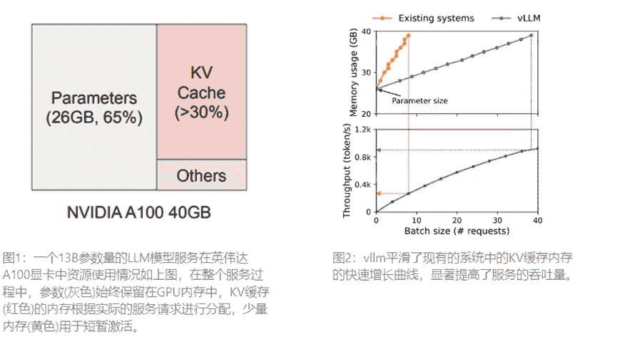

LLM的核心是一个自回归变化器模型。模型根据输入（提示）和它迄今为止生成的输出标记的前一序列，一次生成一个词（标记）。每次重新搜索时，都需要重复这个昂贵的过程，直到模型输出一个终止标记。这种顺序生成过程使得工作负载受到内存的限制，无法充分利用GPU的计算能力，限制了服务吞吐量。将多个请求分批处理可以提高吞吐量。但是要批量处理多个请求，就必须有效管理每个请求的内存空间，例如图1展示了在配备40G内存的英伟达A100GPU上处理13B参数的LLM的内存的分配情况。大约65%的内存分配给了权重模型，这些权重在服务过程中保持不变。近30%的内存用于存储请求的动态状态。对于Transformers而言，这些状态与注意力机制相关的键和值张量，通常称为KV缓存，他们代表了从早期标记到依次生成新输出标记的上下文。而这些KV 缓存又有以下特点：

●大：在 LLaMA-13B 中，单个序列最多需要 1.7GB。

●动态：其大小取决于序列长度，而序列长度是高度可变和不可预测的。因此，有效管理 KV 缓存是一项重大挑战。由于碎片化和过度保留，现有系统浪费了60% - 80%的内存。

其余的小内存的百分比用于其他数据，包括被激活的在评估LLM时创建的短暂张量。由于模型的权重是恒定的，而被激活的张量只占GPU内存的一小部分，因此KV缓存的管理方式对于确定最大批次大小至关重要，如果管理不善，KV缓存内存会极大的限制Batch Size，进而限制LLM的吞吐量。

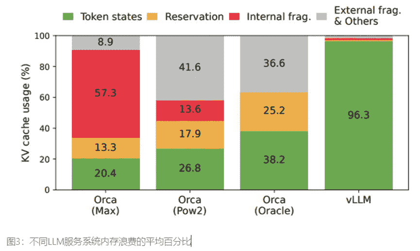

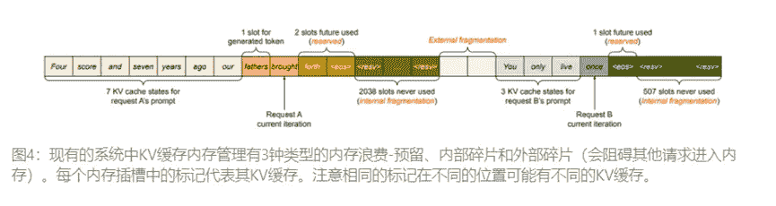

之前的LLM服务系统无法高效的管理内存，主要是因为他们将请求KV缓存存储在连续的内存空间中，而大多数深度学习框架都要求将张量存储在连续的内存中。然而与传统深度学习工作负载中的张量不通，KV缓存具有独特的特性：它会随着模型生成新标记的时间动态增长和收缩，而且其生命周期和长度并不是事先已知的。这些特点使得现有的系统的方法在两个方面明显效率低下，首先现有系统存在内部和外部内存碎片问题。为了在连续内存空间中存储请求KV的缓存，他们预先分配了一块对于请求最大长度（如2048个token）连需的内存。这会导致严重的内部碎片，因为请求的实际长度可能比最大长度短很多，此外即使事现知道实际长度，预分配的效率仍然很低，由于整个分块在请求的生命周期内被保留，其他较短的请求就无法使用当前未使用的分块。此外由于每个请求预分配的大小都可能不同，外部内存碎片也可能非常严重。实际上根据图3的分析表明，在现有的系统中，只有20.4%-38.2%的KV缓存内存用于存储实际的标记状态。

其次现有系统无法利用内存共享，LLM服务通常使用先进的解码算法，如并行采样和波束搜索，每个请求可产生多个输出。在这样的情况下，请求由多个序列组成，这些序列可以部分共享其KV缓存。然而现有系统无法实现内存共享，因为序列的KV缓存存储在不同的连续空间中。

为了解决以上限制，vLLM提出了分页注意力算法（PagedAttention），这种注意力算法的灵感来自于操作系统（OS）对于内存碎片和共享的解决方案：分页虚拟内存。PagedAttention将请求的KV缓存划分为多个区域，每个区域可包含注意键和值。在PagedAttention中，每个KV缓存没有必要存储在连续的空间中，因此我们可以像操作系统的虚拟内存一样，以更灵活的方式管理KV缓存：可以把每个块看作一个页，tokens看成字节，请求看成进程。这种设计通过使用相对较小的块并按需分配，缓解了内部碎片问题，此外由于所有的块大小相同，它还消除了外部碎片。最后他还能在块的粒度、与同一请求相关的不同序列甚至不同请求之间共享内存。

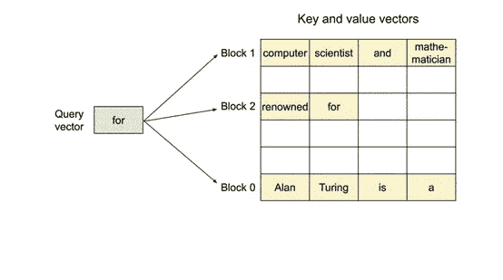

由于区块在内存中不需要连续，因此我们可以像操作系统的虚拟内存一样，以更灵活的方式管理键和值：我们可以把区块看作页，把标记看作字节，把序列看作进程。序列的连续逻辑块通过块表映射到非连续物理内存块。物理内存块在生成新标记时按需分配。

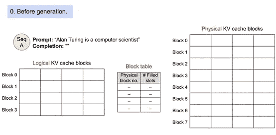

在 PagedAttention 中，内存浪费只发生在序列的最后一个区块。在实践中，这使得内存使用率接近最优，浪费率仅为 4% 以下。事实证明，这种内存效率的提升非常有益：它允许系统将更多序列批量处理在一起，提高了 GPU 的利用率，从而显著提高了吞吐量，如上面的性能结果所示。

PagedAttention 还有另一个关键优势：高效的内存共享。例如，在并行采样中，会从同一提示生成多个输出序列。在这种情况下，提示符的计算和内存可以在输出序列之间共享。

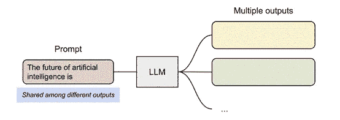

PagedAttention 通过其块表自然而然地实现了内存共享。与进程共享物理内存页的方式类似，PagedAttention 中的不同序列可以通过将其逻辑块映射到相同的物理块来共享块。为确保安全共享，PagedAttention 会跟踪物理块的引用计数，并实施写入时复制机制。

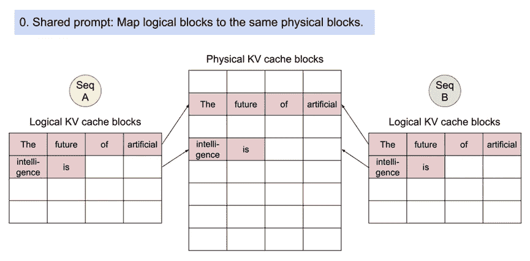

PageAttention 的内存共享功能大大降低了并行采样和波束搜索等复杂采样算法的内存开销，内存使用量最多可减少 55%。这可将吞吐量提高 2.2 倍。这使得此类采样方法在 LLM 服务中非常实用。

# vLLM推理框架下的实际应用与效果

2023年4 月，LMSYS开发了广受欢迎的 Vicuna 聊天机器人模型，并将其公开发布。从那时起，Vicuna 已在聊天机器人竞技场为数百万用户提供服务。最初，LMSYS FastChat 采用了基于高频变形金刚的服务后台来为聊天演示提供服务。随着演示越来越受欢迎，峰值流量飙升了数倍，使高频后端成为一个重要瓶颈。LMSYS 和 vLLM 团队通力合作，很快就开发出了 FastChat-vLLM 集成，将 vLLM用作新的后端，以支持不断增长的需求（多达 5 倍的流量）。在 LMSYS 的早期内部微基准测试中，vLLM 服务后端比最初的高频后端吞吐量高出 30 倍。

自23年4月中旬以来，Vicuna、Koala和LLaMA等最流行的模型都已成功使用FastChat-vLLM集成提供服务--有了FastChat作为多模型聊天服务前端和vLLM作为推理后端，LMSYS就能够利用数量有限的大学赞助的GPU，以高吞吐量和低延迟向数百万用户提供Vicuna服务。LMSYS 正在将 vLLM 的使用扩展到更广泛的模型，包括 Databricks Dolly、LAION 的 OpenAsssiant 和 Stability AI 的 stableLM。

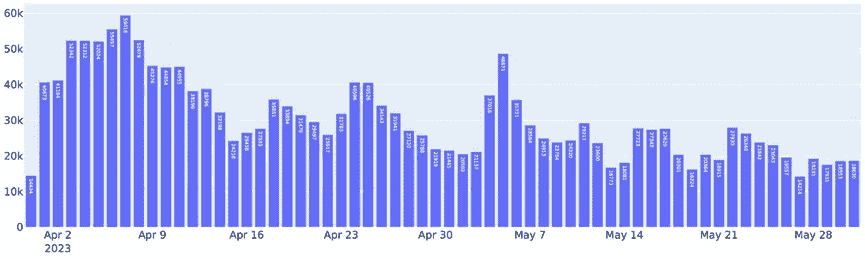

4 月至 5 月期间，聊天机器人竞技场中通过 FastChat-vLLM 集成提供的请求。事实上，超过一半的聊天机器人竞技场请求使用 vLLM 作为推理后端。

vLLM 的使用还大大降低了运营成本。使用 vLLM 后，LMSYS 能够将用于处理上述流量的 GPU 数量减少 50%。vLLM 平均每天处理 30K 个请求，峰值达 60K，这充分证明了 vLLM 的强大功能。

# **结论**

VLLM推理框架通过采用多种技术有效解决了GPU资源紧缺和显存碎片化问题。首先，引入PagedAttention算法允许键值对的非连续存储，通过将键值对划分成多个块并映射到物理块中，实现了键值对的共享和灵活的内存管理，有效避免了显存碎片化。

此外，VLLM利用虚拟内存管理技术，将GPU显存划分为逻辑块，并使用页表技术将这些逻辑块映射到实际的物理块上。这种方法支持延迟分配、写时复制和块粒度的内存交换，根据实际需求动态分配显存资源，从而避免了内存碎片化并提高了显存利用率。VLLM通过模型并行和数据并行策略，将大型模型划分为多个子模型，分布在不同的GPU设备上进行并行推理，以及通过智能的数据分发策略进行计算，不仅进一步提高了显存利用率，还减少了GPU设备间的同步开销。这些策略综合提升了VLLM框架处理大规模模型时的效率和性能。

在官方的博客中比较了 vLLM 与HuggingFace Transformers (HF) 和HuggingFace Text Generation Inference (TGI) 的吞吐量，前者是最流行的 LLM 库，后者是目前最先进的 LLM 库。在两种环境下进行了评估：LLaMA-7B 在英伟达A10G GPU 上运行，LLaMA-13B 在英伟达A100 GPU（40GB）上运行。从 ShareGPT 数据集中对请求的输入/输出长度进行了采样。在实验中，vLLM 的吞吐量比 HF 高出24 倍，比 TGI 高出3.5 倍。

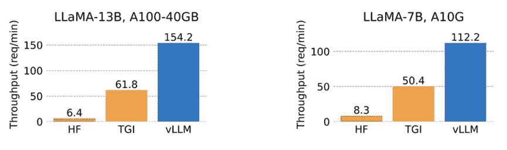

单线程情况下vLLM 的吞吐量比 HF 高 14 - 24 倍，比 TGI 高 2.2 - 2.5 倍。

3个线程的并发情况下，vLLM 的吞吐量比 HF 高 8.5-15 倍，比 TGI 高 3.3-3.5 倍。

同时vllm已经支持市面上的常用的大部分模型，这对于已经使用这些的模型的企业和组织则大大降低了引入vllm的难度。

附：vllm目前支持的模型：

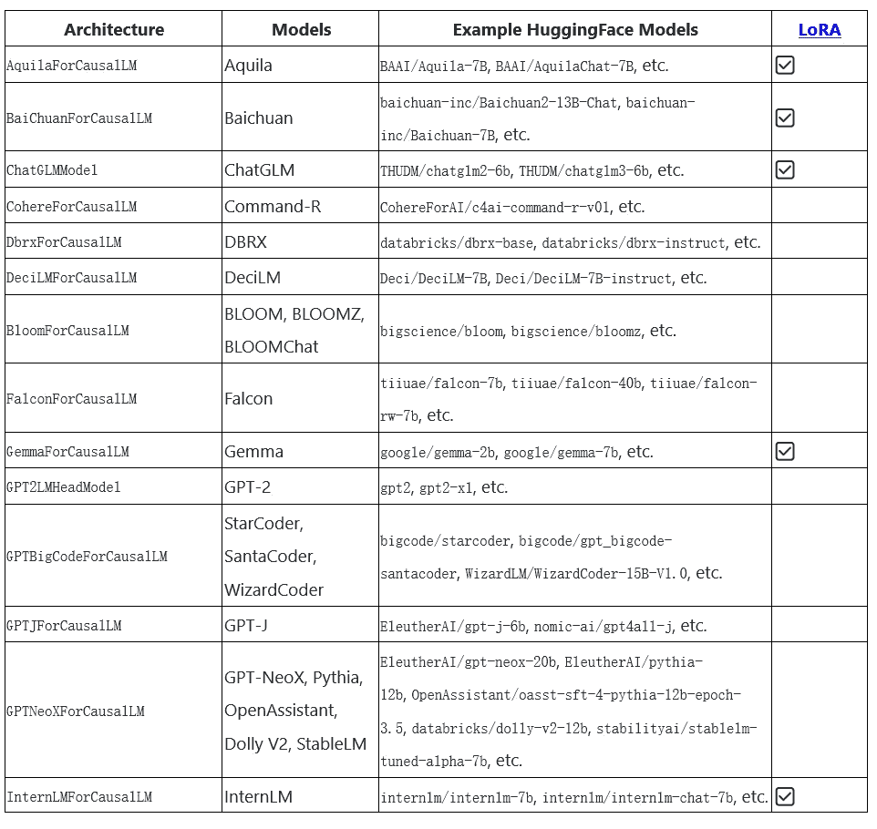

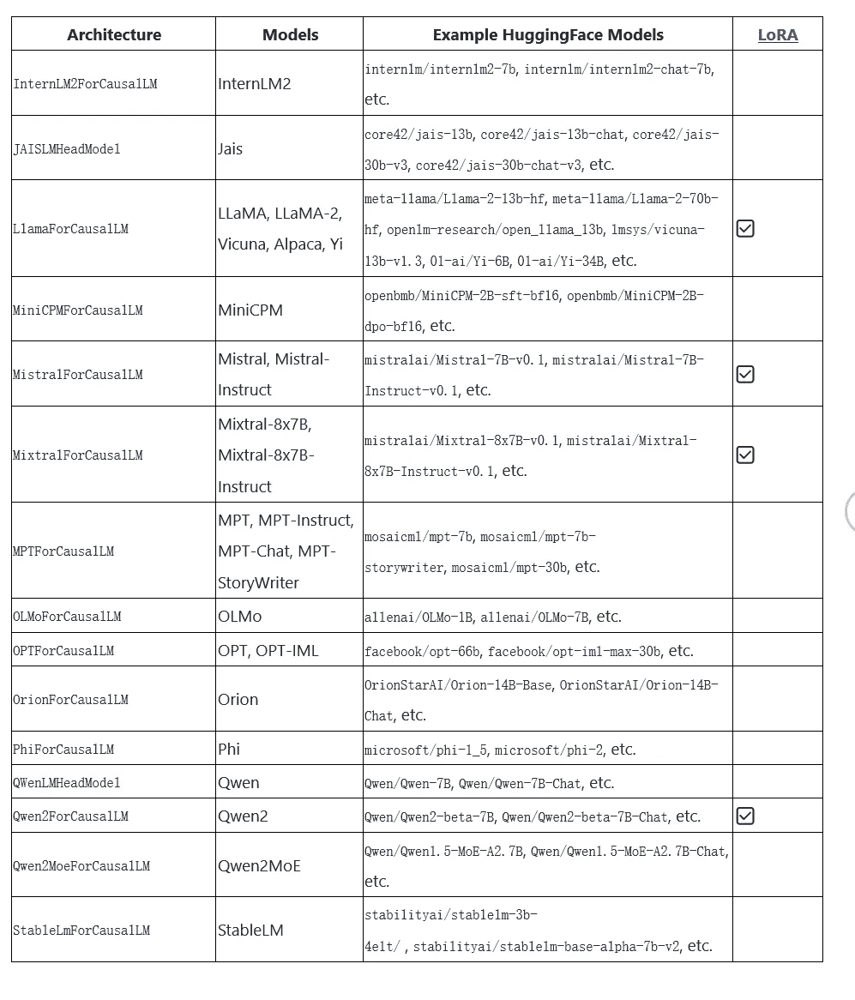

**参考文献**

[1] Efficient Memory Management for Large Language Model Serving with PagedAttention

[2] vLLM: Easy, Fast, and Cheap LLM Serving with PagedAttention