# LEARN: LLM在快手电商广告推荐场景的应用

> 来源：[https://agijuejin.feishu.cn/docx/PWipdxE1CoqsLaxS1SqcnoYbn8e](https://agijuejin.feishu.cn/docx/PWipdxE1CoqsLaxS1SqcnoYbn8e)

> 作者：Lukan | NewBeeNLP

> 知乎原文：[https://mp.weixin.qq.com/s/3w](https://mp.weixin.qq.com/s/3wvh3Xlz1LcUOqJ768uAFw)vh3Xlz1LcUOqJ768uAFw

> 👸号原文：[https://mp.weixin.qq.com/s/Sl](https://mp.weixin.qq.com/s/Slnf-whAqOKtUX-K0TK3JQ)nf-whAqOKtUX-K0TK3JQ

今天继续分享一篇大模型在推荐系统中的落地应用工作，是快手今年5月份发表的论文《Knowledge Adaptation from Large Language Model to Recommendation for Practical Industrial Application》。

## ** 太长不看版 **

这篇文章主要做了两个工作：

+   工作1：使用冻结的LLM提取文本embedding后，设计了一个基于transformer的双塔结构，用对比学习的方式训练用户行为序列数据，以提取更适用于推荐任务的user embedding和item embedding，

+   工作2：在排序模型中加一个CVR辅助任务，使用1学习到user embedding和item embedding接入一个MLP网络和推荐目标做进一步对齐，然后取出中间层特征供排序模型使用

方法其实和上次介绍的📕的NoteLLM（ NoteLLM: 大语言模型在📕推荐系统的落地应用 ）有点类似的地方，都是想用大模型作为特征提取器来提取item文本中的语义信息来弥补推荐模型中的冷启动以及长尾物品由于行为稀疏学不好的问题，并且都使用对比学习的范式进行学习。

不过📕的采用i2i的方式来训练，产出一个item embedding，最终用在i2i的召回上，这篇用的是u2i的方式，能够同时产生user embedding和item embedding，看文章的线上实验最终两个embedding是用在排序模型中作为特征使用（对应工作2），并没有用于u2i召回。

所以个人认为这篇文章对于实践的价值参考意义更大的可能是工作2，虽然笔墨很少，但毕竟是有上线的，工作1花里胡哨一通操作，最终也就离线自己搞了个数据集和其他几个方法跑了跑对比，为了发文章也可以理解，但是思想也可以稍微参考下吧。

## ** 背景 **

现有的推荐系统模型都是通过ID embedding学习用户和物品之间的交互来表示用户和物品，然而这种方式忽略了，物品文本描述中包含的语义信息。同时，对于一些行为数据少的用户和物品（冷启动和长尾）ID embedding是学不好的，但是LLM对于语义信息的表征能力是很强的，所以自然就会想用LLM学习物品描述中的语义信息来改善推荐中的冷启动和长尾问题。

现有的用LLM来做推荐的大多是通过构建prompt将推荐的数据文本化作为LLM的输入，然后通过生成式的方式来推荐物品，但受限于计算性能以及LLM的输入长度，所以也只能在几个玩具数据集上跑一跑，文章把这种方式称为Rec-to-LLM, 而文章要做的工作就是LLM-to-Rec，将LLM用作特征提取器，将推荐任务作为训练目标，不仅有利于从 LLM 的开放世界领域无缝过渡到RS的协作领域，还能确保更好地满足工业在线 RS 的实际需求。

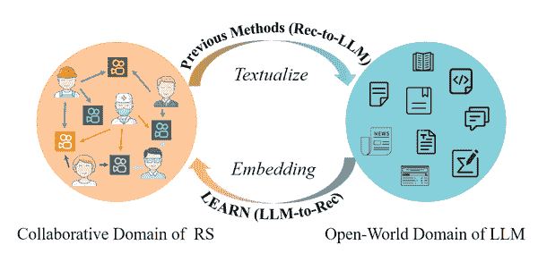

## ** 方法 **

提出方法的框架叫做Llm-driven knowlEdge Adaptive RecommeNdation，简称LERAN，采用的是双塔的架构来进行自监督学习，用户塔和物品塔均由内容嵌入生成模块（CEG）和偏好理解模块（PCH）组成。

模型学习的目标是预测感兴趣的下一个物品，也就是序列推荐，所以训练时会抽出用户的历史行为序列，然后在中间截断一下分成两个序列，

作为用户塔的输入，  作为物品塔的输入。

内容嵌入生成CEG 模块采用了预训练的LLM（文章用的Baichuan2-7B）作为物品编码器。编码的内容包括：标题、类别、品牌、价格、关键词和属性，这里LLM是冻结参数的，防止灾难性遗忘问题，最终会提取出每个token最后一层的隐向量做平均池化后作为物品最终的表征。

偏好理解PCH模块是为了将LLM生成的内容embedding与推荐任务进行对齐，弥补的开放世界知识与协作知识之间的领域差距，采用推荐任务的自监督训练目标来指导模型优化。PCH 模块使用用户交互过的物品的内容嵌入序列作为输入，过一个使用因果注意力的transformer编码器，最终生成user embedding或者item embedding，下面画的这个图右侧应该是用户塔的，很好理解，但是最终生成的user embedding没说是去平均池化还是最后一个token。

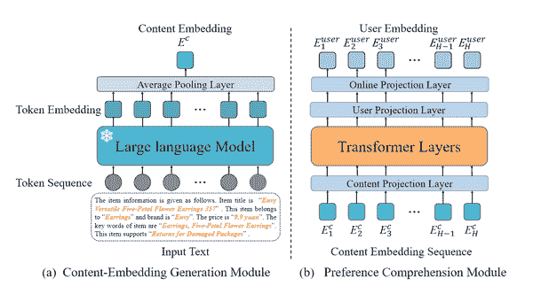

物品塔就写的有点难以理解了，文章说设计了三个变体，最终采用的是变体1，其他两个效果不好，来具体看下三个变体怎么搞的：

+   变体1：采用和用户塔一样的结构和权重，为每个目标物品进行编码

+   变体2：文章说用了自注意力，应该是把变体1的因果注意力换成了自注意力?那为什么输入的时候要换成单个物品输入，而不是用序列输入？这里有点不太理解

+   变体3：这个就是直接把LLM生成的内容嵌入拿来当成item embedding，连加一个映射层都不做了

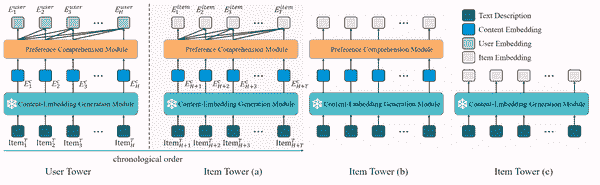

有个不太理解的地方就是这个物品塔为啥用序列作为输入，因为文章说训练时是用一个物品序列作为输入，但是在推理时，只用单个物品，这样不会存在训练和测试不一致的情况吗？

另外还有一个训练成本的问题，因为这里又加了一个transformer的encoder，那么用的序列长度应该也不能很长，而且也不知道这个transformer到底能起到多大作用，毕竟行为序列里面噪声应该还是很多的，所以我觉得更简单粗暴的一个方法是用户塔序列pooling后接一个MLP，这样可以支持更长的序列，物品塔在拿到LLM的表征后也接一个MLP，这样的方式不知道会不会更好。

不管咋样，就当他通过某种手段拿到了LLM提取得到的user embedding和item embedding，然后就是进行对比学习了，正样本用当前用户交互的物品，负样本用其他用户交互的物品，损失函数用的也是Info-NCE

## ** 实验 **

### ** 离线实验 **

离线实验的结果没啥好看的，主要就是自己造个数据集然后和几种方法比了比再做个消融，直接说结论。

1.  LLM embedding比传统的ID embedding以及bert生成的更有优势

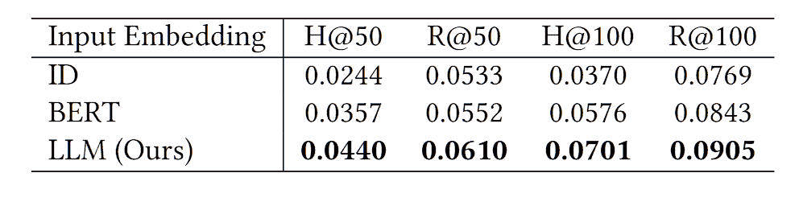

2. 和现有的Rec-to-LLM比也更有优势，在公开数据集MovieLens也比现有的SOTA: HSTU和SASRec更有优势

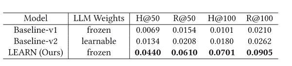

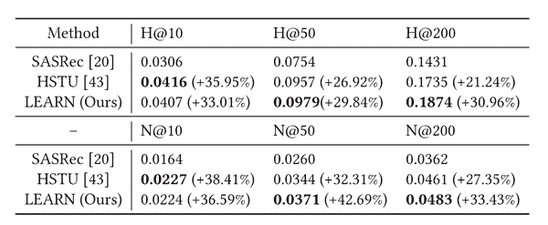

3. 直接冻结LLM提取特征再接transfomer比用lora微调更有优势

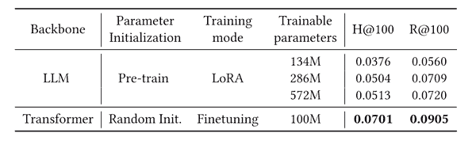

### ** 在线实验 **

在线实验这里就只提到了怎么去把所提出方法的user embedding和item embedding用在排序模型中，所以模型提出来的这个双塔肯定是不能用在u2i召回的，想想成本也很高。

用的具体方法如下，首先在排序模型旁边添加一个辅助的CVR任务，学习目标就是转化率，输入是LEARN学习得到的user emb和item emb，concat起来后过一个MLP，再取输出层前的中间向量mid emb和user emb以及item emb作为正常的特征和其他特征拼接起来喂给排序模型，这里做的事情就是把user emb和item emb再一次和推荐任务的目标进行强制对齐操作，这时候mid emb里面不仅包含了语义信息，也学习到了一些推荐的信号，所以作为一个特征加入到排序中作用应该挺大的

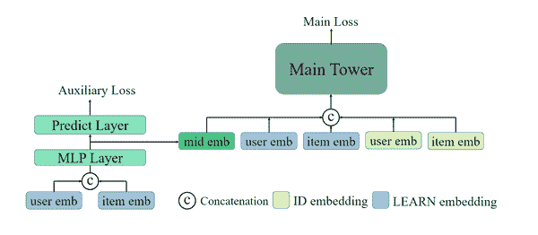

看效果，离线训练的AUC涨幅明显：

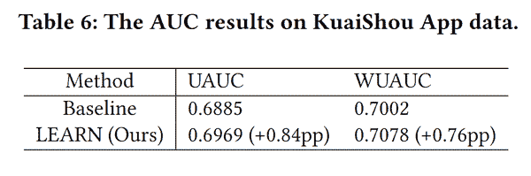

线上看利润和AUC指标也有所提升，拆分了下指标涨幅主要来源于长尾和冷启的用户/商品，借助LLM的开放世界知识可以有效改善冷启动，看起来是比较符合预期的，但是比较神奇的一点是这里的AUC涨幅跟上面的离线结果对应不太上啊

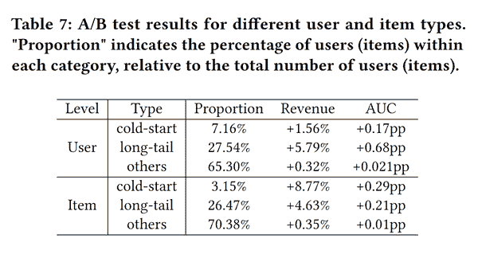

根据我自己的理解，这里这个能起到作用的原因有两个：

1.  LLM包含的丰富的语义信息为现有模型提供了信息增量，对行为数据少的user和item较为友好

1.  两次对齐操作保证了LLM特征的有效性，首先user emb 和item emb在上游LEARN框架中和推荐任务的目标通过对比学习进行了对齐，而在下游排序模型中，又通过CVR任务又强制把user emb和item emb和推荐任务的目标再进行了一次对齐，所以这里不管是user emb、item embed，还是取到的中间层特征向量，都不仅包含了原始大模型里面的丰富的语义信息，还包含了推荐目标的一些信息，可以作为推荐的特征直接加入到排序模型中使用

以往在做推荐的时候，有个往往起不到作用的操作是都想把bert、resnet等模型产出的几十维的多模态向量特征加直接加入到精排模型中，首先不提这些特征包含的增量信息到底有多少，还有一个关键原因应该是这些特征本质上都是在其对应的预训练任务上做的，与推荐任务的目标是不一致的，直接加入到模型中可能会被当成噪音，所以需要做个改造，这篇文章做的两个工作都是为了对这些特征做改造，使其与推荐任务进行对齐，最后再作为特征使用。

**一起交流 **

想和你一起学习进步！『 **NewBeeNLP』 ****目前已经建立了多个不同方向交流群（ 机器学习 ****/ 深度学**习 / 自然语言处理 / 搜索推荐 / 图网络 / 面试交流 / 等），名额有限，赶紧添加下方🛰️加入一起讨论交流吧！（注意一定o要 备注信息 才能通过）

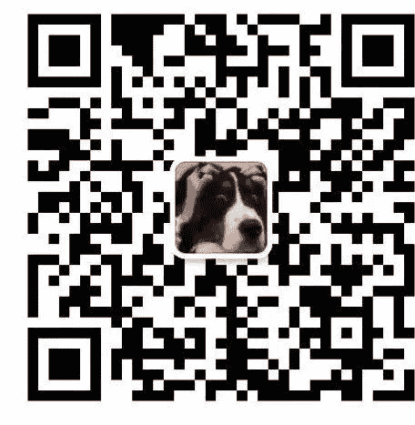