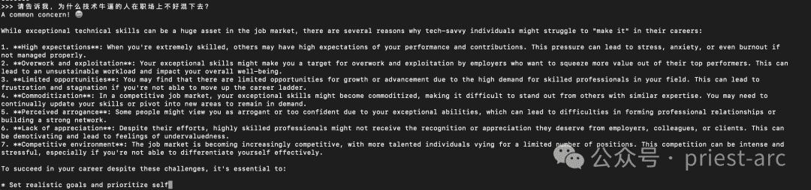
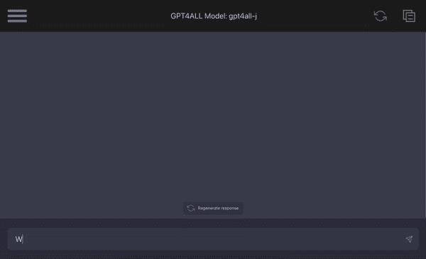
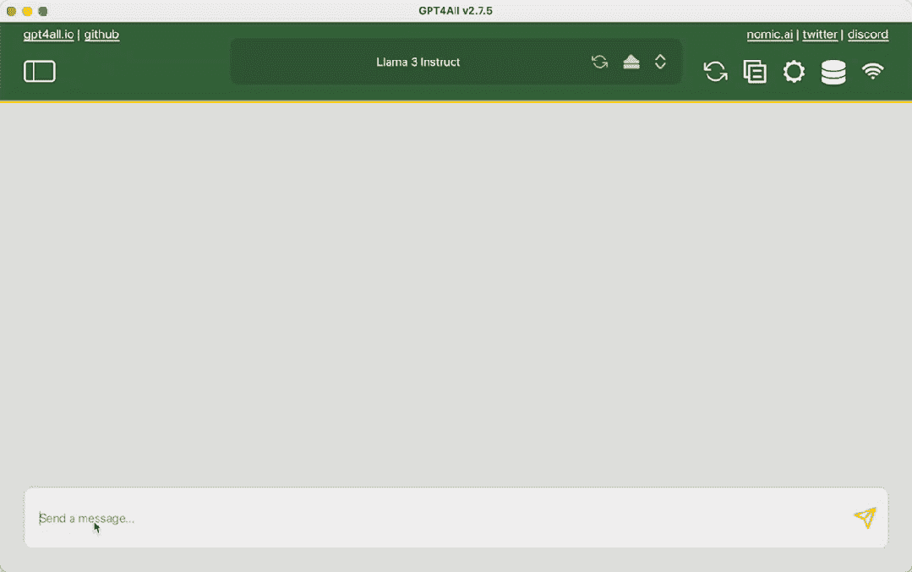
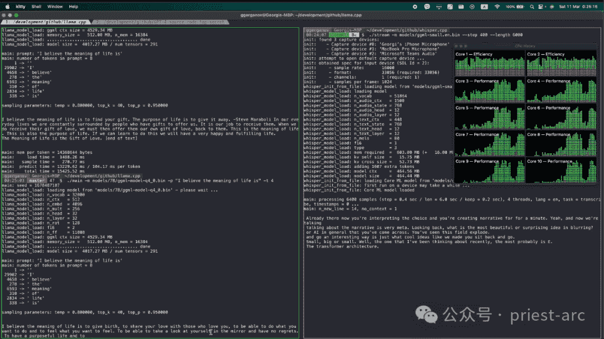

# 一文读懂本地运行 LLM 的最佳实践方法

> 来源：[https://agijuejin.feishu.cn/docx/ZV4qdJYUooJYL0xJbWMcadytnem](https://agijuejin.feishu.cn/docx/ZV4qdJYUooJYL0xJbWMcadytnem)

> 作者：Luga Lee 架构驿站

> 原文：https://mp.weixin.qq.com/s/4NhlZF0NNlEylnZBMr4kdg

Hello folks，我是 Luga，今天我们来聊一下人工智能（AI）生态领域相关的技术 - LLM - 常见的本地运行 LLM 方法。

众所周知，如今使用 ChatGPT 等大型模型工具变得异常简单，只需通过浏览器在线访问即可。然而，需要注意的是，这种方式可能对我们的隐私和数据造成一些潜在影响，这一点需要格外小心。像主流的 OpenAI 等平台会存储我们所构建的提示、响应以及其他元数据，以便重新训练模型。虽然对于某些人来说这并不构成问题，但注重隐私的人往往更倾向于在本地使用这些模型，以确保在交互过程中没有任何外部跟踪的情况下保护隐私。

在本文中，我们将探讨常见的三种在本地使用 LLM 的方法。大多数软件都与各种主要操作系统兼容，并且可以轻松下载和安装，以供大家直接上手。

## Ollama

作为一个开源平台，Ollama 使我们能够在本地计算机上直接运行 Llama 3、Mistral 和 Gemma 等大型语言模型（LLM）。这意味着我们可以充分利用这些人工智能模型的强大功能，而无需依赖基于云的服务。通过使用 Ollama，我们可以在本地进行各种任务，获得高效而便捷的体验。

不论是自然语言处理、文本生成还是其他应用领域，我们都可以在掌握自己的数据和隐私的同时，充分发挥 LLM 的潜力。不再受制于云端服务的限制，我们可以灵活地定制和配置模型，以满足特定需求，并在本地环境中获得更高的性能和效率。这为我们提供了更大的控制权和灵活性，同时降低了对外部云端服务的依赖。

基于 Ollama，我们可以拓展我们的研究和开发能力，探索更广泛的应用场景，并且在保护数据隐私方面更加安心。我们可以在本地环境中充分利用这些强大的语言模型，解决复杂的问题，推动创新的进展。总之，Ollama 为我们提供了一个强大且可靠的方式，让我们能够本地运行 LLM，释放出其全部潜力。

这里，我们以 Mac 平台为例，简单地部署运行 Llama 3 大模型，具体可参考如下步骤所示：

```
[lugalee@Labs ~ ]% docker pull ollama/ollama
Using default tag: latest
latest: Pulling from ollama/ollama
d5a2ad729c09: Pull complete 
e917c61587da: Pull complete 
57bc2d1a456b: Downloading [==================&gt;                                ]  104.2MB/277.6MB
...
Status: Downloaded newer image for ollama/ollama:latest
docker.io/ollama/ollama:latest
[lugalee@Labs ~ ]% docker run -d -v ollama:/root/.ollama -p 11434:11434 --name ollama ollama/ollama
cef2b5f8510c1f995b6500e79052dd141ce03649f2137c6d8c6bdef04ff3c6da
[lugalee@Labs ~ ]% docker ps
CONTAINER ID   IMAGE           COMMAND               CREATED         STATUS         PORTS                                           NAMES
cef2b5f8510c   ollama/ollama   &quot;/bin/ollama serve&quot;   6 seconds ago   Up 5 seconds   0.0.0.0:11434-&gt;11434/tcp, :::11434-&gt;11434/tcp   ollama
```

```
# ollama run llama3
pulling manifest 
pulling 6a0746a1ec1a... 100% ▕██████████████████████████████████████████████████████████████████████████████████████████████████████████████████████▏ 4.7 GB                         
pulling 4fa551d4f938... 100% ▕██████████████████████████████████████████████████████████████████████████████████████████████████████████████████████▏  12 KB                         
pulling 8ab4849b038c... 100% ▕██████████████████████████████████████████████████████████████████████████████████████████████████████████████████████▏  254 B                         
pulling 577073ffcc6c... 100% ▕██████████████████████████████████████████████████████████████████████████████████████████████████████████████████████▏  110 B                         
pulling 3f8eb4da87fa... 100% ▕██████████████████████████████████████████████████████████████████████████████████████████████████████████████████████▏  485 B                         
verifying sha256 digest 
writing manifest 
removing any unused layers 
success 
```



Ollama 不仅提供了直接在本地运行 LLM 的便利性，还具备了出色的扩展性和集成能力。这款开源平台允许开发者在本地启动 HTTP 服务器，将强大的 LLM 能力对接到各类应用程序中，大大拓展了 AI 助手的应用边界。

举例来说，通过集成 Ollama 的本地 HTTP 服务器，我们可以将其无缝融入到广受欢迎的 Code GPT VSCode 扩展之中。开发人员只需在扩展中配置本地服务器地址，便可立即体验到 LLM 在代码编写、优化、错误修复等方面的神级辅助能力。不再被云服务的延迟、隐私泄露等问题所困扰，开发者可以尽情释放 LLM 的潜能，大幅提高工作效率和代码质量。

Ollama 本地服务器的优势并不仅限于此。无论是网站开发中的内容生成、商业分析领域的智能决策支持，还是个人生活中的文本写作助手，Ollama 都可以作为底层 LLM 引擎，为各类应用程序赋能，让人工智能无所不在。更妙的是，这一切仅需在本地计算机上运行 Ollama，就能畅享 LLM 的强大功能，而无需昂贵的云服务费用。

## GPT4ALL

基于海量数据训练而成的 AI 模型，展现出了令人惊叹的自然语言处理能力，在文本理解、生成、推理等多个领域引领了技术革新。然而，庞大的计算资源需求也使绝大多数普通用户和中小企业无缘于 LLMs 强大的能力。

正是基于这一现状，GPT4All 生态系统应运而生，旨在打造最佳的教学调整助理风格语言模型，突破 LLM 模型的资源枷锁，让每个个人和企业都能自由使用、分发和构建定制化的大规模语言模型。

GPT4All 生态系统的核心是经过优化的 LLM 模型文件，体积仅为 3GB-8GB，却蕴含着卓越的自然语言处理实力。用户只需下载并集成这些模型文件，即可立即体验到强大的 AI 助理功能，无需耗费高昂的云服务费用。更重要的是，这些模型可在普通消费级 CPU 上高效运行，解决了传统 LLM 在终端设备上部署的痛点。

除了开箱即用的优化模型，GPT4All 生态系统还提供了灵活的模型训练和定制化工具链。无论是个人开发者还是企业用户，都可以基于 GPT4All 的框架，使用自有数据为 LLM 模型进行教学微调，从而量身定制出符合自身需求的专属 AI 助手。



GPT4All 生态系统并非只是一个提供优化语言模型的平台，而更是一个极具实用价值的人工智能助手。通过提供对重要文档和代码库的访问权限，GPT4All 能够充分发挥其检索增强生成(Retrieval-Augmented Generation)的强大能力，为用户生成高度相关且信息丰富的响应。

具体来说，用户可以指定 GPT4All 模型访问包含了诸如产品文档、技术手册、法律合同等重要文件的文件夹，甚至是庞大的代码库。GPT4All 会自动分析和索引这些内容，将其与语言模型的知识库相结合，形成一个涵盖范围广阔的语义知识图谱。在此基础上，当用户提出查询或请求时，GPT4All 不仅会基于模型本身的知识进行回答，更会从相关文档和代码中检索并综合相关信息，从而生成令人惊艳的高质量响应。

这一检索增强生成的能力使 GPT4All 的应用场景得到极大扩展。无论是企业级的智能知识库构建、代码分析和优化，还是个人层面的写作辅助和信息整合，GPT4All 都能发挥出超乎想象的威力，成为全场景下的得力智能助手。



在 GPT4All 生态系统中，本地大型语言模型(Local LLMs)的运行效率是一个值得重点关注的问题。推理速度直接决定着用户的交互体验，过于滞缓的响应将极大影响模型的实用价值。

影响本地 LLM 推理速度的两大关键因素是：模型的规模大小，以及输入的文本上下文令牌数量。一般来说，模型越大，对应的计算需求就越高；而输入上下文越长，模型也需要消耗更多资源进行处理。因此，在本地 CPU 环境下运行体积庞大、输入上下文冗长的 LLM 模型时，往往会遇到推理速度严重下降的问题。

为了避免这一情况，GPT4All 团队给出了明确的建议：如果需要处理的上下文窗口超过 750 个令牌，最好将 LLM 模型部署在 GPU 环境中运行。这不仅能最大程度地发挥模型性能，还可确保在处理大量上下文时，保持流畅高效的推理速度。事实上，GPT4All 在开发路线图中已经计划支持所有型号的 LLM 在 GPU 上本地化运行，以满足需求更加苛刻的场景。

不难看出，GPT4All 团队在系统设计上体现了极高的务实性和前瞻性。他们深知终端设备的算力限制，因而采取了针对性的优化措施，最大限度挖掘硬件性能，为用户带来流畅一致的本地 LLM 体验。

除了 GPU 加速，GPT4All 还在模型层面进行了多方面的优化，以提升在 CPU 环境下的推理效率。这包括模型剪枝、量化、知识蒸馏等前沿技术的应用，有效降低了模型在保持性能的同时所需的内存和算力资源。这些创新策略的实现，再次印证了 GPT4All 团队在 AI 算法和系统架构方面的卓越能力。

可以说，推理加速是 GPT4All 赖以立足的技术支柱。只有确保 Local LLMs 能快速流畅地响应，GPT4All 才能真正释放 LLM 的全部价值，为用户提供无缝的智能体验。因此，我们有理由相信，随着 GPU 本地化支持的到来，以及更多优化技术的推出，GPT4All 生态系统的性能将再获质的飞跃，继续引领本地 LLM 的未来发展方向。

## LLaMA.cpp

在推动人工智能大众化、本地化进程中，LLaMA.cpp 无疑扮演着先锋的角色。作为一款高度通用的工具，它为用户提供了在本地轻松使用任何开源大型语言模型(Open Source LLMs)的便利，消除了云服务依赖及其带来的种种顾虑。

LLaMA.cpp 的设计理念是赋能和自由，它以命令行界面(CLI)和图形用户界面(GUI)两种方式为用户开启通往本地 LLM 世界的大门。无论是资深开发者还是新手用户，都能在 LLaMA.cpp 的引导下，快速上手并充分挖掘本地 LLM 的潜力。

更为值得一提的是，LLaMA.cpp 背后有着坚实的技术实力支撑。作为一款纯 C/C++ 编写的工具，它展现出了令人赞叹的性能表现。对于任何查询请求，LLaMA.cpp 都能在瞬间作出响应，完全避免了网络延迟等问题，给用户带来流畅、高效的本地 LLM 体验。

这种出色的响应速度源自 LLaMA.cpp 对开源 LLM 模型的深度优化。工具内置了诸如模型剪枝、量化、知识蒸馏等多种先进技术，有效降低了模型在 CPU 和 GPU 环境下的计算资源占用，确保即使在普通个人电脑上，也能够发挥 LLM 的最大潜能。

可以说，LLaMA.cpp 是 GPT4All 等本地 LLM 生态系统中的佼佼者。凭借多方位的优化支持，用户无需高端硬件，即可轻松调用各种开源大模型，在本地完成文本生成、问答、代码编写等多种任务。

与此同时，LLaMA.cpp 还为用户保留了充分的自主权。作为一款高度可定制的工具，它提供了丰富的自定义选项，允许用户根据自身需求调整模型参数、设置偏好，甚至可以在本地对模型进行微调和再训练。这种"开箱即用"但又"可自由改造"的特性，充分契合了人工智能 “Democratization” 的理念。


# 本地 LLM 工具构建与介绍

## 构建与运行输出

```
$ make -j && ./main -m models/llama-13b-v2/ggml-model-q4_0.gguf -p "Building a website can be done in 10 simple steps:\nStep 1:" -n 400 -e
I llama.cpp build info:
I UNAME_S:  Darwin
I UNAME_P:  arm
I UNAME_M:  arm64
I CFLAGS:   -I.            -O3 -std=c11   -fPIC -DNDEBUG -Wall -Wextra -Wpedantic -Wcast-qual -Wdouble-promotion -Wshadow -Wstrict-prototypes -Wpointer-arith -Wmissing-prototypes -pthread -DGGML_USE_K_QUANTS -DGGML_USE_ACCELERATE
I CXXFLAGS: -I. -I./common -O3 -std=c++11 -fPIC -DNDEBUG -Wall -Wextra -Wpedantic -Wcast-qual -Wno-unused-function -Wno-multichar -pthread -DGGML_USE_K_QUANTS
I LDFLAGS:   -framework Accelerate
I CC:       Apple clang version 14.0.3 (clang-1403.0.22.14.1)
I CXX:      Apple clang version 14.0.3 (clang-1403.0.22.14.1)

make: Nothing to be done for 'default'.
main: build = 1041 (cf658ad)
main: seed  = 1692823051
llama_model_loader: loaded meta data with 16 key-value pairs and 363 tensors from models/llama-13b-v2/ggml-model-q4_0.gguf (version GGUF V1 (latest))
llama_model_loader: - type  f32:   81 tensors
llama_model_loader: - type q4_0:  281 tensors
llama_model_loader: - type q6_K:    1 tensors
llm_load_print_meta: format         = GGUF V1 (latest)
llm_load_print_meta: arch           = llama
llm_load_print_meta: vocab type     = SPM
llm_load_print_meta: n_vocab        = 32000
llm_load_print_meta: n_merges       = 0
llm_load_print_meta: n_ctx_train    = 4096
llm_load_print_meta: n_ctx          = 512
llm_load_print_meta: n_embd         = 5120
llm_load_print_meta: n_head         = 40
llm_load_print_meta: n_head_kv      = 40
llm_load_print_meta: n_layer        = 40
llm_load_print_meta: n_rot          = 128
llm_load_print_meta: n_gqa          = 1
llm_load_print_meta: f_norm_eps     = 1.0e-05
llm_load_print_meta: f_norm_rms_eps = 1.0e-05
llm_load_print_meta: n_ff           = 13824
llm_load_print_meta: freq_base      = 10000.0
llm_load_print_meta: freq_scale     = 1
llm_load_print_meta: model type     = 13B
llm_load_print_meta: model ftype    = mostly Q4_0
llm_load_print_meta: model size     = 13.02 B
llm_load_print_meta: general.name   = LLaMA v2
llm_load_print_meta: BOS token = 1 '<s>'
llm_load_print_meta: EOS token = 2 '</s>'
llm_load_print_meta: UNK token = 0 '<unk>'
llm_load_print_meta: LF token  = 13 '<0x0A>'
llm_load_tensors: ggml ctx size =    0.11 MB
llm_load_tensors: mem required  = 7024.01 MB (+  400.00 MB per state)
...................................................................................................
llama_new_context_with_model: kv self size  =  400.00 MB
llama_new_context_with_model: compute buffer total size =   75.41 MB

system_info: n_threads = 16 / 24 | AVX = 0 | AVX2 = 0 | AVX512 = 0 | AVX512_VBMI = 0 | AVX512_VNNI = 0 | FMA = 0 | NEON = 1 | ARM_FMA = 1 | F16C = 0 | FP16_VA = 1 | WASM_SIMD = 0 | BLAS = 1 | SSE3 = 0 | VSX = 0 |
sampling: repeat_last_n = 64, repeat_penalty = 1.100000, presence_penalty = 0.000000, frequency_penalty = 0.000000, top_k = 40, tfs_z = 1.000000, top_p = 0.950000, typical_p = 1.000000, temp = 0.800000, mirostat = 0, mirostat_lr = 0.100000, mirostat_ent = 5.000000
generate: n_ctx = 512, n_batch = 512, n_predict = 400, n_keep = 0


Building a website can be done in 10 simple steps:
Step 1: Find the right website platform.
Step 2: Choose your domain name and hosting plan.
Step 3: Design your website layout.
Step 4: Write your website content and add images.
Step 5: Install security features to protect your site from hackers or spammers
Step 6: Test your website on multiple browsers, mobile devices, operating systems etc…
Step 7: Test it again with people who are not related to you personally – friends or family members will work just fine!
Step 8: Start marketing and promoting the website via social media channels or paid ads
Step 9: Analyze how many visitors have come to your site so far, what type of people visit more often than others (e.g., men vs women) etc…
Step 10: Continue to improve upon all aspects mentioned above by following trends in web design and staying up-to-date on new technologies that can enhance user experience even further!
How does a Website Work?
A website works by having pages, which are made of HTML code. This code tells your computer how to display the content on each page you visit – whether it’s an image or text file (like PDFs). In order for someone else’s browser not only be able but also want those same results when accessing any given URL; some additional steps need taken by way of programming scripts that will add functionality such as making links clickable!
The most common type is called static HTML pages because they remain unchanged over time unless modified manually (either through editing files directly or using an interface such as WordPress). They are usually served up via HTTP protocols – this means anyone can access them without having any special privileges like being part of a group who is allowed into restricted areas online; however, there may still exist some limitations depending upon where one lives geographically speaking.
How to
llama_print_timings:        load time =   576.45 ms
llama_print_timings:      sample time =   283.10 ms /   400 runs   (    0.71 ms per token,  1412.91 tokens per second)
llama_print_timings: prompt eval time =   599.83 ms /    19 tokens (   31.57 ms per token,    31.68 tokens per second)
llama_print_timings:        eval time = 24513.59 ms /   399 runs   (   61.44 ms per token,    16.28 tokens per second)
llama_print_timings:       total time = 25431.49 ms
```



## 工具特性与优势

毫无疑问，这三款工具各具特色，但同时也存在一些共通之处。它们都基于完全开源的架构，代码和模型细节对开发者透明，有利于吸引更多贡献者加入，共同推动生态系统的繁荣发展。此外，它们均支持跨平台、跨硬件环境的部署，确保无论用户使用何种设备，都能获得一致优质的本地 LLM 体验。

最值得一提的是，这些工具都为用户保留了对本地 LLM 的完全所有权和控制权。无需像使用云服务那样将隐私数据托付于第三方，用户可以完全掌控本地模型的输入输出，避免潜在的数据泄露风险，充分保障数据和知识产权的安全。

## 参考资料

[1] `https://github.com/ollama/ollama?tab=readme-ov-file#ollama`

[2] `https://github.com/nomic-ai/gpt4all`

[3] `https://github.com/ggerganov/llama.cpp?tab=readme-ov-file`

Adiós !

## 关于作者

Hello folks，我是 Luga，Traefik Ambassador，Jakarta EE Ambassador， 一个 10 年+ 技术老司机，从 IT 屌丝折腾到码畜，最后到“酱油“架构师。如果你喜欢技术，不喜欢呻吟，那么恭喜你，来对地方了，关注我，共同学习、进步、超越～
