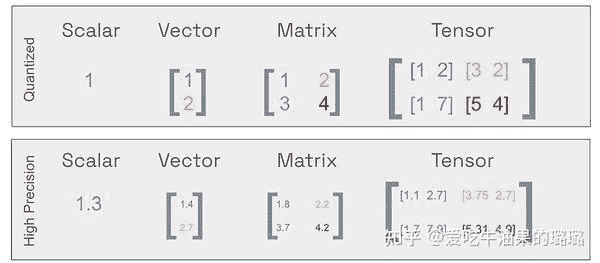
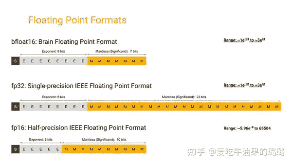
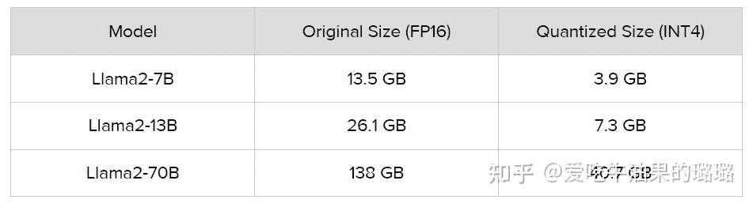
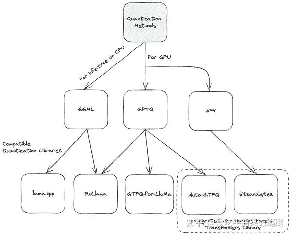

# LLM量化介绍

> 来源：[https://agijuejin.feishu.cn/docx/SBlFdcdSVoZ7XjxAmtAcSGEnnpg](https://agijuejin.feishu.cn/docx/SBlFdcdSVoZ7XjxAmtAcSGEnnpg)

> 作者：爱吃牛油果的璐璐

> 原文：https://zhuanlan.zhihu.com/p/705823666

> 本文将介绍 LLM 量化，包含以下几个方面：

1.  量化基础知识

1.  量化模型的优点和缺点

1.  量化技术（包括示例代码）

## 什么是量化？

量化一词是指将连续的无限值映射到一组较小的离散有限值的过程。在 LLM 的上下文中，它是指将模型的权重从较高精度数据类型转换为较低精度数据类型的过程。

LLM 本质上是神经网络，是 GPU 或 RAM 内存中以张量（多维数字数组）表示的计算模型。使用不同的类型：Float64、Float16 甚至整数进行参数的存储。数据类型将影响内存中需要使用的“位数”，当然还有内存大小。变量的大小可以称为精度，表示在内存中使用多少个“位数”来表示。



通常，在神经网络中使用高精度可以获得更好的准确性和更稳定的训练，使用高精度也会在计算上更加昂贵，因为它需要更多的硬件和更昂贵的硬件。谷歌和 Nvidia 针对在某些神经网络操作中使用较低精度的可能性进行的研究表明，在某些训练和推理操作中可以利用较低的精度。

除了研究之外，两家公司还开发了硬件和框架来支持较低精度的操作。例如，Nvidia T4 加速器是采用 Tensor Cores 技术的较低精度 GPU，其效率明显高于 K80。Google 的 TPU 引入了 bfloat16 的概念，这是一种针对神经网络优化的特殊原始数据类型。较低精度背后的基本思想是，神经网络并不总是需要使用 64 位浮点的所有范围才能使其表现良好。



随着神经网络变得越来越大，利用较低精度的重要性对使用它们的能力产生了重大影响。对于 LLM 来说，这一点变得更加重要。

作为参考，Nvidia 的 A100 GPU 在其最先进的版本中拥有 80GB 内存。在下表中，可以看到 LLama2-70B 模型大约需要 138 GB 内存，这意味着要托管它，将需要多个 A100。将模型分布在多个 GPU 上意味着需要支付更多 GPU 以及开销基础设施的费用。另一方面，量化版本需要大约 40 GB 内存，因此它可以轻松装入一个 A100，从而显著降低推理成本。



## 量化如何缩小模型？

量化通过减少每个模型权重所需的位数来显著减小模型的大小来显著减小模型的大小。一个典型的场景是将权重从 FP16（16 位浮点）减少到 INT4（4 位整数）。这使得模型可以在更便宜的硬件上运行和/或以更高的速度运行。通过降低权重的精度，LLM 的整体质量也会受到一定影响。

研究表明，这种影响因所使用的技术而异，较大的模型受精度变化的影响较小。较大的模型（超过约 70B）即使转换为 4 位也能保持其容量，而某些技术（例如 NF4）表明其性能没有影响。因此，较大的模型， 4 位似乎是性能和大小/速度之间的4 位似乎是最好的折衷方案，而对于较小的模型，6 位或 8 位可能更好。对于这些较大的模型，性能和尺寸/速度之间有所不同，而对于较小的模型， 6 位或 8 位可能更好。

## LLM 量化的两种类型

获取量化模型的技术可以分为两种：

1.  训练后量化 (PTQ)：将已训练模型的权重转换为较低精度，而无需重新训练。虽然 PTQ 简单易行，但由于权重值的精度损失，可能会略微降低模型的性能。

1.  量化感知训练 (QAT)：与 PTQ 不同，QAT 在训练阶段集成了权重转换过程[。这通常会](https://link.zhihu.com/?target=https%3A//arxiv.org/abs/2305.14314)带来更出色的模型性能，但计算要求更高。一种使用率很高的 QAT 技术是QLoRA。

## 量化中值得注意的技术



1.  GPTQ：通过一些实现选项[AutoGPTQ](https://link.zhihu.com/?target=https%3A//github.com/PanQiWei/AutoGPTQ)、[ExLlama](https://link.zhihu.com/?target=https%3A//github.com/turboderp/exllama)和[GPTQ-for-LLaMa](https://link.zhihu.com/?target=https%3A//github.com/qwopqwop200/GPTQ-for-LLaMa)，该方法主要关注 GPU 执行。

1.  NF4：[在bitsandbytes](https://link.zhihu.com/?target=https%3A//github.com/TimDettmers/bitsandbytes)[库上实现，它与 Hugg](https://link.zhihu.com/?target=https%3A//github.com/huggingface/transformers)ing Face Transformers库紧密配合。它主要用于 QLoRA方法，并以 4 位精度加载模型以进行微调。

1.  GGML：此 C 库与 llama.cpp 库紧密配合。它具有独特的 LLM 二进制格式，可快速加载并轻松读取。值得注意的是，它最近转向 GGUF 格式可确保未来的可扩展性和兼容性。

许多量化库支持多种不同的量化策略（例如 4 位、5 位和 8 位量化），每种策略在效率和性能之间提供不同的权衡。

## GPTQ：模型量化的一场革命

通过将 GPT 模型系列的名称与训练后量化 (PTQ) 合并，GPTQ 提供了一种创新的量化解决方案。主要优点包括：

1.  可扩展性： GPTQ 能够在大约 4 个 GPU 小时内压缩大型网络（例如具有 1750 亿个参数的 GPT 模型），将位宽减少到每个权重 3 或 4 位，同时准确度几乎不会下降。论文指出，随着模型规模的增加，FP16 和 GPTQ 之间的性能差异会缩小。

1.  性能：该技术使得使用单个 GPU 对 1750 亿参数模型进行推理成为可能。

1.  推理速度：与 FP16 模型相比，GPTQ 模型在 NVIDIA A100 等高端 GPU 上的速度提高了 3.25 倍，在 NVIDIA A6000 等经济高效的 GPU 上的速度提高了 4.5 倍。

GPTQ 只能将模型量化为基于 INT 的数据类型，最常用的是转换为 4INT。使用 GPTQ 4 位量化的模型与 ExLLama 兼容以实现 GPU 加速。Hugging Face 的AutoGTPQ默认自动使用 ExLLama进行加速。

## GGML 和 llama.cpp：允许在 CPU 上进行推理

[在不断发](https://link.zhihu.com/?target=https%3A//github.com/ggerganov/ggml)展[的机器学习生态系统中，GGML](https://link.zhihu.com/?target=https%3A//ggerganov.com/)已为自己开辟出一席之地。GGML 是一个用于机器学习 (ML) 的 C 库，其中的“GG”指的是其创始人 ( Georgi Gerganov ) 的姓名首字母。

该库的独特优势在于其专有的二进制格式，它提供了一种分发 LLM 的方法，使其有别于其他标准格式。一个值得注意的进展是从 GGML 格式过渡到 GGUF，它支持使用非 llama 模型。GGUF 格式经过量身定制，可扩展且面向未来，同时对量化的 RAM 要求更低。

它经过精心设计，可以与llama.cpp无缝协作库无缝协作库，确保从业者能够高效利用 LLM 的强大功能。llama.cpp 库的主要目标是允许在 MacBook 上使用采用 4 位整数量化的 LLaMA 模型。

GGML 的主要功能之一是方便加载 GGML 模型并在 CPU 上执行它们。尽管现在它也允许将某些层卸载到 GPU 上。这种增强功能不仅加快了推理速度，还为对于普通 VRAM 来说过于昂贵的 LLM 提供了一种解决方法。

[ll](https://link.zhihu.com/?target=https%3A//twitter.com/ggerganov/status/1699791226780975439)ama.cpp 存储库中的最新最近的报告也表明，该技术使180B Falcon模型能够在Mac M2 Ultra上进行推理。这一重要里程碑展示了量化在使大型语言模型在消费者可用的硬件上可用方面的强大功能。llama.cpp 存储库中也提供了该技术，该技术使180B Falcon模型能够在Mac M2 Ultra上进行推理。这一重要里程碑展示了量化在使大型语言模型在消费者可用的硬件上可用的强大功能。

## 代码示例

```
!pip install bitsandbytes
from transformers import AutoModelForCausalLM, AutoTokenizer, BitsAndBytesConfig
import torch
nf4_config = BitsAndBytesConfig(
   load_in_4bit=True,
   bnb_4bit_quant_type=&quot;nf4&quot;,
   bnb_4bit_use_double_quant=True,
   bnb_4bit_compute_dtype=torch.bfloat16
)
model_name = &quot;PY007/TinyLlama-1.1B-step-50K-105b&quot;
tokenizer_nf4 = AutoTokenizer.from_pretrained(model_name, quantization_config=nf4_config)
model_nf4 = AutoModelForCausalLM.from_pretrained(model_name, quantization_config=nf4_config)
```

---

```
from transformers import AutoModelForCausalLM, AutoTokenizer, GPTQConfig
model_id = &quot;facebook/opt-125m&quot;
tokenizer = AutoTokenizer.from_pretrained(model_id)
quantization_config = GPTQConfig(bits=4, dataset = &quot;c4&quot;, tokenizer=tokenizer)
model = AutoModelForCausalLM.from_pretrained(model_id, device_map=&quot;auto&quot;, quantization_config=quantization_config)
```

---

```
from transformers import AutoModelForCausalLM, AutoTokenizer
import torch
model_id = &quot;TheBloke/Llama-2-7b-Chat-GPTQ&quot;
tokenizer = AutoTokenizer.from_pretrained(model_id, torch_dtype=torch.float16, device_map=&quot;auto&quot;)
model = AutoModelForCausalLM.from_pretrained(model_id, torch_dtype=torch.float16, device_map=&quot;auto&quot;)
```