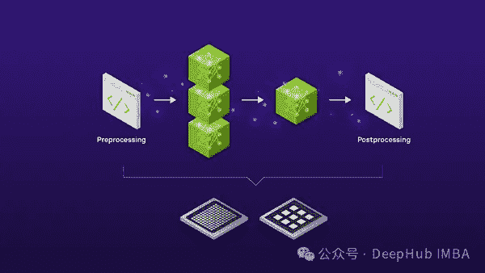
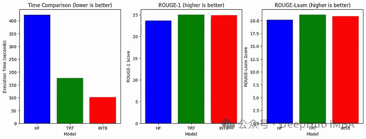
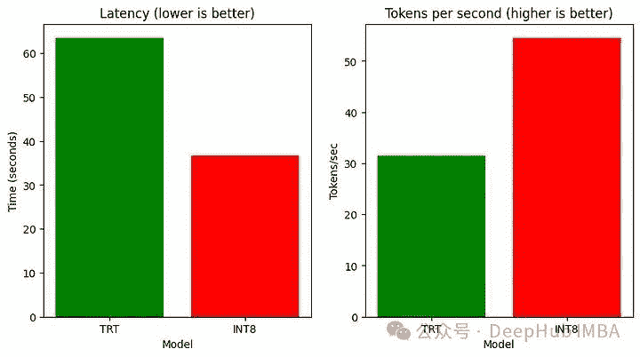
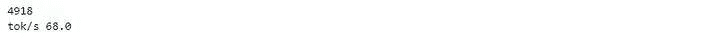
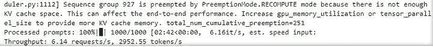
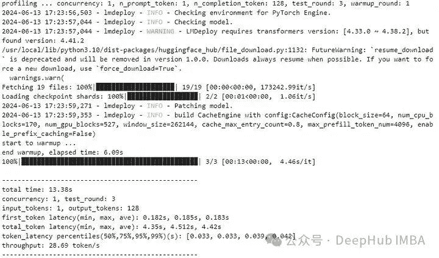
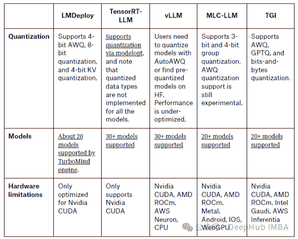

# LLM推理引擎怎么选？TensorRT vs vLLM vs LMDeploy vs MLC-LLM

> 来源：[https://agijuejin.feishu.cn/docx/Af1kdW2Qoo1kXbx0H8tcHf5Dnld](https://agijuejin.feishu.cn/docx/Af1kdW2Qoo1kXbx0H8tcHf5Dnld)

> 作者：P**nHub兄弟网站 | DeepHub IMBA

> 原文：https://mp.weixin.qq.com/s/wL5TvQHWUzR68hNUn7lK_g

LLM擅长文本生成应用程序，如聊天和代码完成模型，能够高度理解和流畅。但是它们的大尺寸也给推理带来了挑战。有很多个框架和包可以优化LLM推理和服务，所以在本文中我将整理一些常用的推理引擎并进行比较。



## **TensorRT-LLM**

TensorRT-LLM是NV发布的一个推理引擎。llm被编译成TensorRT后与triton服务器一起部署并支持多GPU-多节点推理和FP8。

我们将比较HF模型、tensorrt模型和TensorRT-INT8模型(量化)的执行时间、ROUGE分数、延迟和吞吐量。

我这里在Linux上安装Nvidia-container-toolkit，初始化Git LFS(用于下载HF Models)，并下载所需的软件包如下:

```
!curl -fsSL https://nvidia.github.io/libnvidia-container/gpgkey | sudo gpg --dearmor -o /usr/share/keyrings/nvidia-container-toolkit-keyring.gpg \
  &amp;&amp; curl -s -L https://nvidia.github.io/libnvidia-container/stable/deb/nvidia-container-toolkit.list | \
    sed &#x27;s#deb https://#deb [signed-by=/usr/share/keyrings/nvidia-container-toolkit-keyring.gpg] https://#g&#x27; | \
    sudo tee /etc/apt/sources.list.d/nvidia-container-toolkit.list
 !apt-get update
 !git clone https://github.com/NVIDIA/TensorRT-LLM/
 !apt-get update &amp;&amp; apt-get -y install python3.10 python3-pip openmpi-bin libopenmpi-dev
 !pip3 install tensorrt_llm -U --pre --extra-index-url https://pypi.nvidia.com
 !pip install -r TensorRT-LLM/examples/phi/requirements.txt
 !pip install flash_attn pytest
 !curl -s https://packagecloud.io/install/repositories/github/git-lfs/script.deb.sh | bash
 !apt-get install git-lfs
```

然后下载模型权重

```
PHI_PATH=&quot;TensorRT-LLM/examples/phi&quot;
 !rm -rf $PHI_PATH/7B
 !mkdir -p $PHI_PATH/7B &amp;&amp; git clone https://huggingface.co/microsoft/Phi-3-small-128k-instruct $PHI_PATH/7B
```

使用下面的命令将模型转换为TensorRT-LLM格式，并从检查点构建TensorRT-LLM。

```
 !python3 $PHI_PATH/convert_checkpoint.py --model_dir $PHI_PATH/7B/ \
                --dtype bfloat16 \
                --output_dir $PHI_PATH/7B/trt_ckpt/bf16/1-gpu/
 # Build TensorRT-LLM model from checkpoint
 !trtllm-build --checkpoint_dir $PHI_PATH/7B/trt_ckpt/bf16/1-gpu/ \
                --gemm_plugin bfloat16 \
                --output_dir $PHI_PATH/7B/trt_engines/bf16/1-gpu/
```

我们还测试INT8的量化应用

```
!python3 $PHI_PATH/convert_checkpoint.py --model_dir $PHI_PATH/7B \
                --dtype bfloat16 \
                --use_weight_only \
                --output_dir $PHI_PATH/7B/trt_ckpt/int8_weight_only/1-gpu/
 !trtllm-build --checkpoint_dir $PHI_PATH/7B/trt_ckpt/int8_weight_only/1-gpu/ \
                --gemm_plugin bfloat16 \
                --output_dir $PHI_PATH/7B/trt_engines/int8_weight_only/1-gpu/
```

然后就可以在摘要任务上测试phi3和两个TensorRT模型

```
%%capture phi_hf_results
 # Huggingface
 !time python3 $PHI_PATH/../summarize.py --test_hf \
                        --hf_model_dir $PHI_PATH/7B/ \
                        --data_type bf16 \
                        --engine_dir $PHI_PATH/7B/trt_engines/bf16/1-gpu/
 %%capture phi_trt_results
 # TensorRT-LLM
 !time python3 $PHI_PATH/../summarize.py --test_trt_llm \
                        --hf_model_dir $PHI_PATH/7B/ \
                        --data_type bf16 \
                        --engine_dir $PHI_PATH/7B/trt_engines/bf16/1-gpu/
 %%capture phi_int8_results
 # TensorRT-LLM (INT8)
 !time python3 $PHI_PATH/../summarize.py --test_trt_llm \
                        --hf_model_dir $PHI_PATH/7B/ \
                        --data_type bf16 \
                        --engine_dir $PHI_PATH/7B/trt_engines/int8_weight_only/1-gpu/
```

得到结果后就可以解析输出并绘制图表，比较所有模型的执行时间、ROUGE分数、延迟和吞吐量。





可以看到速度提高了不少，所有结果我们最后一起总结。

## **vLLM**

vLLM提供LLM推理和服务，具有SOTA吞吐量，分页注意力，连续批处理，量化(GPTQ, AWQ, FP8)的支持和优化的CUDA内核。

我们首先安装相应的包

```
!pip install -q vllm
!git clone https://github.com/vllm-project/vllm.git
!pip install -q datasets
!pip install transformers scipy
from vllm import LLM, SamplingParams
from datasets import load_dataset
import time
from tqdm import tqdm
from transformers import AutoTokenizer
```

然后加载模型并在数据集的一小部分上生成它的输出。

```
 dataset = load_dataset(&quot;akemiH/MedQA-Reason&quot;, split=&quot;train&quot;).select(range(10))
 prompts = []
 for sample in dataset:
    prompts.append(sample)
 sampling_params = SamplingParams(max_tokens=524)
 llm = LLM(model=&quot;microsoft/Phi-3-mini-4k-instruct&quot;, trust_remote_code=True)
 def generate_with_time(prompt):
    start = time.time()
    outputs = llm.generate(prompt, sampling_params)
    taken = time.time() - start
    generated_text = outputs[0].outputs[0].text
    return generated_text, taken
 generated_text = []
 time_taken = 0
 for sample in tqdm(prompts):
    text, taken = generate_with_time(sample)
    time_taken += taken
    generated_text.append(text)
 
 # Tokenize the outputs and calculate the throughput
 tokenizer = AutoTokenizer.from_pretrained(&quot;microsoft/Phi-3-mini-4k-instruct&quot;)
 token = 1
 for sample in generated_text:
    tokens = tokenizer(sample)
    tok = len(tokens.input_ids)
    token += tok
 print(token)
 print(&quot;tok/s&quot;, token // time_taken)
```



通过vLLM在ShareGPT数据集上对模型的性能进行基准测试

```
!wget https://huggingface.co/datasets/anon8231489123/ShareGPT_Vicuna_unfiltered/resolve/main/ShareGPT_V3_unfiltered_cleaned_split.json
%cd vllm
!python benchmarks/benchmark_throughput.py --backend vllm --dataset ../ShareGPT_V3_unfiltered_cleaned_split.json --model microsoft/Phi-3-mini-4k-instruct --tokenizer microsoft/Phi-3-mini-4k-instruct --num-prompts=1000
```



## **LMDeploy**

LMDeploy允许压缩、部署和服务llm，同时提供高效的推理(持久批处理、阻塞KV缓存、动态分裂和融合、张量并行、高性能CUDA内核)、有效的量化(4位推理性能比FP16高2.4倍)。跨多台机器和GPU部署多模型服务。此外，它还允许分析令牌延迟和吞吐量、请求吞吐量、API服务器和triton推理服务器性能。

```
!pip install -q lmdeploy
!pip install nest_asyncio
import nest_asyncio
nest_asyncio.apply()
!git clone --depth=1 https://github.com/InternLM/lmdeploy
%cd lmdeploy/benchmark
```

LMdeploy还开发了两个推理引擎TurboMind和PyTorch。我们来使用PyTorch引擎。

```
!python3 profile_generation.py microsoft/Phi-3-mini-128k-instruct --backend pytorch
```

它在多个回合中对引擎进行配置，并报告每个回合的令牌延迟和吞吐量。



## **MLC-LLM**

MLC-LLM提供了一个高性能的部署和推理引擎，称为MLCEngine。

```
conda activate your-environment
python -m pip install --pre -U -f https://mlc.ai/wheels mlc-llm-nightly-cu121 mlc-ai-nightly-cu121
conda env remove -n mlc-chat-venv
conda create -n mlc-chat-venv -c conda-forge \
    &quot;cmake&gt;=3.24&quot; \
    rust \
    git \
    python=3.11
conda activate mlc-chat-venv
git clone --recursive https://github.com/mlc-ai/mlc-llm.git &amp;&amp; cd mlc-llm/
mkdir -p build &amp;&amp; cd build
python ../cmake/gen_cmake_config.py
cmake .. &amp;&amp; cmake --build . --parallel $(nproc) &amp;&amp; cd ..
set(USE_FLASHINFER ON)
conda activate your-own-env
cd mlc-llm/python
pip install -e .
```

我们需要将模型权重转换为MLC格式。通过Git LFS下载HF模型，然后转换权重。

```
mlc_llm convert_weight ./dist/models/Phi-3-small-128k-instruct/ \
    --quantization q0f16 \
    --model-type &quot;phi3&quot; \
    -o ./dist/Phi-3-small-128k-instruct-q0f16-MLC
```

现在将MLC格式模型加载到MLC引擎中

```
from mlc_llm import MLCEngine
# Create engine
model = &quot;HF://mlc-ai/Phi-3-mini-128k-instruct-q0f16-MLC&quot;
engine = MLCEngine(model)

# Now let’s calculate throughput
import time
from transformers import AutoTokenizer
start = time.time()
response = engine.chat.completions.create(
    messages=[{&quot;role&quot;: &quot;user&quot;, &quot;content&quot;: &quot;What is the Machine Learning?&quot;}],
    model=model,
    stream=False,
)
taken = time.time() - start
tokenizer = AutoTokenizer.from_pretrained(&quot;microsoft/Phi-3-mini-128k-instruct&quot;)
print(&quot;tok/s&quot;, 82 // taken)
```


## **总结**

TensorRT INT8模型在推理速度上优于HF模型和TensorRT模型，而TensorRT模型在总结任务上表现更好，ROUGE得分最高。可以看到这几个推理引擎都要比使用HF模型的速度快2倍左右，这是因为HF使用的是Python和Pytorch，也没有进行任何的优化。而者4个引擎在推理速度上相差不大，差距在5%-10%左右，这是因为目前这几个引擎都是用了优化的技术，区别只是代码实现的方式不同会产生一些差距，所以在实际使用时，我们只要选择一个兼容性好（或者符合你正在使用的大语言模型）的框架就可以了。

最后这里有个列表 TGI我不熟，就没测，不过结果应该差不多



作者：Zain ul Abideen

---

**MORE**

kaggle比赛交流和组队

加我的微信，邀你进群

