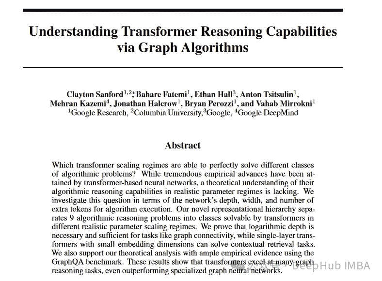
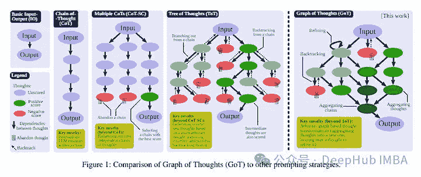
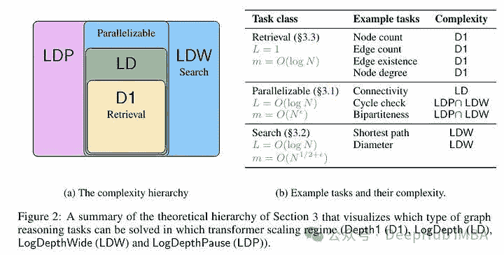
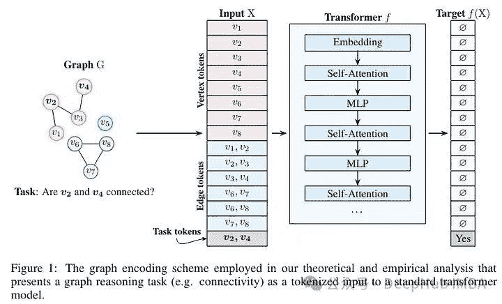
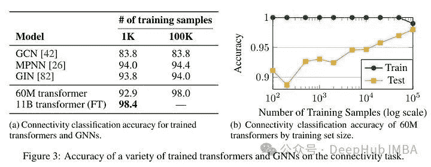
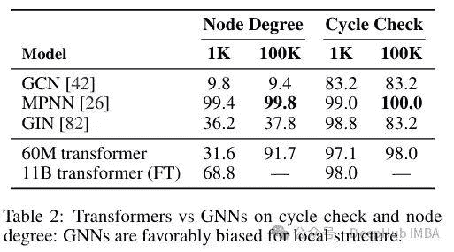
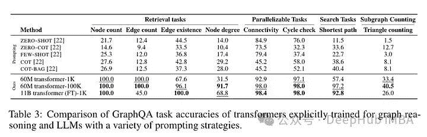

# Transformer 能代替图神经网络吗?

> 来源：[https://agijuejin.feishu.cn/docx/G1VPdM6oyoWDeMxhYD7cvptonwc](https://agijuejin.feishu.cn/docx/G1VPdM6oyoWDeMxhYD7cvptonwc)

> 作者：P**nHub兄弟网站 | DeepHub IMBA

> 原文：https://mp.weixin.qq.com/s/FEgMQX3j-6JC9-1Tv0QMcA

当Transformer模型发布时，它彻底革新了机器翻译领域。虽然最初是为特定任务设计的，但这种革命性的架构显示出它可以轻松适应不同的任务。随后成为了Transformer一个标准，甚至用于它最初设计之外的数据（如图像和其他序列数据）。

然后人们也开始优化和寻找替代方案，主要是为了减少计算成本（自注意力机制的二次方成本）。关于哪种架构在计算成本方面更优的讨论一直在进行，但是对于Transformer来说，它的成功之处在于模型能够展示出强大的推理能力。

## **如何分析神经网络的推理能力？**

最常用的方法之一是研究利用架构内部表示能执行哪些算法。有一个完整的领域致力于这项任务：Neural algorithmic reasoning。Transformer是否能进行泛化，或者通过扩展是否能解决一些问题，这些问题仍然悬而未决，并且这方面的研究也十分活跃。

有些人认为Transformer具有普适推理能力，而其他人认为它是引领我们走向人工通用智能的架构（假设我们能够足够扩展它），但是目前看Transformer能够在不同的领域，NLP，时间序列，甚至CV中取得良好的成绩但是测试其极限也非常重要。我们不仅需要测试它的极限，还需要与其他架构进行比较，并在未来建立基准。

在最近的一项研究中，研究人员决定深入研究一个特定的领域:图神经网络。

今天介绍的这篇论文叫“Understanding Transformer Reasoning Capabilities via Graph Algorithms”

这可能听起来有些奇怪，但近来Transformer（以及大型语言模型）与图（Graphs）之间的关系越来越密切。首先，自注意力可以被视为一种图的形式。其次，图（尤其是知识图谱）可以用来扩展Transformer。第三，图是复杂推理的理想抽象。思维链条和其他技术也可以被视为图的一种抽象。另外许多图问题可以通过简单的架构解决，而其他问题则需要复杂的推理和先进的图神经网络（GNNs）。

图计算已经成为过去几十年计算和人工智能中几个成功设计的基础之一，例如用于蛋白质预测的AlphaFold。许多推理任务可以表达为关于图的推理（这就是为什么像Tree of Thoughts或Graph of Thoughts这样的技术显示出成功）。所以这似乎是测试Transformer能力的最佳选择。

尽管有不同的理论前提，但是进行严格分析并不容易：

图推理任务可以被归类到已知的计算类别中。但是当我们想要评估一个神经网络解决这些任务的能力时，情况就不同了。在Transformer的情况下，我们也感兴趣的不仅仅是固定深度的情况，还有通过改变层数从而学习更简单或更复杂的表征时的变化。并且Transformer也可以在宽度上增长，这在考虑到对上下文长度的重新关注时尤其相关。

作者总结了三类任务，它们的难度逐步增加，只能通过越来越复杂的模型来解决：

1.  **检索任务 **。节点计数、边计数、边存在检查和节点度数是只需要一次查找的任务，因此只需要一个Transformer层和一个小型嵌入。

1.  **可并行化任务 **。连通性、连接节点和循环检查（以及更复杂的任务如二分性和平面性）可以用对数深度的Transformer解决。

1.  **搜索任务 **。最短路径和其他需要更多推理的任务需要模型的扩展。

论文中进行了几项理论分析，展示了Transformer如何解决这些任务以及解决这些任务所需的维度要求。另一个有趣的点是，作者还分析了“pause tokens”的影响。

## **结果**

在对Transformer的推理能力进行了实证分析后。他们选择使用从头开始训练的模型（最多60M参数），对预训练的Transformer（T5，带11B参数）进行微调，测试提示技术，并将其与图神经网络（GNNs）进行比较。使用GraphQA基准任务进行了实验。

图推理算法可以分为局部和全局两种。前者在局部聚合信息（节点及其邻居），而后者模拟节点之间可能是长距离的全局连接。论文主要专注于全局任务，如评估连通性或计算最短路径（这些任务需要分析图的全局结构）。在少数示例情况下，图神经网络（GNNs）在这些任务中更为高效，但通过增加示例数量，Transformer的表现更好（Transformer仍然具有弱归纳偏见，需要许多示例才能最好地学习）。对Transformer进行微调也对预训练的Transformer有积极影响。

以前的研究已经表明，对于图神经网络（GNN）来说，以参数效率的方式解决连通性存在限制。微调后的模型似乎对连通性和最短路径都更有效。虽然Transformer在解决全局任务方面更有效，但GNN在分析局部推理的任务中似乎更为高效：

> 表明GNN对于学习可以通过专门关注局部启发式解决的图推理任务具有有益的归纳偏见。（论文原文翻译）

在GNN中的消息传递框架便于节点与其邻居之间的信息传递（每增加一层相当于图中的一次跳跃）。相比之下，注意力机制计算每对标记之间的关系，因此它通过全局任务来促进，但在数据量较低的情况下，识别重要的局部关系更为困难。

作者还测试了使用大型语言模型（LLM）的情况，对表现优异的Transformer进行微调优于使用提示方法。尽管在训练过程中，LLM会在语料库中看到图数据，因此并不是完全没有接触过此类数据。但这表明在特定任务的情况下专业的小模型还是要更好，并且微调要比直接使用提示的方式好。

## **总结**

这篇论文详细展示了Transformer在图推理方面的能力，并且涵盖了不同的参数缩放模式。许多问题可以被重新表述为图问题，所以这篇论文还是值得阅读。并且论文还显示，一些能力的展示需要一定的网络深度，以便让Transformer解决问题。例如在需要全局推理的任务中，Transformer超过了图神经网络（GNN），这得益于自注意力机制，它允许长距离依赖关系被高效评估。这些发现为使用Transformer处理具有复杂全局依赖性的图推理任务提供了理论和实证支持。

论文地址：https://arxiv.org/abs/2405.18512

作者：Salvatore Raieli

---

**MORE**

kaggle比赛交流和组队

加我的微信，邀你进群

