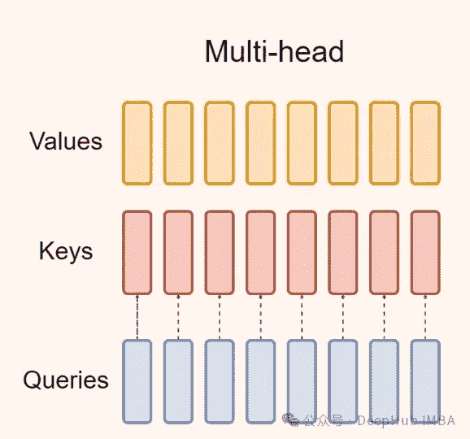
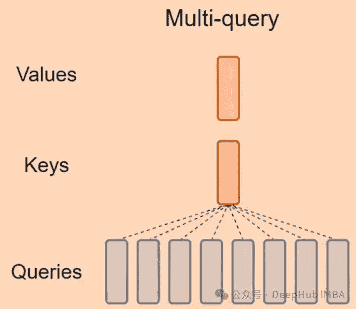
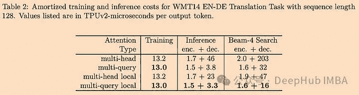

# LLM 加速技巧：Muti Query Attention

> 来源：[https://agijuejin.feishu.cn/docx/LqyydmlFIo4JSnxATp9cXiASnfd](https://agijuejin.feishu.cn/docx/LqyydmlFIo4JSnxATp9cXiASnfd)

> 作者：P**nHub兄弟网站 DeepHub IMBA

> 原文：https://mp.weixin.qq.com/s/uZIj7mXbQ-Qj5i9pE9Kfwg

MQA 是 19 年提出的一种新的 Attention 机制，其能够在保证模型效果的同时加快 decoder 生成 token 的速度。在大语言模型时代被广泛使用，很多LLM都采用了MQA，如Falcon、PaLM、StarCoder等。

在介绍MQA 之前，我们先回顾一下传统的多头注意力

## Multi-Head Attention(MHA)

多头注意力是transformer 模型的默认注意力机制，如下图所示:



在文本生成方面，基于transformer 的自回归语言模型存在一个问题。在训练过程中可以获得真实的目标序列，并且可以有效地实现并行化。

但是在推理过程中，每个位置的查询都要处理在该位置或之前生成的所有键值对。也就是说自注意力层在特定位置的输出影响下一个令牌的生成，所以无法并行化，这使得推理变得非常的慢。

下图是基于transformer 解码器的自回归语言模型中自注意层的解码过程:

```
 def MHAForDecoder(x, prev_K, prev_V, P_q, P_k, P_v, P_o):
     q = tf.einsum(&quot;bd, hdk−&gt;bhk&quot;, x, P_q)
     new_K = tf.concat([prev_K, tf.expand_dims(tf.einsum (&quot;bd, hdk−&gt;bhk&quot;, x, P_k), axis = 2)], axis = 2)
     new_V = tf.concat([prev_V, tf.expand_dims(tf.einsum(&quot;bd, hdv−&gt;bhv&quot;, x, P_v), axis = 2)], axis = 2)
     logits = tf.einsum(&quot;bhk, bhmk−&gt;bhm&quot;, q, new_K)
     weights = tf.softmax(logits)
     O = tf.einsum(&quot;bhm, bhmv−&gt;bhv&quot;, weights, new_V)
     Y = tf.einsum(&quot;bhv, hdv−&gt;bd&quot;, O, P_o)
     return Y, new_K, new_V
```

其中：

X:当前的输入张量，m为当前步，m+1为阶跃，形状为[b, d]

P_q, P_k:查询和键投影张量，形状为[h, d, k]

P_v:值投影张量，形状为[h, d, v]

P_o:学习到的线性投影，形状为[h, d, v]

Prev_K:上一步的关键张量，形状为[b, h, m, k]

Prev_V:前一步的Value张量，形状为[b, h, m, v]

new_K:加上当前步的键张量，形状为[b, h, m+1, k]

new_V:加了当前步长的Value张量，形状为[b, h, m+1, v]

维度表示如下：

M:先前执行的步骤数

B:批量大小

D:输入和输出的尺寸

H:注意力头数

k:Q，K张量的另一个维度

v: v张量的另一个维度

## Multi-Query Attention(MQA)

MQA是多头注意的一种变体。

MQA的方法是保持Q的初始头数，但K和V只有一个头，这意味着所有Q个头共享相同的K和V，因此称为Multi-Query，如下图所示:



**从论文**的解释中可以看到，MQA 让所有的头之间 共享 同一份 Key 和 Value 矩阵，每个头只单独保留了一份 Query 参数，从而大大减少 Key 和 Value 矩阵的参数量。

MQA解码过程的代码本质上与MHA的代码相同，只是从中删除了表示头部尺寸的字母“h”。K, V, P_k, P_v的和方程:

```
 def MQAForDecoder(x, prev_K, prev_V, P_q, P_k, P_v, P_o):
     q = tf.einsum(&quot;bd, hdk−&gt;bhk&quot;, x, P_q)
     new_K = tf.concat([prev_K, tf.expand_dims(tf.einsum (&quot;bd, dk−&gt;bk&quot;, x, P_k), axis = 2)], axis = 2)
     new_V = tf.concat([prev_V, tf.expand_dims(tf.einsum(&quot;bd, dv−&gt;bv&quot;, x, P_v), axis = 2)], axis = 2)
     logits = tf.einsum(&quot;bhk, bmk−&gt;bhm&quot;, q, new_K)
     weights = tf.softmax(logits)
     O = tf.einsum(&quot;bhm, bmv−&gt;bhv&quot;, weights, new_V)
     Y = tf.einsum(&quot;bhv, hdv−&gt;bd&quot;, O, P_o)
     return Y, new_K, new_V
```

上面都是tf的代码，如果阅读有问题，我从 llm-foundry项目中找到了pytorch的代码实现，这里只做个摘抄，有兴趣的请看原项目

```
 class MultiheadAttention(nn.Module):
     def __init__(
             self,
             d_model: int,
             n_heads: int,
             device: str
         ):
         &quot;&quot;&quot;
         Multi Head init func.
 
         Args:
             d_model (int): hidden state size, e.g. 768
             n_heads (int): 设定的注意力头数, e.g. 8
             device (str): _description_
         &quot;&quot;&quot;
         super().__init__()
 
         self.d_model = d_model
         self.n_heads = n_heads
     
         self.Wqkv = nn.Linear(                       # Multi-Head Attention 的创建方法
             self.d_model, 
             3 * self.d_model,                        # 有 query, key, value 3 个矩阵, 所以是 3 * d_model
             device=device
         )                                            # (d_model, 3 * d_model)
         self.attn_fn = scaled_multihead_dot_product_attention
         self.out_proj = nn.Linear(
             self.d_model, 
             self.d_model, 
             device=device
         )
 
     def forward(
         self,
         x
     ):
         &quot;&quot;&quot;
         forward func.
 
         Args:
             x (tensor): (batch, hidden_state, d_model) e.g. -&gt; (1, 768, 512)
 
         Returns:
             _type_: _description_
         &quot;&quot;&quot;
         qkv = self.Wqkv(x)                            # (1, 768, 3 * 768)
 
         query, key, value = qkv.chunk(                # 每个 tensor 都是 (1, 512, 768)
             3, 
             dim=2
         )     
 
         context, attn_weights, past_key_value = self.attn_fn(
             query,
             key,
             value,
             self.n_heads
         )                                             # (1, 512, 768)
 
         return self.out_proj(context), attn_weights, past_key_value
 
 
 class MultiQueryAttention(nn.Module):
     &quot;&quot;&quot;Multi-Query self attention.
 
     Using torch or triton attention implemetation enables user to also use
     additive bias.
     &quot;&quot;&quot;
 
     def __init__(
         self,
         d_model: int,
         n_heads: int,
         device: Optional[str] = None,
     ):
         super().__init__()
 
         self.d_model = d_model
         self.n_heads = n_heads
         self.head_dim = d_model // n_heads
 
         self.Wqkv = nn.Linear(                           # Multi-Query Attention 的创建方法
             d_model,
             d_model + 2 * self.head_dim,                 # 只创建 query 的 head 向量，所以只有 1 个 d_model
             device=device,                               # 而 key 和 value 则只共享各自的一个 head_dim 的向量
         )
 
         self.attn_fn = scaled_multihead_dot_product_attention
         self.out_proj = nn.Linear(
             self.d_model, 
             self.d_model, 
             device=device
         )
         self.out_proj._is_residual = True  # type: ignore
 
     def forward(
         self,
         x,
     ):
         qkv = self.Wqkv(x)                                           # (1, 512, 960)
 
         query, key, value = qkv.split(                               # query -&gt; (1, 512, 768)
             [self.d_model, self.head_dim, self.head_dim],            # key   -&gt; (1, 512, 96)
             dim=2                                                    # value -&gt; (1, 512, 96)
         )
 
         context, attn_weights, past_key_value = self.attn_fn(
             query,
             key,
             value,
             self.n_heads,
             multiquery=True,
         )
 
         return self.out_proj(context), attn_weights, past_key_value
```

从代码中可以看到所有 头之间共享一份 key 和 value 的参数，但是如何将这 1 份参数同时让 8 个头都使用呢？

代码里使用矩阵乘法 matmul 来广播，使得每个头都乘以这同一个 tensor，以此来实现参数共享，主要是这个函数:scaled_multihead_dot_product_attention

```
def scaled_multihead_dot_product_attention(
         query,
         key,
         value,
         n_heads,
         past_key_value=None,
         softmax_scale=None,
         attn_bias=None,
         key_padding_mask=None,
         is_causal=False,
         dropout_p=0.0,
         training=False,
         needs_weights=False,
         multiquery=False,
     ):
     q = rearrange(query, &#x27;b s (h d) -&gt; b h s d&#x27;, h=n_heads)         # (1, 512, 768) -&gt; (1, 8, 512, 96)
     kv_n_heads = 1 if multiquery else n_heads
     k = rearrange(key, &#x27;b s (h d) -&gt; b h d s&#x27;, h=kv_n_heads)        # (1, 512, 768) -&gt; (1, 8, 96, 512) if not multiquery 
                                                                     # (1, 512, 96) -&gt; (1, 1, 96, 512)  if multiquery
     v = rearrange(value, &#x27;b s (h d) -&gt; b h s d&#x27;, h=kv_n_heads)      # (1, 512, 768) -&gt; (1, 8, 512, 96) if not multiquery 
                                                                     # (1, 512, 96) -&gt; (1, 1, 512, 96)  if multiquery
     
     attn_weight = q.matmul(k) * softmax_scale                       # (1, 8, 512, 512)
     attn_weight = torch.softmax(attn_weight, dim=-1)                # (1, 8, 512, 512)
 
     out = attn_weight.matmul(v)                                     # (1, 8, 512, 512) * (1, 1, 512, 96) = (1, 8, 512, 96)
     out = rearrange(out, &#x27;b h s d -&gt; b s (h d)&#x27;)                    # (1, 512, 768)
 
     return out, attn_weight, past_key_value
```

## **MQA指标测试**

MQA能在多大程度上提高速度?让我们看看原文中提供的结果图表:



从上表可以看出，MQA在编码器上的速度提升不是很显著，但在解码器上的速度提升是相当显著的。

论文中也有关于质量的实验，结果表明MQA的性能与基线相比只是稍微低一些。降低应该是肯定的因为毕竟共享了参数，但是只要再可接受范围内并且能够大量提升速度这个降低就是可以接受的，对吧。

## **为什么MQA可以实现推理加速?**

在MQA中，键张量和值张量的大小分别为b * k和b * v，而在MHA中，键张量和值张量的大小分别为b * h * k和b * h * v，其中h表示头的个数。

MQA通过以下方法实现推理加速:

1、KV缓存大小减少了h(头数量)，这意味着需要存储在GPU内存中的张量也减少了。节省的空间可以用来增加批大小，从而提高效率。

2、减少了从内存中读取的数据量，从而减少了计算单元的等待时间，提高了计算利用率。

3、MQA有一个相对较小的KV数量，可以放入缓存(SRAM)中。MHA则需要较大的KV数量，不能完全存储在缓存中，需要从GPU内存(DRAM)读取，这很耗时。

## **总结**

MQA是在2019年提出的，当时的应用还没有那么广泛。这是因为以前的模型不需要关心这些方面，例如，LSTM只需要维护一个状态，而不需要保留任何缓存。

当transformer最初被提出时，它主要用于Seq2Seq任务，特别是在Encoder-Decoder模型中。由于模型的规模不是很大，也并且没有太多的实际需求，所以MQA并没有引起太多的关注。

直到近年来（尤其是2023年开始）基于transformer的大型语言模型(如GPT)得到广泛应用后，推理的瓶颈才被人们重视。所以MQA才被发现非常有用，这主要是由于对大规模gpt式生成模型的实际需求。

最后我们再回顾以下这个论文：https://arxiv.org/abs/1911.02150

最后如果你对LLM的完整构建流程感兴趣，可以看看这个项目，文章的pytorch代码就是从这里找到的

https://github.com/mosaicml/llm-foundry

作者：Florian June