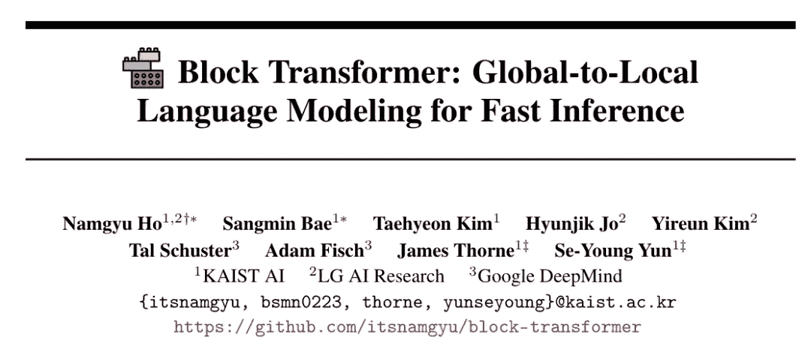
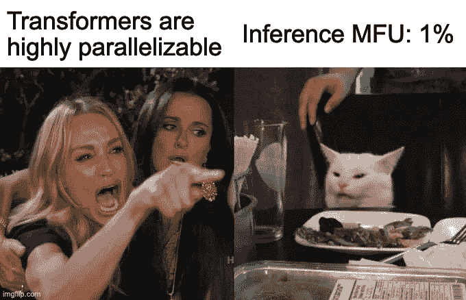
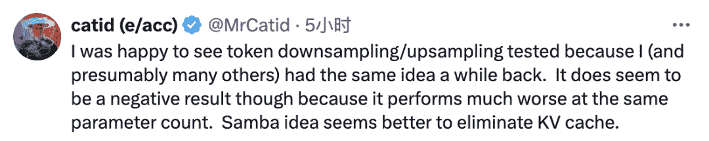
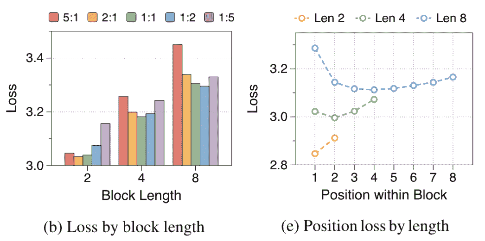
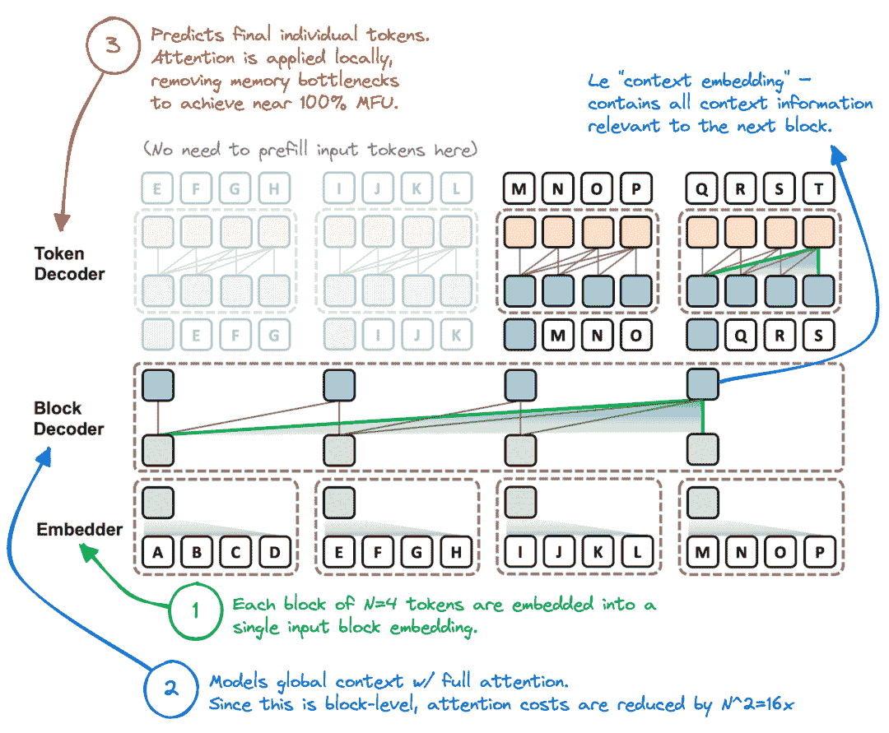
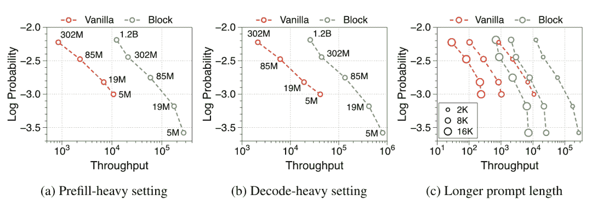
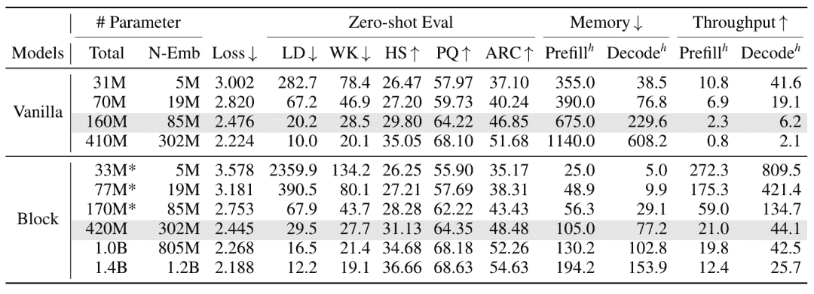
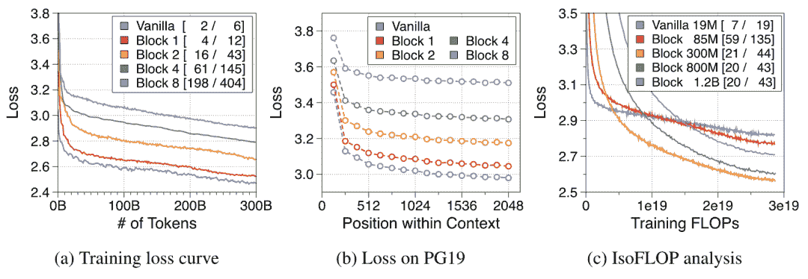
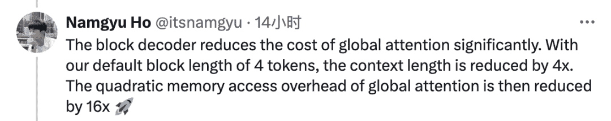

# 拆分Transformer注意力，韩国团队让大模型解码提速20倍

> 来源：[https://agijuejin.feishu.cn/docx/SOYBdYEkfoaWogxhsaUc4vVAnZc](https://agijuejin.feishu.cn/docx/SOYBdYEkfoaWogxhsaUc4vVAnZc)

> 克雷西 发自 凹非寺

> 量子位 | 👸号 QbitAI

> 原文：https://mp.weixin.qq.com/s/JE0w-ksh5TRby_TRfjWbzw

只要将注意力切块，就能让大模型解码提速20倍。

来自韩国科学技术研究院、LG和DeepMind的研究人员，提出了一种新的Transformer架构。

不仅获得了更快的推理速度，内存开销也大幅度下降。

研究人员详细分析了原始Transformer推理速度慢的原因——

**原始Transformer每生成**一个Token就要访问一次全局KV缓存 ，消耗了大量资源。

实际上，这种方法的GPU **有效利用率不到1% **，其余的99%都用在了内存访问上。

针对这一问题，团队对Transformer的注意力机制进行了切块调整，提出了名为 Block Transformer 的新架构。

**结果在没有明显质量损失的情**况下，推理 吞吐量提升了10-20倍 。

有网友表示，自己之前也有过类似的思路，但结果模型的性能不足，现在这个方法看上去确实有效削减了KV缓存。

## “切开”Transformer的注意力

原始Transformer当中，对全局KV的频繁访问，导致计算复杂度高、内存占用大，但推理吞吐量却很低。

针对这一问题，作者的核心思路是将原始Tra**nsform**er**的全局注意力**分解，分成 块级注意力 和 块内注意力 。

**相应地，块级注意力和块内注意**力分**别由 Block Decod**er 和 Token Decoder 进行处理。

具体的切块数量根据总Token数和预设的块大小决定，而块大小的选择，是全局和局部建模之间的平衡——

+   较大的块可以减少块的数量，从而降低Block Decoder的计算复杂度，但每个块包含更多的token，可能影响局部依赖的建模能力；

+   较小的块包含的Token更少，可以提高局部依赖的建模能力，但Block Decoder需要处理更多的块，可能增加计算复杂度。

###### **△ **不同块大小的性能比较

工作流程上，Block Transformer拿到需要处理的序列之后，直接先进行切块，然后利用Embedder将每个块都转换成一个嵌入向量。

具体来说，Embedder可以是一个简单的查找表，将块内的token映射为对应的嵌入向量，然后将这些嵌入向量拼接或累加得到块嵌入向量。

完成块的向量化之后，Block Decoder接收Embedder生成的块嵌入向量序列作为输入。

在其每个自注意力层中，都会对块嵌入向量序列进行自注意力计算，捕捉块与块之间的全局依赖关系。

经过多个自注意力层的处理，块嵌入向量融合了全局上下文信息，所以，Block Decoder的输出是一个全局上下文感知的块嵌入向量序列。

完成块级处理之后，Block Decoder的输出会与块内已生成的Token向量一起被Token Decoder接收。

在Token Decoder中，块嵌入向量首先被转换为与Token嵌入向量相同维度的向量，然后在Token Decoder的多个自注意力层中进行处理，捕捉Token之间的局部依赖关系。

经过多个自注意力层的处理，Token嵌入向量融合了局部上下文信息和来自块嵌入向量的全局信息。

最终，Token Decoder的输出是一个包含了局部上下文感知的Token嵌入向量序列，用于生成当前块的Token，Token Decoder重复这个过程，直到生成当前块的所有token。

回到整体上，Block Transformer通过交替执行块级自回归建模和块内自回归解码，迭代生成整个输出序列。

比如在生成第i个块时，Block Decoder会根据前i-1个块的嵌入向量预测第i个块的嵌入向量，然后Token Decoder根据第i个块的嵌入向量和已生成的Token，生成第i个块的Token序列。

这个过程重复进行，直到生成整个输出序列。

## **推理吞吐量最高提升20倍**

对注意力的切块带来的效果立竿见影，模型的推理吞吐量直接提升了10-20倍。

例如，在decode-heavy设置下，85M参数的Block Transformer吞吐量达到了每秒13.5万Tokens，而同等大小的原始Transformer仅有约6千Tokens。

针对更长的提示词，Block Transformer同样具有吞吐量优势——在提示词长度为8K的情况下，Block Transformer的吞吐量超过了提示词长度为2K的原始Transformer。

吞吐量的提升并没有让质量下降，在HellaSwag、PIQA和ARC-easy等多个零样本任务上，Block Transformer的准确率与同等大小的原始Transformer相当甚至略高。

进一步探究结果表明，Block Transformer这种全局-局部建模方式能在提高推理效率的同时保持较低的训练损失 （图a） 。

同时这种方法还能有效利用全局上下文，在PG19测试集上，取得了与原始Transformer相似的位置损失 （图b） 。

另外，在相同的训练计算量和推理吞吐量预算下，Block Transformer能达到比原始Transformer更低的训练损失，展现出了优异的训练效率 （图c） 。

除了带来性能提升之外，Block Transformer也降低了模型的训练成本。

使用其默认的4个Token的块长度，全局注意力的二次内存访问开销减少了16倍。

反复读取KV缓存带来的内存开销也几乎消除，1%的GPU利用率提升到了44%。

论文地址：https://arxiv.org/abs/2406.02657