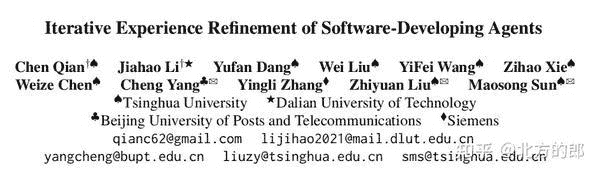
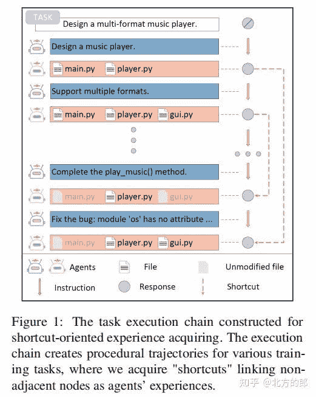
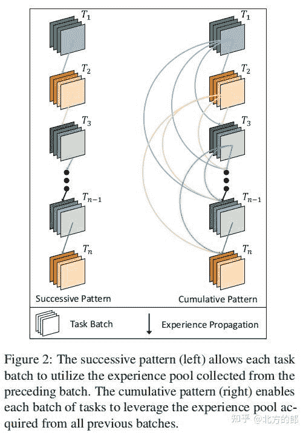
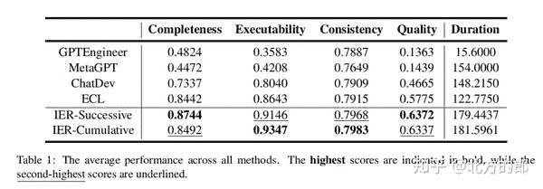
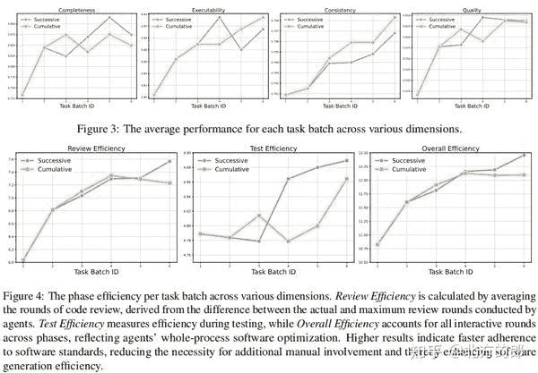
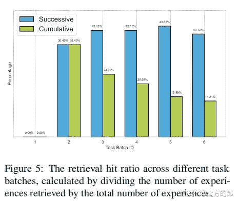
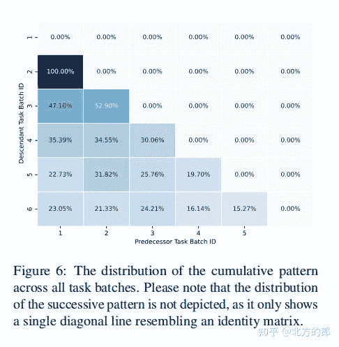
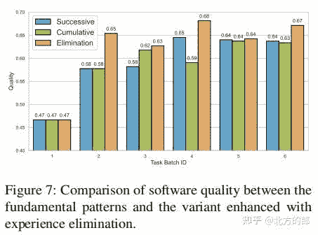

# 提升LLM代理能力的新路径：迭代经验优化框架

> 来源：[https://agijuejin.feishu.cn/docx/GiM3dbt37ojyoaxok1jcLCe3nlb](https://agijuejin.feishu.cn/docx/GiM3dbt37ojyoaxok1jcLCe3nlb)

> 作者：北方的郎

> 原文：https://zhuanlan.zhihu.com/p/701774055

在**人**工智能领域，如何让大规模语言模型（LLM）更智能、更高效地执行复杂任务，一直是科学家们追求的目标。近日ChatDev团队发表了“ Iterative Experience Refinement of Software-Developing Agents ”，提出了一种创新的迭代经验优化框架（Iterative Experience Refinement, IER），通过不断积累和优化经验，让LLM代理在连续任务执行中表现出色。

论文地址： https:// arxiv.org/abs/2405.0421 9

## 1. 引言

本文从实际应用中的挑战出发，指出现有LLM代理在执行复杂软件开发任务时，往往缺乏足够的经验积累和优化机制。作者提出了IER框架，通过迭代的方式优化经验池，提升代理的整体性能和任务执行效率。

## 2. 相关工作

在这一部分，作者回顾了现有的LLM代理框架，如GPT-Engineer、MetaGPT和ChatDev，指出它们在处理复杂任务时的局限性。特别是，它们在经验利用和优化方面存在显著不足，难以在多任务环境中保持高效性能。

## 3. 方法论

本文核心提出了IER框架，包括两种模式：连续模式（Successive Pattern）和累计模式（Cumulative Pattern）。通过引入启发式经验淘汰机制，IER能够动态管理和优化经验空间，从而在提高性能的同时，保持较高的经验质量。

### 迭代经验优化框架

传统的经验设计通常是通过启发式规则一次性完成的，这种静态的经验缺乏在未来任务执行过程中动态优化的能力。为了解决这一挑战，本文提出了一个迭代经验优化（IER）框架，智能体在任务求解过程中可以动态优化其经验。具体来说，所有任务被划分为不重叠的任务批次⟨T1, T2, · · · , Tn⟩，在每个批次中，智能体会生成一个新的经验库，并将其传递给后续的批次。

### 经验获取与利用

这个模块的目标是通过执行每个批次的任务来获取经验，以便不断迭代经验库。通过图1可以看到，类似于Qian等人（2023b）的研究，本文设计了一个指导智能体和一个响应智能体，它们在协同任务执行过程中记录了一系列指令（I={i1, i2, · · · , in}）和相应的解决方案（S = {s1, s2, · · · , sn}），每个解决方案代表一个完整的软件代码。整个通信过程可以表示为一个有向链G = (N,E)，其中N表示节点，对应解决方案，E表示边，对应指令。

### 经验获取

在任务执行链中，获取经验并不是简单的从一个解决方案到另一个解决方案的转变，而是通过识别并获取非相邻节点之间的“捷径”来获取更有效的经验。这些捷径被认为是伪指令，通过标准的自我指导机制提取，能够有效地激励智能体使用这些捷径进行思考。

### 经验利用

获取经验后，这些捷径被分为指导智能体拥有的解决方案到指令的知识，以及响应智能体拥有的指令到解决方案的知识。这些知识以键值对的形式被整合到智能体的经验库中，在处理未见过的任务时，指导智能体会检索与查询最匹配的经验指令，响应智能体则检索最匹配的响应，从而生成增强经验的解决方案。

### 经验传播

经验传播部分提出了两种主要模式：连续模式（Successive Pattern）和累计模式（Cumulative Pattern）。连续模式中，后续任务批次继承最新的前序经验库，优先考虑最新知识；累积模式中，后续任务批次继承所有前序任务批次的历史经验。这两种模式分别类似于知识的代际传承：前者类似于从父母继承知识，后者类似于从所有前辈继承知识。

### 经验淘汰

为了避免经验库的无序扩展，本文提出了一种基于信息密度和利用频率的启发式经验淘汰机制。具体来说，通过选择性地识别非相邻节点，其解决方案优化过程的信息增益超过预定阈值，则该经验被保留。动态使用频率分布的经验池进一步选择性淘汰，以确保高质量和高频使用的经验得到优先保留。

本文在智能体经验的动态迭代优化上提供了全新的方法，通过任务批次间的经验获取、利用、传播和淘汰，使智能体能够在不断优化的过程中高效完成复杂任务。

## 4. 实验

实验部分展示了IER框架在多个基准数据集上的表现，并与其他现有方法进行了详细对比。实验结果表明，IER在软件生成质量方面有显著提升，尤其是在连续模式下，表现出高达11%的相对性能提升。

### 4.1 质量提升分析

首先对IER框架在任务质量提升方面进行了详细分析。通过多个基准数据集的实验，IER框架展示了显著的性能优势。实验结果表明，在智能体完成的软件开发任务中，IER框架生成的解决方案在代码完整性、可执行性和一致性方面表现出色。

例如，在代码质量评分上，IER框架达到了0.6372的高分，而传统方法如GPT-Engineer仅为0.1363。这一结果证明了IER框架在提升智能体任务质量方面的有效性。

### 4.2 性能分析

本文进一步通过多个维度对IER框架的性能进行了详细分析，包括任务执行时间、资源消耗和经验利用效率。

IER框架在任务执行时间方面表现出色，尽管需要额外的计算资源来管理和优化经验库，但整体任务完成时间并未显著增加。相反，由于经验利用效率的提高，智能体能够更快速地生成高质量的解决方案，从而在总体时间消耗上实现平衡。

在资源消耗方面，IER框架通过动态管理经验库，避免了无效经验的积累，从而在计算和存储资源的使用上更加高效。实验数据显示，启发式经验淘汰机制有效地减少了低质量和低频使用经验的占比，使得智能体能够在较少的资源条件下保持高效的任务执行性能。

通过对经验利用效率的分析，IER框架展示了其在多任务环境中的优势。智能体能够高效地从经验库中检索相关经验，并应用于当前任务执行中，从而大幅提升了任务完成的成功率和解决方案的质量。

实验结果表明，IER框架不仅适用于单个智能体的任务执行优化，还能够在复杂的软件系统中发挥重要作用。通过引入IER框架，GPT-4生成的软件系统在处理多样化和高复杂度任务时，表现出更高的稳定性和效率。

实验结果显示，连续模式下，后续任务批次继承最新的前序经验库，能够更快速地适应新任务环境；而累积模式下，后续任务批次继承所有前序任务批次的历史经验，表现出更高的知识积累和传承能力。两种模式各有优势，具体应用选择依赖于任务类型和应用场景的具体需求。。

## 5. 结论

本文总结了IER框架的优势和创新点，强调了启发式经验淘汰机制在提高代理性能方面的关键作用。通过实验证明，IER不仅在单次任务执行中表现优异，还能在连续任务执行中保持稳定的高性能表现。作者期望，这一框架能够引领LLM代理设计的新方向，推动集体智能的演化和发展。