# LLM参数高效微调综述和详解-从Adpter、PrefixTuning到LoRA

> 来源：[https://agijuejin.feishu.cn/docx/NP29d90mYo69wbxOz5fc8VcQnze](https://agijuejin.feishu.cn/docx/NP29d90mYo69wbxOz5fc8VcQnze)

> 作者：[LeonYi](https://www.zhihu.com/people/lei-yi-43-4)

> 原文：https://zhuanlan.zhihu.com/p/696057719

## 一、背景

### 1.1 Transformer结构

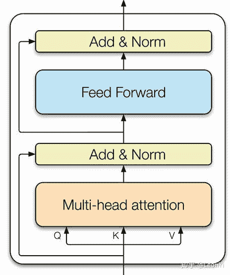

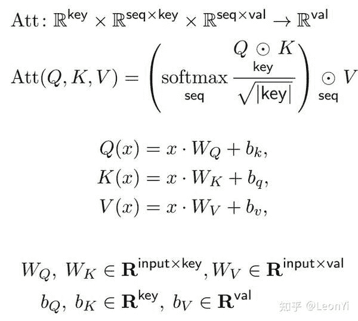

### 1.2 指令微调

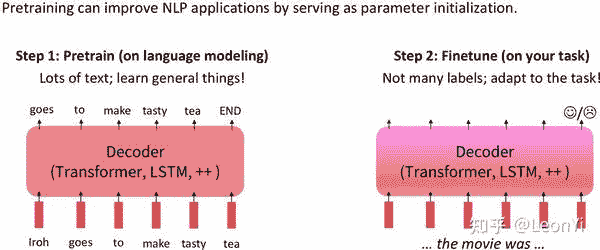

在大量通用数据上进行预训练语言模型训练，然后再针对特定下游任务进行微调，达到领域适应（迁移学习）的目的。是NLP目前的主流范式。

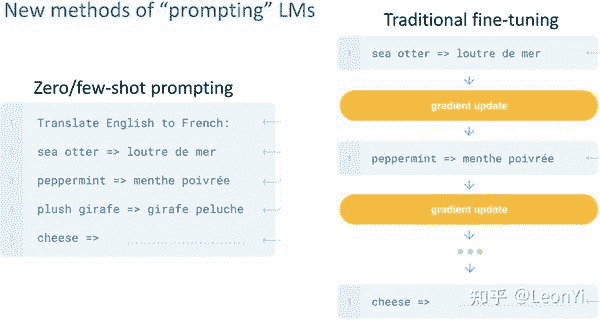

指令微调在预训练语言模型微调的基础进行优化，其目的是尽量让下游任务的形式尽量接近预训练任务。

> 从而减少下游任务和预训练任务之间的Gap, 实现预训练语言模型适应下游任务，而非下游任务去适应模型

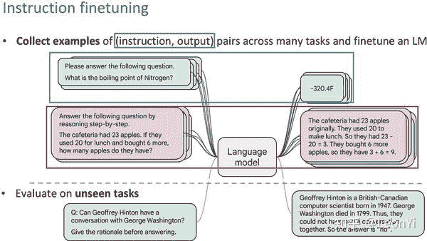

指令微调的效果要优于基于Zero/Few-shot的提示词工程的上下文学习。

但随着预训练语言模型进入LLM时代，其参数量愈发庞大。全量微调模型所有参数所需的显存早已水涨船高。

例如：

> 全参微调Qwen2-7B预估要2张80GB的A800，160GB显存

> 全参微调Qwen2-72B预估要20张80GB的A800，至少1600GB显存

而且，通常不同的下游任务还需要LLM的全量参数，对于算法服务部署来说简直是个灾难（当然，一种折衷做法就是全量微调后把增量参数进行SVD分解保存，推理时再合并参数 ）。

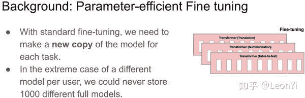

### 1.3 PEFT综述

为了寻求一个不更新LLM全部参数的廉价微调方**案，**之前一些预训练语言**模型**的高效微调( P **ar**amete**r **E fficient F ine- T uning, PEFT)工作，要么插入一些参数或学习外部模块来适应新的下游任务。

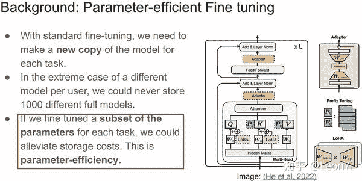

现有的微调方法旨在解决大型语言模型微调的效率问题。以下是一些相关研究的概述：

1.  **Adapters **：通过在Transformer模型的子层后引入小型全连接网络来实现参数高效的微调。

1.  **BitFit **：通过仅微调网络的偏置项来实现参数效率。

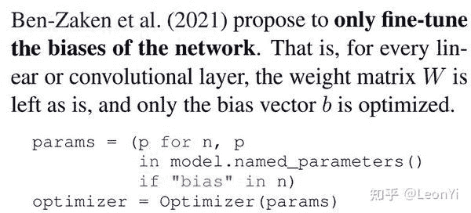

1.  LoRa (Low-Rank Adaptation) ：使用低秩矩阵分解来微调权重矩阵，从而减少可训练参数的数量。

1.  **Compacter **：结合了Kronecker积和低秩矩阵来生成适配器权重，同时在不同层之间共享参数以提高效率。

1.  **Soft Prompts **：通过在模型输入嵌入中添加可训练的张量（软提示）来优化模型行为，将离散空间中的提示寻找问题转化为连续优化问题。

1.  **Prefix-Tuning **：与软提示类似，但在所有层的隐藏状态中添加可训练参数。

1.  Intrinsic Prompt Tuning (IPT) ：通过预训练软提示并使用自编码器来压缩其维度，从而减少每个新任务所需的参数数量。

1.  Ladder-Side Tuning (LST) ：通过在预训练网络旁边训练一个小的Transformer网络，即side network，利用预训练模型作为特征提取器，减少训练时的内存和计算需求。side network用门控网络来组合了预训练backbone network和自身的隐状态. side network只用了预训练模型作为特征提取器，反向传播计算只在side network.

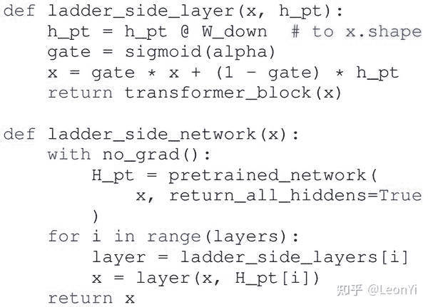

1.  **(IA)3 **：通过学习新的参数来重新缩放关键、值和隐藏FFN激活，实现高参数效率。

1.  **SparseAdapter **：通过在初始化时稀疏化适配器层并进行修剪，提高参数效率。

1.  **UniPELT **：结合了LoRa、Prefix-Tuning和Adapters的方法，通过门控机制实现参数高效的微调。

1.  **S4 **：通过自动化算法搜索，结合所有PEFT类别以在额外0.5%的参数计数下最大化准确性。

**方法分类 **：

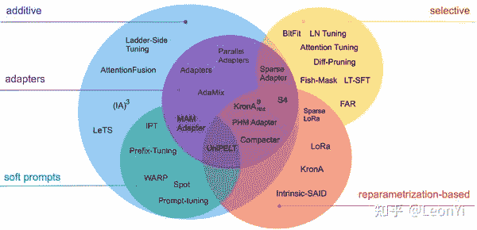

Additive methods : Augmenting the existing pre-trained model with extra parameters or layers and training only the newly added parameters.

**Adapters **: A type of additive PEFT method that involves introducing small fullyconnected networks after Transformer sub-layers.

**Soft Prompts **: A part of the model’s input embeddings is fine-tuned via gradient descent. Soft prompts can be trained for the input layer only or for all layers.

Selective methods: 早期的Selective PEFT仅仅微调网络的最后几层, 即freeze这种经典的迁移学习套路。 Modern approaches are usually based on the type of the layer or the internal structure, such as tuning only model biases or only particular rows. An extreme version of selective methods is sparse update methods which can completely ignore the structure of the model, and select parameters individually 。

Reparametrization**-based methods: Reparametrization-based P**EFT methods leverage low-rank representations to minimize the number of trainable parameters . 支撑就是empirical and theoretical analysis of dl证实neural networks有low dimensional representations。例如，LoRA employs a simple low-rank matrix decomposition to parametrize the weight update.

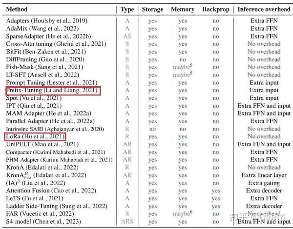

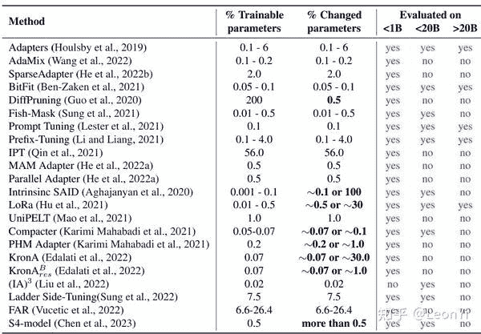

这一段主要基于：Scaling Down to Scale Up: A Guide to Parameter-Efficient Fine-Tuning

尽管提出了这么多方法，复杂的方法很少用，而实际使用的最多的可能就是LoRA，因为架构简单、效果不错，便于实现和推理。不然就是全参数微调了。毕竟宁愿加卡，也不愿去折腾奇奇怪怪的算法。

接下来将介绍如下4个PEFT方法 （重点是主流的LoRA）：

+   Adatper Tuning

+   Prompt Tuning

+   Prefix Tuning

+   LoRA

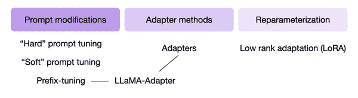

## 二、参数高效微调

### 2.1 Adapter Tuning

A**dapter Tuning**试图在Transformer Layer的Self-Attetion+FFN之后，插入 一个先降维再升维的MLP （以及一层残差和LayerNormalization）来学习模型微调的知识。

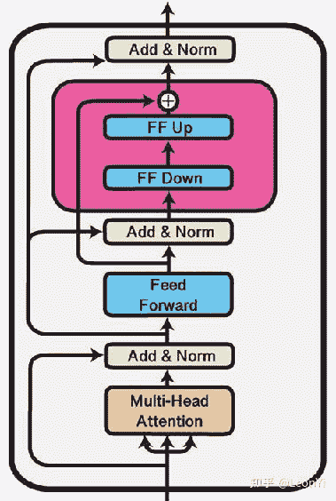

Adapter即插入的FF up + FF Down。

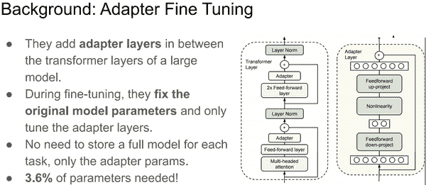

在微调时，Transformer Layer原有的所有参数冻结，反向传播后仅更新Adapter参数。

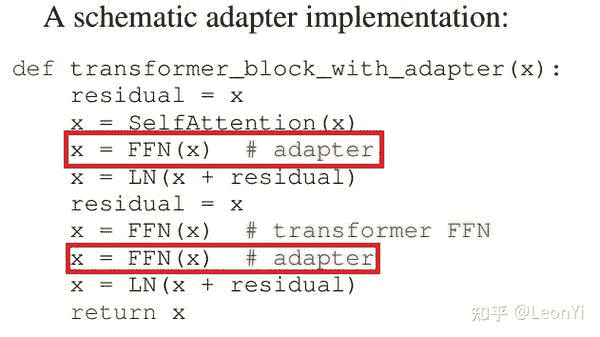

**缺点 **：需要修改原有模型结构，同时还会增加模型参数量。

### 2.2 Promot Tuning

Prompt Tuning设计了一种prefix prompt方法，即在模型输入的token序列前添加前缀prompt token，而这个前缀prompt token的embedding是由网络学到。

Prompt Tuning可以看做token已经确定，但是embedding是可以学的。

> 它相当于仅用prompt token的embedding去适应下游任务，相比手工设计或挑选prompt，它是一种Soft的prompt(软提示)

给定   n n 个token组成的输入序列   x1,x2,…,xn {{x}{1} , {x}{2}, \ldots,{x}_{n}} ，其对应token embedding矩阵为   Xe∈Rn×d \mathbf{X}_{e} \in \mathbb{R}^{n \times d} ，   d d 代表嵌入维度。

Soft-prompts对应参数   Pe∈Rp×d \mathbf{P}_{e} \in \mathbb{R}^{p \times d} ，   p p 代表prompt的长度。

然后，将prompt拼接到输入前面，就能得到完整的模型输入   [Pe;Xe]∈R(p+n)×d [\mathbf{P}_{e} ; \mathbf{X}_{e}] \in \mathbb{R}^{(p+n) \times d} 。

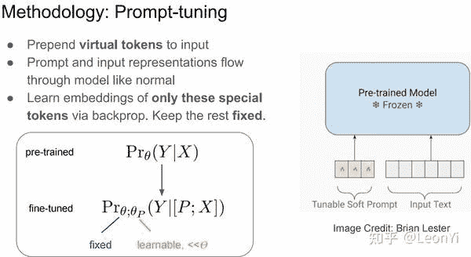

这个新的输入将会送入模型   f([P;X];Θ,Θp) f([\mathbf{P}; \mathbf{X}]; \Theta, \Theta_{p}) ，以最大化交叉熵损失来最大化条件概率   PrΘ,Θp(Y|[P;X]) Pr_{\Theta, \Theta_{p}}(\mathbf{Y} | [\mathbf{P}; \mathbf{X}]) ，以拟合其标签token序列   Y \mathbf{Y} 。

> 在针对下游任务微调时，Prompt Tuning将冻结原始LLM的参数， 只学习独立的prompt token参数 （参数化的prompt token加上输入的token送入模型进行前向传播，反向传播只更新prompt token embedding的参数）。

在针对不同的下游任务微调时，就可以分别学习不同的Task Specifical的Prompt Token参数。

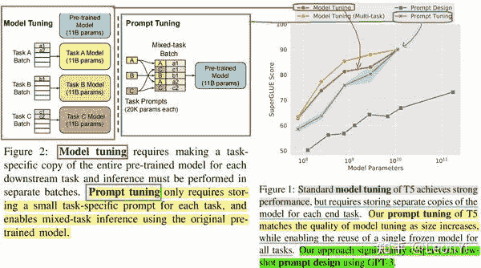

+   Soft Prompt Tuning在模型增大时可以接近Model Tuning(fine-tuning)的效果

+   离散Prompt Tuning(Prompt Design)基本不能达到Model Tuning的效果

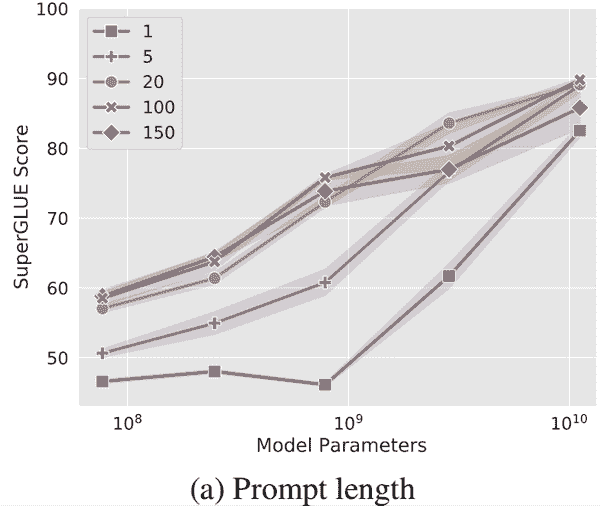

Promot Tuning方法的参数成本是   ed ed ，其中e是提示长度，   d d 是token嵌入维度。

> 提示越短，必须调整的新参数就越少，那么调参的目标是就是找到表现仍然良好的最小prefix prompt长度。

Promot Tuning在输入序列前缀添加连续可微的软提示作为可训练参数，其缺点在于：

> 由于模型可接受的最大输入长度有限，随着软提示的参数量增多，实际输入序列的最大长度也会相应减小，影响模型性能。

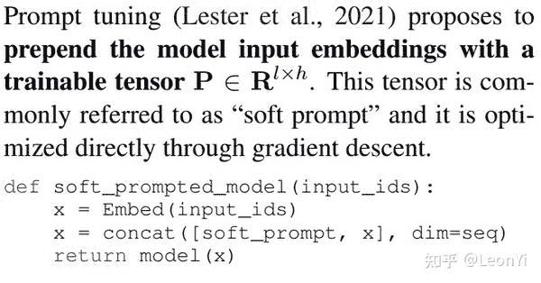

### 2.3 Prefix-Tuning

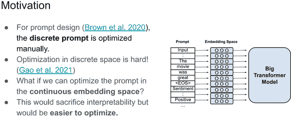

为了避免人为的离散Prompt选取优化，Prefix-Tuning提出可学习的Prefix Prompt。

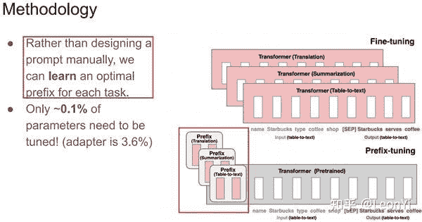

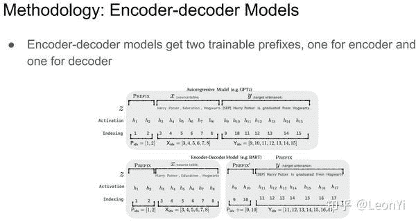

Prefix-Tuning提出可学习的Prompt，即：

> learns a sequence of prefixes that are prepended at every transformer layer

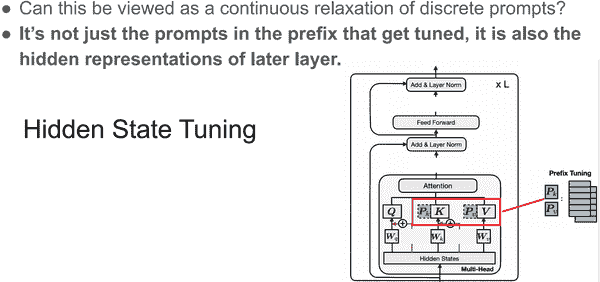

Prefix tuning为   l l 层的Transformer Layer的每层多头注意力的键和值都配置了可学习的prefix vectors.

Two sets of prefix vectors   Pk \mathbf{P}_{k} ,   Pv∈Rl×d \mathbf{P}_{v} \in \mathbb{R}^{l\times d} are concatenated with the original key   K \mathbf{K} and value   V \mathbf{V}

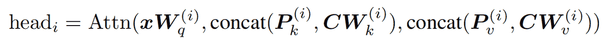

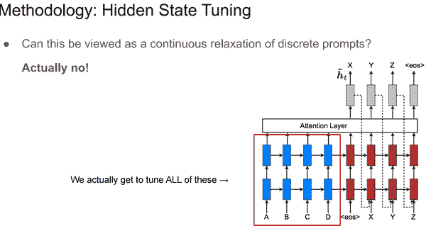

> 看到这里可以知道，Prefix-Tuning可以算是Promot Tuning的一个特例（Promot Tuning只在输入侧加入可学习的Prefix Prompt Token，Prefix-Tuning推广到Transformer Layer每一层的K、V上）

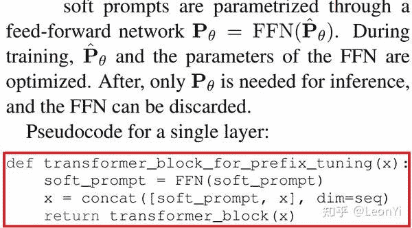

### 2.4 LoRA

LoRA（Low-Rank Adaptation of LLMs），即LLMs的低秩适应，被提出用于高效参数微调。

LoRA的核心思想，是假设 **LLM在下**游任务上微调得到的增量参数矩阵   ΔW \Delta \mathbf{W} 是低秩的 ，即是存在冗余参数的高维矩阵，但实际有效矩阵是更低维度的。

> 相关论文表明训练学到的过度参数化的模型实际上存在于一个较低的内在维度上。类似于机器学习中的降维算法，假设高维数据实际是在低维的流形上一样。

**Lora架构**

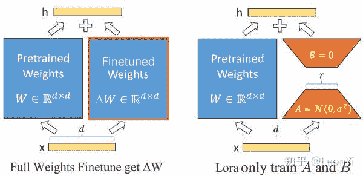

全参数微调会优化LLM的所有参数。这相当于在LLM的原始权重   W0∈Rd×d \mathbf{W}_{0} \in \mathbb{R}^{d \times d} 上，加上一个了微调增量参数   ΔW∈Rd×d \Delta \mathbf{W} \in \mathbb{R}^{d \times d} （相当于冻结原始权重，插入增量参数并仅对做优化）。

对于全参数微调后的LLM权重，给定输入   x \mathbf{x} ，其输出为下式：

h=(W0+ΔW)x=W0x+ΔWx \mathbf{h} = (\mathbf{W}_{0} + \Delta \mathbf{W} ) \mathbf{x} = \mathbf{W}_{0}\mathbf{x} + \Delta \mathbf{W}\mathbf{x}

既然，对 **增量参数矩阵 ****  ΔW **\Delta \mathbf{W} 有 低秩假设。

那**么在微调L**LM时，完全可以对每一层的参数，加入参数   B \mathbf{B} 和   A \mathbf{A} 对 增量参数   ΔW \Delta \mathbf{W} 进行来低秩近似，同时只训练参数   B \mathbf{B} 和   A \mathbf{A} 。这就是上图右侧的Lora微调。

这样一来， 在**微**调过程中，可训练的参数量大大减少 （使得微调参数量从   d×d d \times d 降低至   2rd 2 r d , 有   r<<d r << d ）

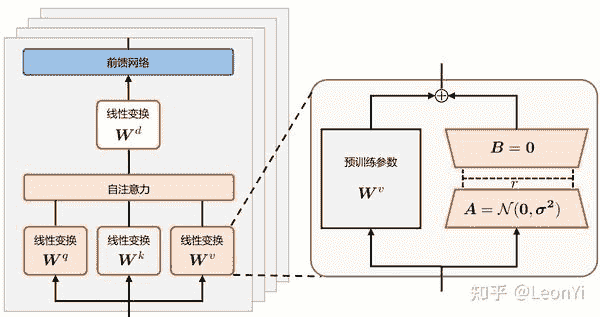

具体来说 **， **LoRA将   ΔW=BA∈Rd×d \Delta \mathbf{W} = \mathbf{B} \mathbf{A} \in \mathbb{R}^{d \times d} 用两个更小的参数矩阵进行低秩近似，其中   r r 是LoRA的需要近似   ΔW \Delta \mathbf{W} 的秩的维度，   B∈Rd×r \mathbf{B}\in \mathbb{R}^{d\times r} 和   A∈Rr×d \mathbf{A}\in \mathbb{R}^{r \times d} 。

在LoRA微调时，冻结预训练的模型权重   W0∈Rd×d \mathbf{W}_{0} \in \mathbb{R}^{d \times d} ，并将可训练的LoRA低秩分解矩阵注入到LLM的每个Transformer Decoder层中。在训练时，只优化所有的   B \mathbf{B} 和   A \mathbf{A} 矩阵，从而大大减少了下游任务的可训练参数量。

对于该权重的输入   x \mathbf{x} 来说，输出为下式：

h=(W0+ΔW)x=W0x+BAx \mathbf{h} = (\mathbf{W}_{0} + \Delta \mathbf{W} ) \mathbf{x} = \mathbf{W}_{0}\mathbf{x} + \mathbf{B}\mathbf{A} \mathbf{x}

> LoRA参数初始化时，矩阵   A \mathbf{A} 通过高斯函数初始化。

> 矩阵   B \mathbf{B} 为全零初始化，其目的是希望训练开始之前旁路对原模型不造成影响（带来噪声），即参数改变量为0。

对于使用LoRA的模型来说，由于可以将原权重与训练后权重合并，因此在推理时不存在额外的开销。

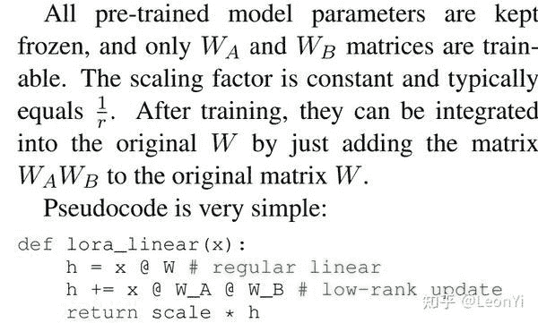

## 三、适用范围

近来LLM主要是指，Decoder-Only架构的大规模预训练语言模型。

> 毕竟，同等参数规模和训练数据量，Encoder-Decoder架构的T5和Bart在生成任务上，相比Decoder-Only架构并不具备优势。更不用说，Encoder-Only架构的BERT了。

但是，所有使用Transformer架构的算法都可以使用上述PEFT方法。

针对主流的Decoder Only的生成式因果语言模型，其训练范式具体是：

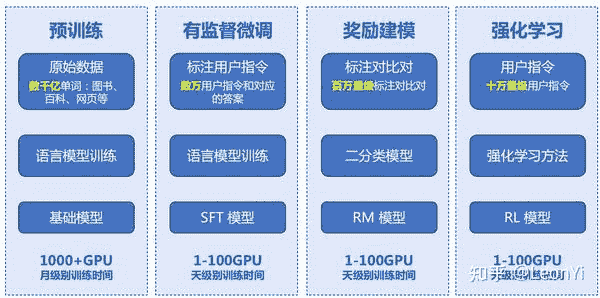

+   预训练（Pretraining） ：基于海量语料进行Transformer Decoder架构的自回归预训练，拟合语料序列的条件概率分布   P(wi |wi,...,wi−1) P(w_i |w_{i}, ..., w_{i-1}) ，从而压缩信息，最终学到一个具备长上下文建模能力的超大规模神经语言模型，即LLM

+   有监督微调（Supervised Finetuning） ：基于高质量的指令数据(用户输入的提示词 + 对应的理想输出结果)微调LLM，从而得到有监督微调模型（SFT模型）。SFT模型将具备初步的指令理解能力和上下文理解能力（预训练得到的LLM在指令微调的过程中被引导如何使用其学到的知识）
进一步基于结果有排序指令样本，

+   奖励建模（Reward Modeling） ：奖励阶段试图构建一个文本质量对比模型（相当于一个Critor）。对同一个提示词，它将对SFT模型给出的多个不同输出的质量做排序。奖励模型可通过二分类模型，对输入的两个结果之间的优劣进行判断。

+   强化学习（Reinforcement Learning） ：强化学习阶段将根据给定的提示词样本数据，利用在前一阶段训练的奖励模型，给出SFT模型对用户提示词补全结果的质量评估，并与语言模型建模目标综合得到更好的效果。强化学习微调将在SFT模型基础上，它将使LLM生成的结果文本能获得更高的奖励。

除了预训练，增量预训练、有监督微调、有监督微调、奖励建模、强化学习阶段都可以采用PEFT方式。

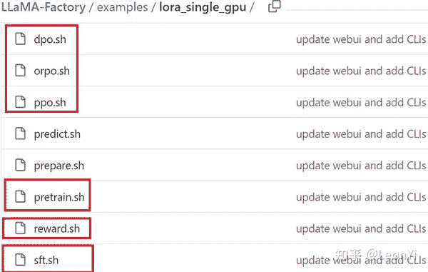

## 参考资料

+   [0] CS224N:Natural Language Processing
with Deep Learning, Sildes (Lecture 11: Prompting, Instruction Finetuning, and RLHF)

+   [1] PrinCETON LLM课程 Sildes(Prompt as Parameter-Efficient
Fine-Tuning)

+   [[2] 《The Power of Scal](https://zhuanlan.zhihu.com/p/551174711)e for Parameter-Efficient Prompt Tuning》论文阅读 https:// zhuanlan.zhihu.com/p/55 1174711

+   [3] Prompt Tuning里程碑作品：The Power of Scal[e for Parameter-Effic](https://zhuanlan.zhihu.com/p/551014127)ient Prompt Tuning https:// zhuanlan.zhihu.com/p/55 1014127

+   [[4] 图解大模型微调系列之：大模型低秩适配](https://zhuanlan.zhihu.com/p/646831196)器LoRA( https:// zhuanlan.zhihu.com/p/64 6831196  )

+   [5] Understanding Parameter-Efficient Finetuning of [Large Language Models: From Prefix Tu](https://link.zhihu.com/?target=https%3A//lightning.ai/pages/community/article/understanding-llama-adapters/)ning to LLaMA-Adapters https:// lightning.ai/pages/comm unity/article/understanding-llama-adapters/

+   [6] Scaling Down to Scale Up: A Guide to Parameter-Efficient Fine-Tuning

本文使用 Zhihu On VSCode 创作并发布