# GenAI的“关键一跃”：推理与知识

> 来源：[https://agijuejin.feishu.cn/docx/JXeJdO20aoPkDUxFE06chgzYnMb](https://agijuejin.feishu.cn/docx/JXeJdO20aoPkDUxFE06chgzYnMb)

> 作者：吕坚平

> 翻译：宛子琳、杨婷 | OneFlow

> 原文：https://mp.weixin.qq.com/s/GSaohRL8YFujEnlNs13dwA

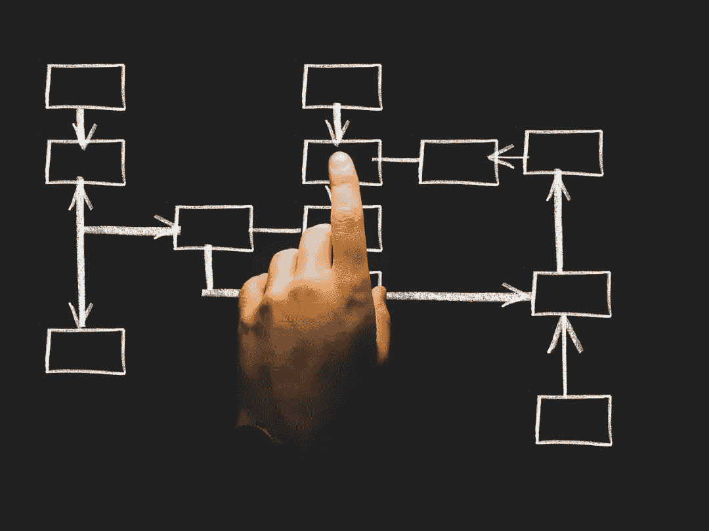

当前的人工智能领域正通过生成式人工智能（GenAI）经历一场重大转变。这一转变不仅代表了技术上的飞跃，更标志着人工智能领域的范式转变，引发了有关GenAI的独特特性及其深远影响的关键问题讨论。

植根于计算革命的丰富历史，本文从计算复杂性角度出发，探索推理和知识的本质，将历史性成就与最新的进展巧妙地交织在一起，以丰富我们对人工智能的理解。

（本文作者为吕坚平博士。以下内容经授权后由OneFlow编译发布，转载请联系授权。原文： https://cplu.medium.com/reasoning-and-knowledge-80a02ec6c75b）

---

## **1 ****引言：计算革命的回响**

GenAI象征着一个时刻，与计算机的早期时代相共鸣，这个时代以1931年库尔特·哥德尔（Kurt Gödel）和1937年艾伦·图灵（Alan Turing）的革命性贡献为标志。

他们的开创性工作最初旨在探索机器取代数学家的潜在可能，但无意中奠定了现代计算的基础。这种追求重新引发了人们对那个时代的一个重要问题的关注：“机器能否思考？” 现在，这一问题已经演变为关注机器是否能像人类一样‘推理’和‘获取知识’，这是我们现在所称之为通用人工智能（AGI）的关键特征。

回顾20世纪50年代艾伦·图灵的实用方法，即通过实践看看效果如何（let’s do it and see how it works）体现的哲学思想，GenAI的能力体现了这一精神。思维链（Chain-of-Thought（CoT））提示工程（prompting）（Wei, 2022）和检索增强生成（Retrieval-Augmented Generation（RAG））（Lewis, 2020）等技术展示了如何让人工智能模拟人类推理和知识吸收方式，其重点是人机协同验证。思维链使人工智能能够在解决问题时“深思熟虑”，而RAG使得人工智能能够访问大量数据源以丰富其回应。

相比之下，哥德尔对AGI的看法更为审慎、明智，他重点关注人类思维相比机器的优越性，在两者之间提供了一种必要的平衡。这种观点强调了在AI开发中采用理论上坚实和稳健的方法的重要性。有趣的是，当前人工智能领域取得的进展，如新的训练方法和对齐策略，在某种程度上与哥德尔的原则是相呼应的。

GenAI的演进还表现为使其能够自我参照和自我改进的先进技术，这些技术借鉴了哥德尔的数学洞察力和图灵的计算理论。像Auto-CoT（Zhang，2022）和Self-RAG（Asai, 2023）等创新就是GenAI利用其技术进行自我增强的例证。

尽管GenAI的表现令人印象深刻，但也面临着各种问题和挑战，这些挑战主要体现在扩展图灵遗产的经验主义方法上。从哥德尔的角度考虑这些挑战，可能会为我们提供宝贵的见解。这种情况呈现出一个明显的悖论：如果“P vs. NP问题”（计算复杂性领域尚未解决的基本问题）得到明确解决，可能会影响到哥德尔对人类思维优越性的看法。下文将详细探讨这一悖论及其对AGI的影响。

引言部分为深入探讨GenAI做了一定铺垫。本文的目标是剖析GenAI如何实现其卓越表现，并揭示其中固有的挑战。我们将专注于广泛的历史和方法论方面，这对GenAI的持续发展至关重要。

对于那些对计算的历史和理论基础感兴趣的人，推荐阅读“从不可能的机器到多功能计算机，再到AGI”部分。

对生成式人工智能的独特性以及它与计算机基础和图灵的经验主义方法的契合感到好奇的读者，应深入了解“生成式人工智能是计算的全面扩展”部分。

要从哥德尔的角度理解推理和知识，“从第一性原理重新审视推理和知识”是阅读的首选部分。

最后，“从P vs. NP到AGI”部分将为读者提供对以人为中心的AGI的前瞻性见解。

## **2 **从不可能的机器到多功能计算机，再到AGI

要充分理解GenAI的革命性，就必须深入探索艾伦·图灵所设想的计算的基本问题。在图灵时代，由大卫·希尔伯特（David Hilbert）领导的数学形式主义学派提倡一种观念，即所有数学知识都可以从一组基础公理或第一性原理中通过逻辑推导得出。这一时代见证了逻辑推理从亚里士多德时代有意识的思维训练发展为一种机械符号操纵系统。这种方法根植于逻辑规则和数学公理的形式系统，表明数学家的聪明才智和固有的知识在数学中可能并非至关重要。这一思路还催生了通用证明机（universal proving machine）概念，该机器能够通过符号逻辑解决任何数学问题，而不依赖先前的数学知识——这是Entscheidungsproblem（判定问题）的核心概念。

### **从判定问题到停机问题**

1931年，库尔特·哥德尔的第一不完备性定理从根本上改变了数学的面貌。该定理揭示了没有既能够“完备（包含其范围内的每一条真理）”，又能够“一致（即没有矛盾）”的形式系统。哥德尔后来阐明了其定理的深刻含义，他说：“思维在使用中不是静态的，而是不断发展的，也就是说，随着我们不断使用抽象术语，我们对它们的理解会变得越来越精确。”（Copland，2013）。这强调了人类的参与在数学第一原理的理解和扩展中起着至关重要的作用，突显了仅仅从这些基本概念进行逻辑推理是不够的。

在这一转变的范式中，图灵走上了通向“判定问题”（Entscheidungsproblem）的另一条路径，偏离了对通用“证明”机的探求，转而研究通用计算机的可能性。其动机在于，这样一台机器将会过于强大以至于无法存在。它将能够自我参照，这必然会导致悖论。

这一探索的最终成果是图灵对停机问题的构想：在不实际运行某个机器的情况下，一台假设的机器，他称之为‘停机预言机（Halting Oracle）’是否能够确定任何给定的机器在特定输入下是否最终会停机，还是会无限运行？图灵通过构思一个名为M的假设机器来应对这一挑战，该机器被设计为直接违背停机预言机的预测，如下图所示：

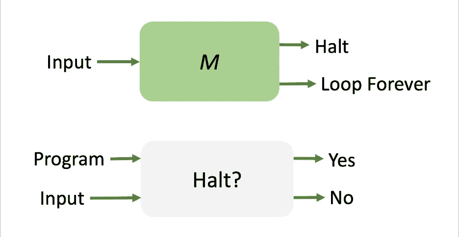

来源：作者

这导致了自指悖论（self-referential paradox）：

1.  如果M在给定M作为输入时停机，根据其定义，它将无限循环：这是一个矛盾。

1.  相反，如果M在输入M时无限循环，它应当停机：这是另一个矛盾。

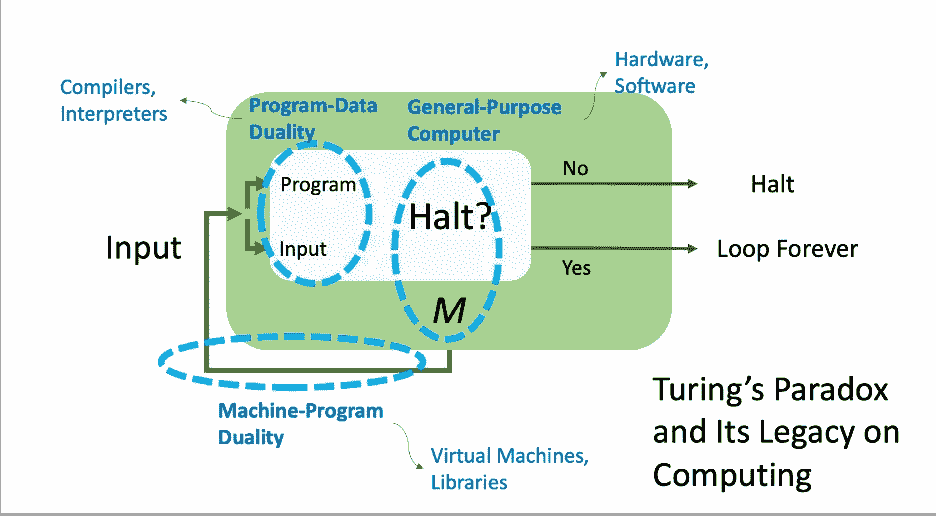

来源：作者

这一深刻的悖论使图灵得出一个重要结论：即停机预言机（一个设想中能够预测任何机器运行结果的实体）是不可能存在的。因此，停机问题（即确定一个机器是否会停机或无限运行）成为了一个不可判定的问题。图灵的洞察力进一步延伸到数学证明：如果存在一种通用的证明机制，理论上可以通过将每个数学问题重新表述为对预言的查询来将其转化为停机预言。因此，图灵对停机预言机不存在的证明间接地暗示了通用证明机制的不存在。反之，停机预言机的存在将允许创建一个通用证明机制，在这种机制中，证明（proof）被系统地搜索，然后咨询预言机该搜索是否会停机。因此，停机问题的不可解性与判定问题的不可解性有着内在的联系，反之亦然。

### **现代计算的基础**

图灵的悖论确实对计算领域产生了深远影响，并概括为如下三个塑造现代计算系统的定义性特征：

1.  **通用计算机 **：图灵提出的一台能够模拟任何程序，甚至是停机预言的机器（M），它奠定了通用计算机的基础。这一创新清晰地区分了硬件和软件。

1.  **机器-程序二元性 **：停机预言将M同时视为硬件和软件的概念引入了机器-程序二元性。这种二元性意味着程序可以被视为其他程序的硬件，比如虚拟机和库，从而形成不同层次的抽象。

1.  **程序-数据二元性 **：图灵认识到M可以处理其他机器作为输入，这引发了程序-数据二元性的出现。这一原则指出，程序可以被其他程序视为数据，使得编译器和解释器等软件工具得以实现。这种二元性是现代软件架构的核心。

> 缺乏通用的证明机制，或是理论上可能使软件工程变得过时的停机预言机，却意外地推动了计算机革命，催生了多功能的计算机和如今我们所熟知的软件工程师所扮演的不可或缺的角色。

> 缺乏通用的证明机制或者停机预言机意外地推动了计算机革命，使得多功能计算机得以崛起，并塑造了软件工程师这一不可或缺的角色。

### **从人类直觉到通用人工智能**

图灵的工作揭示了一个深刻的悖论：形式系统内在的逻辑推理的局限性有利于它们的机械化。这一认识突显了人类直觉的不可或缺性，特别是在从各种选项中“选择”最合适的定理证明机（theorem-proving machine）时，如附图所示。这种直觉过程类似于发现证明本身所涉及的直觉。从现代计算的角度来看，选择正确的机器就类似于编写程序，而图灵指出，程序员的直觉类似于数学家的直觉。

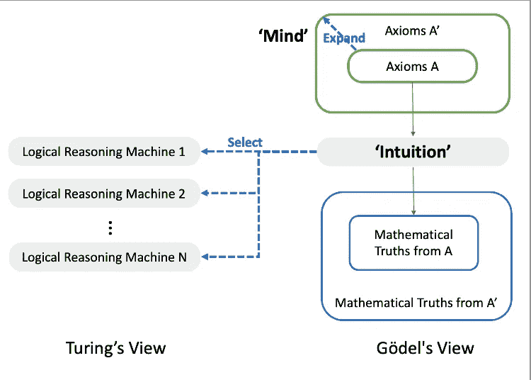

来源：作者

> 图灵的研究重新点燃了那个至关重要的问题：“机器能思考吗？” 现在则转变为“直觉能被机械化吗？”。这种转变标志着对于通用人工智能（AGI）讨论的深刻演变，暗示AGI可能不仅仅是计算革命的延续，而且可能是其巅峰。

>

> 关键问题，“机器能思考吗？” 转变为 “直觉能被机械化吗？” 哥德尔的观点丰富了这一概念，阐明了人类思维在概念化和扩展公理方面的能力。这种能力可以通过从集合A过渡到A'的过程来展示，如图表所示。这种过渡超越了机械化证明的范畴。他的这种见解强调了人类思维具有超越机械化直觉限制的独特能力。

## **3 **生成式人工智能是计算的全面扩展

> 以语言大模型（LLM）为核心的生成式人工智能（GenAI）在通用意图的推理“硬件”方面开辟了一个充满潜力但也充满挑战的世界。这场革命的核心是一种被描述为“不知而行（doing without knowing）”或者“通过实践看看效果如何（let’s do it and see how it works）”的矛盾方法。这种方法表现为，GenAI依赖涌现能力而非明确编程的特征，使其在各个领域展现出卓越甚至“不合理”的效果。然而，支撑其适应性的这一特征也会导致算术错误等基本错误，以及所谓的“幻觉”现象。在这些情况下，GenAI自信地产生引人误解或不准确的信息，突显出对其自身知识限制的认识不足。GenAI内部的这种二重性——多功能以及容易出错的特征——令人着迷，引发了人们对其能力的热情，同时也需要谨慎对待。

>

> 我们对生成式人工智能（GenAI）的热情是矛盾的，因为它不仅毫不费力地展现出巨大的潜力，又预示了一个充满希望却又复杂的未来。它被认为是“不合理”的有效性，意味着GenAI体现出计算的本质特性，使其成为一股革命性的力量，类似于计算本身。

>

> GenAI的有效性意味着它具有类似计算本身的本质特性。

### **LLM 作为新硬件**

深入探讨语言大模型的具体特性，我们可以确定其中的三个关键特点：

1.  **自然语言接口 **：LLM擅长理解和生成人类语言，因此能够与其进行直观互动。这使得系统能够处理高级提示和响应，包括“智能体（agent）”，即促进用户和LLM之间交互的软件模块。这种动态过程对于GenAI的“机器程序二元性”至关重要。在这种架构的每个抽象层级中，系统呈现出外部智能体或用户所感知的人工智能，这与现代计算系统中的多层次架构相呼应。

1.  **指令 遵循 **：由于机器-程序二元性，LLM被视为人工智能抽象层次结构中的基础元素，十分擅长处理自然语言指令。这类似于计算机中CPU的功能，将LLM定位为一种通用推理“硬件”。它能理解广泛的指令和任务，使其在认知和推理任务领域具有计算机硬件的多功能性。这一特性凸显了GenAI在各种应用中的功能，反映出通用计算机的适应性。

1.  **上下文学习/少样本学习 **：LLM的这一显著特点使其能够从有限的示例中学习和适应，甚至可以从自身的输出中学习。这表明了计算中固有的程序-数据二元性，即数据（在本例中是学习示例或生成的内容）可以被重新输入作为程序指令。这种在少数示例中持续学习和适应的能力反映了数据和程序可互换的动态性质，这是计算的一个关键特征。

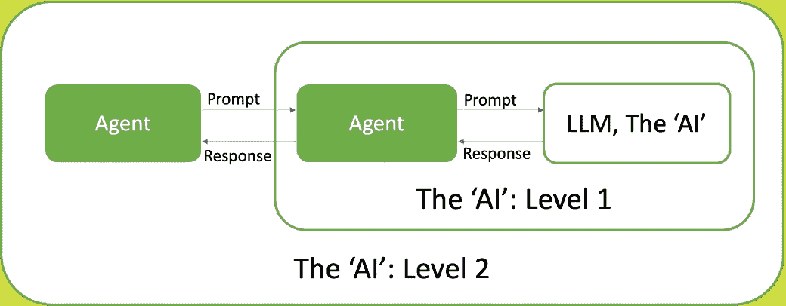

来源：作者

以变革性的视角来看，GenAI不仅仅是计算的一个分支，更是其全面的延伸，预示着类似于图灵时代发起的计算革命的转变。这种对计算核心特征的整合体现在以下图表中：

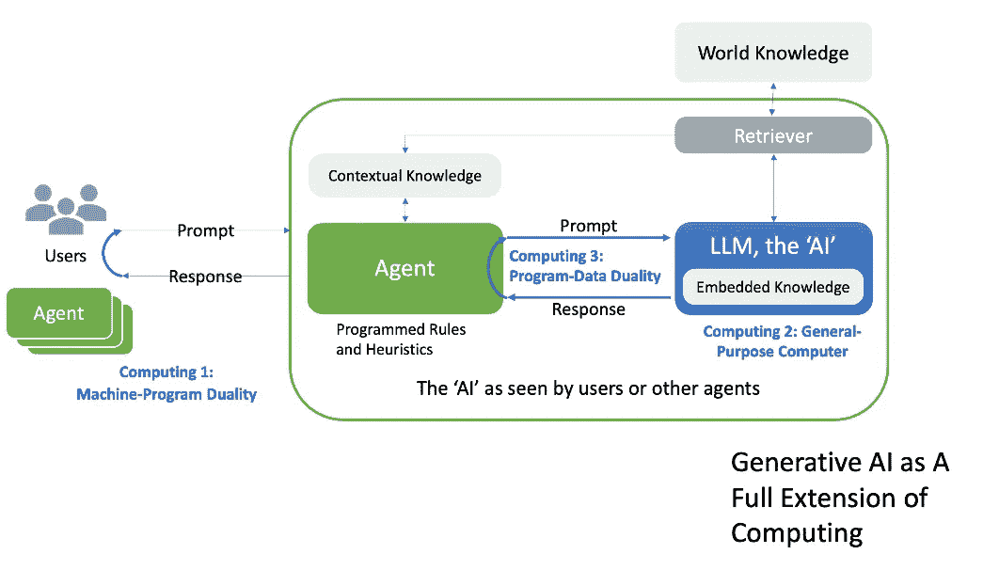

来源：作者

### 生成式人工智能创新成为新的 软件工程

GenAI系统中的智能主要源自LLM，然而人类AI创新者在提供程序化智能方面发挥着重要作 用。创新的三个关键模式——"密切监督AI（Let’s Watch AI’s Back）"、"增强AI的自主性（Let AI Do More Work）"和"开拓AI理解周围环境的能力（Let’s Look Around for AI）"——正在重新定义由AI创新者主 导的软件工程领域。这些模式代表了在GenAI中推动创新的关键方法，标志着如何在AI的框架下进行软件工程的变革性方法。

**1. 密切监督AI（ Let’s Watch AI ’s **Back ）：解决 LLM 的不可预测性

这一模式专注于对AI系统的警惕监督和持续改进。它致力于解决语言大模型的不可预测性和潜在错误，这是推进GenAI的一个关键方面。这种创新方法符合GenAI中的“机器-程序二元性”。

**2. 增强 AI 的自主性（ Let AI Do M**ore Work ）：拓展AI的功能范围

这一模式代表着在增强GenAI功能方面的战略转变，使得AI系统能够自主管理更广泛的复杂任务。这种创新方法符合GenAI中的通用计算。

**3**. 开拓AI理解周围环境的能力 （ Let’s Look Around for AI ）：拓展上下文意识

这一模式的典型代表是检索增强生成（RAG）（Lewis，2020），它涉及整合外部实时信息以丰富AI对上下文的理解和响应。它反映了一种创新方法，符合GenAI中的程序-数据二元性。

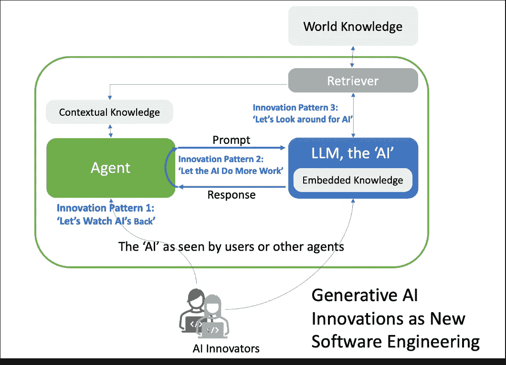

来源：作者

一个典型的例子是自我反思型的RAG（Self-Reflective RAG），或称自我RAG（Self RAG）（Asai, 2023），它采用了生成式人工智能（GenAI）中的三种创新模式，具体如下：

1.  解决 AI 的不可预测性或“ 密切监督AI ” ：这一模式专注于对AI系统的警惕监督和持续。它重点解决了语言大模型的不可预测性和潜在错误，这是推进GenAI的一个关键方面。

1.  拓展 AI 的功能范围或“增强AI的自主性” ：这一模式代表着在增强GenAI能力方面的重大转变，赋予AI系统自主管理各种复杂任务的能力。这一趋势的一个典型例子是假设文档嵌入（HyDE）方法（Gao, 2022），它利用AI生成的示例来引导相似性搜索。这展示了对AI生成特征的巧妙应用，特别是在战略性地利用其“幻觉”来增强密集检索系统性能方面。

1.  拓展上下文感知或“ 开拓AI理解周围环境的能力 “ ：这种模式以检索增强生成（RAG）（Lewis，2020）为代表，涉及整合外部的实时信息，以丰富人工智能对上下文的理解和响应。

Auto-CoT（Zhang，2023）方法应用了GenAI中的三种创新模式，具体如下：

1.  密切监督AI（ Let’s Watch AI ’s Back ） ：该模式侧重于通过聚类和有针对性的采样来识别和缓解AI推理中的错误，以确保密切监督和持续改进。

1.   增强 AI 的自主性（ Let AI Do More Work ）  : Auto-CoT自动生成推理链，使得AI能够更自主地处理复杂的推理任务。

1.   **开拓AI理解周围环境的能力 （ Let’s L**ook Around for AI ）  : 该模式通过存储和检索各种AI生成的推理链，为未来任务构建更丰富的上下文，增强人工智能的上下文适应能力。

通过自我反思 RAG（Self-Reflective RAG）和Auto-CoT可以看出，GenAI中整合了三种创新模式——“密切监督AI’（Let’s Watch AI’s Back）”、“增强AI的自主性’（Let AI Do More Work）”和“开拓AI理解周围环境的能力’（Let’s Look Around for AI）”。这种整合不仅推动了特定的技术进步，而且整体上引领了GenAI中看似无穷无尽的创新。这 种多层面的方法可能无意中推动GenAI朝着实现AGI的方向发展，表明这些创新策略的持续演进和整合可能是跨越AGI门槛的关键。

### **GenAI迈向AGI的必由之路**

图灵测试（Turing Test）是艾伦·图灵（Alan Turing）的一项重要遗产。在《计算机器与智能》（Computing Machinery and Intelligence）（1950年）这篇开创性论文中，他提出了图灵测试，将其作为评估机器智能的标准，关注的焦点是“机器能否表现出与人类无法区分的行为”。这种方法为评估通用人工智能（AGI）进展提供了一个经验主义、以人为中心的标准，回避了长期以来关于“什么是思维？”的定义性争论。

图灵将这一测试视为一个不断发展的挑战，他表示：“并不存在同时战胜所有机器的问题。可能有比任何给定机器更聪明的人，但也可能有其他更聪明的机器，依此类推”（Turing，2012）。这一观点与当今GenAI的动态性相吻合，特别是在其应用自然语言处理和自适应学习方面。

在探索GenAI如何进行推理、产生知识时，我们发现它正在解决与人类认知核心相关的问题。人工智能的推理是否与人类思维过程一致，还是代表一种新的方法论？推理是否固有地依赖于知识，还是可以独立发挥作用？

GenAI避开了这些争论，展示出类似于小型图灵测试的能力。语言大模型（LLM）在其技术框架中整合了认知、心理和哲学概念，如“思考”、“反思”、“解释”和“批判”。例如，思维链（Chain-of-Thought）（CoT）（Wei，2022年）将“思考”定义为推理过程中的一个独特步骤。人工智能可以自主生成“理性（rational）”，正如在Zero-Shot CoT（Kojima，2022年）中所示，其中诸如“让我们逐步思考”之类的提示会引导其进行推理。通过整合人类反馈确保人工智能的推理与人类思维模式相一致。以下简化图表展示了它们的工作原理。

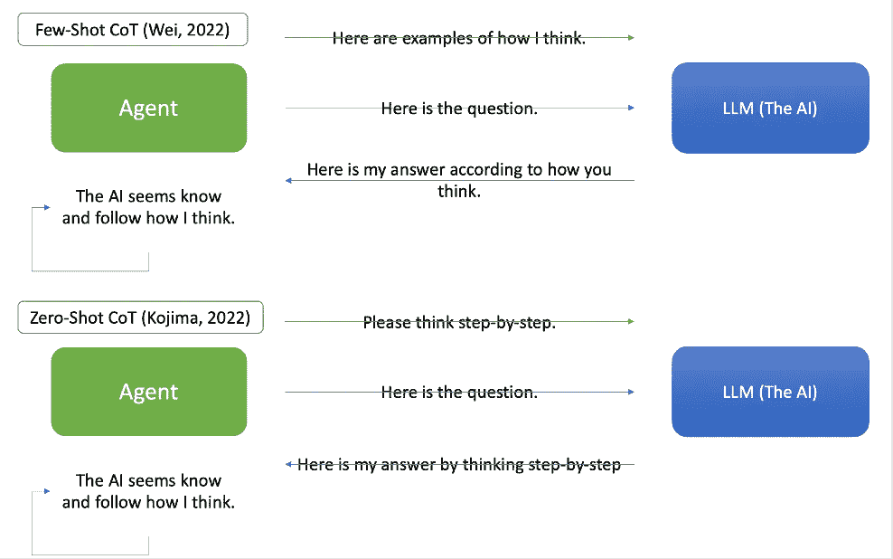

来源：作者

在检索增强生成（RAG）中，“知识”的定义是：人工精选的对AI可访问的数据（Lewis，2020）。这一定义符合人工智能的运行框架，与人类对知识的更广义理解相一致。当人工智能以自然语言处理和呈现这些数据时，它会使人类和AI对知识的解释保持同步。以下的简化图表展示了它的工作原理。

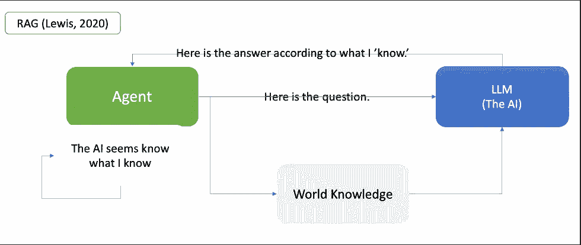

来源：作者

GenAI还促进了“推理”和“知识”的动态互动。在Zero-Shot CoT的基础上，Automatic CoT（Zhang，2023年）采用prompt如“让我们一次一次地思考”来鼓励人工智能生成自己的思维链示例，从而为未来的推理创建知识库。这体现了GenAI对图灵经验主义方法的遵循。

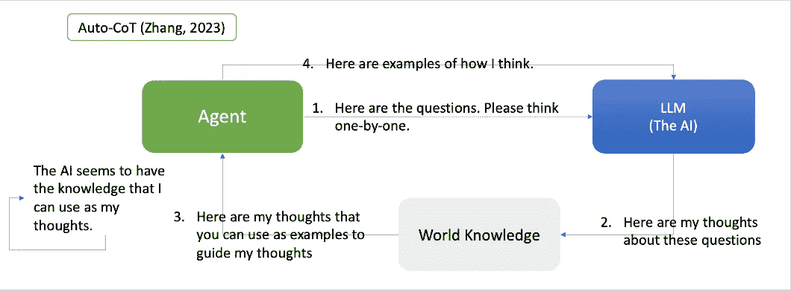

来源：作者

> GenAI的这些发展与图灵对机器和人类思维处理方式的愿景相一致。虽然GenAI主要关注可扩展性和商业应用，但其发展轨迹日益与追求AGI的目标相交汇。在经济需求和功能需求的推动下，GenAI的发展不仅推动了人工智能技术的进步，或许也在不经意间引导其朝着AGI方向发展。

>

> GenAI的历程或许正在无意中引导其走向AGI的实现。

## **4 **从 第一性原理 重新审视推理和知识

哥德尔以其不完备性定理（incompleteness theorems）而闻名，尽管在其一生中，他并未直接讨论通用人工智能 (AGI)，但他提供了一个与当代GenAI的发展形成有趣的对比的基础性视角。哥德尔认为，人类的思维能力远超任何机器可能达到的程度，这表明真正的通用人工智能可能无法完全实现。他强调对人类智能的深刻理解——这一概念可以概括为“先知后行（knowing before doing）”和“使其正确（let’s make it right.）”。哥德尔的观点意味着，虽然GenAI领域取得了重大进步，但仍有很长的路要走。他主张探索人类思维和推理的重要性，指出发展人工智能技术应该与深入探讨人类认知复杂性的研究相辅相成。

当我们深入研究生成式人工智能（GenAI）的复杂性时，采用了哥德尔的“先知后行”原则，侧重于“知（knowing）”这一方面。这一哲学基于对人类认知优越性的信仰，旨在以更符合人类认知和理性的方式分析人工智能。这种方法指导和影响着新型语言大模型 (LLM)（被视为通用推理硬件）的训练和对齐过程。

### **逻辑推理与合情推理**

在采用语言大模型(LLM)的生成式人工智能(GenAI)中，我们观察到了非正式推理和正式推理之间的相互作用。Huang (2023) 所强调的“非正式演绎推理”概念体现了这种相互作用。在这一背景下，“非正式”通常指的是自然语言推理，虽然经常与常识推理或归纳推理混为一谈，但仍保持着其独特性。

约翰·范·本特姆（Johan van Benthem）(2011)描述了一个绝佳场景，来演示这些推理类型是如何发挥作用的。为使这个场景更易于理解，下面我用自己的话来改述原文：

> 假设一名服务员收到一份包含浓缩咖啡和苏打水的订单。他问：“谁点了苏打水？”一旦他弄清楚是谁点的苏打水，那么对于他来说，知道谁点的浓缩咖啡就很容易了。

上述场景可分为两个推理阶段：

1.  合情推理（Plausible Reasoning）：最初，服务员的推理方式是合情推理，主要源自于工作经验或观察到的顾客行为。这种形式的推理涉及弱三段论（weak syllogism）和概率思维（probabilistic thinking），其中一般模式（A→B）和具体实例（A为真）推导出可能的结论（B可能为真）。这个概念与乔治·波利亚（George Pólya）（1945）和E.T.杰恩斯（E.T. Jaynes）（2003）关于“概率作为扩展逻辑”的概念一致，从而允许从可用信息中推导出的可能性得出结论。

1.  逻辑推理：在确定谁点了苏打水之后，服务员转而采用演绎的逻辑推理。这一步骤涉及从一个普遍前提（A→B）和具体信息（C→A）到一个逻辑结论（C→B）的清晰三段论推理。

这个场景不仅说明了在日常情境中非正式和正式推理的融合，并展示了传统的“正式（formal）”推理模式（如三段论和弱三段论）如何在自然语言中体现。在这些例子中，起初服务员的合情推理和随后的逻辑推理都是通过自然语言表达的，但它们都遵循正式推理的模式。因此，为了避免混淆，将推理分类为“逻辑”推理和“合情”推理，而不是“正式推理 ” 和 “ 非正式 ” 推理更合适。这种区分对于理解GenAI如何处理人类推理的复杂性尤为重要，特别是在其依赖自然语言处理的情况下。

### **逻辑推理的 第一性原理**

注意：以下符号推理部分是技术性内容，如不感兴趣可自行跳过，跳过这部分不会影响对文章主旨的理解。

为了从第一性原理探索逻辑推理，我们将咖啡馆场景表示如下：

+   E1：“顾客1点了浓缩咖啡”

+   S1：“顾客1点了苏打水”

+   E2：“顾客2点了浓缩咖啡”

+   S2：“顾客2点了苏打水”

三段论推理如下：

1.  大前提：每位客人恰好点了一份饮料，并且每种饮料都有一位客人点单，XOR语句表示如下：

+   E1⊕S1（顾客1点了浓缩咖啡或苏打水，但不能两者都点）

+   E2⊕S2（顾客2点了浓缩咖啡或苏打水，但不能两者都点）

1.  小前提：顾客1点了苏打水（S1为真）。

1.  结论：因此，顾客2点了浓缩咖啡（从S1推导出E2）。

符号表示如下：

+   (E1⊕S1)∧(E2⊕S2)（大前提）

+   S1 (Minor Premise)

+   S1（小前提）

+   ∴E2 (Conclusion)

+   ∴E2（结论）

在逻辑推理中，我们的结论是由逻辑的基本公理所引导的。这些公理充当基础规则，确保我们的推理过程是一致且合理的。下表列出了逻辑的基本公理。这些公理是逻辑推理的基石，构成了我们推导真理和做出理性决策的基础。表格以结构化方式呈现了每个基本公理，其中包括一个简单的自然语言描述和与之相关的人类价值观。这种结构的目的是展示每个基本公理的数学或逻辑本质，以及它在推理和伦理思考中的实际应用。通过这种方式，我们可以更容易地理解逻辑原则在实际生活和形式推理中的意义和价值。

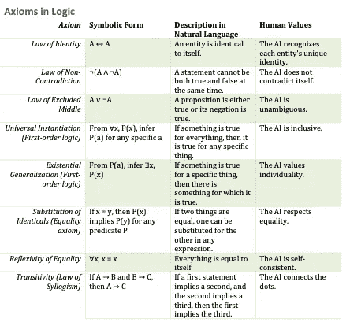

来源：作者

有趣的是，虽然AI可以分析逻辑推理的符号表示并理解逻辑的基本公理，但它通常不像人类那样以传统的方式操纵符号。Zero-Shot CoT提示‘Let’s think step-by-step’鼓励AI模拟三段论推理，其中每个“理性（rational）”通常表示三段论的应用。这可能涉及基于在训练数据中找到的基本公理的自然语言描述的模式识别。此外，将AI推理与每个基本公理中固有的人类价值观对齐可能会增强其逻辑推理能力，正如“人类价值观 ” 栏中所示。

### **快速验证；很难猜测**

我们观察到，人类认知出现了从严格逻辑的结构化方法向更灵活的概率直觉的转变，这种转变标志着对决策制定和问题解决的更深刻的理解。

以看似平凡的咖啡馆场景为例。尽管表面上服务员的决策看似使用了演绎推理，但深入了解后我们发现其决策的基础在于概率直觉。服务员使用由经验和观察塑造的合情推理，通过对各种情景的直观概率判断浏览各种场景。这体现了逻辑推理背后通常不为人们所察觉的层面，即直觉判断在构建逻辑推理过程中扮演着基础性角色。

直觉、概率考虑的影响甚至延伸到了服务员在逻辑公理应用中的逻辑推理，如不矛盾律（the Law of Non-Contradiction）和排中律（the Law of Excluded Middle）。因此，合情推理不仅是一种辅助手段，更是一种指导力量，使服务员能够评估潜在的结果并在合理猜测的基础上做出决策。在这种情况下，逻辑推演过程也起到了支持性作用，证实了最初从直觉洞察中得出的结论。

逻辑和直觉之间的动态相互作用不仅局限于日常场景，还深刻地影响了数学领域。在图灵关于判定问题（Entscheidungs problem）的著作中，他提出合理推理直觉（图灵将其称之为“直觉”）在证明的发现中起着至关重要的作用。他认为，这个直觉阶段一旦完成，随后的逻辑过程在很大程度上会是机械的。这种观点强调了直觉洞察力和有条不紊的逻辑在解决问题和定理证明中的相互作用。在现代人工智能的背景下，思维链（CoT）提示（Wei，2022）似乎利用了类似机制。它可能会触发人工智能进行逻辑后思考（logical afterthought），这本质上验证了直觉跳跃之后的逻辑步骤，反映了人类推理的这一基本过程。

### **如何衡量一个好的猜测？**

咖啡馆场景进一步说明了这一点，其中建立逻辑序列的过程与合情推理深深交织在一起。例如，假设“B可能为真”转化为高概率P(B)。理解P(B)代表着什么需要深入研究概率的本质及其在合情推理中的作用。

关于概率的概念，有以下三种截然不同的看法：

1.  **频率论者的观点 **：将概率视为事件的长期频率。虽然对于日常决策来说并不完全实用，就像我们的服务员所面临的那样，但它构成了概率论的基础方面。

1.  **贝叶斯观点 **：将概率视为个人信仰或知识的衡量标准，深受人类经验的影响。这种观点与我们在日常生活中解释概率的方式密切相关。

1.  **杰恩斯观点 **：由杰恩斯在2003年提出，该方法将贝叶斯框架扩展到包括人工智能和搜索算法等非人类实体。其中概率是适用于任何推理实体（无论是人类还是机器）的知识状态。

我们必须承认，语言大模型主要在杰恩斯概率（Jaynesian probability）的范畴内发挥作用，一旦意识到LLM是非人类实体，并且无法执行频率试验来确定后续词元的概率分布，这一点就变得显而易见。重要的是，通过将人类和人工智能视为能够持有信念的实体，我们将自己定位为观察者，具有分析和理解自身认知过程和人工智能系统认知过程的独特能力。这种观察者和参与者的双重角色对于全面理解人工智能的动态及其与人类推理的相互作用至关重要。

### **合情推理 的第一性原则**

下表呈现了杰恩斯对合情推理的期望。这些原则指导了我们日常生活中的“常识”性决策。每个期望都有一个概率或数学解释，展示了我们的直觉决策与这些原则的一致性。此外，表格突出了相应的人类价值观，强调了这些原则在我们日常生活中的伦理和实际影响。尽管每个原则都包含丰富的细节，但表格的设计旨在提供参考，以便在闲暇时深入探讨。它提醒我们，结构化推理通常会以我们没有明确意识到的方式引导我们的直觉和判断。

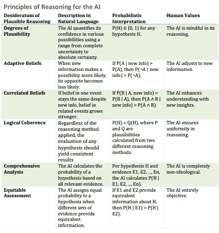

来源：作者

虽然语言大模型和类似的人工智能系统本质上不具备贝叶斯推理能力，但通常表现出符合杰恩斯所期望的原则的行为。这种一致性很可能是它们在大量自然语言数据集上全面训练的结果。未来人工智能的发展可能会更有意识地注重嵌入这些合情推理原则，从而提高系统的决策能力。

### **知识广博的推理体面临的挑战**

推理和知识之间错综复杂的关系在有效推理中起着至关重要的作用，适用于人类认知和人工智能系统。杰恩斯的期望原则中的“公平评估（Equitable Assessment）”和“全面分析（Comprehensive Analysis）”等原则强调了这种联系。这些原则强调人工智能系统客观考虑和评估所有相关证据的重要性，这方面的显著不足是造成AI“幻觉”（从内部知识中得出的误导性结论）或因外部误导信息产生的不准确性（比如被“相似性误导”）（Zhang，2022）等问题的主要原因之一。然而，现实世界的数据数量十分庞大复杂，这使得构建一个完全客观的人工智能系统变得十分困难，甚至成为了不切实际的目标。

推理和知识之间错综复杂的关系在有效推理中起着至关重要的作用，适用于人类认知和人工智能系统。

接下来，我们将探讨这一挑战在其他方面的影响，检验全面实施这些原则的潜在“不可行性（infeasibility）”将对计算领域和人工智能发展的未来产生何种影响。

## **5 ****从P vs. NP 到 AGI**

### 重新审视判定问题（ Entscheidungsproblem ）

我们对合理推理的讨论自然会涉及定理证明中的判定问题，其定义非常明确和狭窄。如果从第一性原理出发的合理推理是可行的，那么判定问题也一定是可行的。然而，艾伦·图灵在1937年证明了这个问题是不可解的，这促使我们将视角从可能性与不可能性转向了可行性问题。

最初，判定问题是在数学和逻辑背景下提出的，并不存在效率和输入大小限制。在这一领域，搜索总是穷尽的，涉及所有可能性。

哥德尔的贡献虽然没有直接解决AGI，但对计算复杂性理论产生了重大影响。他引入了将问题规模进行扩展以研究解决时间的概念，这是该领域的一个关键概念。该理论根据所需的计算资源（如时间和空间）对问题进行分类，定义了P（多项式时间，可行解决问题）、NP（非确定性多项式时间，可行验证解决方案）和EXP（指数时间，解决时间呈指数增长）等类别。该理论的核心问题是P vs. NP，它关注的是是否每个可被快速验证的问题 (NP) 也都可以被可行地解决 (P)。当考虑判定问题中涉及的逻辑推理时，这一点尤其重要，突显了这一领域中问题可以被可行地解决的频率。

在1945年与约翰·冯·诺依曼的通信中，哥德尔推测他修改后的决策问题（现在属于NP类）既能通过逻辑推理迅速验证，又可以被迅速地解决，这意味着NP可能等于P。这一推测早于并预示了P vs. NP问题。哥德尔认为，如果这一假设成立，将动摇他之前的信念（人类智慧在数学中起着独特的作用）。

计算机科学领域普遍认为P不等于NP，这表明从计算问题的角度来看，最初被图灵证明无法解决的判定问题可能是不可行的。相比之下，语言大模型已经表现出了类似人类的合理推理能力，这表明GenAI对构建以人为中心的AGI至关重要。

### **如果存在停机预言机会如何？**

反思现代计算和人工智能，我们通过思考有关经典判定问题和P vs. NP问题的“假设（what-if）”场景获得了新视角。这种方法不仅重新审视了这些长期存在的问题，而且还将它们重新置于当代技术进步的背景之下。

想象一下，如果存在“停机预言机”会怎样？它可能会削弱许多开放性数学问题带来的智力刺激和挑战，比如哥德巴赫猜想。我们可以设计一个简单的程序，系统地评估从4开始的每个偶数，检查每个偶数是否可以表示为两个质数之和，然后我们可以询问“停机预言机”这个程序是否最终会得出结论，“停机预言机”可能会提供问题的解决方案。

哥德尔在这一领域的洞察力尤其深刻。他认为，不存在通用证明机或停机预言机并不是人类推理局限导致的，而是因为机械化逻辑推理的约束。从现代进步的角度来看，这一观点强调了图灵时代（包括图灵）缺少有效弥合逻辑推理和合情推理之间鸿沟的概念框架。图灵使用“选择（selection）”来描述合情推理，这个术语后来成为了计算复杂性理论中的“搜索”的核心，凸显了这种概念上的分歧。矛盾的是，开发能够包含合情推理的逻辑推理机（logical reasoning machines）却催生了具备机械化合情推理潜力的新框架和新工具的创造。

### **如果P= NP 会怎样？**

> 与上述情况类似，假设出现了一种“圣杯”解决器，即一种可行的NP求解器——人工智能的定义经历了一场范式转变，与通用人工智能的传统轨迹大相径庭。这种转变，特别是在假设P等于NP的情况下，为AI能力引入了根本性变革。在这种情况下，推理和知识之间的边界变得模糊；传统上依赖于积累知识的推理可以在没有庞大信息数据库（目前是必不可少的）的情况下实现。

>

> 在这样一个假设情境中，传统上依赖于积累知识的推理可以在没有庞大信息数据库（目前是必不可少的）的情况下实现。

>

> 假设人工智能具备了一个能够解决任何问题的算法。在这种情况下，AI不再需要像以前那样通过学习演进、积累数据，或模仿人类思维等方式来解决问题。经过这一计算方面的突破，AI变成了一个全能的问题解决者，虽然在学习方面没有进展，但在解决问题方面却是无与伦比的。AI的作用也发生了巨大变化，不再仅仅是一个根据人类需求不断发展和适应的工具，成为了一个无所不能的解决者，重新定义了计算和问题解决的极限。问题的本质曾经需要依赖知识和经验，现在却变成了一个完全由算法探索的领域。在这个新时代，人类陷入了深刻的身份危机，开始质疑自己在一个智能和问题解决不再受知识积累限制的世界中的角色和目的。

>

> 在假设的“P=NP”时代，人类陷入了身份危机，开始质疑自己角色和目的。

## **6 ****结论**

值得庆幸的是，此类突破性发现成为现实的可能仍然渺茫，尽管面临挑战，但通用人工智能仍可能在未来找到一条通向以人类为中心的AGI的可行路径。解决GenAI带来的挑战可能会将我们引进一个充满计算新见解的时代，同时还能加深我们对自身本质的理解。这不可避免地引出了一个问题，让人联想到了哥德尔的逻辑探究问题：“在创造通用人工智能的背景下，机械化思维意味着什么？”

在创建AGI的背景下，机械化思维意味着什么？

[注]尽管本文的原始概念和想法均为我个人所创，但我仍要感谢OpenAI的ChatGPT在本文撰写过程中提供的帮助，它为文章提供了额外的见解、细化了某些观点，并协助了文章的起草。

**参考文献 ****（请上下滑动） **

1.  Aaronson, S. (2016). P=?NP. In Open Problems in Mathematics. Springer.

1.  Asai, A., Wu, Z., Wang, Y., Sil, A., & Hajishirzi, H. (2023). Self-RAG: Learning to Retrieve, Generate, and Critique through Self-Reflection. https://arxiv.org/abs/2310.11511 .

1.  Cook, S. (1971). “The complexity of theorem proving procedures”. Proceedings 1. of the Third Annual ACM Symposium on Theory of Computing. pp. 151–158.

1.  Copland, J. B., Posy, C. J., & Shagrir, O. (2013). Computability: Turing, Gödel, Church, and Beyond (Kindle ed.). The MIT Press.

1.  Fiorillo, C. D. (2012). Beyond Bayes: On the need for a unified and Jaynesian definition of probability and information within neuroscience. Information, 3(2), 175–203. Retrieved from https://doi.org/10.3390/info3020175 .

1.  Gao, Y., Xiong, Y., Gao, X., Jia, K., Pan, J., Bi, Y., Dai, Y., Sun, J., & Wang, H. (2023). Retrieval-Augmented Generation for Large Language Models: A Survey. ArXiv. https://arxiv.org/abs/2312.10997 .

1.  Gödel, K. (1931). Über formal unentscheidbare Sätze der Principia Mathematica und verwandter Systeme I. Monatshefte für Mathematik und Physik, 38(1), 173–198. doi:10.1007/BF01700692

1.  He, Z., Zhong, Z., Cai, T., Lee, J. D., & He, D. (2023). REST: Retrieval-Based Speculative Decoding. Peking University & Princeton University. Retrieved from arXiv:2311.08252v1

1.  Huang, J., & Chang, K. C-C. (2023). Towards Reasoning in Large Language Models: A Survey. [Manuscript submitted for publication]. University of Illinois at Urbana-Champaign. https://ar5iv.org/abs/2212.10403 .

1.  Jaynes, E. T. (2003). Probability Theory: The Logic of Science. Cambridge University Press.

1.  Kojima, T., Gu, S. S., Reid, M., Matsuo, Y., & Iwasawa, Y. (2022). Large Language Models are Zero-Shot Reasoners. ArXiv. Available at: https://arxiv.org/abs/2205.11916 .

1.  Lewis, P., Perez, E., Piktus, A., Petroni, F., Karpukhin, V., Goyal, N., Küttler, H., Lewis, M., Yih, W., Rocktäschel, T., Riedel, S., & Kiela, D. (2020). Retrieval-Augmented Generation for Knowledge-Intensive NLP Tasks. ArXiv. /abs/2005.11401.

1.  Lu, C. (2020a). AI since Aristotle: Part 1 Logic, Intuition and Paradox. Retrieved from https://medium.com/cantors-paradise/logic-intuition-and-paradox-d0881627762a

1.  Lu, C. (2020b). AI since Aristotle: Part 2 The Limit of Logic and The Rise of the Computer. Retrieved from https://www.cantorsparadise.com/the-limit-of-logic-and-the-rise-of-the-computer-1641219f86c3

1.  Lu, C. (2020c). AI since Aristotle: Part 3 Intuition, Complexity and the Last Paradox. Retrieved from https://www.cantorsparadise.com/intuition-complexity-and-the-last-paradox-ec0a7f8ad93b

1.  Lu, C. (2023). From Self-Referential Paradoxes to Intelligence. Retrieved from https://medium.com/@cplu/from-self-referential-paradoxes-to-intelligence-b073cbebafe2 .

1.  Mithen, S. J. (1990). The eco-psychology of decision making. In Thoughtful Foragers: A Study of Prehistoric Decision Making (pp. 21–51). Cambridge University Press.

1.  Pólya, G. (1945). How to Solve It: A New Aspect of Mathematical Method. Princeton University Press.

1.  Polya, G. (1954). Induction and Analogy in Mathematics.

1.  Poincare, H. (1969). INTUITION and LOGIC in Mathematics. The Mathematics Teacher, 62(3), 205–212.

1.  Prokopenko, M., Harré, M., Lizier, J., Boschetti, F., Peppas, P., & Kauffman, S. (2017). Self-referential basis of undecidable dynamics: From The Liar Paradox and The Halting Problem to The Edge of Chaos. ArXiv. https://doi.org/10.1016/j.plrev.2018.12.003 .

1.  Stanford Encyclopedia of Philosophy. (n.d.). Logic and Information. Retrieved from https://plato.stanford.edu/entries/logic-information/ .

1.  Stanford Encyclopedia of Philosophy. (n.d.). The Analysis of Knowledge. Retrieved from https://plato.stanford.edu/entries/knowledge-analysis/ .

1.  Turing, A. M. (1937). On Computable Numbers, with an Application to the Entscheidungsproblem. Proceedings of the London Mathematical Society, Series 2, 42(1), 230–265. doi:10.1112/plms/s2–42.1.230.

1.  Turing, A. M. (1950). Computing Machinery and Intelligence. Mind, 59(236), 433–460. Retrieved from https://academic.oup.com/mind/article/LIX/236/433/986238 .

1.  Turing, A. M. (2012). Alan M. Turing: Centenary Edition. (S. Turing, Ed.) Cambridge University Press. (Original work published 1959).

1.  van Benthem, J. (2011). Logical Dynamics of Information and Interaction. Cambridge: Cambridge University Press.

1.  Wang, J., Li, J., & Zhao, H. (2023a). Self-prompted Chain-of-Thought on Large Language Models for Open-domain Multi-hop Reasoning. ArXiv. /abs/2310.13552.

1.  Wang, X., Narang, S. (2023b). Self-Consistency Improves Chain of Thought Reasoning in Language Models. Retrieved from https://ar5iv.org/abs/2203.11171

1.  Wei, J., Wang, X., Schuurmans, D., Bosma, M., Ichter, B., Xia, F., Chi, E., Le, Q., & Zhou, D. (2022). Chain-of-Thought Prompting Elicits Reasoning in Large Language Models. ArXiv. /abs/2201.11903.

1.  Zhang, Z., Zhang, A., Li, M., & Smola, A. (2022). Automatic chain of thought prompting in large language models.

1.  Zhang, Z., Zhang, X., Ren, Y., Shi, S., Han, M., Wu, Y., Lai, R., & Cao, Z. (2023). IAG: Induction-Augmented Generation Framework for Answering Reasoning Questions. Huawei Poisson Lab, China.

【语言大模型推理最高 加速11 倍】 SiliconLLM是由硅基流动开发的高效、易用、可扩展的LLM推理加速引擎，旨在为用户提供开箱即用的推理加速能力，显著降低大模型部署成本，加速生成式AI产品落地。（技术合作、交流请添加🛰️：SiliconFlow01）

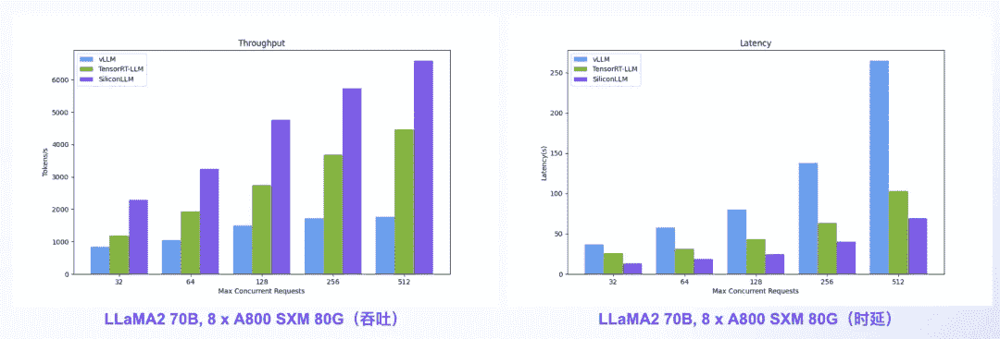

**Si**liconLLM的吞**吐最**高提升近 4 倍，时延最高降低近 4 倍

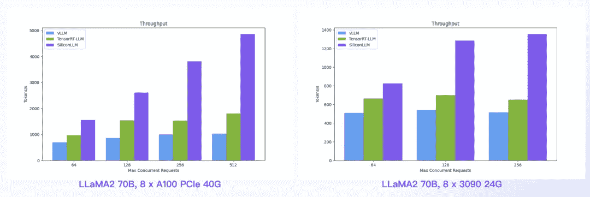

**数据中心+PCIe ****：S**ili**conLLM****的吞**吐最高提升近 5 倍； 消费卡场景 ：SiliconLLM的吞吐最高提升近 3 倍

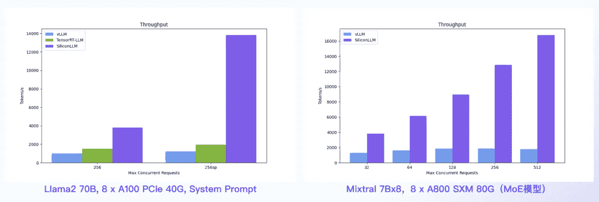

**Sy **ste**m Prom****pt场**景 ：SiliconLLM的吞吐最高提升 11 倍； MoE模型 ：推理 SiliconLLM的吞吐最高提升近 10 倍

其他人都在看

+   [800+页免费“大模型”电子书](http://mp.weixin.qq.com/s?__biz=MzU5ODY2MTk3Nw==&mid=2247493221&idx=1&sn=0c75b8115f4d4a27c8a5d6505a0a4986&chksm=fe426853c935e145d21abd30e0ceb29486c9e306032dfcb3d071ce34d171425c11341a57d7bf&scene=21#wechat_redirect)

+    [语言大模型的推理技巧](http://mp.weixin.qq.com/s?__biz=MzU5ODY2MTk3Nw==&mid=2247493108&idx=1&sn=b254dff8281096bf6f5462489e94658a&chksm=fe426bc2c935e2d404fb803985241ea05109aa9d7925a1876304a51c322fa5e6e57dd41e2e66&scene=21#wechat_redirect)

+   [语言大模型的推理演算](http://mp.weixin.qq.com/s?__biz=MzU5ODY2MTk3Nw==&mid=2247491309&idx=1&sn=407fefb7ec76a2c9fdfe1ae960f7de4d&chksm=fe4190dbc93619cd0b9bfecb979e142a125fd8548d323dd9bdc2cbeb619400202e6e1affced0&scene=21#wechat_redirect)

+   [语言大模型推理加速指南](http://mp.weixin.qq.com/s?__biz=MzU5ODY2MTk3Nw==&mid=2247493321&idx=1&sn=ffc39c67080fefb01f1790e285a5085b&chksm=fe4268ffc935e1e9c8aeb5a095f08868a5eb8df90c1f46eb1e07044ec34ae6404d14b8b5926b&scene=21#wechat_redirect)

+    从头理解与编码LLM的自注意力机制

+   迈向100倍加速：全栈Transformer推理优化

+   Mistral AI:LLM推理的吞吐、时延及成本空间

试用OneDiff: github.com/siliconflow/onediff