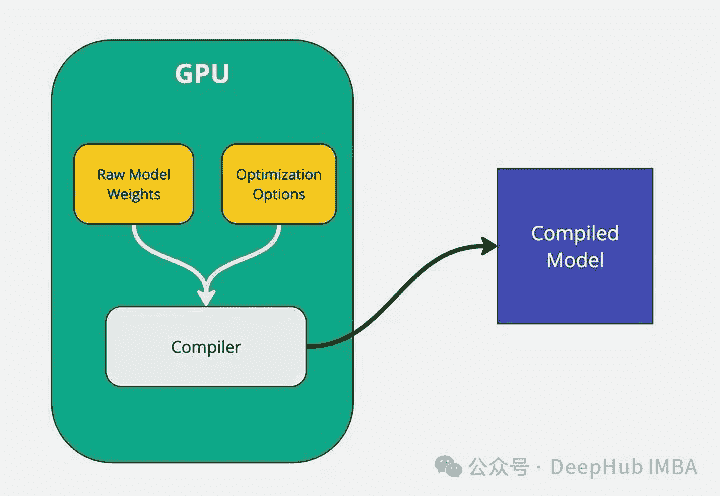
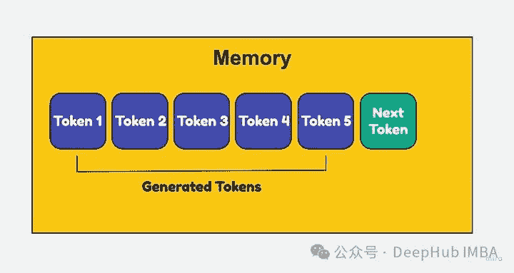
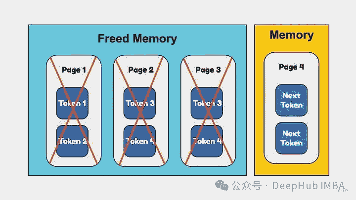
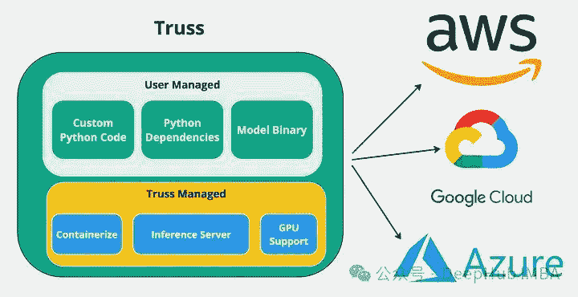
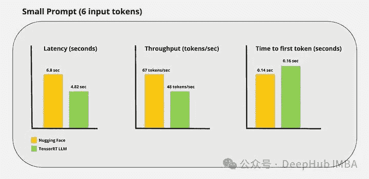
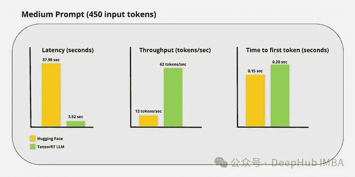
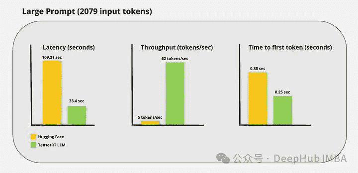

# 使用TensorRT-LLM进行生产环境的部署指南

> 来源：[https://agijuejin.feishu.cn/docx/G7Ffd9vpHoyzzwxMrHVcnnMhnMc](https://agijuejin.feishu.cn/docx/G7Ffd9vpHoyzzwxMrHVcnnMhnMc)

> 作者：P**nHub兄弟网站 DeepHub IMBA

> 原文：https://mp.weixin.qq.com/s/mSnWecvb0lkLqVXhbHGzwA

TensorRT-LLM是一个由Nvidia设计的开源框架，用于在生产环境中提高大型语言模型的性能。该框架是基于 TensorRT 深度学习编译框架来构建、编译并执行计算图，并借鉴了许多 FastTransformer 中高效的 Kernels 实现，并且可以利用 NCCL 完成设备之间的通讯。


虽然像vLLM和TGI这样的框架是增强推理的一个很好的起点，但它们缺乏一些优化，因此很难在生产中扩展它们。所以Nvidia在TensorRT的基础上有开发了TensorRT-LLM，像Anthropic, OpenAI, Anyscale等大公司已经在使用这个框架为数百万用户提供LLM服务。

## **TensorRT-LLM**

与其他推理技术不同，TensorRT LLM不使用原始权重为模型服务。它会编译模型并优化内核，这样可以在Nvidia GPU上有效地服务。运行编译模型的性能优势远远大于运行原始模型。这是TensorRT LLM非常快的主要原因之一。



原始模型权重和优化选项(如量化级别、张量的并行性、管道并行性等)一起传递给编译器。然后编译器获取该信息并输出针对特定GPU优化的模型二进制文件。

但是这里整个模型编译过程必须在GPU上进行。生成的编译模型也是专门针对运行它的GPU进行优化的。例如，在A40 GPU上编译模型，则可能无法在A100 GPU上运行它。所以无论在编译过程中使用哪种GPU，都必须使用相同的GPU进行推理。

但是TensorRT LLM并不支持开箱即用所有的大型语言模型（原因是每个模型架构是不同的）。但是TensorRT所作的做深度图级优化是支持大多数流行的模型，如Mistral、Llama和Qwen等。具体支持的模型可以参考TensorRT LLM Github官方的列表

## **TensorRT-LLM的好处**

TensorRT LLM python包允许开发人员在不了解c++或CUDA的情况下以最高性能运行LLM。

**分页注意力**

大型语言模型需要大量内存来存储每个令牌的键和值。随着输入序列变长，这种内存使用会变得非常大。

通常情况下，序列的键和值必须连续存储。所以即使你在序列的内存分配中释放了空间，你也不能把这个空间用于其他序列。这会导致碎片化和浪费。



分页注意力将键/值分成而不是连续的页，这样可以放在内存中的任何地方，如果您在中间释放一些分页，那么这些空间可以用于其他序列。

这可以防止碎片，并允许更高的内存利用率。在生成输出序列时，可以根据需要动态地分配和释放页面。



**高效KV缓存**

llm有数十亿个参数，这使得它们运行推理时速度缓慢且占用大量内存。KV缓存通过缓存LLM的层输出和激活来帮助解决这个问题，因此它们不需要为每个推理重新计算。

下面是它的工作原理:

在推理期间，当LLM执行每一层时，输出将被缓存到具有唯一键的键值存储中。当后续推断使用相同的层输入时，不是重新计算层，而是使用键检索缓存的输出。这避免了冗余计算，减少了激活内存，提高了推理速度和内存效率。

下面我们开始使用TensorRT-LLM部署一个模型

## TensorRT-LLM部署教程

使用TensorRT-LLM部署模型首先就是要对模型进行编译，这里我们将使用Mistral 7B instruction v0.2。编译阶段需要GPU，所以为了方便使用我们直接在Colab上操作。

TensorRT LLM主要支持高端Nvidia gpu。所以我们在Colab上选择了A100 40GB GPU。

下载TensorRT-LLM git库。这个repo包含了编译模型所需的所有模块和脚本。

```
 !git clone https://github.com/NVIDIA/TensorRT-LLM.git
 %cd TensorRT-LLM/examples/llama
```

然后安装所需的包

```
 !pip install tensorrt_llm -U --pre --extra-index-url https://pypi.nvidia.com
 !pip install huggingface_hub pynvml mpi4py
 !pip install -r requirements.txt
```

下载模型

```
 from huggingface_hub import snapshot_download
 from google.colab import userdata
 
 snapshot_download(
     &quot;mistralai/Mistral-7B-Instruct-v0.2&quot;,
     local_dir=&quot;tmp/hf_models/mistral-7b-instruct-v0.2&quot;,
     max_workers=4
 )
```

这一步可以查看Colab的tmp/hf_models目录，在那里可以看到模型权重。

然后是加载模型，并转换成特定的tensorRT LLM格式

```
 !python convert_checkpoint.py --model_dir ./tmp/hf_models/mistral-7b-instruct-v0.2 \
                              --output_dir ./tmp/trt_engines/1-gpu/ \
                              --dtype float16
```

下一步就是使用trtllm-build命令编译模型。如果需要量化和其他优化，可以在这里指定参数。为了简单起见，我没有使用任何额外的优化。

```
!trtllm-build --checkpoint_dir ./tmp/trt_engines/1-gpu/ \
             --output_dir ./tmp/trt_engines/compiled-model/ \
             --gpt_attention_plugin float16 \
             --gemm_plugin float16 \
             --max_input_len 32256
```

Mistral 7B instruction v0.2支持32K上下文长度。所以这里在max_input_length标志设置了上下文长度。

> 编译模型需要15-30分钟

模型编译完成后就可以直接使用了。我们这里还要介绍一下模型部署的方法，有很多方法可以部署这个编译后的模型比如像FastAPI这样的简单工具，或者像triton推理服务器这样更复杂的工具。

当使用像FastAPI这样的工具时，开发人员必须设置API服务器，编写Dockerfile，并正确配置CUDA，这里面包含了很多服务器后端的工作，有时候我们并不熟悉，所以这里我们介绍一个简单的开源工具Truss。

Truss允许开发人员使用GPU打包他们的模型，并在任何云环境中运行它们。它有很多很棒的功能，使集成模型变得轻而易举。使用Truss的主要好处是，可以轻松地将具有GPU支持的模型容器化，并将其部署到任何云环境中。



安装:

```
pip install --upgrade truss
```

如果从头开始创建Truss项目，你可以运行下面的命令:

```
truss init mistral-7b-tensort-llm
```

mistral-7b-tensort-llm是我们项目的名称，可以随便编写。运行上面的命令会自动生成部署Truss所需的文件。

下面是mistral-7b- tensort -llm-truss的目录结构:

```
├── mistral-7b-tensorrt-llm-truss
 │   ├── config.yaml
 │   ├── model
 │   │   ├── __init__.py
 │   │   └── model.py
 |   |   └── utils.py
 |   ├── requirements.txt
```

以下是上述文件的快速介绍:

1、config.yaml用于为模型设置各种配置，包括其资源、依赖项、环境变量等。在这里，我们可以指定模型名称、要安装的Python依赖项以及要安装的系统包。

2、model/model.py是Truss的核心。它包含将在Truss服务器上执行的Python代码。在model.py中有两个主要方法:load()和predict()。

load方法是我们从hugs face下载编译模型并初始化TensorRT LLM的地方；predict方法接收HTTP请求并调用模型。

3、model/utils.py包含model.py文件的一些辅助函数。utils.py文件不是我们自己编写的，可以直接从TensorRT LLM存储库中获取的。

4、含运行编译模型所需的Python依赖项，truss会使用它来初始化我们的环境。

model.py包含执行的主代码，让我们首先看一下load函数。

```
 import subprocess
 subprocess.run([&quot;pip&quot;, &quot;install&quot;, &quot;tensorrt_llm&quot;, &quot;-U&quot;, &quot;--pre&quot;, &quot;--extra-index-url&quot;, &quot;https://pypi.nvidia.com&quot;])
 
 import torch
 from model.utils import (DEFAULT_HF_MODEL_DIRS, DEFAULT_PROMPT_TEMPLATES,
                    load_tokenizer, read_model_name, throttle_generator)
 
 import tensorrt_llm
 import tensorrt_llm.profiler
 from tensorrt_llm.runtime import ModelRunnerCpp, ModelRunner
 from huggingface_hub import snapshot_download
 
 STOP_WORDS_LIST = None
 BAD_WORDS_LIST = None
 PROMPT_TEMPLATE = None
 
 class Model:
     def __init__(self, **kwargs):
         self.model = None
         self.tokenizer = None
         self.pad_id = None
         self.end_id = None
         self.runtime_rank = None
         self._data_dir = kwargs[&quot;data_dir&quot;]
 
     def load(self):
         snapshot_download(
             &quot;htrivedi99/mistral-7b-v0.2-trtllm&quot;,
             local_dir=self._data_dir,
             max_workers=4,
         )
 
         self.runtime_rank = tensorrt_llm.mpi_rank()
 
         model_name, model_version = read_model_name(f&quot;{self._data_dir}/compiled-model&quot;)
         tokenizer_dir = &quot;mistralai/Mistral-7B-Instruct-v0.2&quot;
 
         self.tokenizer, self.pad_id, self.end_id = load_tokenizer(
             tokenizer_dir=tokenizer_dir,
             vocab_file=None,
             model_name=model_name,
             model_version=model_version,
             tokenizer_type=&quot;llama&quot;,
         )
 
 
         runner_cls = ModelRunner
         runner_kwargs = dict(engine_dir=f&quot;{self._data_dir}/compiled-model&quot;,
                              lora_dir=None,
                              rank=self.runtime_rank,
                              debug_mode=False,
                              lora_ckpt_source=&quot;hf&quot;,
                             )
 
         self.model = runner_cls.from_dir(**runner_kwargs)
```

在文件的顶部，我们导入了必要的模块，特别是tensorrt_llm；然后在load函数中，我们使用snapshot_download函数下载编译后的模型；然后使用model/utils.py附带的load_tokenizer函数下载模型的标记器；最后使用TensorRT LLM使用ModelRunner类加载编译后的模型。

下面就是predict函数

```
 def predict(self, request: dict):
 
         prompt = request.pop(&quot;prompt&quot;)
         max_new_tokens = request.pop(&quot;max_new_tokens&quot;, 2048)
         temperature = request.pop(&quot;temperature&quot;, 0.9)
         top_k = request.pop(&quot;top_k&quot;,1)
         top_p = request.pop(&quot;top_p&quot;, 0)
         streaming = request.pop(&quot;streaming&quot;, False)
         streaming_interval = request.pop(&quot;streaming_interval&quot;, 3)
 
         batch_input_ids = self.parse_input(tokenizer=self.tokenizer,
                                       input_text=[prompt],
                                       prompt_template=None,
                                       input_file=None,
                                       add_special_tokens=None,
                                       max_input_length=1028,
                                       pad_id=self.pad_id,
                                       )
         input_lengths = [x.size(0) for x in batch_input_ids]
 
         outputs = self.model.generate(
             batch_input_ids,
             max_new_tokens=max_new_tokens,
             max_attention_window_size=None,
             sink_token_length=None,
             end_id=self.end_id,
             pad_id=self.pad_id,
             temperature=temperature,
             top_k=top_k,
             top_p=top_p,
             num_beams=1,
             length_penalty=1,
             repetition_penalty=1,
             presence_penalty=0,
             frequency_penalty=0,
             stop_words_list=STOP_WORDS_LIST,
             bad_words_list=BAD_WORDS_LIST,
             lora_uids=None,
             streaming=streaming,
             output_sequence_lengths=True,
             return_dict=True)
 
         if streaming:
             streamer = throttle_generator(outputs, streaming_interval)
 
             def generator():
                 total_output = &quot;&quot;
                 for curr_outputs in streamer:
                     if self.runtime_rank == 0:
                         output_ids = curr_outputs[&#x27;output_ids&#x27;]
                         sequence_lengths = curr_outputs[&#x27;sequence_lengths&#x27;]
                         batch_size, num_beams, _ = output_ids.size()
                         for batch_idx in range(batch_size):
                             for beam in range(num_beams):
                                 output_begin = input_lengths[batch_idx]
                                 output_end = sequence_lengths[batch_idx][beam]
                                 outputs = output_ids[batch_idx][beam][
                                           output_begin:output_end].tolist()
                                 output_text = self.tokenizer.decode(outputs)
 
                                 current_length = len(total_output)
                                 total_output = output_text
                                 yield total_output[current_length:]
             return generator()
         else:
             if self.runtime_rank == 0:
                 output_ids = outputs[&#x27;output_ids&#x27;]
                 sequence_lengths = outputs[&#x27;sequence_lengths&#x27;]
                 batch_size, num_beams, _ = output_ids.size()
                 for batch_idx in range(batch_size):
                     for beam in range(num_beams):
                         output_begin = input_lengths[batch_idx]
                         output_end = sequence_lengths[batch_idx][beam]
                         outputs = output_ids[batch_idx][beam][
                                   output_begin:output_end].tolist()
                         output_text = self.tokenizer.decode(outputs)
                         return {&quot;output&quot;: output_text}
```

predict函数接受一些模型输入，如提示、max_new_tokens、温度等。我们使用请求在函数的顶部提取所有这些值。调用LLM模型来使用self.model.generate函数生成输出。generate函数接受各种参数，帮助控制LLM的输出。

为了在云中运行我们的模型，还需要将其容器化。Truss会负责为我们创建Dockerfile并打包所有内容，所以我们不需要做太多事情。

在mistral-7b- tensort -llm-truss目录之外创建一个名为main.py的文件。将以下代码粘贴到其中:

```
 import truss
 from pathlib import Path
 
 tr = truss.load(&quot;./mistral-7b-tensorrt-llm-truss&quot;)
 command = tr.docker_build_setup(build_dir=Path(&quot;./mistral-7b-tensorrt-llm-truss&quot;))
 print(command)
```

运行main.py文件并查看mistral-7b- tensort -llm-truss目录。应该会看到自动生成的一堆文件。下面就可以使用docker构建容器。依次运行以下命令:

docker build mistral-7b-tensorrt-llm-truss -t mistral-7b-tensorrt-llm-truss:latest

docker tag mistral-7b-tensorrt-llm-truss <docker_user_id>/mistral-7b-tensorrt-llm-truss

docker push <docker_user_id>/mistral-7b-tensorrt-llm-truss

这些docker的配置文件就是truss为我们自动生成好的，我们下面简单的介绍一下看k8s的部署，我不会深入讨论如何设置GKE集群，因为这不在本文的讨论范围之内。

创建以下kubernetes部署:

```
 apiVersion: apps/v1
 kind: Deployment
 metadata:
   name: mistral-7b-v2-trt
   namespace: default
 spec:
   replicas: 1
   selector:
     matchLabels:
       component: mistral-7b-v2-trt-layer
   template:
     metadata:
       labels:
         component: mistral-7b-v2-trt-layer
     spec:
       containers:
       - name: mistral-container
         image: htrivedi05/mistral-7b-v0.2-trt:latest
         ports:
           - containerPort: 8080
         resources:
           limits:
             nvidia.com/gpu: 1
       nodeSelector:
         cloud.google.com/gke-accelerator: nvidia-tesla-a100
 ---
 apiVersion: v1
 kind: Service
 metadata:
   name: mistral-7b-v2-trt-service
   namespace: default
 spec:
   type: ClusterIP
   selector:
     component: mistral-7b-v2-trt-layer
   ports:
   - port: 8080
     protocol: TCP
     targetPort: 8080
```

这是一个标准的kubernetes部署，它运行一个映像为htrivedi05/mistral-7b-v0.2-trt:latest的容器。

可以通过运行命令创建部署:

kubectl create -f mistral-deployment.yaml

分配kubernetes pod需要几分钟的时间。一旦pod开始运行，我们之前编写的load函数就会被执行。

一旦加载了模型后就可以在pod日志中看到类似Completed model.load()的执行时间为449234毫秒。要通过HTTP向模型发送请求，我们需要对服务进行端口转发。你可以使用下面的命令:

kubectl port-forward svc/mistral-7b-v2-trt-service 8080

打开任意Python脚本并运行以下代码:

```
 import requests
 
 data = {&quot;prompt&quot;: &quot;What is a mistral?&quot;}
 res = requests.post(&quot;http://127.0.0.1:8080/v1/models/model:predict&quot;, json=data)
 res = res.json()
 print(res)
```

将看到如下输出:

```
 {&quot;output&quot;: &quot;A Mistral is a strong, cold wind that originates in the Rhone Valley in France. It is named after the Mistral wind system, which is associated with the northern Mediterranean region. The Mistral is known for its consistency and strength, often blowing steadily for days at a time. It can reach speeds of up to 130 kilometers per hour (80 miles per hour), making it one of the strongest winds in Europe. The Mistral is also known for its clear, dry air and its role in shaping the landscape and climate of the Rhone Valley.&quot;}
```

这样我们的推理服务就部署成功了

## **性能基准测试**

我运行了一些自定义基准测试，得到了以下结果:







可以看到TensorRT-LLM的加速推理还是很明显的

## **总结**

在这篇文章中，我们演示了如何使用TensorRT LLM实现模型加速推理，文章内容涵盖了从编译LLM到在生产中部署模型的所有内容。

虽然TensorRT LLM比其他推理优化器更复杂，但性能提高也是非常明显。虽然该框架仍处于早期阶段，但是可以提供目前最先进的LLM优化。并且它是完全开源的可以商业化，我相信TensorRT LLM以后还会有更大的发展，因为毕竟是NVIDIA自己的产品.

TensorRT-LLM代码：https://github.com/NVIDIA/TensorRT-LLM

本文Colabhttps://colab.research.google.com/drive/1tJSMGbqYDstnChytaFb9F37oBspDcsRL

作者：Het Trivedi