# 长序列中Transformers的高级注意力机制总结

> 来源：[https://agijuejin.feishu.cn/docx/JU9SdcguEoi151xp2sxcNa0Ynxc](https://agijuejin.feishu.cn/docx/JU9SdcguEoi151xp2sxcNa0Ynxc)

> 作者：P**nHub兄弟网站 | DeepHub IMBA

> 原文：https://mp.weixin.qq.com/s/7HEJ0R4lGc989dpFyHSZ9A

在处理长序列时，Transformers面临着注意力分散和噪音增加等挑战。随着序列长度的增长，每个词元必须与更多词元竞争注意力得分，这会导致注意力分数被稀释。这种稀释可能导致不那么集中和相关的上下文表示，特别是影响彼此距离较远的词元。

并且较长的序列更有可能包含不相关或不太相关的信息，从而引入噪声，这也会进一步分散注意力机制，使其无法集中于输入的重要部分。

所以本文的重点是深入研究长序列种应用的高级注意力机制的数学复杂性和理论基础，这些机制可以有效地管理Transformer模型中的长序列所带来的计算和认知挑战。

## **序列长度对注意力的影响**

为了理解较长的序列是如何稀释注意力得分和增加噪音的，我们需要深入研究Transformers等模型中使用的注意力机制的数学原理。

Transformer中的注意机制基于缩放点积注意，其定义为:

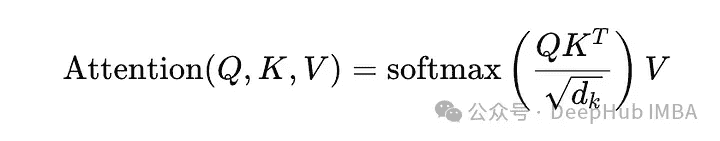

Q (Query)， K (Key)和V (Value)是由输入嵌入导出的矩阵。Dk是向量的维数，用于缩放点积以防止可能破坏softmax函数稳定的大值。

考虑一个简单的例子，其中Q和K是相同的，每个元素都同样相关:

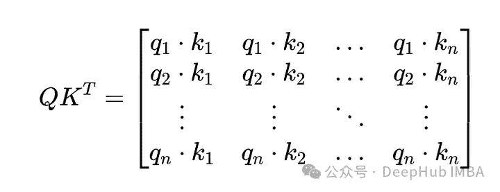

随着n(序列长度)的增加，矩阵QK^T(在应用softmax之前)中每一行的总和增加，因为添加了更多的项，这可能会导致这样一种情况，即任何单个k_j对给定q_i的影响都会减弱，因为它更接近于平均值:

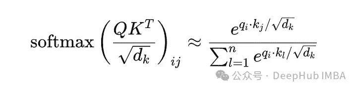

n越大，分母越大，将注意力分散到更多的词元上。这种“稀释”降低了模型专注于最相关项的能力。

并且较长的序列通常包含与正在处理的当前上下文不太相关的片段。这些不太相关或“嘈杂”的片段仍然会计算注意力机制中的点积:

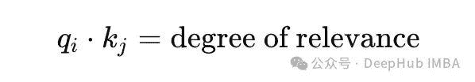

随着n的增加，q_i与表示噪声(或不太相关的信息)的几个k_j一致的概率也会增加。这种噪音影响了softmax函数有效地优先考虑最相关的能力，从而降低了注意力驱动的上下文理解的整体质量。

## **局部敏感哈希（Locality-Sen**sitive Hashing, LSH）

通过限制词元之间的交互数量来减少计算需求。将令牌词元到桶中，仅计算桶内交互，从而简化了注意力矩阵。

每个词元被投影到一个由哈希函数定义的低维空间中:

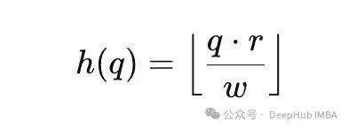

注意力只在桶内计算:

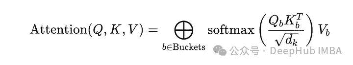

这种机制选择性地集中了模型的计算资源，将整体复杂度从O(n²)降低到O(n log n)。

## 低秩注意力（Low-Rank Attention）

低秩注意力是一种优化注意力机制的方法，通过将注意力矩阵分解为低秩矩阵，这种方法能够有效地简化计算过程。低秩分解假设交互空间可以被更小的子空间有效捕获，减少了对完整n×n注意力计算的需要。

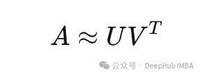

这里的U和V是秩较低的矩阵，大大降低了复杂度，增强了跨长序列的注意力的可管理性。这样注意力的计算就变为：

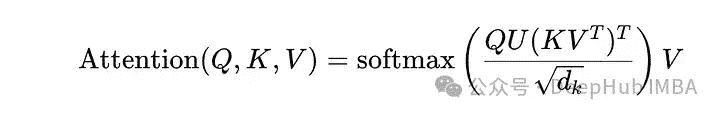

这种方法极可以将计算负荷从O(n²)减少到O(nk)。

## 分段注意力（Segmented Attention）

通过将输入序列分割成较小的片段，并在这些片段上独立地计算注意力，从而减少计算的复杂度和内存需求。

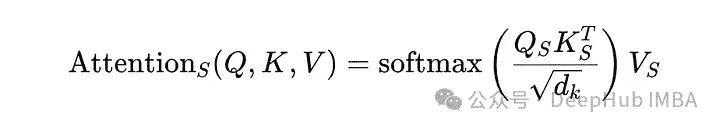

在每个独立的片段上执行标准的注意力机制。这意味着，每个片段内的元素只与同一片段内的其他元素进行交互，而不是与整个序列的元素进行交互。

在某些实现中，可能会在分段注意力之后添加一个步骤，以整合不同片段间的信息，确保全局上下文不会丢失。这可以通过另一层跨段注意力或简单的序列级操作（如汇聚或连接）来实现。

## 层次化注意力（Hierarchical Attention）

这种注意力模型通过在不同的层次上逐级应用注意力机制，能够更有效地捕捉数据中的结构和关联。

数据被组织成多个层次，例如，在文本处理中，可以将数据结构化为字、词、句子和段落等层次。模型首先在较低层次上计算注意力，然后将计算结果传递到更高层次。每一层都有自己的查询（Q）、键（K）和值（V）表示，注意力权重是在每个层次局部计算并通过softmax函数标准化的。高层的注意力机制可以综合低层的输出，提取更广泛的上下文信息。

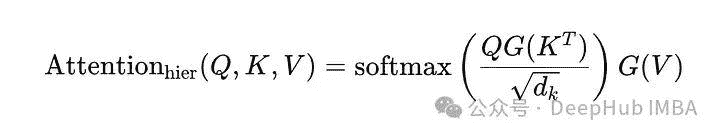

这里的G(⋅)表示一个函数，该函数聚合了跨段或层的输出，可能包含额外的转换，以细化跨层的注意力过程。

## **递归记忆**

在Transformers中加入记忆可以让他们“记住”过去的计算，增强他们在较长序列中保持上下文的能力。

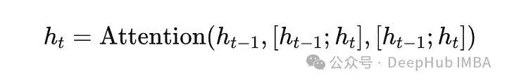

这种递归调用集成了历史信息，提供了一个连续的上下文线索，对于理解超出当前处理窗口的序列至关重要。

## **带有路由的注意力机制**

带有路由的注意力机制是一种高级的神经网络架构，通常用于处理具有复杂内部结构或需要精细调整信息流动的应用中。这种方法结合了注意力机制的灵活性和动态路由协议的决策过程，从而实现更有效的信息处理。

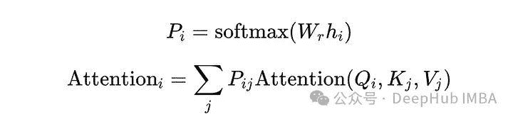

这里的W_r是一个路由矩阵，它决定了不同注意路径上的概率分布，允许模型根据输入的性质动态地调整其注意焦点。

在带有路由的注意力模型中，不是简单地对所有输入使用相同的注意力权重计算方法，而是根据输入的特点和上下文动态调整信息的流向。这可以通过多个注意力头实现，每个头负责不同类型的信息处理。路由决策可以基于额外的网络（如胶囊网络中的动态路由算法），这种网络使用迭代过程动态调整不同组件间的连接强度。

## **相对位置编码**

相对位置编码使用位置之间的差异来计算注意力，而不是绝对位置信息。

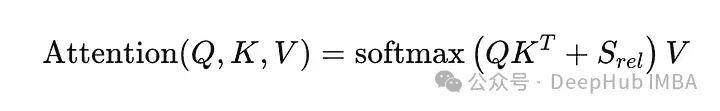

S_rel表示相对位置偏差，允许模型根据标记的相对距离和排列调整其注意力，增强其处理不同序列长度和结构的能力。

相对位置编码为Transformer及其变体提供了更为强大和灵活的方式来理解和处理序列数据，这在需要精确捕捉元素间复杂关系的高级任务中尤为重要。

## **总结**

本文综合介绍了几种高级的注意力机制，通过结合这些方法Transformer架构不仅实现了计算效率，而且还提高了它们在扩展序列上理解和生成上下文丰富和连贯输出的能力。这些技术不仅提高了模型处理复杂数据的能力，还增强了其效率和泛化能力，显示出在自然语言处理、计算机视觉等多个领域的广泛应用潜力。