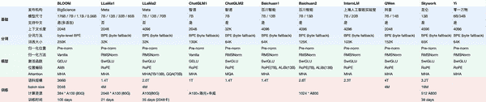
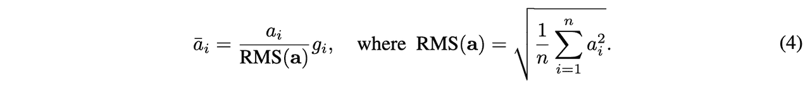

# LLM基座模型横向对比: 数据/模型/训练

> 来源：[https://agijuejin.feishu.cn/docx/W7HGdTGfKohOiQxbwQ6c6SuRnex](https://agijuejin.feishu.cn/docx/W7HGdTGfKohOiQxbwQ6c6SuRnex)

> 作者：nghuyong

> 原文： [https://zhuanlan.z](https://zhuanlan.zhihu.com/p/663970656)hihu.com/p/663970...

+   24.1.5 新增deepseek

+   23.11.6 新增Yi 6B/34B

+   23.11.4 新增Skywork13B

从基础信息，分词方式，模型结构，训练过程等角度，横向对比当前开源的基座模型

表格在线版本: [h](https://link.zhihu.com/?target=https%3A//docs.qq.com/sheet/DYlNwWmxiSWhsT3lw%3Ftab%3DBB08J2)ttps:// docs.qq.com/sheet/DYlNw WmxiSWhsT3lw?tab=BB08J2  （持续更新）

**基本结论:**

1.  BPE+bypefallback, pre-norm, RMSNorm, SwiGLU, RoPE 已成标配

1.  上下文长度: >= 2048

1.  数据规模: > 1T

1.  计算资源: > 512卡 * A100

**速查笔记:**

1.  pre-norm

pre-norm相比post-norm训练更稳定，但是效果较差（相当于宽度增加）

+   pre-norm: x + F(Norm(x))

+   post-norm: Norm(x+F(x))

2. RMSNorm

LayerNorm相比LayerNorm效果相当，但速度更快

RMSNorm认为e-scaling是关键，而不是re-centering，所以移除了“减均值”的步骤

3. SwiGLU

系统的参数下SwiGLU相比ReLU效果更好，也会引入新参数

ReLU : ReLU(x) = max(0,x)

FFN层：ReLU(xW1)W2

W1:[h,4h],W2:[4h,h] ，总参数量: 8h^2

SwiGLU：Swish(x) x (xV) = x * sigmoid(x) x (xV)

FFN层: SwiGLU(xW1)W2 = [Swish(xW1) x (xV)]W2

W1:[h, ah], V:[h, ah], W2:[ah, h]，总参数量 3ah^2，a=8/3