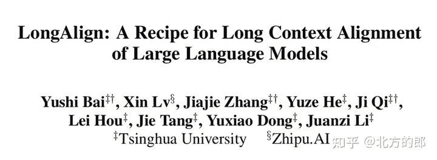
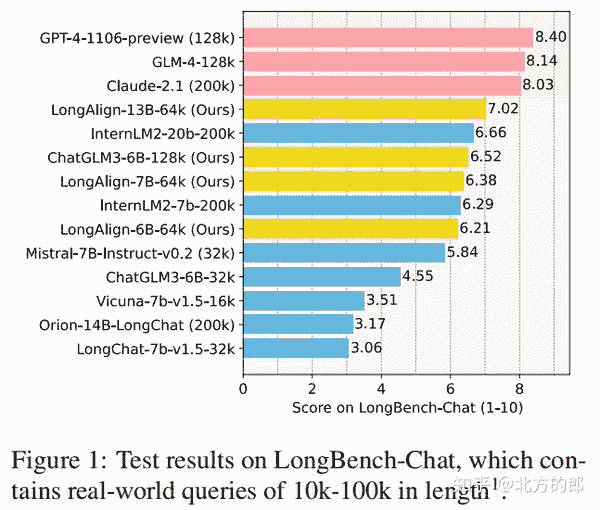
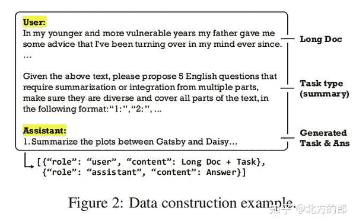
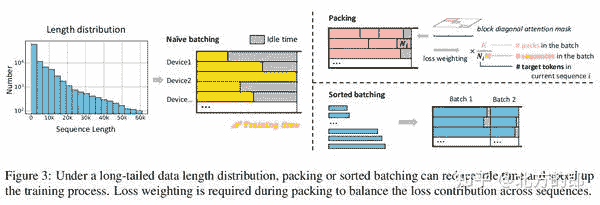
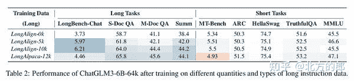
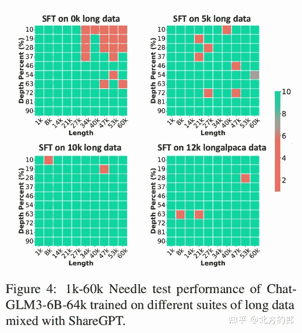
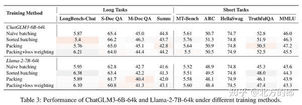
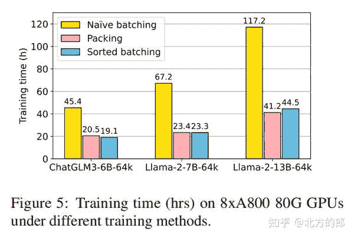
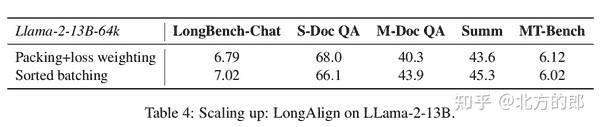
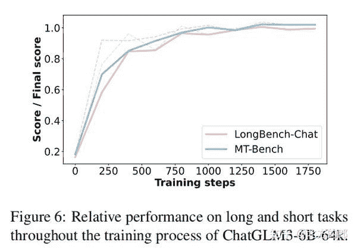

# 提升LLM的“长篇阅读”能力：LongAlign助力提升长文理解

> 来源：[https://agijuejin.feishu.cn/docx/ToJwdatW1oPZRIxIW4ncIMG7n0c](https://agijuejin.feishu.cn/docx/ToJwdatW1oPZRIxIW4ncIMG7n0c)

> 作者：北方的郎

> 原文：[https://zhuanlan.z](https://zhuanlan.zhihu.com/p/682324807)hihu.com/p/682324...

在当今的大数据时代，人工智能技术正在快速发展。其中，大型语言模型（LLM）作为一种关键技术，已经被广泛应用于自然语言处理、机器翻译、文本生成等领域。然而，当面对篇幅较长的文本时，LLM的表现却往往不尽如人意。清华大学和智谱AI发布的一篇名为《LongAlign: A Recipe for Long Context Alignment》的论文，介绍了 LongAlign 方法，它可以帮助大型语言模型有效处理长达 64k 的长上下文，并展现出强大的长文本理解和生成能力。

论文地址： [L](https://link.zhihu.com/?target=https%3A//arxiv.org/abs/2401.18058)ongAlign: A Recipe for Long Context Alignment of Large Language Models

## 介绍

首先，让我们先来了解一下论文的主要贡献。这篇论文提出了一种名为LongAlign的长文对齐方法，旨在帮助LLM更好地处理长篇文本。该方法通过构建大规模的长文指令跟随数据集、采用高效的训练策略以及对齐长文基准测试，来提升LLM在长文理解任务上的表现。

## LongAlign 方法

具体来说，LongAlign 方法包括以下几个方面：

数据集构建：构建了一个包含10,000条长度在8k-64k之间的长文指令跟随数据集，这些数据来自于9个不同的数据源，包括学术论文、书籍、百科全书等，覆盖了多样化的任务类型。

高效训练方法：提出了两种高效的训练方法，分别是打包策略（packing）和排序分组（sorted batching）。其中，packing方法通过将不同长度的文本打包到最大长度再分配到GPU上进行计算，以减少GPU间的空闲时间；sorted batching方法则通过将文本按长度排序后分批次训练，以减少同一批次内的空闲时间。

损失函数加权：在packing训练中，为了避免不同长度的文本对损失函数贡献不同的问题，提出了损失函数加权策略，对每条文本的损失进行加权平均。

长文基准测试：构建了LongBench-Chat长文基准测试集，包含50个长度在10k-100k之间的真实用户查询，涵盖了文档问答、总结、编程等多样化任务，并使用GPT-4对模型回答进行评分。

### 实验效果

实验结果表明，LongAlign方法可以有效地帮助LLM处理长度在64k以内的文本，同时不会对处理短文本的能力造成负面影响。与现有方法相比，该方法在长文任务上提升了30%的性能，同时保持了LLM处理短文本任务的优秀表现。

## 结论

LongAlign方法通过数据集构建、高效训练和对齐基准测试，为LLM的长文理解能力提升提供了一种有效的解决方案。随着LLM在长文理解任务上的表现日益成熟，相信它将为智能客服、智能写作、智能翻译等应用领域带来更加出色的表现。