# 饮鸩止渴？LLM训练要不要过采样/训多个epoch

> 来源：[https://agijuejin.feishu.cn/docx/MgcEdKee6obsM3xTBg4cfIxPnyb](https://agijuejin.feishu.cn/docx/MgcEdKee6obsM3xTBg4cfIxPnyb)

> 作者：[咸鱼王](https://www.zhihu.com/people/wow-kong)

> 原文：[https://zhuanlan.z](https://zhuanlan.zhihu.com/p/671634621)hihu.com/p/671634...

目前已经有很多paper论证了数据量（尤其在pretrain阶段）对LLM的重要性，然而数据、尤其是高质量数据往往可遇不可求，因此过采样或训练多个epoch就成了缓解data hungry的常见手段。但是这种repeat究竟会对LLM带来什么影响？

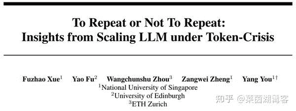

**论文链接：**

[To Repeat or Not To Repeat: Insi](https://link.zhihu.com/?target=https%3A//arxiv.org/pdf/2305.13230.pdf)ghts from Scaling LLM under Token-Crisis

## 01 背景

众所周知，为了缓解LLM的data hungry，pretrainTokens的量级一直是目前LLM迭代、更新的最重要因素之一，然而尤其在垂域适配时，优质的数据往往可遇而不可求，因此repeat就成了缓解hungry的最直接手段。这篇论文主要探讨了pretrain阶段repeat对LLM带来的影响，笔者尝试以本篇论文为主干，结合相关文章和笔者的个人见解，对pretrain、SFT阶段repeat的影响做进一步分析。

## 02 实验设置

作者基于T5及C4数据进行pretrain实验，验证不同repeat下模型的效果，为了方便阅读和理解，笔者将文中提及的multi-epoch training和的过采样，统一称为repeat。

## 03 LLM易受repeat影响：过拟合并性能下降

### 3.1 repeat会导致score下降

为验证repeat对模型带来的影响，作者在确保trainedTokens相同的前提下，训练、对比了不同repeat程度下LLM的MLM准确率。具体的，假设从C4随机采样、用于pretrain的tokens数为 `T`，pretrain阶段repeat的次数为 `R`，作者实验的3组配置为：`(T,R)={(235,1),(229,26),(227,28)}` `(T, R)=\{(2^{35},1),(2^{29}, 2^{6}),(2^{27}, 2^{8})\}` ，以确保每个方案下都训练了 `T∗R=235 T*R=2^{35}` 个tokens。

实验结果如下图，MLM准确率随着repeat次数的增加呈下降趋势，但以笔者拙见，由于缺乏 `(2^{29},2^6)` 和 `(2^{29},2^0)` 的对比实验，并无法确定token-crisis下，repeat能否在一定程度上缓解token-crisis问题。

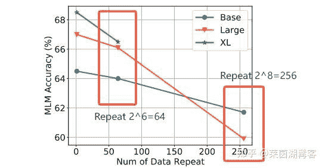

作者目的更多在于验证data hungry下，repeat对模型带来的影响。但是很显然，在正常分布下，repeat fake的数据显然不如同量级真实分布的数据，如果将数据视为真实世界分布中的采样点，数据越多、分布越广、越均匀，则采样构成的面越平滑、越能还原真实分布，而repeat本身并无法带来这种增益，显然不如同量级真实分布的训练效果。

为验证repeat是否会持续影响后续的SFT甚至RL，作者对repeated pretrain模型在SQuAD上进行了微调，具体如下图，可以看出，pretrain阶段经过多次repeat的LLM，在SFT后仍显著低于未repeat的模型。但仍如之前所述，该实验 无法区分这种负面影响，是repeat带来的，还是data hungry带来的。

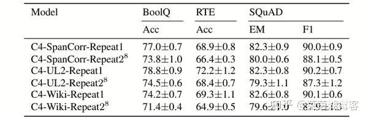

### 3.2 少量repeat也有过拟合风险

Jeremy Howard在 [[Can LLMs learn from](https://link.zhihu.com/?target=https%3A//www.fast.ai/posts/2023-09-04-learning-jumps/) a single example?] 中给出了另一个典型的案例：LLM在SFT中呈现阶梯状的`train_loss`曲线，且每次骤降均发生在epoch末尾，具体如下图，Howard认为最直接的原因就是LLM在repeat后产生了过拟合。这个结论还是比较令人吃惊的，不同于论文中64甚至256次的repeat，这意味着模型仅在1+ repeat后就产生了过拟合。

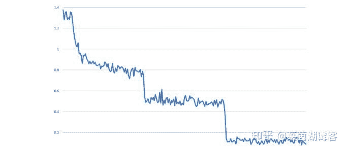

为验证猜想，Howard调整了学习率衰减策略，进一步观测模型在2个epoch内的`train_loss`/`valid_loss`变化，验证了模型在1-2次repeat后就发生了较为明显的过自信/过拟合现象。（对验证流程不感兴趣的读者可以先行跳过）

具体的，借助`Cyclical Learning Rates`衰减策略，使学习率在单个epoch内完成`warm_up`及衰减，具体如下图1。不出意外，`train_loss`/`valid_loss`曲线走向与Howard猜想基本一致，实验结果如下图2：

+ 在`epoch_1`的`warm_up`初期，学习率缓慢上升，`train_loss`/`valid_loss`由于学习率较低下降缓慢；

+ 在`epoch_1`的`warm_up`末尾，学习率上升至高点，`train_loss`/`valid_loss`由于学习率较高开始迅速下降；

+ 在`epoch_1`的中后期，学习率逐渐衰减至低点，`train_loss`/`valid_loss`趋于平缓；

+ 在`epoch_2`的`warm_up`初期，由于训练集没有`shuffle`，batch顺序和`epoch_1`完全一致，即此时的batch也是`epoch_1`的`warm_up`初期的batch，由于初见时学习率较低仍未较好拟合，因此`train_loss`/`valid_loss`仍比较正常；

+ 在`epoch_2`的`warm_up`末尾，学习率上升至高点，此时遇见的batch已经在`epoch_1`较好拟合，再次遇见之后趋向于过度拟合、甚至记忆样本，此时对model的泛化性几乎没有提升，因此`train_loss`再次陡降，`valid_loss`开始陡升，模型开始过自信/过拟合；

+ 在`epoch_2`的末尾，此时与`warm_up`初期的情况较为相似，遇见的batch在`epoch_1`仍未较好拟合，model原本记忆样本所学习到的规则与此时遭遇的样本产生碰撞，甚至矫正model回归至更合理的置信度水平，因此`train_loss`逐渐攀升、`valid_loss`逐渐下降。

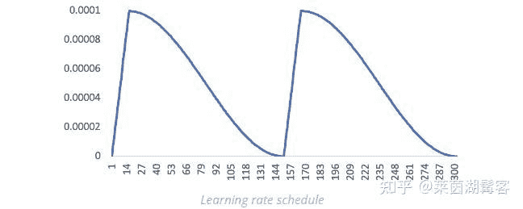

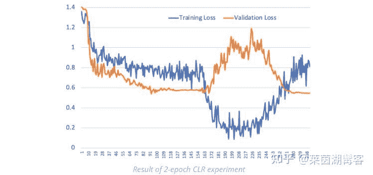

作者未提及的是，`train_loss`是有滞后性的，即先计算`loss`再计算梯度并反向传播，在数据没有`shuffle`的前提下，当前batch的`loss`体现的是上一个epoch的拟合效果。因此，`train_loss`的骤降意味着 即便在第一个epoch，LLM在拟合规则的同时，就已经开始记忆examples了 ，在第二次遇见之后则再次强化了这种记忆效果、并导致过自信/过拟合，这也是为什么`valid_loss`的陡升会在`train_loss`的陡降之后发生。

不过作者也提到了，`valid_loss`的攀升并不严格等同于过拟合或准确率的下降，也有可能仅是过自信的表现。但笔者认为，即便是过自信，也会在一定程度上影响模型（尤其在OOD）的泛化效果。另外，该实验主要在图片分类场景进行，但作者认为结论对LLM同样具备拓展性。（包括笔者在内的不少从业者也的确到过很多相似案例，此外，符神每周主持的会议中也有提到类似的问题： `loss`形状由训练数据的顺序决定 ）

### 3.3 从重要性角度验证repeat的影响

笔者也尝试过从 [[FROM LANGUAGE MODELING TO INSTRUCTION FOLLOWING: UNDERST](https://link.zhihu.com/?target=https%3A//arxiv.org/pdf/2310.00492.pdf)ANDING THE BEHAVIOR SHIFT IN LLMS AFTER INSTRUCTION TUNING] 提出的重要性角度，对repeat前后的模型进行了实验分析：定义 `In,m I_{n,m}` 为输入token `xn x_n` 对输出token `ym y_m` 的重要性，具体的，`In,m I_{n,m}` 为删掉 `xn x_n` 前后，LLM生成 `ym y_m` 的置信度偏移，偏移越大则说明生成 `ym y_m` 时越依赖 `xn x_n` 。具体内容在笔者的另一篇文章也有所介绍，此处不再赘述。

[莱茵湖髯客：SFT和RL究竟为LLM带来了什么 244 赞同 · 1 评论 文章](https://zhuanlan.zhihu.com/p/669265454)

笔者基于同一份SFT数据在LLM上进行微调，并分别重复1/5次，经分析发现，repeat5次以后的模型，`InstructTokens`和`InputTokens`对输出的重要性平均下降了10%/6%，也即在生成结果时，repeat后的模型会更加不依赖指令和输入 ，换言之，LLM开始对输出分布过拟合，在生成 `y(t) y(t)` 时，逐渐更focus on `y(1:t−1) y(1:t-1)` 于而非instruction或input。

仔细一想也合乎情理，因为NLG模型在建模时学习的是 `P(yt|x,y0,y1...yt−1) P(y_t|x,y_0,y_1...y_{t-1})` ，如果输出分布过于极端，LLM非常容易产生坍塌、更依赖于历史生成结果而非input进行持续生成，并且这个问题在repeat后会更加严重。

## 04 corpus不同，LLM受repeat的影响也不同

### 4.1 数量的影响

作者通过对比 `(2^{27}, 2^8)` 和 `(2^{29}, 2^8)` 两组实验，验证不同数据量级下，LLM受repeat的影响程度，实验结果如下图。

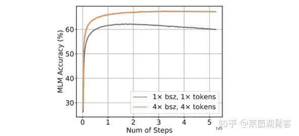

实际上这应该是送分题了， 数据量越多、分布越广、越均匀，模型在训练过程中就更不易过拟合 。正如笔者在 [SFT和RL究竟为LLM带来了什么] 一文中提及的，如果我们展示给模型的数据只是真实分布中一个相当小、相当片面的子集，模型十分容易透过这部分“狭隘”的数据学到一些不符合期望的特征或规则。

例如我们想训练一个分辨马的模型，如果数据很少、分布十分狭隘（都是草原上的马），模型学习到的或许是分辨草而非分辨马，只有数据包含了水上马、笼中马、草上牛等各种 对照 之后，模型才更容易从这些足够广泛、均匀的数据中还原出符合期望的特征或规则。

在这种情况下，为了缓解模型过拟合，一般是通过 强化数据广度、均匀度、平滑度等分布，拓宽模型“视野”，使模型更倾向于抽取更加全局、通用、有效的特征 ；或通过 降低模型学习效率 ，如学习率调节、早停、加入通用数据等方法，来降低模型过拟合的风险。

这其实与BP也有相同之处，我们在训练模型（尤其是大模型）时，往往倾向于选择更大的`BatchSize`：更大的`BatchSize`意味着分布更广、更平滑、更加贴近真实分布，模型也就更倾向于抽取、拟合更加全局的特征，从而稳步的向全局最优方向收敛。

显然，repeat并不能在分布广度、均匀度、平滑度上带来提升，反而可能因为更高的计算资源消耗，加剧模型陷入局部最优、对冗余/不相关特征过度拟合的风险。但这也是一个悖论，正如文章开头就提到的，repeat本身就是为了缓解data hungry不得已而为之的策略，如果有足够的语料，反而不需要repeat了。

### 4.2 质量的影响

数据质量作为评定训练集的另一个重要维度，在直观上似乎对缓解repeat下的过拟合有一定积极作用。作者在wiki和C4上分别进行了 `(2^{27},2^{19})` 的pretrain（显然此处wiki是一种质量更高的数据源），由于数据分布不同，MLM准确率不再具备横向可比性，因此作者直接验证在下游任务上的效果，具体如下表。

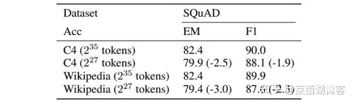

令人意外的是，从实验结果来看，wiki更高的数据质量并未在下游任务中带来收益，那么可以断定数据质量对repeat下的过拟合防治是没有收益的么？笔者认为也不尽然，首先 数据质量不论对pretrain还是SFT的影响都毋庸置疑 ，低质数据可能存在表达不符合常规、真实性错误、模式/内容重复等各种问题，不仅会 影响language model的建模效果，也会恶化模型认知能力、加剧模型对冗余/不相关特征过度拟合风险 。文中wiki/C4并没有显著差异的原因或许在于：

1. C4数据质量相对wiki较差，但仍然属于可用的pretrain数据，绝对值上并没有差到上述的情况；

1. 在1)的前提下，如4.1所说，数据质量同样无法在分布广度、均匀度、平滑度上带来提升，wiki和c4都只是真实分布中的子集，依旧存在过拟合风险；

因此数据质量高于一定程度之后，或许质量的再次提升就无法在repeat下的过拟合防治给出更高增益，不过很遗憾的是本篇论文并没有在更多的数据来源上进一步实验。

### 4.3 难度/OOD程度的影响

由于论文作者更多专注于pretrain阶段repeat带来的影响，所以并未对任务难度、SFT与pretrain分布的OOD程度做相关阐述，在此笔者尝试结合个人的经验做简单介绍。

笔者之前做过一个简单的实验：让LLM基于 极端分布 的数据进行SFT，并测试SFT效果。具体的，笔者构建了一个基本运算SFT数据集，且50%的examples中output均为7777，任务指令、目标均在prompt中有明确说明。经测试，尽管数据分布极度不均匀，LLM在SFT之后仍具备十分好的泛化能力。

于是笔者又做了另外一个实验：自定义一种新的运算符号 `a©b:=(a−242)∗2−b+3` 或 `a©b:=(a-242)*2-b+3`，构建同量级数据、同样确保SFT数据集中50%的examples中output均为7777，并将任务指令、目标、运算符计算公式在prompt明确说明。然而这次，LLM在SFT之后出现了明显的 坍塌 现象，即LLM输出结果与预先定义的运算符结果完全不同，且以50%左右的统计频次输出7777。

实验结果也相当符合预期，LLM在经过持续pretrain之后，在绝大多数通用、以及不那么垂域的domain都具备非常好的泛化效果， 这种泛化效果不仅体现在ID task下优秀的zero/few shot能力，同时也体现在ID task在少量数据、极端分布下SFT时的anti-overfit能力 。然而一旦我们的SFT task过于复杂、偏离原有分布（例如包含过多OOD实体、信息、逻辑，或有很多非常规的人为定义的规则），LLM作为一种大参量模型，反而更加容易受到数据极端分布的影响。因此， 在难度较高、OOD程度较大的SFT任务中，我们需要更加注意包括repeat在内的、可能影响数据分布的策略。

## 05 如何防治

### 5.1 dropout

自年初业界迈入LLM的时代以来，笔者很少看到在pretrain、甚至SFT阶段引入`dropout`的做法，仿佛`dropout`这一个经久不衰的正则方法突然“人间蒸发”了。在常规的、满足甚至超越chinchilla法则的pretrain场景下，或许`dropout`的确不会产生太大影响，甚至还会拖累LLM训练效率。但是在语料不足的pretrain/SFT任务中，`dropout`能否起到一定正则作用呢？

作者在文中也对`dropout`进行了实验：在不用`dropout`、用`dropout`、后期再用`dropout`三种策略下分别对LLM进行pretrain，结果发现，使用`dropout`的策略在多次repeat后表现出了更好的MLM准确率，即 `dropout`在LLM下仍具备较好的正则效果 ，具体如下图。

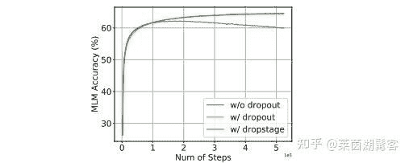

作者同样测试了不同量级下`dropout`的收益：随着LLM规模的提升，模型受repeat的影响也愈发严重，在XL量级下`dropout`甚至无法较好矫正LLM的过拟合问题。但即便如此，没有使用`dropout`策略的LLM随着参数量的增加，与`dropout`下的LLM差距越来越大，因此也从侧面反映了 `dropout`的积极作用 （尤其对于更大规模的模型而言）。

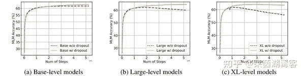

### 5.2 其他方法有用吗

除`dropout`以外，作者也对`droppath`、`LSR`、`weight decay`等方法进行了实验，具体结果如下表，结论就是在`dropout`基础上使用这些正则手段 没什么增益，`weight decay`甚至会使训练流程不稳定 （这个还是挺出乎意料的，毕竟`weight decay`也是BERT时代十分常用的SFT插件了）。

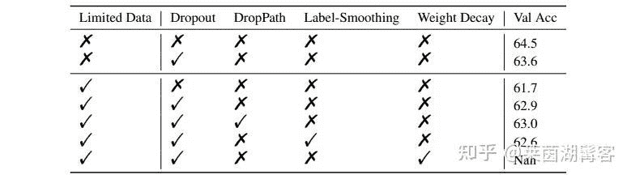

此外，Howard在 [Can LLMs learn from a single example?](https://link.zhihu.com/?target=https%3A//www.fast.ai/posts/2023-09-04-learning-jumps/) 中也给出了相关观点，他认为BT等传统的token级别的扰动或增强方式，在LLM时代已经不再适用，LLM强大的理解和特征抽取能力已经使其能够"明察秋毫"，但Howard同样肯定了`dropout`在SFT中的作用。同时，在SFT中混合一些丰富、通用的数据也是一种比较好的手段。

## 06 总结：到底要不要做`repeat`

在前面几节，我们已经从多个角度分析、验证了`repeat`对模型带来的负面影响：即便在少量`repeat`下模型也有过拟合的风险，并且模型在`repeat`之后会逐渐忽视`instruction`和`input`进行“自说自话”。那么`repeat`就是一个百无一用的技术吗？笔者认为也不尽然。

Howard在之前的博客中提到了一个非常有意思的观点：从`weights`偏移的角度出发，如果SFT的任务比较简单（可以在相当程度上借助/激活模型pretrain赋予的能力、知识完成任务），那么只需要轻微调整`weights`即可。相反，如果目标task内在逻辑或知识在pretrain阶段没有体现，则需要更多的`weights`更新以影响模型（当然也意味着更高的过拟合风险）。

结合笔者在4.3的实验来看，或许`repeat`的影响并非绝对，如果SFT任务OOD严重，则意味着需要更多的`weights`更新，也即更多的计算资源（例如`repeat`）来确保足够的`weights updates`。如果SFT任务与pretrain相近，那么`repeat`反而会加剧过拟合风险。

从笔者的经验来看也的确如此，尤其[在有监督数据不足的情况下，对复杂任务](https://link.zhihu.com/?target=https%3A//openreview.net/forum%3Fid%3DAf5GvIj3T5)进行1-3次的`repeat`反而能够起到正向增益。另外，虽然本篇论文更多是在较大的`repeat`下进行实验，其作者在 Open Review 中也提及，`repeat`也并非只有负面影响。所以`repeat`可以做，但是要根据任务难度、OOD程度来定，少量`repeat`依然能带来一些正面增益。

但是在`repeat`时也要采取一些对抗过拟合的策略，例如第5节中多次提及的`dropout`，以及在训练时加入足够的通用域数据混合训练，以确保`weights updates`时，下降方向保持通用化、全局化，以降低LLM过拟合风险。
