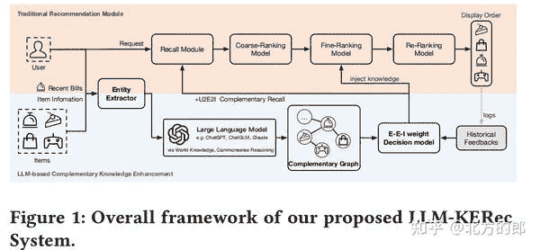
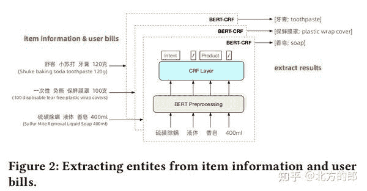
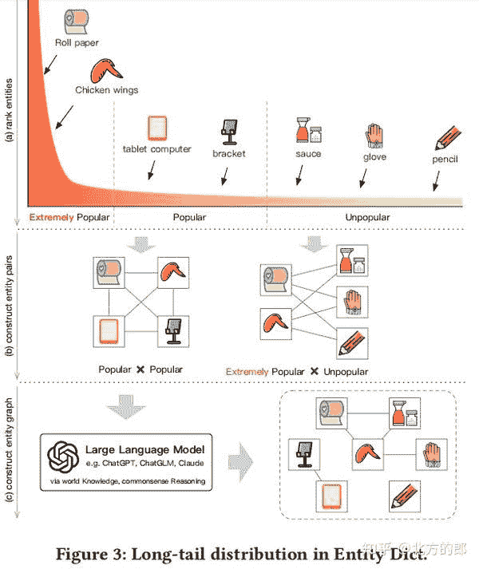
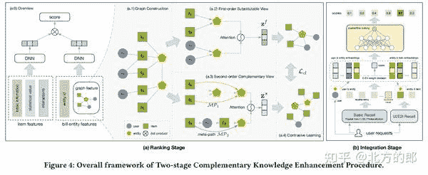
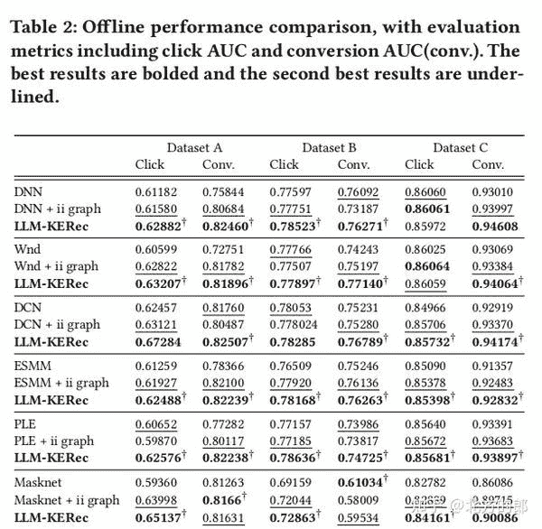
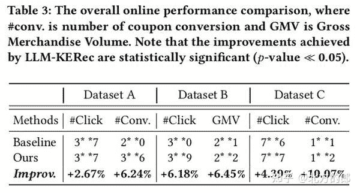
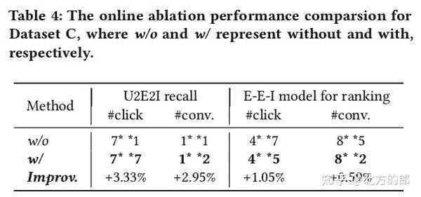
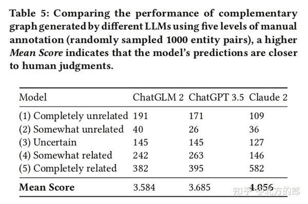
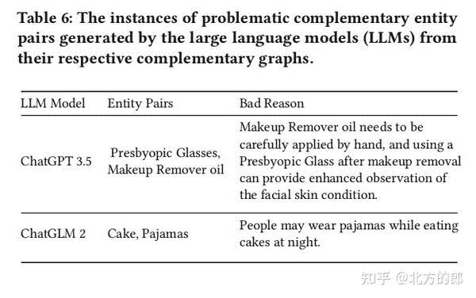
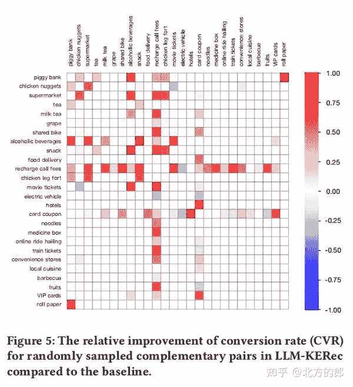

# LLM-KERec：利用大语言模型打破推荐系统的壁垒

> 来源：[https://agijuejin.feishu.cn/docx/VbxKdgzSPopx2MxeAOtcCuvWnHe](https://agijuejin.feishu.cn/docx/VbxKdgzSPopx2MxeAOtcCuvWnHe)

> 作者：北方的郎

> 原文：[https://zhuanlan.z](https://zhuanlan.zhihu.com/p/686290848)hihu.com/p/686290...

推荐系统在电商网站和在线平台中发挥着重要作用，它可以帮助用户快速找到他们感兴趣的商品。然而，现有的推荐系统主要依赖于历史数据和用户反馈，这使得它们在捕捉用户意图变化方面存在困难。最近，知识图谱(KB)模型被提出，试图通过整合专家知识来改进推荐效果，但这种模型难以适应不断涌现的新商品和电商环境的变迁。为了解决这些问题，来自蚂蚁集团的研究者发布了《Breaking the Barrier: Utilizing Large Language Models for Industrial Recommendation Systems through an Inferential Knowledge Graph》，提出了一种新的基于大语言模型的互补知识增强推荐系统(LLM-KERec)。

论文地址： https:// arxiv.org/abs/2402.1375 0

## 引言

推荐系统(Recommendation System, RS)在在线服务平台如亚马逊和淘宝等上被广泛使用，作为缓解信息过载的有效工具。RS的主要目标是通过用户过去的行为推断用户的偏好，并推荐与他们兴趣最匹配的物品。现有的推荐系统主要基于历史曝光和点击日志进行训练。RS包括以下子任务：

+   基于用户曝光或点击反馈推荐替代品

+   基于用户转换反馈推荐互补品

+   进行流量探索或业务干预，以探索用户的潜在兴趣

尽管深度点击率预测模型如DNN、Wide&Deep等在RS中取得了显著改进，但作者认为它们仍存在以下两大局限：

+   过度依赖曝光样本和用户反馈，限制了RS在冷启动场景中的表现，难以应对新物品的不断涌现

+   用户交互样本稀疏，现有CTR模型更擅长推荐替代品而不是互补品

专家手工互补规则或知识图谱模型虽有助于推荐互补品，但受效率和成本挑战的影响，在快速变化的电商环境下难以持续。因此，在RS中，结合高效的知识和具有人类推理和逻辑的大语言模型以改进RS表现是至关重要的。然而，由于大语言模型部署难度大、推理时间长，在RS中只被用作文本嵌入的工具，难以充分利用其强大的推理能力。

## 系统概述

LLM-KERec系统包括传统推荐模块和基于LLM的互补知识增强模块。传统推荐模块负责召回候选商品、粗排过滤、精排和重排。LLM互补知识增强模块则包括实体提取器、互补图构造、E-E-I权重决策模型等，以整合互补知识，增强推荐效果。

具体包括：

传统推荐模块

+   用户打开应用时，服务器会自动触发召回模块，返回大量候选物品。

+   候选物品经过粗排模型筛选，产生较小的候选物品集。

+   细排模型和重排模型用于最终确定物品的展示顺序。

+   每个步骤都可能进行人工干预，例如给物品分配权重进行发布。

基于大语言模型的互补知识增强模块

+   实体提取器从用户账单和物品信息中提取统一的概念术语（实体），并给每个物品分配一个唯一的实体作为其类别。

+   基于实体流行度和策略，生成候选的实体对。

+   利用大语言模型判断每个实体对之间是否存在互补关系，并构建互补图。

+   使用真实互补物品的曝光点击反馈，训练E-E-I权重决策模型。

+   E-E-I模型将互补图的边权重注入到排名模型，实现互补物品的推荐。

+   实体提取器和互补图定期更新，以适应新物品和变化的环境。

大语言模型

+   大语言模型具有强大的理解和推理能力。

+   文中使用了Claude 2.1作为底层语言模型，并设计了可靠的提示来引导模型进行逐步分析和提供可靠的推理证据。

+   通过对大量样本进行手工标注并不断优化提示，获得了可接受的推理结果准确性。

## LLM-KERec系统各模块

### 实体提取器

从商品信息中提取统一的概念实体，为不同内容建立联系。

实体字典

+   每个实体代表一个特定概念，如“手机”或“可乐”。

+   专家小组精心设计实体字典，包含数万个实体。

+   每周定期更新实体字典，以适应新物品和内容。

提取实体

+   将实体提取视为命名实体识别任务。

+   使用BERT-CRF模型从用户行为中准确提取实体。

+   从每个用户的近期账单中提取实体，形成近期实体交易序列。

+   从物品信息中提取实体，并为每个物品分配一个唯一的实体作为其类别。

### **互补图构建**

生成实体对，利用LLM确定互补关系，构建互补图。

实体对构建：

+   通过对流行实体进行排序，将实体分为极流行、流行和不流行三类。

+   仅在流行实体内部构建实体对，以提高流行物品的表现和覆盖。

+   构建包含极流行和不流行实体的实体对，以确保不流行物品在互补图中的全面覆盖。

大语言模型

+   使用Claude 2.1作为底层语言模型，设计可靠的提示来引导模型进行逐步分析和提供可靠的推理证据。

+   通过手工标注大量样本并不断优化提示，获得可接受的推理结果准确性。

自动更新策略

+   每日自动构建增量互补图，以及时识别并更新受欢迎程度的变化，确保系统的持续有效运行。

### E-E-I权重决策模型

利用互补商品的曝光和点击反馈训练，为下游精排模型提供知识注入。

模型概述：提出了两阶段互补知识增强过程，包括排序阶段和集成阶段。

排序阶段

+   采用双塔结构，输出分别代表互补物品和账单实体的表示，点积作为偏好程度指标。

+   使用图神经网络和对比学习从替代视角和互补视角表示实体。

+   构建了用户-物品-实体图，并设计了三种边关系来表示实体。

集成阶段

+   在召回模块中增加了互补召回路径，使用E-E-I模型为当前样本提供分数、实体嵌入和物品嵌入。

+   细排模型结合当前互补物品和用户画像行为进行个性化排序。

## 实验结果

### 实验设置

+   数据集：使用了来自支付宝的真实工业数据集，涵盖三个主要营销和推荐场景。每个场景每天有数千万用户参与。

+   评估指标：离线实验使用AUC作为评估指标，在线实验直接统计点击数和转化数。

+   基线：选择了最新推荐系统模型作为基线，包括DNN、Wide&Deep、DCN、ESMM、PLE和Masknet。

### 实验结果

离线性能比较：LLM-KERec在三个数据集上的点击率和转化率AUC均显著优于多个SOTA基线模型。

在线性能比较：A/B测试显示，LLM-KERec相比在线基线，点击率和转化率分别提升6.24%和10.07%。

Ablation实验：表明互补召回模块和E-E-I权重决策模型均有效。

不同LLM比较：Claude生成的互补实体对相关性最高。

案例分析：LLM-KERec推荐的互补商品转化率更高。

## 总结：

LLM-KERec通过整合互补知识和利用LLM的推理能力，改进了传统推荐系统。它不仅能降低结果同质化，还能提升整体点击率和转化率，为工业推荐系统提供了一种新的解决方案。