# LLM 评估：运行所需的一切、基准 LLM 评估

> 来源：[https://agijuejin.feishu.cn/docx/GVSBd6JyUoTpDZxaqPcccXBonvD](https://agijuejin.feishu.cn/docx/GVSBd6JyUoTpDZxaqPcccXBonvD)

> 作者：北方的郎

> 原文：[https://zhuanlan.zhihu.com/p/691756684](https://zhuanlan.zhihu.com/p/691756684)

翻译自：“LLM Evaluation: Everything You Need To Run, Benchmark LLM Evals”

原文地址：[https://arize.com/blog-course/llm-evaluation-the-definitive-guide/](https://arize.com/blog-course/llm-evaluation-the-definitive-guide/)

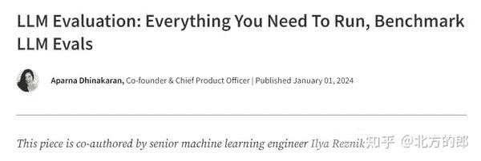

## 为什么需要LLM评估？

大型语言模型 (LLM) 是开发人员和企业领导者为消费者创造新价值的不可思议的工具。他们提出个人建议，在结构化和非结构化数据之间进行转换，总结大量信息，等等。

随着应用程序的增加，衡量LLM应用程序性能的重要性也随之增加。需要LLM辅助评估，因为用户反馈或任何其他“事实来源”极其有限并且通常不存在；即使可能，人工标记仍然很昂贵；而且很容易使LLM应用变得复杂。

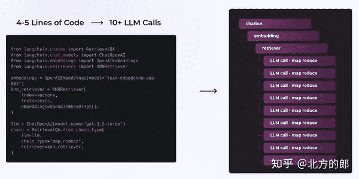

幸运的是，我们可以利用LLM的力量来自动化评估。在本文中，我们将深入研究如何进行设置并确保其可靠。


LLM评估的核心是AI评估AI，也称为AI辅助评估

虽然这听起来可能是循环的，但我们一直让人类智力评估人类智力（例如，在工作面试或大学期末考试中）。现在人工智能系统终于可以为其他人工智能系统做同样的事情了。

这里的过程是让LLM生成可用于评估另一个系统的综合基础事实。这就引出了一个问题：为什么不直接使用人类反馈？简而言之，因为你永远不会受够。

即使只有百分之一的输入/输出对获得人类反馈也是一项巨大的壮举。大多数团队甚至都没有意识到这一点。但为了使这个过程真正有用，对每个LLM子调用进行评估非常重要，我们已经看到这样的子调用可能有很多。

让我们探讨一下如何做到这一点。

### LLM模型评估和LLM系统评估（又名任务评估）有什么区别？

```
LLM_model_evals != LLM_System_evals
```

LLM 模型评估着眼于 LLM 在一系列任务中的整体宏观表现，LLM 系统评估（也称为 LLM 任务评估）更针对系统和用例，评估构建 LLM 应用程序的 AI 工程师可以控制的组件（即提示模板或上下文）。

[由于“LLM评估”一词](https://link.zhihu.com/?target=https%3A//arize.com/blog-course/large-language-model-evaluations-vs-llm-task-evaluations-in-llm-application-development/)可以互换使用，因此在实践中有时会丢失这种区别。 然而，了解其中的区别 至关重要。

### 什么是 LLM 模型评估 (Eval)？（What Are LLM Model Evaluations (Evals)?）

LLM 模型评估重点关注基础模型的整体性能。最初推出面向客户的LLM的公司需要一种方法来量化其在一系列不同任务中的有效性。

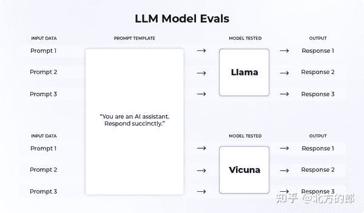

在这种情况下，我们正在评估两种不同的开源基础模型。我们正在两个模型中测试相同的数据集，并查看它们的指标（例如 hellaswag 或 mmlu）如何叠加。 LLM模型评估指标

[OpenAI Eval](https://link.zhihu.com/?target=https%3A//arxiv.org/abs/1905.07830) 库是一种具有 [LLM 模型评估](https://link.zhihu.com/?target=https%3A//arxiv.org/abs/2109.07958) 的流行库，它最初专注于[模型评估用例](https://link.zhihu.com/?target=https%3A//arxiv.org/abs/2009.03300)。有很多指标，例如 HellaSwag （评估 LLM 完成句子的能力）、 TruthfulQA （衡量模型响应的真实性）和 MMLU （衡量 LLM 执行多任务的能力）。甚至还有一个 [排行榜](https://link.zhihu.com/?target=https%3A//huggingface.co/spaces/HuggingFaceH4/open_llm_leaderboard) ，可以查看开源LLM之间的竞争情况。

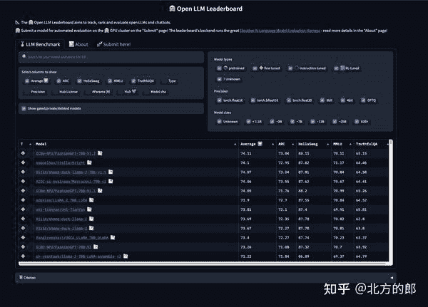

### 什么是LLM系统评估（Evals）？

目前为止，我们已经讨论了LLM模型评估。相比之下， LLM 系统评估 （有时也称为 LLM 任务评估）是对您系统中可以控制的组件的完整评估。这些组件中最重要的是提示（或提示模板）和上下文。LLM 系统评估评估您的输入如何确定您的输出。

例如，LLM 系统评估可以保持 LLM 不变并更改提示模板。由于提示是系统中更动态的部分，因此这种评估在项目的整个生命周期中都非常有意义。例如，LLM可以评估您的聊天机器人响应的有用性或礼貌性，并且相同的评估可以为您提供有关生产过程中性能随时间变化的信息。

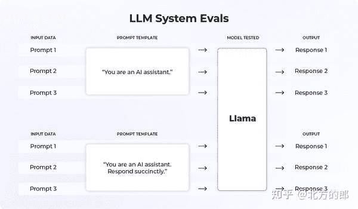

在本例中，我们正在单个基础模型上评估两个不同的提示模板。我们正在跨两个模板测试相同的数据集，并查看它们的指标（如精确度和召回率）如何叠加。何时使用 LLM 系统评估与 LLM 模型评估：这取决于您的角色

使用LLM评估的人有不同的角色。一个是模型开发人员或负责微调核心 LLM 的工程师，另一个是组装面向用户的系统的从业者。

LLM 模型开发人员很少，他们往往在 OpenAI、Anthropic、Google、Meta 等地方工作。 模型开发人员关心 LLM 模型评估 ，因为他们的工作是提供满足各种用例的模型。

对于机器学习从业者来说，任务也从模型评估开始。开发 LLM 系统的第一步是选择模型（即 GPT 3.5、4、Palm 等）。然而，这一群体的LLM模型评估通常是一次性的。一旦解决了哪种模型在您的用例中表现最好的问题，应用程序生命周期的其余大部分将由 LLM 系统评估来定义。因此， ML 从业者关心 LLM 模型评估和 LLM 系统评估，但可能会在后者上花费更多时间。

## LLM系统评估指标（LLM System Evaluation Metrics）

使用其他机器学习系统后，您的第一个问题可能是：“[结果指标](https://link.zhihu.com/?target=https%3A//arize.com/blog-course/introduction-to-retrieval-augmented-generation/) 应该是什么？”答案取决于您想要评估的内容。

● 提取结构化信息 ：你可以看看LLM提取信息的效果如何。例如，您可以查看完整性（输入中是否存在输出中没有的信息？）。

● 问答 ：系统回答用户问题的程度如何？您可以查看答案的准确性、礼貌性或简洁性，或以上所有内容。

● 检索增强生成（ RAG ） ：检索到的文档和最终答案是否相关？

作为系统设计师，您最终对系统性能负责，因此您需要了解需要评估系统的哪些方面。例如，如果您有一个与儿童互动的LLM（例如辅导应用程序），您需要确保响应适合年龄且无毒。

### 顶级 LLM 系统评估指标是什么？（What Are the Top LLM System Evaluation Metrics?）

当今最常见的LLM评估指标是相关性、幻觉、问答准确性、毒性和特定于检索的指标。这些 LLM 系统评估中的每一项都会根据您要评估的内容而具有不同的模板。下面列出了 LLM 系统评估指标的完整列表。

| 类型 | 描述 | 指标示例 |

| --- | --- | --- |

| 多样性 | 检查基础模型在响应不同类型查询时的多功能性 | 流畅度、困惑度、ROUGE 分数 |

| 用户反馈 | 超越准确性，从连贯性和有用性方面考虑响应质量 | 连贯性、质量、相关性 |

| 基于地面实况的指标 | 将 RAG 系统的响应与一组预定义的正确答案进行比较 | 准确率、F1 分数、精确率、召回率 |

| 答案相关性 | LLM 的响应与给定用户的查询的相关程度如何。 | 二元分类（相关/不相关） |

| 质量检查正确性 | 根据检索到的数据，问题的答案是否正确？ | 二元分类（正确/错误） |

| 幻觉 | 看看关于检索上下文的LLM幻觉 | 二元分类（事实/幻觉） |

| 毒性 | 回应是否带有种族主义、偏见或有毒？ | 差异分析、公平评分、二元分类（无毒/有毒） |

### 哪些LLM评估指标对检索增强生成有用？（What LLM Evaluation Metrics are Useful for Retrieval Augmented Generation?）

[在评估LLM RAG](https://link.zhihu.com/?target=https%3A//arize.com/blog-course/llm-rag-retrieval-augmented-generation-roadmap/)评估的检索部分时，上下文相关性、忠实性和大海捞针测试可能非常有用。当与任务评估结合使用时，这些指标和测试有助于解决这些 LLM 系统的潜在复杂性。

**流行的LLM检索指标**

上下文相关性和忠实性是利用 LLM RAG 时评估检索到的文档文件的准确性和相关性的两个最广泛使用的指标。

● [上下文相关性](https://link.zhihu.com/?target=https%3A//arize.com/blog-course/monitoring-collaborative-filtering-recsys/%23metrics) 着眼于检索到的上下文与原始查询的相关性。这可以是相关/不相关的二元分类，也可以使用排名指标（即 MRR 、 Precision@K、 MAP 、 NDCG 等）

● 忠实性 或基础性着眼于基础模型的响应与检索到的上下文的一致程度。例如，这可以是忠诚或不忠诚的二元分类。

### 大海捞针测试：它是什么以及在哪里使用它（The Needle In a Haystack Test: What It Is and Where To Use It）

[大海捞针测试](https://link.zhihu.com/?target=https%3A//arize.com/blog-course/the-needle-in-a-haystack-test-evaluating-the-performance-of-llm-rag-systems/)最初由 Gregory Kamradt 创建，旨在帮助 RAG LLM 用例，是一种了解不同 LLM 检索隐藏在不同长度上下文中的信息的能力的方法。

虽然这是一项相对较新的技术，但该测试对于解决LLM人工智能工程师“忘记”信息或忽略提示中包含的部分上下文所面临的相对常见问题非常有用。它的功能是将特定的、定制的信息（“针”）放入更大、更复杂的文本主体（“大海捞针”）中。最终目标是评估LLM在海量数据中识别和利用特定花絮的能力。

**具体示例：评估上下文的相关性**

[为了简单起见，下面是一个使用](https://link.zhihu.com/?target=https%3A//phoenix.arize.com/)开源 Arize Phoenix 工具评估上下文相关性的示例。在 Phoenix 工具中，存在适用于大多数常见用例的默认模板。这是我们将在本示例中使用的：

```
Relevance Eval Template:
You are comparing a reference text to a question and trying to determine if the reference text contains information relevant to answering the question. Here is the data:
[BEGIN DATA]
************
[Question]: {query}
************
[Reference text]: {reference}
[END DATA]Compare the Question above to the Reference text. You must determine whether the Reference text
contains information that can answer the Question. Please focus on whether the very specific
question can be answered by the information in the Reference text.
Your response must be single word, either “relevant” or “irrelevant”,
and should not contain any text or characters aside from that word.
“irrelevant” means that the reference text does not contain an answer to the Question.
“relevant” means the reference text contains an answer to the Question.
```

首先，我们将导入所有必要的依赖项：

```
from phoenix.experimental.evals import (
   RAG_RELEVANCY_PROMPT_TEMPLATE_STR,
   RAG_RELEVANCY_PROMPT_RAILS_MAP,
   OpenAIModel,
   download_benchmark_dataset,
   llm_eval_binary,
)
from sklearn.metrics import precision_recall_fscore_support
```

现在，让我们引入数据集：

```
# Download a &quot;golden dataset&quot; built into Phoenix
benchmark_dataset = download_benchmark_dataset(
   task=&quot;binary-relevance-classification&quot;, dataset_name=&quot;wiki_qa-train&quot;
)
# For the sake of speed, we&#x27;ll just sample 100 examples in a repeatable way
benchmark_dataset = benchmark_dataset.sample(100, random_state=2023)
benchmark_dataset = benchmark_dataset.rename(
   columns={
       &quot;query_text&quot;: &quot;query&quot;,
       &quot;document_text&quot;: &quot;reference&quot;,
   },
)
# Match the label between our dataset and what the eval will generate
y_true = benchmark_dataset[&quot;relevant&quot;].map({True: &quot;relevant&quot;, False: &quot;irrelevant&quot;})
```

现在我们来进行一下评估：


```
# Any general purpose LLM should work here, but it is best practice to keep the temperature at 0
model = OpenAIModel(
   model_name=&quot;gpt-4&quot;,
   temperature=0.0,
)
# Rails will define our output classes
rails = list(RAG_RELEVANCY_PROMPT_RAILS_MAP.values())


benchmark_dataset[&quot;eval_relevance&quot;] = \
   llm_eval_binary(benchmark_dataset,
                   model,
                   RAG_RELEVANCY_PROMPT_TEMPLATE_STR,
                   rails)
y_pred = benchmark_dataset[&quot;eval_relevance&quot;]


# Calculate evaluation metrics
precision, recall, f1, support = precision_recall_fscore_support(y_true, y_pred)
```

# 如何让人工智能来评估人工智能

使用LLM评估基于LLM的系统的过程有两个不同的步骤。首先，为您的 LLM 评估指标建立基准。为此，您需要组合一个基于 LLM 的专用评估，其唯一任务是像人类标记“黄金数据集”一样有效地标记数据。然后，您可以根据该评估对您的指标进行基准测试。然后，根据您的 LLM 申请结果运行此 LLM 评估指标（更多内容见下文）。

## 如何建立LLM评估

正如我们上面所讨论的，第一步是为您的评估建立一个基准。

为此，您必须从最适合您的用例的指标开始。然后，您需要黄金数据集。这应该代表您期望 LLM 评估看到的数据类型。黄金数据集应具有“真实情况”标签，以便我们可以衡量 LLM 评估模板的性能。这些标签通常来自人类反馈。构建这样的数据集非常费力，但您通常可以找到适合最常见用例的标准化数据集（就像我们在上面的代码中所做的那样）。

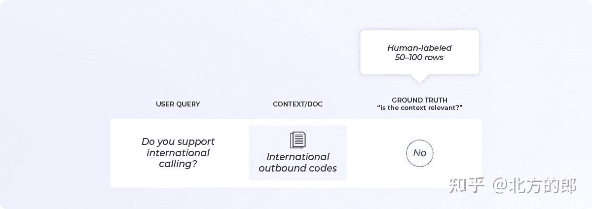

然后您需要决定要使用哪个LLM进行评估。这可能是与您在申请中使用的不同的LLM。例如，您可能在应用程序中使用 Llama，在评估中使用 GPT-4。通常这种选择会受到成本和准确性问题的影响。

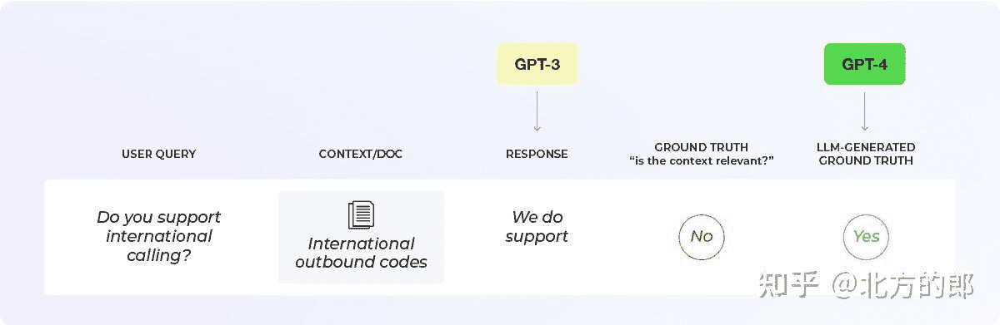

### 现在是我们正在尝试进行基准测试和改进的核心组件：`eval` 模板

如果您使用的是 `OpenAI` 或 `Phoenix` 等现有库，您应该从现有模板开始，看看该提示的执行情况。

如果您想要纳入特定的细微差别，请相应地调整模板或从头开始构建您自己的模板。请记住，模板应该具有清晰的结构。明确以下内容：

1. 输入是什么？ 在我们的示例中，它是检索的文档/上下文以及来自用户的查询。

2. 我们在问什么？ 在我们的示例中，我们要求LLM告诉我们该文档是否与查询相关

3. 可能的输出格式有哪些？ 在我们的示例中，它是二元相关/不相关的，但它也可以是多类的（例如，完全相关、部分相关、不相关）。

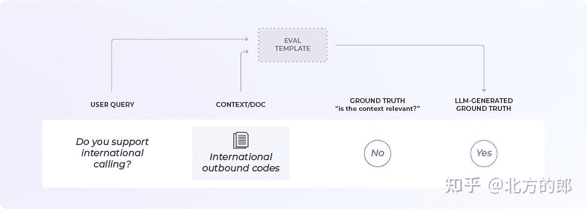

### 您现在需要在黄金数据集上运行评估

运[行评估。然后您可](https://link.zhihu.com/?target=https%3A//arize.com/blog-course/precision-vs-recall/)以 [生成指标 （总体准](https://link.zhihu.com/?target=https%3A//arize.com/blog-course/f1-score/)确率、 精确率、召回率 、 F1-score 等）来确定基准。重要的是不仅仅要关注整体准确性。我们将在下面更详细地讨论这一点。

如果[您对 LLM 评](https://link.zhihu.com/?target=https%3A//arize.com/blog/cross-validation-machine-learning/)估模板的性能不满意，您需要更改提示以使其性能更好。这是一个由硬指标告知的迭代过程。与往常一样，避免模板与黄金数据集过度拟合非常重要。确保有代表性的保留集或运行 `k` 倍交叉验证。

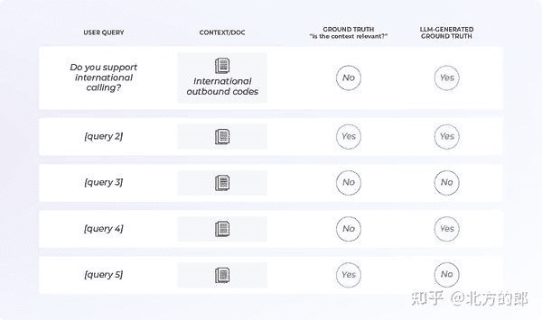

### 最后，您达到了基准

黄金数据集上的优化性能代表了您对 LLM 评估的信心。它不会像你的基本事实那么准确，但它会足够准确，而且它的成本比在每个示例的循环中都配备人工标记员要少得多。

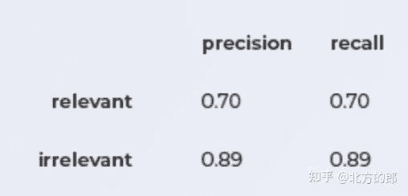

### 数值评估怎么样？

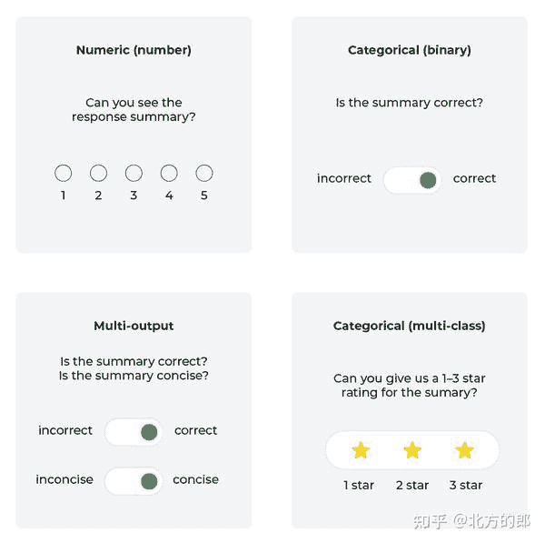

数字评估涉及LLM根据定义的评估标准回答一个数字，例如根据最近的客户服务通话记录，客户的满意度从一到十；分类评估是LLM从预定义且通常基于文本的选项中进行选择的地方，例如正面/负面或正确/不正确。

[最近 ](https://link.zhihu.com/?target=https%3A//arize.com/blog-course/numeric-evals-for-llm-as-a-judge/)对主要基础模型（包括 `OpenAI` 的 GPT-4、`Anthropic` 的 Claude 和 Mistral AI 的 Mixtral-8x7b）的研究表明，LLM 不能很好地处理连续范围，尚不能用于数值分数评估。相反，分类评估往往表现得更加一致。这些可以是二进制或多输出。

### LLM 基准：为什么使用精度和召回率很重要？

当数据中存在类别不平衡或者您需要针对特定业务目标进行优化（即最大限度地减少代价高昂的漏报）时，在对 LLM 提示模板进行基准测试时单独使用准确性可能会产生误导；使用精确率、召回率和 F 分数可以提供重要的见解。

该行业尚未完全标准化LLM评估的最佳实践。鉴于围绕黄金数据集构建的LLM辅助任务评估本质上是在评估认知任务的奇特分类模型，因此值得留意这一机器学习领域的经验教训。

这是数据科学实践中最常见的问题之一：非常严重的类别不平衡使得准确性成为不切实际的指标。

从相关性指标的角度来思考它是有帮助的。假设您经历了所有的麻烦和费用来组装最相关的聊天机器人。您可以选择适合该用例的LLM和模板。这应该意味着您的更多示例应该被评估为“相关”。让我们选择一个极端的数字来说明这一点：99.99% 的查询都会返回相关结果。万岁！

现在从LLM评估模板的角度来看。如果输出在所有情况下都是“相关的”，甚至无需查看数据，那么它在 99.99% 的情况下都是正确的。但它会同时错过所有（可以说是最）重要的情况——模型返回不相关结果的情况，而这正是我们必须捕获的情况。

在此示例中，准确度会很高，但精确度和召回率（或两者的组合，如 F1 分数）会非常低。准确率和召回率可以更好地衡量模型的性能。

另一个有用的可视化是混淆矩阵，它基本上可以让您看到正确和错误预测的相关和不相关示例的百分比。

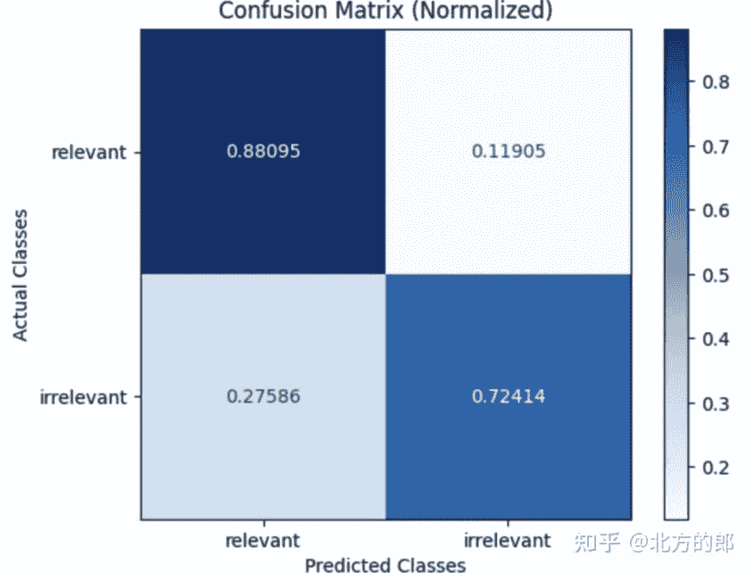

### 在此示例中

我们看到预测正确的比例最高：黄金数据集中的相关示例有 88% 的机会被我们的评估标记为正确。然而，我们发现评估在“不相关”示例上的表现明显较差，超过 27% 的时间对它们进行了错误标记。

## 如何在您的应用上运行LLM评估

此时，您应该拥有您的 LLM 应用和经过测试的 LLM 评估。您已经向自己证明了评估的有效性，并且对黄金数据集的性能有了可量化的了解。

现在我们实际上可以在我们的应用程序上使用我们的 `eval` 了。这将帮助我们衡量我们的LLM申请的表现并找出改进的方法。

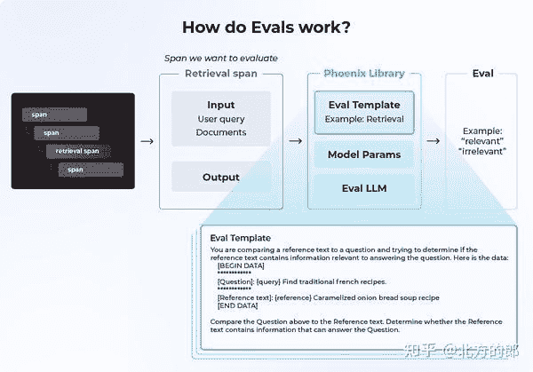

LLM 系统评估只需一个额外步骤即可运行您的整个系统。例如：

1. 您检索输入文档并将它们与示例用户输入一起添加到提示模板中。

2. 您向LLM提供该提示并收到答案。

3. 您向评估提供提示和答案，询问答案是否与提示相关。

最佳实践是不要使用一次性代码进行 LLM 评估，而是使用具有内置提示模板的库。这提高了可重复性，并允许更灵活的评估，您可以更换不同的部件。

这些评估需要在三种不同的环境中工作：

1. 进行基准测试时的预生产。

2. 当您测试应用程序时进行预生产。这有点类似于传统机器学习中的离线评估概念。这个想法是在将系统交付给客户之前了解系统的性能。

3. 部署后进行生产。生活很混乱。数据漂移、用户漂移、模型漂移，一切都以不可预测的方式发生。仅仅因为您的系统曾经运行良好并不意味着它在周二晚上 7 点也会如此。 评估可帮助您在部署后持续了解系统的性能。

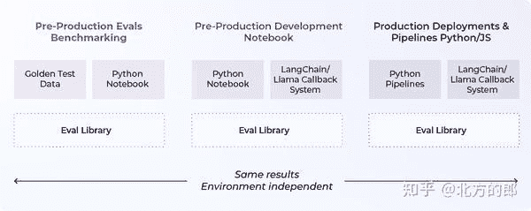

### 制定LLM评估策略时要考虑的问题

#### 您应该采样多少行？

LLM评估范式并不神奇。你无法评估你遇到过的每一个例子——这将是非常昂贵的。然而，您已经必须在人工标记过程中对数据进行采样，而更多的自动化只会让这变得更容易、更便宜。因此，与人工标记相比，您可以采样更多行。

您应该使用哪些评估？

这很大程度上取决于您的用例。对于搜索和检索，相关性类型的评估效果最好。毒性和幻觉具有特定的评估模式。

其中一些评估对于故障排除流程非常重要。问答准确性可能是一个很好的总体指标，但如果您深入研究为什么该指标在您的系统中表现不佳，您可能会发现这是因为检索不良等原因。通常可能的原因有很多，您可能需要多个指标才能弄清真相。

#### 我应该建立自己的评估器吗？

许多人工智能工程师——尤其是在数据高度专有的行业中——可能会发现，通过构建自己的评估模板并使[用黄金数据集进行预先](https://link.zhihu.com/?target=https%3A//phoenix.arize.com/)测试，最适合他们的用例。其他人发现，利用或调整 预先测试的 LLM 任务评估模板 （例如来自 `Phoenix` 的 模板，这些模板针对作为 LLM 评估库基准数据集一部分提供的黄金数据集进行测试）可能是有用的常见 LLM 系统任务。一如既往，经常测试和迭代是值得的。

#### 我应该使用什么型号？

不可能说一种模型适用于所有情况。相反，您应该运行模型评估来了解哪种模型适合您的应用程序。您可能还需要考虑召回率与精确率的权衡，具体取决于什么对您的应用程序有意义。换句话说，进行一些数据科学来了解您的特定情况。

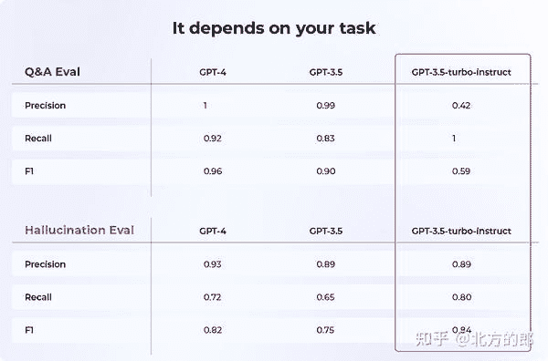

#### 通常使用哪种模型取决于您的任务

结论

当涉及到生产代码时，能够评估应用程序的性能非常重要。在LLM时代，问题变得更加困难，但幸运的是，我们可以利用LLM的技术来帮助我们进行评估。这样的评估应该测试整个系统，而不仅仅是底层的LLM模型——想想提示模板对用户体验有多重要。最佳实践、标准化工具和精选数据集简化了LLM系统的开发工作。
