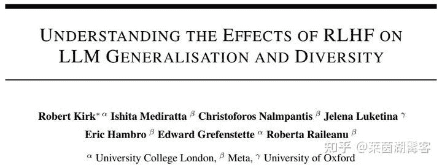
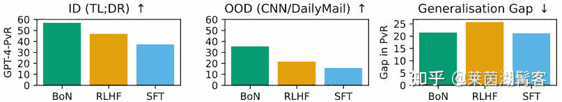
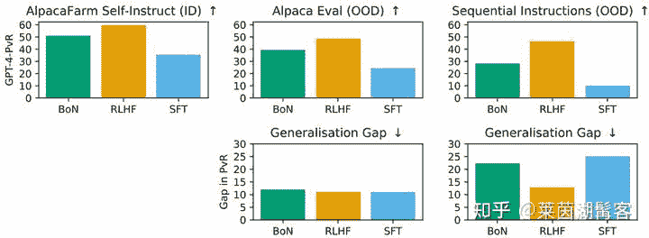
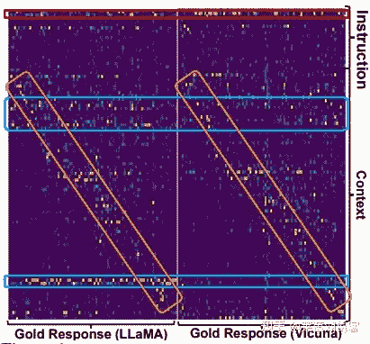
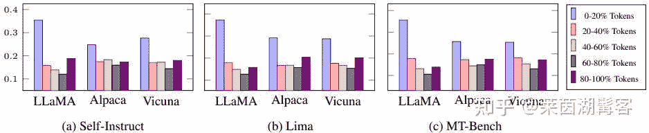
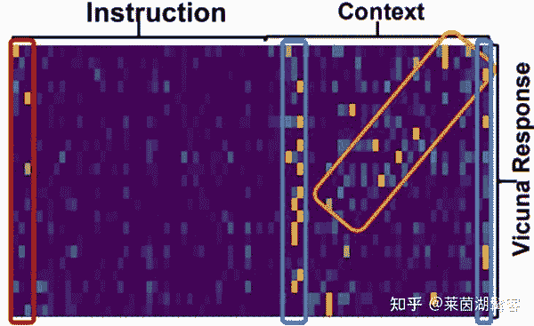
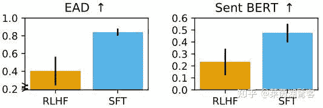
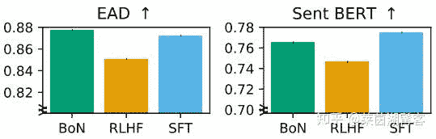
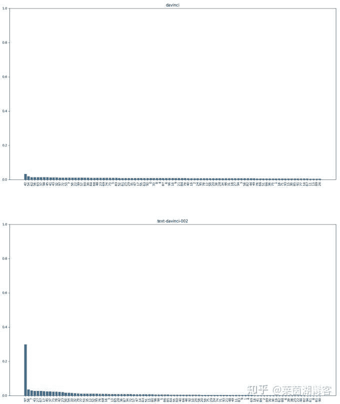

# SFT和RL究竟为LLM带来了什么

> 来源：[https://agijuejin.feishu.cn/docx/IHbLdzBHqokSYmxeDvvcgcSHnub](https://agijuejin.feishu.cn/docx/IHbLdzBHqokSYmxeDvvcgcSHnub)

> 作者：咸鱼王

> 原文：[https://zhuanlan.z](https://zhuanlan.zhihu.com/p/669265454)hihu.com/p/669265...

Pretrain+SFT+RL已经逐渐成为孵化LLM的标准流程：SFT解锁Instruction following、RL强化helpfulness、honesty、safety偏好。但Instruction Tuning和Reforcing Learning究竟从什么角度影响、多大程度上影响了LLM却鲜有深入探究。本文以META这篇论文为引，结合相关文章和笔者的个人见解，尝试对SFT、RL的作用做进一步分析。

**论文链接：**

[U](https://link.zhihu.com/?target=https%3A//arxiv.org/pdf/2310.06452.pdf)NDERSTANDING THE EFFECTS OF RLHF ON LLM GENERALISATION AND DIVERSITY

## 01 实验设置

本文从泛化性、多样性两个角度，以LLAMA-7B、OPT为基座模型，验证SFT、RLHF、BoN（Best Of N）对模型带来的影响。

### 1.1 对比方案

+   SFT：基于In-domain数据集进行指令微调。

+   B**oN：基于I**n-domain数据集训练RM，利用RM从SFT模型的K个outputs中挑选top1作为最终结果，本质是一种 生成后排序 的方法。

+   RLHF：基于In-domain数据集训练RM，并基于SFT进行RLHF。

### 1.2 数据集

+   Summarisation

+   [训练集/I](https://link.zhihu.com/?target=https%3A//openaipublic.blob.core.windows.net/summarize-from-feedback/website/index.html%23/tldr)n-domain测试集： TL;DR

+   [Out-of-domain](https://link.zhihu.com/?target=https%3A//openaipublic.blob.core.windows.net/summarize-from-feedback/website/index.html%23/cnndm)测试集： CNN/DailyMail

+   Instruction Following

+   [训练集/In-dom](https://link.zhihu.com/?target=https%3A//huggingface.co/datasets/tatsu-lab/alpaca_farm/viewer/alpaca_human_preference)ain测试集： AlpacaFarm

+   [Out-of-doma](https://link.zhihu.com/?target=https%3A//huggingface.co/datasets/tatsu-lab/alpaca_eval)in测试集： AlpacaEval 、Sequential Instructions

### 1.3 评测方法

+   泛化性：基于GPT-4进行自动评测，在context中给出input、model_output、reference，将model_output pick rate作为评测分数，经作者验证，该场景下模型评测与人工评测一致性在70%左右。作者将模型在ID、OOD下分数之差作为泛化性分数。

+   多样性

+   distinct N-grams：模型输出结果中，去重后的N-grams个数

+   Sentence-BERT embedding：模型输出结果在语义空间的平均余弦距离

## 02 结论：RLHF使泛化性提升

### 2.1 实验

作者首先基于Summarisation任务进行了泛化性测试，具体如下图。不难看出，几种方法从ID迁移到OOD时，pick rate分数不约而同有所下降，两个比较反常识的现象是：pick rate**分数B**oN>RLHF>SFT，泛化性BoN≈SFT>RLHF。作者并未对RLHF表现不佳的原因做深入探讨和分析，但作者后续尝试了多种参数量和数据划分逻辑，结论均一致。从BoN、SFT泛化性分数基本一致可以看出，至少RM迁移至OOD时是基本 无损 的（BoN本质上和SFT是同一种方法，只是语料分布不同，如果RM泛化性较差，BoN的泛化性分数应比SFT更差）。

在Instruction Following上的结论相对令人"喘了一口气"，具体如下图。首先在ID和两个OOD测试集上，均表现为RLHF>BoN>SFT。另外，在domain偏移相对不大的AlpacaEval上，3种方法泛化性差异相似，而在更难的Sequential Instructions任务中，RLHF则较明显的优于BoN和SFT。

从3组实验来看，作者给出的RLHF使泛化性提升的结论似乎并不强烈，但结合日常使用的经验，RLHF后的模型的确在指令理解、响应上更胜一筹。之所以只有在Sequential Instructions下有明显提升，笔者认为，或许是因为RLHF能够在整体上给模型泛化性带来提升，但并不能保证每种任务类型下都是增益，因此在Instruction Following这种复杂多样的场景下有所提升，而在如Summarisation的某些垂类任务里有所下降。

### 2.2 从token2token重要性角度剖析SFT带来的影响

在给出更多的猜想之前，笔者想先引入另一篇文章。该篇文章从inputToken对responseToken重要性的角度，来分析指令微调后，prompt对LLM的影响：

定义inp**ut第  n 个token为  x_n ，output第  m 个**token为  y_m ，则  x_n 对  y_m 的重要性为  I_{n,m}=p(y_m|Z_m)-p(y_m|Z_{m,/n}) ，其中  Z_m 指input+output的前  m-1 个token。简而言之，  I_{n,m} 意为删掉  x_n 前后，LLM生成  y_m 的置信度偏移，偏移越大则越重要。文中作者利用P值检验， 验证  I_{n,m} 和LLM是否遵循指令强相关，也即  I_{n,m} 越高，LLM越倾向于响应Instruction中对应的intents ，验证流程不再赘述。

作者依据  I_{n,m} ，绘制了LLAMA和Vicuna的  (instruction+context, response) 重要性**显著**图，如下所示。可以看出经过SFT的Vicuna，InstructionTokens（红框）更亮且亮的更多，ContextTokens亮的更少（篮框），说明 经过指令微调以后，模型能更精准区分prompt中的instruction和context，且以更高程度、更长时间让InstructionTokens干预response的生成。

此外，作者也对prompt中  I_{n,m} 的分布进行了统计，如下图所示，重要性随着位置的变化呈现高-低-较高的趋势，即 LLM更容易忽略prompt中尾部的tokens（尤其是中间） ，经过SFT后有所改善，这也和我们平时的经验一致。

另外作者还发现， LLM有时会“假装”遵循了指令 ，如下图，模型在执行某个文本纠错指令时，生成response的过程中实际仅参考了前3个tokens（这3个tokens并没有实际意义），而context部分无意义的token又扮演了instruction的角色，全程指引LLM完成生成（蓝框，对应的token为"\n\nInput:"和"\n\nOutput:"）。

这让笔者想到一个例子：给定Leetcode题让LLM写代码，理想情况是LLM读题、理解题意、然后写出答案，但实际上LLM可能看到 http:// Leetcode.xxx  就不再关注后面的内容了。笔者认为， 这个问题本质上是LLM在训练过程中对某些模式产生了过拟合 ，我们以往期望模型完成某项任务时，通常是将任务或逻辑具象化为数据，再用数据训练模型，让模型从数据中统计、抽象、还原出数据背后的逻辑。

实际上，碍于采样方式、标注人力等因素，我们展示给模型的数据往往只是真实世界分布中一个相当小、相当片面的子集，很难、也不可能涵盖所有情况。模型能否透过这部分“狭隘”的数据，还原出和我们期望完全一致的逻辑是不得而知的，因此一叶知秋有时只是我们的一厢情愿。再举个例子，我们想训练模型分辨马，但训练图片中马往往与草同时出现，所以模型可能误以为任务是分辨草， 此时模型对训练数据产生了错误的解读，或说对某些模式产生了过拟合 ，在ID测试集下看不出问题，OOD下就会立刻现出原形（比如草里的猪也识别成了马）。

### 2.3 从token2token重要性角度看待RLHF带来的泛化性提升

2.2主要探讨了SFT对模型的影响，虽然该篇文章的作者没有对RLHF后的模型做类似实验，但RLHF带来的泛化性提升或许可以借鉴这种解读方式。笔者认为， RLHF本质上是一种更有力地、矫正或规范模型输出偏好的训练方式 ，目前多数chat模型所强调的helpfulness、honesty、safety只是期望偏好的个例，我们也可以利用RLHF让chat模型学习身份偏好、语气偏好、情感偏好等等。

然而不论是SFT还是RLHF，SFT模型和RM模型的训练本质都是基于CE的方式，相比RL这种reward导向的方法，对误差相对不那么敏感。例如"我很喜欢草莓"和"我不喜欢草莓"在SFT训练中loss不会太大，但RM能敏锐的捕捉这种语义偏差，并通过reward的方式放大误差、“痛击”LLM。

我们通常将泛化性理解为模型在OOD下的适应能力，笔者想在Instruction Following场景下对泛化性做进一步细化：在不涉及到知识迁移的情况下，泛化性可以理解为LLM对低频指令及指令描述的响应能力。结合之前的一些实验结论可以猜想，LLM在经由RLHF强化helpfulness过程中，也在强化模型对指令的识别、理解和遵循能力：通过reward导向，最大程度上鼓励响应尽可能多的指令的生成方式、打击未遵循、漏遵循指令的生成方式，使模型比SFT模型对instructionTokens更加敏感，从而倾向于让instructionTokens以更长时间、更高程度干预response的生成。

但RLHF也绝非一劳永逸的方案，RM仍然和SFT一样都是基于CE训练的模型，能够通过RM放大误差、影响LLM的前提是RM能够识别这种误差，因此 RLHF的泛化能力依旧受限于RM的泛化能力 。好在我们可以通过构建comparisons的方式让RM更轻易的感知到这种偏差，且RM作为NLU的模型本身就更易于训练。

## 03 结论：RLHF后多样性下降

### 3.1 实验

多样性评测上，作者仅基于Summarisation进行了实验，Instruction Following则因为不同模型的输出长度等偏好不统一，不具备较好的可比性。作者从per-input、across-input两个角度进行了实验，分别如下图(上)、下图(下)所示，二者区别在于是否先沿input维度做reduce_mean。

假设有模型  \pi 、输入  input_i ，则  \pi 的  K 个输出为  O^i_\pi:=\{y_j\sim\pi(y|x_i)|j=1...K\} ：

1.   PerInputDiversity_D(\pi):=\Sigma_{i=1}^ND(O_\pi^i)/N ，即先沿input维度对  K 个输出做reduce_mean，再对整个测试集做reduce_mean。

1.   CrossInputDiversity_D(\pi):=D(\bigcup_{i=1}^{N}O^i_\pi[1]) ，即取每个input的top1输出做reduce_mean。

两种评测方式的结论基本一致，在多样性表现上RLHF均低于SFT，但across-input的diff要远小于per-input的diff。这个结论也比较容易理解，per-input由于存在多个beams（文中  K=16 ），在广度上要远大于across-input，per-input下的diff更大也间接反应RLHF后的模型beams更加集中。此外，作者将across-input的diff更小归因于RLHF导致的"mode collapse"：即便inputs不同，模型也趋向于输出固定模式或风格的结果。

笔者认为，RLHF导致模型多样性降低的问题应辩证看待： 多样性降低是RLHF做风格矫正、强化后带来的必然后果 ，甚至有时让LLM惯于按照某种风格/格式进行输出，也是使用RLHF目的之一。实际上SFT也能基于大量数据达到类似效果，但效率和力度没有RL这么高。此外在多数场景下，我们的确需要一个对轻微扰动不敏感的模型。

### 3.2 从mode collapse看待模型多样性降低

Mysteries of mode collapse 较为详细的描述了模式坍塌这一问题，文中枚举了许多范例，展示RLHF带来的一些莫名其妙的输出倾向，而这些倾向不同于上一节所说的、我们乐于见到的稳定性/鲁棒性提升，而是模型对某些模式过拟合的表现。

以下图为例，作者分别基于davinci和text-davinci-002进行随机数生成实验，发现RLHF后的模型存在明显的随机数生成偏好，笔者在GPT-4上也进行了相似的实验，结论基本一致。

作者在文章中也提到，模型对可能在指令微调阶段出现过的prompts更容易出现模式坍塌的问题。笔者认为，2.2节中LLM“假装”遵循指令的例子就是模式坍塌的一个表现，模式坍塌不是RLHF才会有的问题，只是RLHF更强的矫正力度使这一现象更加明显，因此，模式坍塌本质上或许就是LLM对某些特征的过拟合。这种过拟合可能是因为RM的过拟合、并通过RLHF传递给了LLM，也有可能是SFT的过拟合、使LLM在RL阶段跳不出SFT的圈子，也有可能是RL阶段语料分布的不够广。

## 04 总结

本文从泛化性、多样性的角度对SFT、RLHF的影响进行了简单分析。SFT后的模型能够更加精准的识别InstructionTokens、并依赖这些指令进行生成，而RLHF作为一种更有力的训练方式，能够进一步强化LLM对指令的识别及响应能力，因此在泛化性提升上，RLHF>SFT。

在多样性上，输出模式、风格的集中是RLHF的必然后果，因此RLHF后LLM的多样性会有所降低。同时，RLHF对误差更加敏感也是一把双刃剑，在训练过程中可能会对某些模式或特征产生过拟合，也即模式坍塌现象。