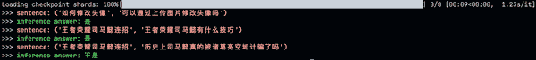
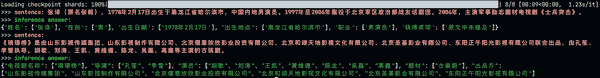
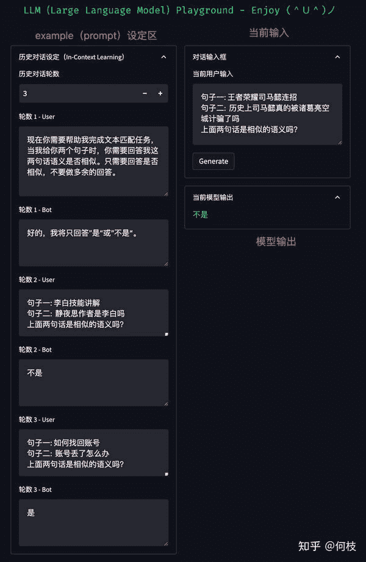

# LLM（Large Language Model）下的自然语言处理任务（附源码）

> 来源：[https://agijuejin.feishu.cn/docx/OnAqdlkZjo56AYxXdfcc9XrpnDd](https://agijuejin.feishu.cn/docx/OnAqdlkZjo56AYxXdfcc9XrpnDd)

> 作者：[何枝](https://www.zhihu.com/people/who-u)

> 原文：[https://zhuanlan.z](https://zhuanlan.zhihu.com/p/615305245)hihu.com/p/615305...

> 完整源码在 文末 。

随着 ChatGPT 和 GPT-4 等强大生成模型出现，自然语言处理任务方式正在逐步发生改变。

鉴于大模型强大的任务处理能力，未来我们或将不再为每一个具体任务去 finetune 一个模型，

而是使用同一个大模型，对不同任务设计其独有的 prompt，以解决不同的任务问题。

[在这篇文章中，我们将基](https://link.zhihu.com/?target=https%3A//github.com/THUDM/ChatGLM-6B)于清华开源大模型 ChatGLM-6B ，

尝试提供多个自然语言处理任务如何通过 prompt 来实现 zero-shot 的案例，

希望能够对你有所启发。

## 1. 文本分类任务（Text Classification）

### 1.1 任务描述

如下所示，我们从 百度百科 中选择了几段描述文本：

```
1. 加拿大（英语/法语：Canada），首都渥太华，位于北美洲北部。东临大西洋，西濒太平洋，西北部邻美国阿拉斯加州，南接美国本土，北靠北冰洋。气候大部分为亚寒带针叶林气候和湿润大陆性气候，北部极地区域为极地长寒气候。
2. 《琅琊榜》是由山东影视传媒集团、山东影视制作有限公司、北京儒意欣欣影业投资有限公司、北京和颂天地影视文化有限公司、北京圣基影业有限公司、东阳正午阳光影视有限公司联合出品，由孔笙、李雪执导，胡歌、刘涛、王凯、黄维德、陈龙、吴磊、高鑫等主演的古装剧。
3. 《满江红》是由张艺谋执导，沈腾、易烊千玺、张译、雷佳音、岳云鹏、王佳怡领衔主演，潘斌龙、余皑磊主演，郭京飞、欧豪友情出演，魏翔、张弛、黄炎特别出演，许静雅、蒋鹏宇、林博洋、飞凡、任思诺、陈永胜出演的悬疑喜剧电影。
4. 布宜诺斯艾利斯（Buenos Aires，华人常简称为布宜诺斯）是阿根廷共和国（the Republic of Argentina，República Argentina）的首都和最大城市，位于拉普拉塔河南岸、南美洲东南部、河对岸为乌拉圭东岸共和国。
5. 张译（原名张毅），1978年2月17日出生于黑龙江省哈尔滨市，中国内地男演员。1997年至2006年服役于北京军区政治部战友话剧团。2006年，主演军事励志题材电视剧《士兵突击》。
```

我们期望模型能够帮我们识别出这 5 句话中，每一句话描述的是一个什么 类型 的物体。

这 5 段描述分别节选自：

```
[&#x27;加拿大&#x27;, &#x27;《琅琊榜》&#x27;, &#x27;《满江红》&#x27;, &#x27;布宜诺斯艾利斯&#x27;, &#x27;张译&#x27;]
```

因此，我们期望模型输出的结果为：

```
[&#x27;国家&#x27;, &#x27;电视剧&#x27;, &#x27;电影&#x27;, &#x27;城市&#x27;, &#x27;人物&#x27;]
```

### 1.2 prompt 设计

对于大模型来讲，prompt 的设计非常重要，一个 明确 的 prompt 能够帮助我们更好从大模型中获得我们想要的结果。

在该任务的 prompt 设计中，我们主要考虑 2 点：

+   需要向模型解释什么叫作「文本分类任务」

+   需要让模型按照我们指定的格式输出

为了让模型知道什么叫做「文本分类」，我们借用 Incontext Learning 的方式，先给模型展示几个正确的例子：

```
&gt;&gt;&gt; User: &quot;岳云鹏，本名岳龙刚，1985年4月15日出生于河南省濮阳市南乐县，中国内地相声、影视男演员。&quot; 是 [&#x27;人物&#x27;, &#x27;书籍&#x27;, &#x27;电视剧&#x27;, &#x27;电影&#x27;, &#x27;城市&#x27;, &#x27;国家&#x27;] 里的什么类别？
&gt;&gt;&gt; Bot: 人物
&gt;&gt;&gt; User: &quot;《三体》是刘慈欣创作的长篇科幻小说系列，由《三体》《三体2：黑暗森林》《三体3：死神永生》组成，第一部于2006年5月起在《科幻世界》杂志上连载，第二部于2008年5月首次出版，第三部则于2010年11月出版。&quot; 是 [&#x27;人物&#x27;, &#x27;书籍&#x27;, &#x27;电视剧&#x27;, &#x27;电影&#x27;, &#x27;城市&#x27;, &#x27;国家&#x27;] 里的什么类别？
&gt;&gt;&gt; Bot: 书籍
...
```

其中， User 代表我们输入给模型的句子， Bot 代表模型的回复内容。

注意：上述例子中 Bot 的部分也是由人工输入的，其目的是希望看到在看到类似 User 中的句子时，模型应当做出类似 Bot 的回答。

这部分提供给模型看的 例子 ，在代码开头中的 class_example 变量里：

```
# 提供所有类别以及每个类别下的样例
class_examples = {
        &#x27;人物&#x27;: &#x27;岳云鹏，本名岳龙刚，1985年4月15日出生于河南省濮阳市南乐县，中国内地相声、影视男演员 [1]  。2005年，首次登台演出。2012年，主演卢卫国执导的喜剧电影《就是闹着玩的》。2013年在北京举办相声专场。&#x27;,
        &#x27;书籍&#x27;: &#x27;《三体》是刘慈欣创作的长篇科幻小说系列，由《三体》《三体2：黑暗森林》《三体3：死神永生》组成，第一部于2006年5月起在《科幻世界》杂志上连载，第二部于2008年5月首次出版，第三部则于2010年11月出版。&#x27;,
        &#x27;电视剧&#x27;: &#x27;《狂飙》是由中央电视台、爱奇艺出品，留白影视、中国长安出版传媒联合出品，中央政法委宣传教育局、中央政法委政法综治信息中心指导拍摄，徐纪周执导，张译、张颂文、李一桐、张志坚、吴刚领衔主演，倪大红、韩童生、李建义、石兆琪特邀主演，李健、高叶、王骁等主演的反黑刑侦剧。&#x27;,
        &#x27;电影&#x27;: &#x27;《流浪地球》是由郭帆执导，吴京特别出演、屈楚萧、赵今麦、李光洁、吴孟达等领衔主演的科幻冒险电影。影片根据刘慈欣的同名小说改编，故事背景设定在2075年，讲述了太阳即将毁灭，毁灭之后的太阳系已经不适合人类生存，而面对绝境，人类将开启“流浪地球”计划，试图带着地球一起逃离太阳系，寻找人类新家园的故事。&#x27;,
        &#x27;城市&#x27;: &#x27;乐山，古称嘉州，四川省辖地级市，位于四川中部，四川盆地西南部，地势西南高，东北低，属中亚热带气候带；辖4区、6县，代管1个县级市，全市总面积12720.03平方公里；截至2021年底，全市常住人口315.1万人。&#x27;,
        &#x27;国家&#x27;: &#x27;瑞士联邦（Swiss Confederation），简称“瑞士”，首都伯尔尼，位于欧洲中部，北与德国接壤，东临奥地利和列支敦士登，南临意大利，西临法国。地处北温带，四季分明，全国地势高峻，矿产资源匮乏，森林及水力资源丰富，总面积41284平方千米，全国由26个州组成（其中6个州为半州）。&#x27;
    }
...
```

您可以在该变量中 修改 / 添加 自定义的例子。

### 1.3 运行结果

模型推理结果如下：

## 2. 文本匹配任务（Text Matching）

### 2.1 任务描述

如下所示，我们构造了几个短文本对：

```
1. (&#x27;如何修改头像&#x27;, &#x27;可以通过上传图片修改头像吗&#x27;)
2. (&#x27;王者荣耀司马懿连招&#x27;, &#x27;王者荣耀司马懿有什么技巧&#x27;)
3. (&#x27;王者荣耀司马懿连招&#x27;, &#x27;历史上司马懿真的被诸葛亮空城计骗了吗&#x27;)
```

我们期望模型能够帮我们识别出这 3 对句子中，哪几对描述的是相似的语句。

我们期望模型输出的结果为：

```
[&#x27;相似&#x27;, &#x27;相似&#x27;, &#x27;不相似&#x27;]
```

### 2.2 prompt 设计

同样，在该任务的 prompt 设计中，我们主要考虑 2 点：

+   需要向模型解释什么叫作「文本匹配任务」

+   需要让模型按照我们指定的格式输出

为了让模型知道什么叫做「相似语言判断任务」，我们借用 Incontext Learning 的方式，先给模型展示几个正确的例子：

```
&gt;&gt;&gt; User: 句子一: 如何找回账号\n句子二: 账号丢了怎么办\n上面两句话是相似的语义吗？
&gt;&gt;&gt; Bot: 是
&gt;&gt;&gt; User: 如何找回账号\n句子二: 附近最近的饭店\n上面两句话是相似的语义吗？
&gt;&gt;&gt; Bot: 不是
...
```

其中， User 代表我们输入给模型的句子， Bot 代表模型的回复内容。

注意：上述例子中 Bot 的部分也是由人工输入的，其目的是希望看到在看到类似 User 中的句子时，模型应当做出类似 Bot 的回答。

这部分提供给模型看的 例子 ，在代码开头中的 examples 变量里：

```
# 提供相似，不相似的语义匹配例子
examples = {
    &#x27;是&#x27;: [
        (&#x27;如何找回账号&#x27;, &#x27;账号丢了怎么办&#x27;),
    ],
    &#x27;不是&#x27;: [
        (&#x27;如何找回账号&#x27;, &#x27;附近最近的饭店&#x27;),
        (&#x27;李白技能讲解&#x27;, &#x27;静夜思作者是李白吗&#x27;)
    ]
}
...
```

### 2.3 运行结果

模型推理结果如下：



## 3. 信息抽取（Information Extraction）

### 3.1 任务描述

首先，我们定义信息抽取的 schema：

```
# 定义不同实体下的具备属性
schema = {
    &#x27;人物&#x27;: [&#x27;姓名&#x27;, &#x27;性别&#x27;, &#x27;出生日期&#x27;, &#x27;出生地点&#x27;, &#x27;职业&#x27;, &#x27;获得奖项&#x27;],
    &#x27;书籍&#x27;: [&#x27;作者&#x27;, &#x27;类型&#x27;, &#x27;发行时间&#x27;, &#x27;定价&#x27;],
    &#x27;电视剧&#x27;: [&#x27;导演&#x27;, &#x27;演员&#x27;, &#x27;题材&#x27;, &#x27;出品方&#x27;]
}
```

随后，我们从百度百科中找到一些句子，并利用模型进行信息抽取：

```
1. 张译（原名张毅），1978年2月17日出生于黑龙江省哈尔滨市，中国内地男演员。1997年至2006年服役于北京军区政治部战友话剧团。2006年，主演军事励志题材电视剧《士兵突击》。
2. 《琅琊榜》是由山东影视传媒集团、山东影视制作有限公司、北京儒意欣欣影业投资有限公司、北京和颂天地影视文化有限公司、北京圣基影业有限公司、东阳正午阳光影视有限公司联合出品，由孔笙、李雪执导，胡歌、刘涛、王凯、黄维德、陈龙、吴磊、高鑫等主演的古装剧。
```

经测试，直接进行全 schema 的混抽效果很差，

因此，我们通过第 1 小节中提到的「分类任务」的方法，先将描述文本分为具体的类别，

再根据类别在定义 schema 中找到对应的属性进行信息抽取任务。

### 3.2 prompt 设计

同样，在该任务的 prompt 设计中，我们主要考虑 2 点：

+   需要向模型解释什么叫作「信息抽取任务」

+   需要让模型按照我们指定的格式（json）输出

为了让模型知道什么叫做「信息抽取」，我们借用 Incontext Learning 的方式，先给模型展示几个正确的例子：

```
&gt;&gt;&gt; User: 岳云鹏，本名岳龙刚，1985年4月15日出生于河南省濮阳市南乐县，中国内地相声、影视男演员。2005年，首次登台演出。2012年，主演卢卫国执导的喜剧电影《就是闹着玩的》。2013年在北京举办相声专场。提取上述句子中“人物”(姓名, 性别, 出生日期, 出生地点, 职业, 获得奖项)类型的实体，并按照JSON格式输出，上述句子中没有的信息用[&#x27;原文中未提及&#x27;]来表示，多个值之间用&#x27;,&#x27;分隔。
&gt;&gt;&gt; Bot: {&quot;姓名&quot;: [&quot;岳云鹏&quot;], &quot;性别&quot;: [&quot;男&quot;], &quot;出生日期&quot;: [&quot;1985年4月15日&quot;], &quot;出生地点&quot;: [&quot;河南省濮阳市南乐县&quot;], &quot;职业&quot;: [&quot;相声演员&quot;, &quot;影视演员&quot;], &quot;获得奖项&quot;: [&quot;原文中未提及&quot;]}
...
```

其中， User 代表我们输入给模型的句子， Bot 代表模型的回复内容。

注意：上述例子中 Bot 的部分也是由人工输入的，其目的是希望看到在看到类似 User 中的句子时，模型应当做出类似 Bot 的回答。

这部分提供给模型看的 例子 ，在代码开头中的 ie_examples 变量里：

```
# 提供一些例子供模型参考
ie_examples = {
        &#x27;人物&#x27;: [
                    {
                        &#x27;content&#x27;: &#x27;岳云鹏，本名岳龙刚，1985年4月15日出生于河南省濮阳市南乐县，中国内地相声、影视男演员。&#x27;,
                        &#x27;answers&#x27;: {
                                        &#x27;姓名&#x27;: [&#x27;岳云鹏&#x27;],
                                        &#x27;性别&#x27;: [&#x27;男&#x27;],
                                        &#x27;出生日期&#x27;: [&#x27;1985年4月15日&#x27;],
                                        &#x27;出生地点&#x27;: [&#x27;河南省濮阳市南乐县&#x27;],
                                        &#x27;职业&#x27;: [&#x27;相声演员&#x27;],
                                        &#x27;获得奖项&#x27;: [&#x27;原文中未提及&#x27;]
                            }
                    }
        ],
        &#x27;书籍&#x27;: [
                    {
                        &#x27;content&#x27;: &#x27;《三体》是刘慈欣创作的长篇科幻小说系列，由《三体》《三体2：黑暗森林》《三体3：死神永生》组成，第一部于2006年5月起在《科幻世界》杂志上连载，第二部于2008年5月首次出版，第三部则于2010年11月出版。&#x27;,
                        &#x27;answers&#x27;: {
                                        &#x27;书名&#x27;: [&#x27;《三体》&#x27;],
                                        &#x27;作者&#x27;: [&#x27;刘慈欣&#x27;],
                                        &#x27;类型&#x27;: [&#x27;长篇科幻小说&#x27;],
                                        &#x27;发行时间&#x27;: [&#x27;2006年5月&#x27;, &#x27;2008年5月&#x27;, &#x27;2010年11月&#x27;],
                                        &#x27;定价&#x27;: [&#x27;原文中未提及&#x27;]
                            }
                    }
        ]
}
...
```

### 3.3 运行结果

模型推理结果如下：



## 4. 调试平台（Playground）

为了更方便的调试 prompt，您可以使用代码中包含的 Playground 进行 prompt 设计：



文中的完整代码在：https://github.com/HarderThenHarder/transformers_tasks/tree/main/LLM