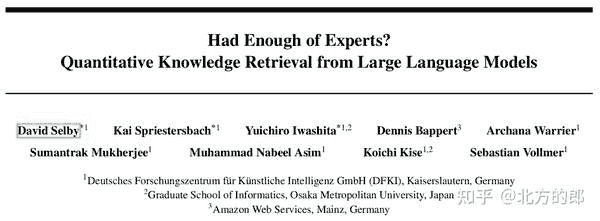
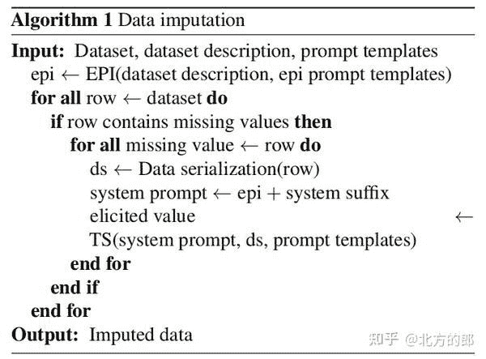
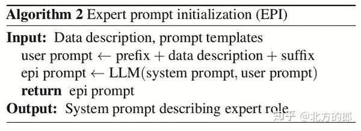
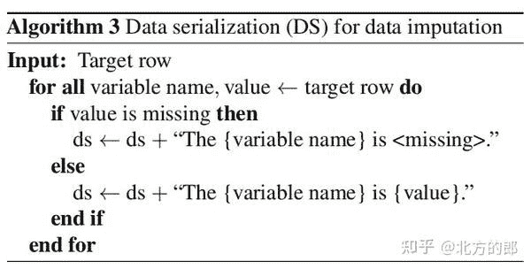
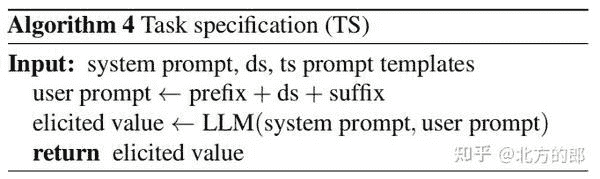
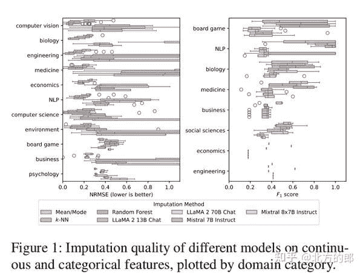
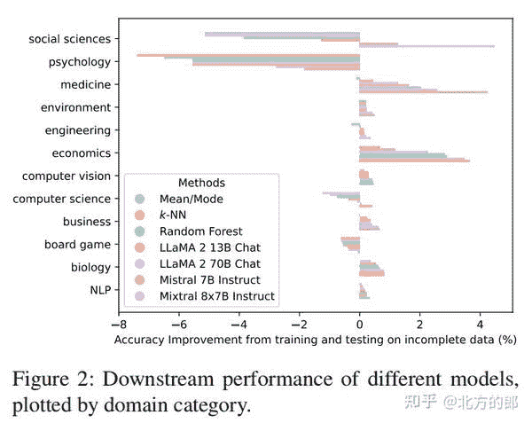
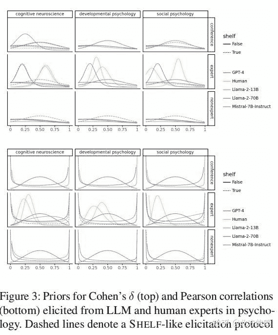
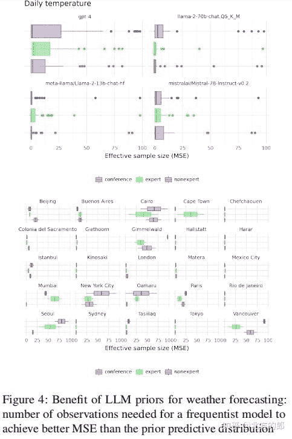

# 大型语言模型能否取代专家，现在看好像还差点

> 来源：[https://agijuejin.feishu.cn/docx/F7rbdfqJpoqbdZxbQbdcXfpnnDe](https://agijuejin.feishu.cn/docx/F7rbdfqJpoqbdZxbQbdcXfpnnDe)

> 作者：北方的郎

> 原文： [https://zhuanlan.z](https://zhuanlan.zhihu.com/p/682242507)hihu.com/p/682242...

在人工智能领域，大型语言模型（LLM）近年来取得了显著的进展，特别是ChatGPT和GPT-4等模型的发布，引起了广泛关注。这些强大的语言模型拥有数百万到数亿参数，经过海量文本训练后，能够生成连贯的文本，回答问题，甚至完成一些简单的数学计算。这些功能令人印象深刻，但也引发了一个值得思考的问题：LLM能否替代人类专家，成为可信赖的信息来源？

一篇最近发表的论文《Had Enough of Experts? Quantitative Knowledge Retrieval from Large Language Models》对此进行了探讨。论文作者来自德国人工智能研究中心和日本大阪都市大学，他们提出了一种利用LLM获取定量知识的框架，并将其应用于缺失值填充和先验分布推导两个任务，然后与人类专家的结果进行比较。

论文地址： https:// arxiv.org/abs/2402.0777 0

以下内容为抽取的论文关键信息：

---

## 背景

在数据科学和机器学习中，我们经常会面临训练数据缺失的情况。为了解决这个问题，一种方法是利用专家知识来填补这些缺失值。例如，我们可以咨询专家对某个变量的合理取值范围，然后利用这些先验信息来填补数据。另一种方法是使用统计方法，如均值填充或随机森林预测。

## 专家框架

这两种方法各有优缺点。专家知识的获取成本高且主观性强，而统计方法虽然客观，但对训练数据的质量敏感。于是，作者提出可以利用LLM来模拟专家的角色，填补数据缺失。具体来说，他们设计了一个框架，首先利用LLM生成“专家角色”的描述，然后将其应用于具体的缺失值填充任务。例如，对于某个病人的血压数据，LLM会根据其角色描述生成一个血压的先验分布，然后填补缺失值。这个框架主要用于从大语言模型中提取定量信息，具体包括以下步骤：

+   数据预处理：将数值数据转换为自然语言描述。这一步骤使用了固定的模板，将每一列的数据值描述为一个句子，例如"The variable is value"。

+   专家角色提示：设计系统提示，让大语言模型扮演专家角色。具体做法是，首先给出数据集的描述，然后让模型回答“在这种情况下，哪个虚拟角色最适合作为该数据集的领域专家？”模型将生成一个简短的专家角色描述，例如“你是一位资深的医学专家”。

+   任务转换：将查询转换为明确的数值任务。例如，对于缺失值填充，任务可以转换为“使用你的专业知识和经验，估计以下数据行中缺失值最可能是什么”。对于先验分布提取，任务可以转换为“给出你对某参数的先验分布”。

+   获取专家建议：使用专家角色提示和任务转换，从大语言模型中获取数值结果。例如，模型可能回复“缺失值最可能是50”或“参数的先验分布是normal(0,1)”。

+   格式化输出：将模型的回复格式化为json格式，仅保留数值部分，例如{“output”:50}。

这一框架通过让大语言模型扮演专家角色，并给出明确的数值任务，从而引导模型生成定量知识。这一框架可以灵活应用于缺失值填充、先验分布提取等任务，并能够以零样本的方式使用。

## 实验效果

为了验证这个框架的有效性，作者在多个领域的数据集上进行了实验。结果显示，在缺失值填充任务上，LLM的表现总体上优于简单的统计方法，但在一些领域上效果不佳。而在先验分布推导任务上，LLM生成的分布与人类专家的结果有较大差异，但在某些任务上也有一定的参考价值。具体为：

+   数据填补(Data imputation)：在50个真实世界数据集上评估了基于大语言模型(LLM)的数据填补方法。结果显示，LLM填补方法在某些数据集上效果良好，但在总体上不如均值填补、K近邻填补和随机森林填补等基准方法。进一步分析表明，LLM在工程和计算机视觉领域的数据集上表现较好，而在经济学和商业领域的数据集上表现较差。

+   先验分布提取(Prior elicitation)：利用LLM提取了心理学研究中小效应量和相关系数的先验分布，并与人类专家提取的先验分布进行了比较。结果显示，LLM提取的先验分布与人类专家存在较大差异，尤其在相关系数的先验分布上。此外，实验还评估了LLM提取的先验分布对下游任务的效果，发现LLM先验分布对于天气预测任务有一定帮助，能够提高预测误差。

论文通过实验证明，LLM在提取定量知识方面具有一定的潜力，但仍存在一定的局限性和改进空间。需要进一步优化模型或提示工程技术，以提升LLM在定量知识检索任务上的性能。

## 总结

这篇论文给出了LLM在定量知识获取方面的应用，但仍存在一些挑战。例如，LLM的“黑盒”特性使得我们难以理解其决策过程，而且其训练语料的质量也会影响结果的可靠性。因此，虽然LLM在定量知识获取方面有潜力，但仍需要进一步的研究和改进。希望未来LLM能够成为人类专家的得力助手，帮助我们做出更好的决策。