# MyScale Telemetry：开源版 LangSmith，增强 LLM 应用程序的可观测性

> 来源：[https://agijuejin.feishu.cn/docx/HpGydz4wJoh35PxvjQFcU7tJnEh](https://agijuejin.feishu.cn/docx/HpGydz4wJoh35PxvjQFcU7tJnEh)

> 作者：MyScale | AI 搜索引擎

> 原文： [https://mp.weixin.](https://mp.weixin.qq.com/s/OM7vIBeq6Zb9N6Ui7ZpBvA)qq.com/s/OM7vIBeq...

随着LLM应用程序的不断发展和改进，实现强大的可观测性对于确保最佳性能和可靠性至关重要。然而，由于其复杂性和规模，跟踪和存储 LLM 应用程序的运行时事件是具有挑战性的。

为了应对这些挑战，我们很高兴发布 MyScale Telemetry，它与 LangChain Callbacks 集成。

MyScale Telemetry 无缝地捕获基于 LangChain 的 LLM 应用程序的跟踪数据，并将其存储在MyScale 中，使诊断问题、优化性能和理解模型行为变得容易。

你可以将 MyScale Telemetry 看作是 LangSmith 的开源替代品，它提供与 LangSmith 类似的功能，包括跟踪和评估 LLM 应用程序。MyScale Telemetry 通过使用多功能强大的 MyScale SQL向量数据库和广泛使用的 Grafana 仪表板，减少了系统复杂性并提高了数据安全性。此外，由于MyScaleDB 与 ClickHouse 兼容，MyScale Telemetry 可以直接与 ClickHouse 一起使用。

让我们在以下部分中详细查看 MyScale Telemetry 系统的工作原理和用法。

#  MyScale Telemetry 是如何工作的

将 MyScale Telemetry 与 LangChain 集成是直接的。回调处理程序会自动为你的 LangChain 应用程序中的每个运行时事件创建一个嵌套跟踪，包括：

+   on_chain_start

+   on_chain_end

+   on_llm_start

+   on_llm_end

+   on_chat_model_start

+   on_retriever_start

+   on_retriever_end

+   on_tool_start

+   on_tool_end

+   on_tool_error

+   on_chain_error

+   on_retriever_error

+   on_llm_error

然后收集的运行时事件数据被组织成跟踪数据，类似于 OpenTelemetry 跟踪数据，并存储在MyScale 数据库中的专用跟踪数据表中。请参阅以下 SQL 脚本，了解此跟踪数据表结构和 CREATE TABLE 语句。

```
CREATE TABLE your_database_name.your_table_name
(
    `TraceId` String CODEC(ZSTD(1)),
    `SpanId` String CODEC(ZSTD(1)),
    `ParentSpanId` String CODEC(ZSTD(1)),
    `StartTime` DateTime64(9) CODEC(Delta(8), ZSTD(1)),
    `EndTime` DateTime64(9) CODEC(Delta(8), ZSTD(1)),
    `Duration` Int64 CODEC(ZSTD(1)),
    `SpanName` LowCardinality(String) CODEC(ZSTD(1)),
    `SpanKind` LowCardinality(String) CODEC(ZSTD(1)),
    `ServiceName` LowCardinality(String) CODEC(ZSTD(1)),
    `SpanAttributes` Map(LowCardinality(String), String) CODEC(ZSTD(1)),
    `ResourceAttributes` Map(LowCardinality(String), String) CODEC(ZSTD(1)),
    `StatusCode` LowCardinality(String) CODEC(ZSTD(1)),
    `StatusMessage` String CODEC(ZSTD(1)),
    INDEX idx_trace_id TraceId TYPE bloom_filter(0.001) GRANULARITY 1,
    INDEX idx_res_attr_key mapKeys(ResourceAttributes) TYPE bloom_filter(0.01) GRANULARITY 1,
    INDEX idx_res_attr_value mapValues(ResourceAttributes) TYPE bloom_filter(0.01) GRANULARITY 1,
    INDEX idx_span_attr_key mapKeys(SpanAttributes) TYPE bloom_filter(0.01) GRANULARITY 1,
    INDEX idx_span_attr_value mapValues(SpanAttributes) TYPE bloom_filter(0.01) GRANULARITY 1,
    INDEX idx_duration Duration TYPE minmax GRANULARITY 1
)
ENGINE = MergeTree()
PARTITION BY toDate(StartTime)
ORDER BY (SpanName, toUnixTimestamp(StartTime), TraceId);
```

#  **工作流程概述 **

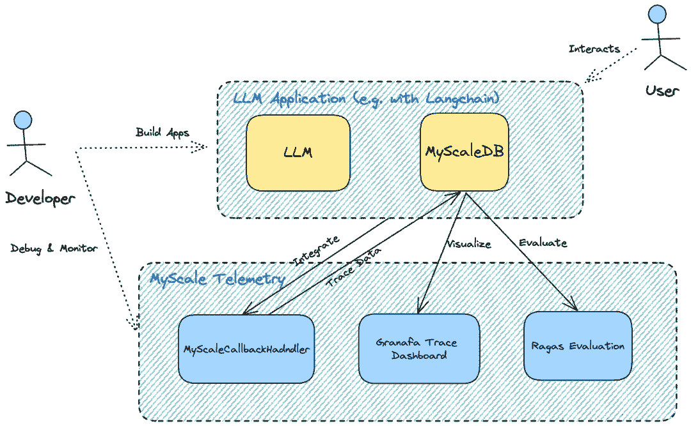

MyScale Telemetry 自动将用户与 LLM 应用程序交互生成的所有跟踪数据记录到 MyScale Cloud或 MyScaleDB 中。然后，开发人员可以在 Grafana 仪表板中可视化这些存储的跟踪数据，从而全面调试和分析 LLM 应用程序。这些跟踪数据还可以输入到像 Ragas 这样的评估框架中进行进一步分析，帮助优化应用程序。

因此，MyScale Telemetry 对开发人员来说是非常有价值的。它提供了一个强大的工具，可以以最小的性能影响调试和增强 LLM 应用程序。它提供了全面的可观测性洞察，允许开发人员深入理解他们的应用程序的行为和性能。

#  MyScale Telemetry 的实际应用示例

让我们通过考虑以下完整示例开始使用 MyScale Telemetry：设置 MyScaleDB 和 Grafana 仪表板（用于存储和监控跟踪数据）—使用Ragas评估这些数据。

按照以下步骤有效设置和使用 MyScale Telemetry：

##  设置 MyScaleDB 和 Grafana

首先，使用 Docker Compose 启动 MyScaleDB 和 Grafana 实例。你可以在此文件夹中找到 docker-compose.yml 文件。运行以下命令启动容器：

```
git clone https://github.com/myscale/myscale-telemetry.git
cd myscale-telemetry/deploy/
docker-compose up -d
```

或者，你可以在 MyScale Cloud 上启动一个托管的 MyScaleDB 实例。如果你选择此选项，请使用以下命令禁用本地 MyScaleDB 实例启动：

```
docker-compose up --scale myscaledb=0 -d
```

##  **安装所需包 **

接下来，使用 pip 安装 MyScale Telemetry 包以及 LangChain，LangChain OpenAI 集成和Ragas：

```
pip install myscale-telemetry langchain_openai ragas
```

##  **构建一个简单的链 **

下一步是构建一个简单的 LangChain 链，并将其与 MyScaleCallbackHandler 集成以收集跟踪数据，如下所示：

```
import os
from myscale_telemetry.handler import MyScaleCallbackHandler
from operator import itemgetter
from langchain_core.output_parsers import StrOutputParser
from langchain_core.prompts import ChatPromptTemplate
from langchain_openai import ChatOpenAI, OpenAIEmbeddings
from langchain_community.vectorstores import MyScale
from langchain_community.vectorstores.myscale import MyScaleSettings
from langchain_core.runnables import RunnableConfig
 
# set up the environment variables for OpenAI and MyScale Cloud/MyScaleDB:
os.environ[&quot;OPENAI_API_KEY&quot;] = &quot;YOUR_OPENAI_KEY&quot;
os.environ[&quot;MYSCALE_HOST&quot;] = &quot;YOUR_MYSCALE_HOST&quot;
os.environ[&quot;MYSCALE_PORT&quot;] = &quot;YOUR_MYSCALE_HOST&quot;
os.environ[&quot;MYSCALE_USERNAME&quot;] = &quot;YOUR_MYSCALE_USERNAME&quot;
os.environ[&quot;MYSCALE_PASSWORD&quot;] = &quot;YOUR_MYSCALE_PASSWORD&quot;
 
# create a vector store and retriever using MyScale and OpenAI embeddings:
texts = [
  &quot;Harrison worked at Kensho.&quot;,
  &quot;Alice is a software engineer.&quot;,
  &quot;Bob enjoys hiking on weekends.&quot;,
  &quot;Claire is studying data science.&quot;,
  &quot;David works at a tech startup.&quot;,
  &quot;Eva loves playing the piano.&quot;,
  &quot;Frank is a graphic designer.&quot;,
  &quot;Grace is an artificial intelligence researcher.&quot;,
  &quot;Henry is a freelance writer.&quot;,
  &quot;Isabel is learning machine learning.&quot;
]
 
myscale_settings = MyScaleSettings()
myscale_settings.index_type = &#x27;SCANN&#x27;
vectorstore = MyScale.from_texts(texts, embedding=OpenAIEmbeddings(), config=myscale_settings)
retriever = vectorstore.as_retriever()
 
# set up the llm and prompt template:
model = ChatOpenAI()
template = &quot;&quot;&quot;Answer the question based only on the following context:
{context}
Question: {question}
&quot;&quot;&quot;
prompt = ChatPromptTemplate.from_template(template)
 
# create the chain
chain = (
    {
    &quot;context&quot;: itemgetter(&quot;question&quot;) | retriever,
    &quot;question&quot;: itemgetter(&quot;question&quot;),
    }
    | prompt
    | model
    | StrOutputParser()
)
 
# integrate MyScaleCallbackHandler to capture trace data during the chain execution:
chain.invoke({&quot;question&quot;: &quot;where did harrison work&quot;}, config=RunnableConfig(
    callbacks=[
        MyScaleCallbackHandler()
    ]
))
```

成功运行后，你将在 MyScaleDB 中的 otel.otel_traces 表中找到相应的跟踪数据。

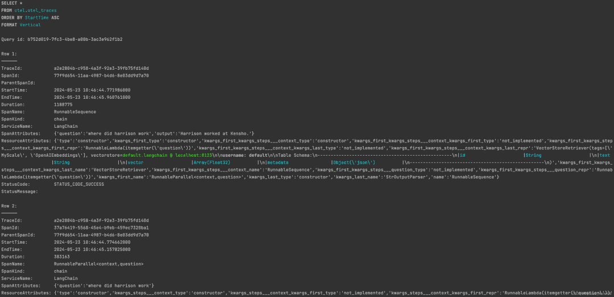

请参阅 MyScale Telemetry 自定义参数文档以自定义 MyScaleCallbackHandler 。

##  **可观测性 **

为了从 LLM 应用程序运行时轻松清晰地显示通过 MyScale Telemetry 收集的跟踪数据，我们还提供了 Grafana 跟踪仪表板。仪表板允许用户监控LLM应用程序的状态，类似于 LangSmith，使调试和改进其性能变得更加容易。Docker Compose 示例在 http://localhost:3000 启动了一个 Grafana 实例。使用用户名 admin 和密码 admin 登录。

##  **设置跟踪仪表板 **

在使用 MyScale Telemetry 处理程序收集跟踪数据后，请按照以下步骤在 Grafana中 设置 MyScale 跟踪仪表板：

1.  安装 Grafana-clickhouse-datasource 插件：

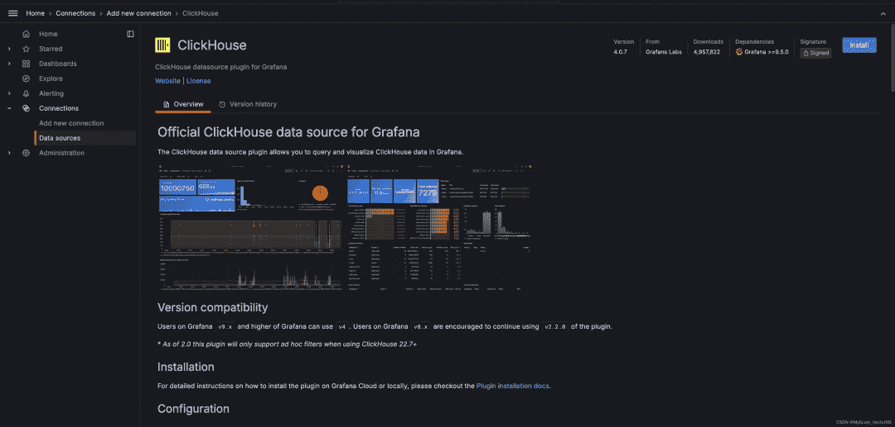

1.  在 Grafana 中添加新的 ClickHouse 数据源：在Grafana数据源设置中添加一个新的 ClickHouse 数据源。服务器地址、服务器端口、用户名和密码应与使用的MyScaleDB的主机、端口、用户名和密码相对应。对于提供的Docker Compose示例，这些值是：

+   地址： myscaledb

+   端口： 9000

+   用户名： default

+   密码： default

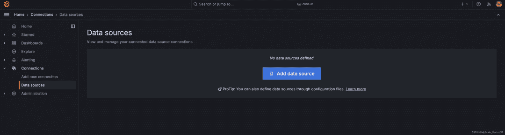

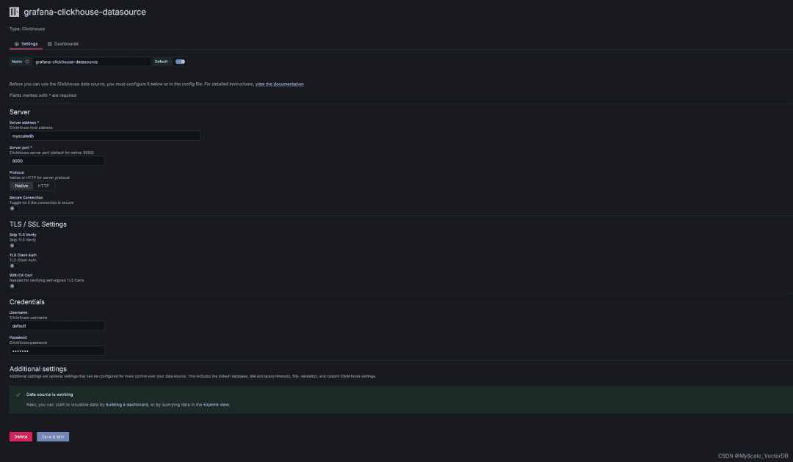

1.  导入 MyScale 跟踪仪表板：添加了 ClickHouse 数据源后，可以导入 MyScale 跟踪仪表板。

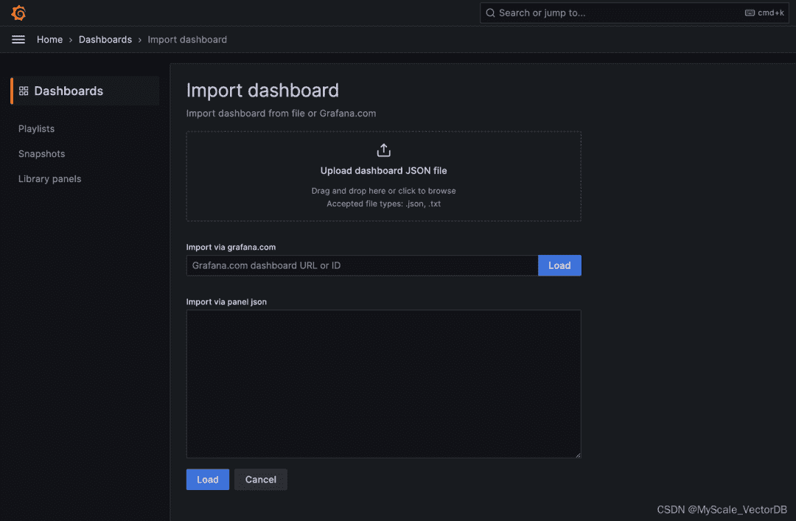

1.  配置仪表板：导入 MyScale 跟踪仪表板后，选择 MyScale 集群（ClickHouse 数据源名称）、数据库名称、表名称和要分析的跟踪的TraceID。然后，仪表板将显示所选跟踪的跟踪表和跟踪详细信息面板。

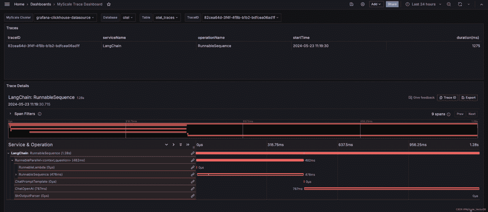

##  通过 MyScale 跟踪仪表板进行分析

MyScale 跟踪仪表板，类似于 LangSmith，提供了对 LLM 应用程序运行时行为的全面洞察。它显示了有助于调试、优化和理解应用程序性能的关键信息。

##  **函数执行时间 **

仪表板显示LangChain应用程序中每个函数的执行时间，帮助您识别性能瓶颈。

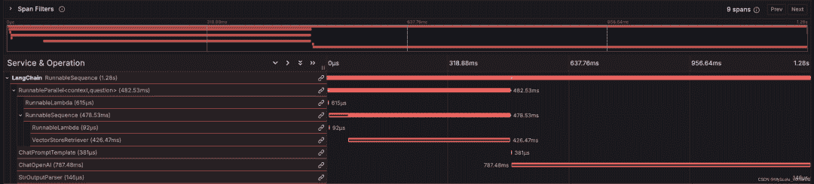

##  **输入和输出 **

仪表板提供了链的总体输入和输出的详细视图，使跟踪应用程序中的数据流变得容易。

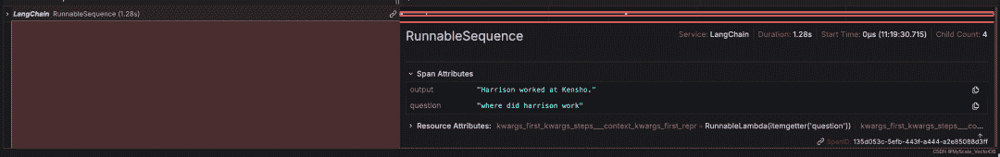

##  **DB检索器返回 **

它显示数据库检索器返回的特定数据，允许您验证是否正在获取和使用正确的数据。

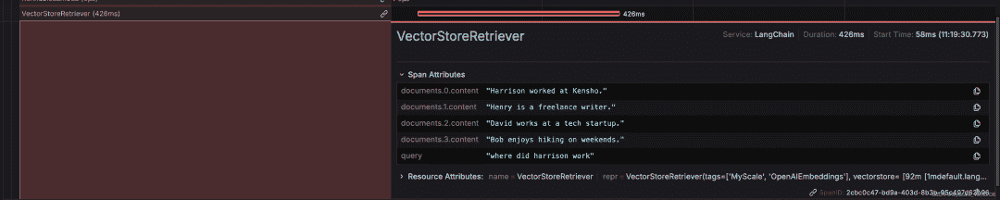

##  **Prompt 信息 **

你可以查看生成并发送到 LLM 的确切提示，这对于确保所提出问题的准确性和相关性至关重要。

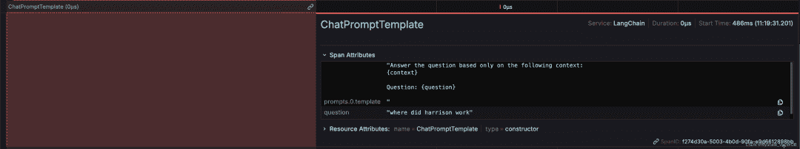

##  **ChatOpenAI 输出 **

还显示了 ChatOpenAI 生成的输出，提供了LLM对提示的响应的清晰度。此外，显示了令牌使用详情，以帮助您监控和优化与LLM API调用相关的成本。

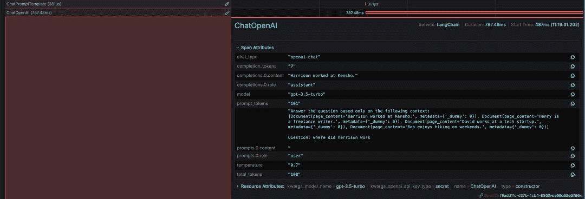

#  **使用 Ragas 评估 **

存储在 MyScaleDB 中的跨度数据可以用来分析和评估 RAG pipeline 与 Ragas，这是一个流行的开源 RAG 评估框架。

以下 Python 代码演示了如何通过评估检索的上下文和生成的答案来使用 Ragas 评分跟踪：

```
import os
from datasets import Dataset
from ragas import evaluate
from ragas.metrics import faithfulness, answer_relevancy, context_utilization
from clickhouse_connect import get_client
 
 
def score_with_ragas(query, chunks, answer):
  test_dataset = Dataset.from_dict({&quot;question&quot;: [query], &quot;contexts&quot;: [chunks], &quot;answer&quot;: [answer]})
  result = evaluate(test_dataset, metrics=[faithfulness, answer_relevancy, context_utilization])
  return result
 
 
def evaluate_trace(question, topk, client, database_name, table_name):
  trace_id, answer = client.query(
    f&quot;SELECT TraceId, SpanAttributes[&#x27;output&#x27;] as Answer FROM {database_name}.{table_name} WHERE SpanAttributes[&#x27;question&#x27;] = &#x27;{question}&#x27; AND ParentSpanId = &#x27;&#x27;&quot;
  ).result_rows[0]
 
  span_dict = client.query(
    f&quot;SELECT SpanAttributes FROM {database_name}.{table_name} WHERE TraceId = &#x27;{trace_id}&#x27; AND SpanKind = &#x27;retriever&#x27;&quot;
  ).result_rows[0][0]
 
  contexts = [span_dict.get(f&quot;documents.{i}.content&quot;) for i in range(topk)]
 
  print(score_with_ragas(question, contexts, answer))
 
 
test_question = &quot;where did harrison work&quot;
client = get_client(
  host=os.getenv(&quot;MYSCALE_HOST&quot;),
  port=int(os.getenv(&quot;MYSCALE_PORT&quot;)),
  username=os.getenv(&quot;MYSCALE_USERNAME&quot;),
  password=os.getenv(&quot;MYSCALE_PASSWORD&quot;),
)
evaluate_trace(test_question, 4, client, &quot;otel&quot;, &quot;otel_traces&quot;)
```

运行示例后，你可以使用 Ragas 提供的分数评估你的 RAG pipeline 性能。

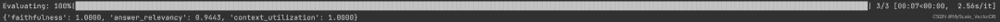

#  **结论 **

MyScale Telemetry 为改善 LLM 应用程序的可观测性和评估提供了一个强大、开源的解决方案。通过与 LangChain Callbacks 无缝集成，它捕获详细的跟踪数据并将其存储在 MyScaleDB 中，使诊断问题、优化性能和理解应用程序行为变得更加容易。

Grafana 中的 MyScale 跟踪仪表板提供了这些跟踪数据的清晰可视化，帮助您有效地监控和调试你的 LLM 应用程序。关键洞察包括函数执行时间、输入和输出跟踪、DB 检索器返回、提示信息、ChatOpenAI 输出和令牌使用情况。

此外，将 Ragas 与 MyScale Telemetry 集成允许全面评估 RAG pipeline。使用存储在 MyScaleDB 中的跟踪数据，Ragas 可以评估指标，如忠实度、答案相关性和上下文利用，确保高质量的结果和持续改进。

为什么不尝试使用 MyScale Telemetry 和 Grafana 仪表板，充分利用这些强大的工具呢？如果有任何问题或需要进一步的帮助，请随时联系我们的 MyScale Discord支持团队。