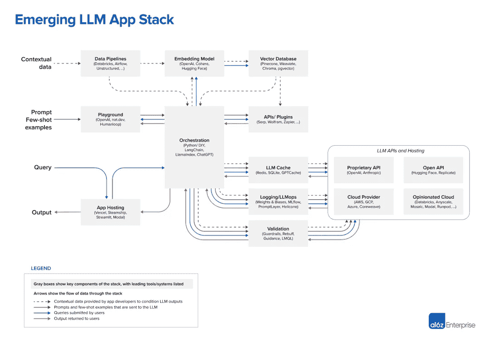
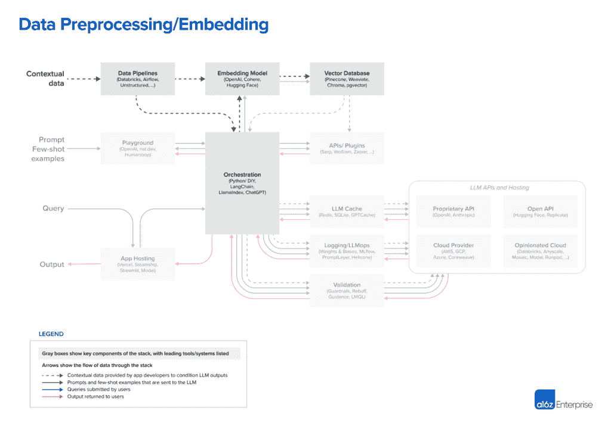
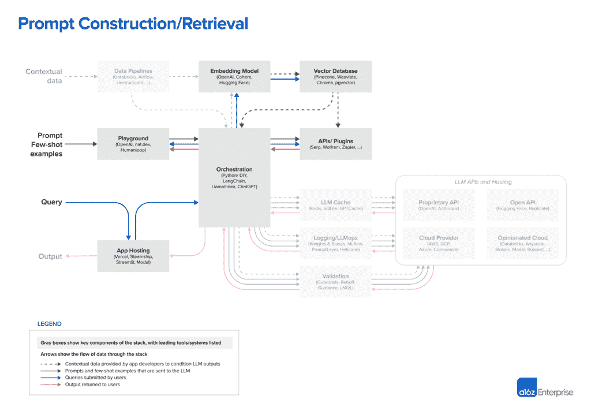
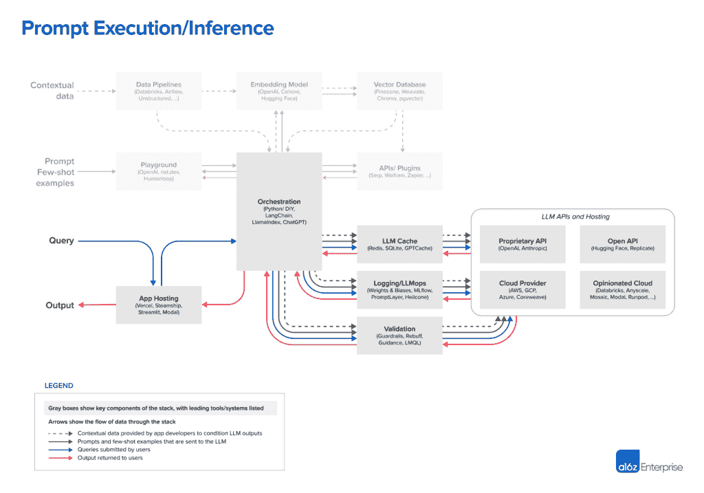

# LLM应用程序的新兴架构

> 来源：[https://agijuejin.feishu.cn/docx/PNRgdnJugoCHCNxPvBxcc57vnTe](https://agijuejin.feishu.cn/docx/PNRgdnJugoCHCNxPvBxcc57vnTe)

> 作者：向量检索实验室 | AI 搜索引擎

> 原文：[https://mp.weixin.](https://mp.weixin.qq.com/s/CFIqEtvkJS-KpFyl6kRlhg)qq.com/s/CFIqEtvk...

原文链接：https://a16z.com/emerging-architectures-for-llm-applications/

大语言模型（LLM）为软件构建提供了一种强大的新方法。由于这种技术相对较新，且其运作方式与传统计算资源大相径庭，如何有效利用它们并不是显而易见的。

在这篇文章中，我们将分享LLM应用开发中新兴的参考架构。这一架构展示了AI初创企业和技术巨头常用的系统、工具和设计模式。虽然这一架构还处于初期阶段，未来可能会随着技术进步而有较大变化，但我们希望它能为目前从事LLM开发的开发者提供有价值的参考。

这项工作基于我们与AI初创公司创始人和工程师的交流。特别感谢Ted Benson, Harrison Chase, Ben Firshman, Ali Ghodsi, Raza Habib, Andrej Karpathy, Greg Kogan, Jerry Liu, Moin Nadeem, Diego Oppenheimer, Shreya Rajpal, Ion Stoica, Dennis Xu, Matei Zaharia, 和 Jared Zoneraich提供的宝贵意见。

## LLM应用程序技术栈

以下是我们对LLM应用堆栈的当前理解（点击放大查看）：

为方便快速查阅，以下是各项目的链接列表：

| 数据流水线 | 嵌入模型 | 向量数据库 | 沙盒环境 | 业务流程编排 | API/插件 | LLM缓存 |

| --- | --- | --- | --- | --- | --- | --- |

| Databricks | OpenAI | Pinecone | OpenAI | Langchain | Serp | Redis |

| Airflow | Cohere | Weaviate | nat.dev | LlamaIndex | Wolfram | SQLite |

| Unstructured | Hugging Face | ChromaDB | Humanloop | ChatGPT | Zapier | GPTCache |

|  |  | pgvector |  |  |  |  |

| 大语言模型运维 | 过程验证 | App托管 | LLM APIs (私有) | LLM APIs (开放) | 云服务提供商 | 预配置云服务 |

| --- | --- | --- | --- | --- | --- | --- |

| Weights &amp; Biases | Guardrails | Vercel | OpenAI | Hugging Face | AWS | Databricks |

| MLflow | Rebuff | Steamship | Anthropic | Replicate | GCP | Anyscale |

| PromptLayer | Microsoft Guidance | Streamlit |  |  | Azure | Mosaic |

| Helicone | LMQL | Modal |  |  | CoreWeave | Modal |

|  |  |  |  |  |  | RunPod |

构建LLM应用有多种方式，包括从零开始训练模型、微调开源模型、使用托管API。我们展示的技术栈基于上下文学习 [1]这一设计模式，这是目前开发者入门的首选方法，并且现在只能通过基础模型实现。

下一节将简要解释此模式；有经验的LLM开发人员可以跳过此部分。

## 设计模式：上下文学习（In-context learning）

上下文学习的核心思想是直接使用LLM（即不进行任何微调），通过精心设计的提示词和依赖特定“上下文”数据来控制其行为。

例如，若你想构建一个能回答法律文件问题的聊天机器人，一个简单的方法是将所有文件内容输入到ChatGPT或GPT-4中，然后在最后提出问题。这种方法对小数据集来说可能行得通，但难以扩展。GPT-4最大模型仅能处理大约50页的输入文本，且当输入接近这个上限时，性能（以推理时间和准确度衡量）会大幅下降，这就是所谓的上下文窗口限制。

上下文学习通过一个巧妙的方法解决了这个问题：不是每次都发送全部文档，而是仅发送几份相关性最强的文档。而这些最相关的文档是通过LLM来确定的。

大体上，工作流程分为三个阶段：

+ 数据预处理/嵌入：此阶段涉及存储后续需要检索的私有数据（如法律文件）。通常，文档被分割、通过嵌入模型处理后存储于一个专门的向量数据库中。

+ 构建提示词/检索：用户提交查询（如法律问题）时，应用会构建一系列提示发送给语言模型。构建的提示通常包括开发者预设的模板、有效输出的示例（少量样本示例）、必要的外部API信息以及从向量数据库检索的相关文档。

+ 执行/推理：编译好的提示被提交给预训练的LLM进行推理，这包括专有模型API和开源或自训练模型。此阶段，一些开发者还会加入日志记录、缓存和验证等操作。

虽然听起来步骤繁多，但实际上这比直接训练或微调LLM要简单得多。进行上下文学习不需要专门的机器学习工程师团队，也无需自建基础设施或向OpenAI购买昂贵的专用实例。这种模式有效将AI问题转化为大多数初创企业和大公司已经熟悉的数据工程问题，对于相对较小的数据集，它的性能也往往优于微调——因为一条特定的信息需要在训练集中至少出现约10次，LLM才会通过微调记住它，此外这样做还可以近乎实时地拟合新数据。

关于上下文学习的一个主要疑问是，如果我们改变底层模型以增加上下文窗口会怎样？这确实是可能的，也是一个活跃的研究领域（例如，参见 Hyena论文 [2]或 近期的这篇文章）。但这需要权衡——主要是推理的成本和时间与提示的长度呈二次方关系。目前即使是线性增长（理论上的最佳结果）对许多应用来说也是成本过高的。单次GPT-4查询处理10,000页文档的费用会在当前API定价下达到数百美元。因此，我们不预期会因扩大上下文窗口而对技术栈进行根本性改变，但我们将在文章主体中进一步讨论此事。

如果您希望深入了解上下文学习，AI典范 [4]中有众多优质资源（特别是“实践指南”部分）。在本文的剩余部分，我们将以上述工作流程为指导，详细介绍参考技术栈。

LLM应用中的上下文数据包括文本文档、PDF文件，甚至是如CSV或SQL表这样的结构化数据格式。我们与之交流的开发者在处理这些数据的数据加载和转换解决方案上有着广泛的差异。多数人使用传统的ETL（抽取-转换-加载）工具，比如Databricks或Airflow。有些人还利用业务流程编排框架中内置的文档加载器，如由Unstructured支持的LangChain和由Llama Hub支持的LlamaIndex。然而，我们认为这部分技术栈相对不成熟，专为LLM应用设计的数据复制解决方案仍有很大的发展空间。

在嵌入方面，大多数开发者偏好使用OpenAI API，尤其是`text-embedding-ada-002`模型。这个模型易于使用（特别是如果您已经在使用其他OpenAI API的情况下），提供了相当不错的结果，并且成本越来越低。一些大型企业也在考虑使用Cohere，后者将产品开发更多地集中在嵌入上，在某些场景下表现更佳。对于偏好开源解决方案的开发者来说，Hugging Face的句子转换器库是标准选择。根据不同的使用案例，也可以创建不同类型的嵌入 [5]；尽管这如今还是一个比较小众的实践，但它是一个有前途的研究领域。

从系统的角度来看，预处理流程中最关键的部分是向量数据库。它负责高效地存储、比较和检索多达数十亿个嵌入（即向量）。市场上我们看到的最常用的选择是Pinecone。它之所以成为首选，是因为它完全基于云端，因此易于开始使用，并具备大型企业生产中所需的许多特性（例如，大规模的良好性能、单点登录（SSO）和服务等级协议（SLA））。

值得注意的是，市场上有许多向量数据库可供选择：

+ 开源系统如Weaviate、Vespa和Qdrant：它们通常提供出色的单节点性能，并且可以针对特定应用进行定制，因此在喜欢构建定制平台的经验丰富的AI团队中很受欢迎。

+ 本地向量管理库如Chroma和Faiss：它们提供了出色的开发者体验，对于小型应用和开发实验来说启动简单。它们不一定能替代大规模数据库。

+ OLTP扩展如pgvector：对于那些看到任何数据库问题都想用Postgres解决的开发者——或者那些几乎从单一云提供商那里购买所有数据基础设施的企业——这是一个很好的支持向量的解决方案。从长远来看，将向量和标量工作负载紧密耦合是否有意义还有待观察。

展望未来，大多数开源向量数据库公司都在开发云服务。我们的研究表明，在云中实现跨广泛设计空间的强大性能是一个非常困难的问题。因此，短期内选项集可能不会有大的变化，但长期来看很可能会变化。关键问题是向量数据库是否会像它们的OLTP和OLAP同行一样，围绕一两个流行的系统进行整合。

另一个悬而未决的问题是,随着大多数模型可用的上下文窗口的增长，嵌入和向量数据库将如何发展。人们可能会认为嵌入会变得不那么重要，因为上下文数据可以直接放入提示中。然而，专家们持相反观点——嵌入工作流可能会越来越重要。大的上下文窗口是一个强大的工具，但它们也带来了显著的计算成本。因此，高效地利用它们变得尤为重要。我们可能会开始看到不同类型的嵌入模型变得流行，这些模型直接为模型相关性进行训练，以及设计向量数据库以实现和利用这一点。

对LLMs进行提示并纳入上下文数据的策略变得越来越复杂——并且成为产品差异化的一个越来越重要的来源。大多数开发者通过实验简单的提示开始新项目，包括直接指令（零样本提示）或一些示例输出（少样本提示）。这些提示通常能得到不错的结果，但未达到生产部署所需的准确性水平。

下一级别的提示技巧旨在将模型响应锚定在某些真实来源上，并提供模型未训练过的外部上下文。提示工程指南 [6]列出了不少于12个更高级的提示策略，包括思维链、自我一致性、生成知识、思维树、定向刺激等多种策略。这些策略也可以结合使用，以支持不同的LLM用例，如文档问题回答、聊天机器人等。

这就是像LangChain和LlamaIndex这样的业务流程编排框架发挥作用的地方。它们抽象了许多提示链的细节；与外部API的接口（包括确定何时需要API调用）；从向量数据库检索上下文数据；以及在多个LLM调用中维护记忆。它们还为上面提到的许多常见应用提供模板。它们的输出是提交给语言模型的一个或一系列提示。这些框架在希望快速启动应用的业余爱好者和初创公司中广泛使用，其中LangChain遥遥领先。

LangChain仍然是一个相对新的项目，但我们已经开始看到使用它构建的应用投入生成。一些开发人员，特别是LLMs的早期开发者，更愿意在生产中切换到原生Python，以消除一个额外的依赖。但我们预计，对于大多数用例，这种DIY方法会随着时间的推移而减少，这类似于传统的Web应用技术栈的发展。

细心的读者会在业务流程编排框中注意到一个看似奇怪的条目：ChatGPT。在其常规形态下，ChatGPT是一个应用，而不是一个开发者工具。但它也可以作为API访问。而且，如果你细看，它执行了一些与其他编排框架相同的功能，例如：抽象掉对定制提示的需要；维护状态；并通过插件、API或 其他来源 [7]检索上下文数据。虽然它不是这里列出的其他工具的直接竞争者，ChatGPT可以被视为一个替代方案，它可能最终成为提示构建的一个可行、简单的替代方案。

如今，OpenAI在语言模型领域处于领先地位。几乎我们采访过的每位开发人员都使用 OpenAI API 来构建新的 LLM 应用程序，通常使用 gpt-4 或 gpt-4-32k 模型。这为应用程序性能提供了最佳场景，并且易于使用，因为它适用于广泛的输入域，并且通常不需要微调或自我托管。

当项目进入生产并开始规模化时，更广泛的选择就会发生作用。我们了解到的一些常见选择包括：

+ 切换到 gpt-3.5-turbo：它比GPT-4便宜约50倍且明显更快。许多应用不需要GPT-4级别的准确性，但确实需要低延迟推理和对免费用户友好的成本支持。

+ 尝试其他专有供应商（特别是Anthropic的Claude模型）：Claude提供快速推理、GPT-3.5级别的准确性、更多定制选项供大客户选择，并支持多达100k的上下文窗口（尽管我们发现准确性会随着输入的增加而降低）。

+ 将一些请求分流到开源模型：这在高流量的B2C用例中特别有效，如搜索或聊天，其中查询复杂性存在很大差异，并且需要以低成本为免费用户提供服务。

+ 这通常最适合与微调开源基础模型结合使用。我们在这篇文章中没有深入探讨那些工具堆栈，但Databricks、Anyscale、Mosaic、Modal和RunPod等平台被越来越多的工程团队使用。

+ 对于开源模型，有多种推理选项可用，包括Hugging Face和Replicate的简单API接口；主要云提供商的原始计算资源；以及上述更具主张的云服务。

开源模型目前落后于专有产品，但差距开始缩小。Meta的LLaMa模型为开源准确性设定了新的标准，并引发了一系列变种。由于LLaMa仅获得研究用途的授权，一些新的提供商已经介入训练替代基础模型（例如，Together、Mosaic、Falcon、Mistral）。Meta也在讨论LLaMa 2的真正开源版本。 [8]

当开源LLM达到与GPT-3.5相当的准确性水平时，我们预计将看到一个类似于文本的Stable Diffusion时刻——包括大规模的实验、共享和微调模型的生产。托管公司如Replicate已经在添加工具，使这些模型更易于软件开发者使用。开发者中越来越多的人相信，较小的、微调过的模型可以在狭窄的用例中达到最先进的准确性。

我们采访过的大多数开发者还没有深入研究LLM的操作工具。缓存相对常见——通常基于Redis——因为它提高了应用响应时间和成本。像Weights & Biases和MLflow（从传统机器学习中移植）或PromptLayer和Helicone（为LLMs专门构建）这样的工具也相当广泛使用。它们可以记录、跟踪和评估LLM输出，通常是为了改进提示构建、调整管道或选择模型。还有一些新工具正在开发中，用于验证LLM输出（例如，Guardrails）或检测提示注入攻击（例如，Rebuff）。这些操作工具中的大多数鼓励使用它们自己的Python客户端进行LLM调用，因此将会很有趣地看到这些解决方案如何随着时间的推移共存。

最后，LLM应用的静态部分（即，模型之外的一切）也需要在某处托管。到目前为止，我们看到的最常见的解决方案是标准选项，如Vercel或主要的云提供商。然而，有两个新类别正在出现。像Steamship这样的初创公司为LLM应用提供端到端托管，包括编排（LangChain）、多租户数据上下文、异步任务、向量存储和密钥管理。而像Anyscale和Modal这样的公司允许开发者在一个地方托管模型和Python代码。

## 关于代理的讨论

这个参考架构中缺少的最重要组成部分是AI代理框架。AutoGPT [9]，被描述为“使GPT-4完全自主的一个实验性开源尝试”，是今年春天历史上增长最快的Github仓库 [10]，几乎今天的每一个AI项目或初创公司都以某种形式包括代理。

与我们交谈的大多数开发者对代理的潜力感到非常兴奋。我们在这篇文章中描述的上下文学习模式在解决幻觉和数据新鲜度问题上有效，以便于好地支持内容生成任务。另一方面，代理为AI应用提供了一组根本上的新能力：解决复杂问题、对外部世界采取行动，并在部署后从经验中学习。它们通过高级推理/规划、工具使用以及记忆/递归/自我反思的组合实现这一点。

因此，代理有可能成为LLM应用架构的核心部分（或者，如果你相信递归自我改进，甚至接管整个堆栈）。像LangChain这样的现有框架已经纳入了一些代理概念。只有一个问题：代理还没有真正发挥作用。今天，大多数代理框架都处于概念验证阶段——效果令人难以置信，但尚未能够可靠、可重复地完成任务。我们将密切关注它们在不久的将来如何发展。

## 展望未来

预训练的AI模型代表了自互联网诞生以来软件架构最重要的变化。它们使个人开发者能够在几天内构建出色的AI应用，超越了大型团队花费数月构建的监督式机器学习项目。

我们在这里列出的工具和模式可能是整合LLMs的起点，而不是终点。我们将根据主要变化发生时更新这一点（例如，向模型训练转变）并在合适时发布新的参考架构。如果你有任何反馈或建议，请联系我们。

## 相关链接

[1] https://en.wikipedia.org/wiki/Prompt_engineering#In-context_learning

[2] https://arxiv.org/abs/2302.10866

[3] https://blog.gopenai.com/how-to-speed-up-llms-and-use-100k-context-window-all-tricks-in-one-place-ffd40577b4c

[4] https://a16z.com/ai-canon/

[5] https://github.com/openai/openai-cookbook/blob/main/examples/Customizing_embeddings.ipynb

[6] `https://www.promptingguide.ai/techniques`

[7] `https://github.com/openai/chatgpt-retrieval-plugin`

[8] `https://www.youtube.com/watch?t=139&v=6PDk-_uhUt8&feature=youtu.be`

[9] `https://github.com/Significant-Gravitas/AutoGPT`

[10] `https://twitter.com/OfficialLoganK/status/1647757809654562816`
