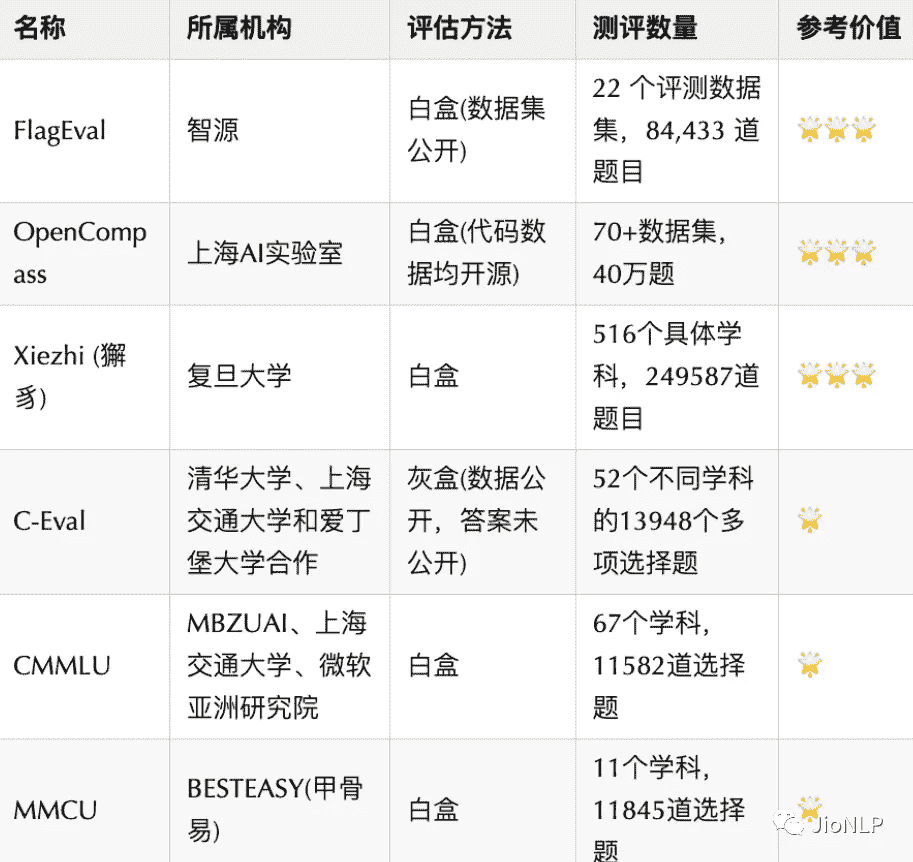
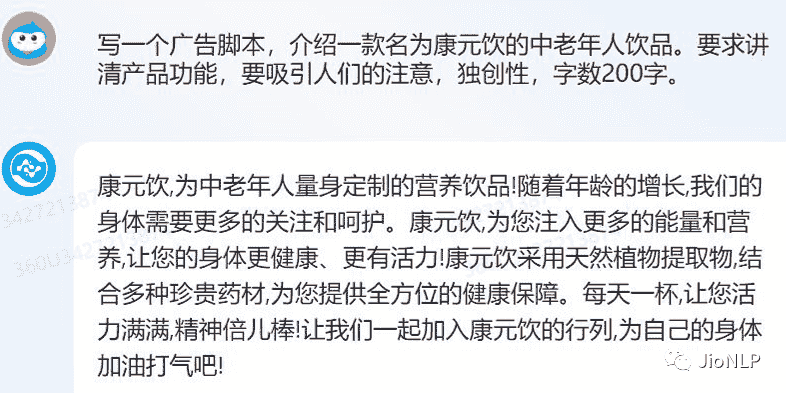
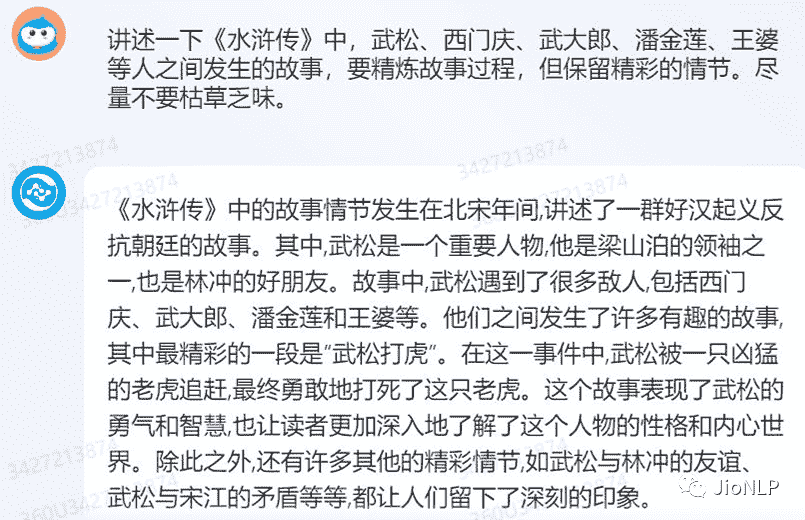
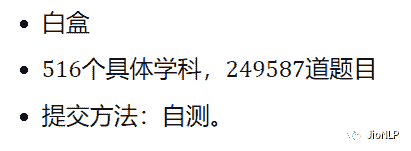
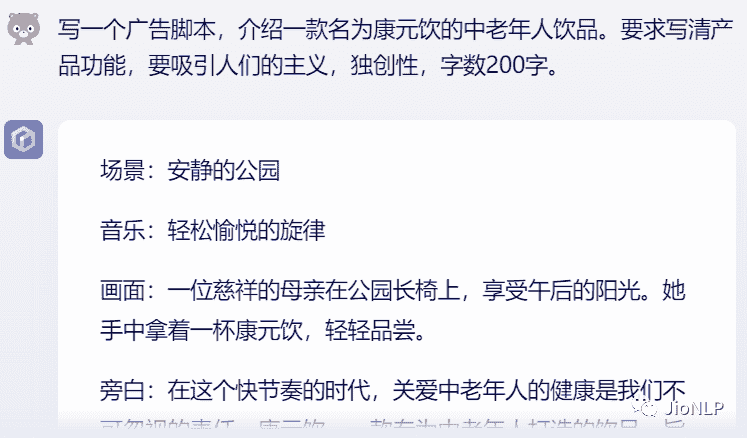
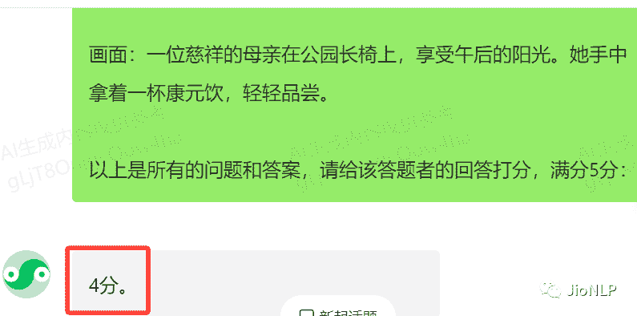

# 如何优雅地自动评测 LLM 模型质量

> 来源：[https://agijuejin.feishu.cn/docx/OAMtdxiBBoT4rpxGq6vcoDIinCc](https://agijuejin.feishu.cn/docx/OAMtdxiBBoT4rpxGq6vcoDIinCc)

> 作者：JioNLP

> 原文：[https://mp.weixin.](https://mp.weixin.qq.com/s/cAUzd1Zl9omI4av6DZElYA)qq.com/s/cAUzd1Zl...

LLM 距离去年 GPT 发布，火了也快有一年时间了，也有相当多的企业和高校参与到了 LLM 的研发当中，所以，对这些模型质量的评测也就成了一个重要的工作。

大家也知道，我在今年5月制作过一个 JioNLP 的大语言模型评测数据集，并对若干模型进行了评测。

这篇文章也是对 **JioNLP 评测工作的延续 **，主要是 提出一种如何优雅地自动评测 LLM 模型质量的方法 。

> 何为优雅，何为自动？容我慢慢说。

## ** 零、当前的一些评测题集**

当时，市面上也有非常多的评测题集，目前我所了解到的如下（顺手薅一下别人的图）：



其实各家方法差别不大。都是拿一些数据题集来对模型进行打分判断。当然，我也做过一些模型的评测，在工具包 jionlp 中是可以直接看到的。

**评测 LLM 模型质量 **这件事，说得再大白话一点，就是 给模型出一份考试题，然后给模型的回答打分。 这件事的本质和高考、考公完全是一回事，还是数据收集和整理的范畴。

当然，这是一个非常耗时耗力的人工工作，就像每年高考出题和评分判卷一样麻烦。评测 LLM 模型质量，也需要人工寻找各种各样领域的题目，然后对模型的回答结果做人工判断，（这事非得人工来干不可，毕竟，我们是在评价机器回答的质量）

想要做好 LLM 模型的评测，说起来也非常简单，只要找一些 prompt 作为题目，人工评价模型的回答是否正确即可。例如以下例子：



基于以上例子，我假设满分5分，我给上述回答3分。一方面模型的回答基本上达到了一个广告脚本的要求，但是在一些主观的独创性上有一些不足，缺少一些响亮的广告语。因此打分 3 分。

不过，当题目的数量和难度变多之后，评测 LLM 还是有一些难点的：

## ** 一、LLM 模型评测的难点**

### ** 1、模型评测严重依赖人工 **

本身评测工作严重依赖人工，像上述的评测实例，还需要大量的prompt 提问和模型的回答，综合所有的评测例子，最终给出一个完整的分数。

假设模型评测试题中包含 100 道题目，那么就需要完成 100 次人工评测。这个工作量非常大。

像上面一节中，有的评测题集总共会有上万道题目，那么，相当一部分工作都要依赖人工来完成。该不会真的有人去把上万道题目全都人工去评价回答一下吧？

为了解决这个人力成本太高的问题，最好的方法是，由机器来完成阅卷，最简单的方法，就是把评测题目改为选择题或者判断题。也就是如下形式：


这样一来，打分工作就可以交给机器来完成了： 只要模型回答中出现了正确答案的字母，即可判断模型回答的正确与否。 这就像高考中，选择题部分全都由 2B 铅笔答题，机器打分，省去了大量的人力，而且还比人工更加准。

当然，这种方式也有很强的局限性：

+   模型可能回答的是正确的，但是却包含了错误答案的字母，导致机器打分错误。例如，回答中有可能这么说： “正确答案是B，英国。另外 A、C、D 三个则是错误的答案。” 这样一来，程序在匹配字母时，会把所有选项都匹配上，导致阅卷错误。

+   LLM 评测数据集 完全是选择题、判断题，限制了大语言模型的评测范围 。这就像高考一样，客观题可以由机器改卷，但是主观题部分，尤其是，数学推理大题、语文的作文等等，还必须得由人工，也就是老师来完成。这部分是必不可少的。

总之，想要脱离开大量的人工劳动，依然是很难的。像上述的评测标准中，题目多达上万道，人工来完成，还要考虑人脑疲劳、懈怠、偷懒造成的偏差。这个偏差，随着题目数量的增多，会越来越大。

### ** 2、主观标准 **

由于 LLM 模型的输入输出在很多主观题上，没**有什么标准答案，这**就造成了模型的结果由 单独一个人来判断 ，缺乏一定的权威性，例如：



在这个例子中，满分5分，我给这个回答打4分，但是如果换成张三，可能就会打2分，换成王五，就会打1分，因为每个人的评判标准不一样。这也造成了人工打分的不准确性。

因此，最好的方法，还是找若干个人，组成一个专家系统，共同对一个问题进行打分，最终得出模型的最终结论。

这实际上也和高考中，由至少两个语文老师来给作文打分，取平均分，是一样的道理。

不过，更多的人工参与到评测 LLM 模型上，又会增加评测成本。

###  3、难以做好评测的管理和维护

前面的表格，提到了很多的评测数据集。每一家或多或少都是自己组织数据，自己评测，也就是，自己是裁判员，自己又是出题员，完全可能导致评测题目的偏颇。

> 也就是说，假设比较 A、B、C 三个模型的质量高低，不同的评测数据集完全可能得出不同的结果，Mary 制作了评测数据集，得出 A 模型质量最高，Bob 制作了另外一个数据集，得出 B 模型质量最高，完全是可以人为控制的。

想要维护一个评测数据集，并且把这个评测维护成一个业内公认的标准 ，是非常难的事情。

原因在于，模型是随着时间不断进化的，想要探测到一个模**型的真实能力，势必**也要随着模型的演进而 不断更改评测题目 。就像高考题一样，每年出一份新的，不可能拿往年的考题来考今年的学生，否则就失去了评测的意义。

对于一份完全不演进的评测题集，模型会在这份题集上不断拟合，直到逼近满分。

所以，当你需要定期更新一整套多达上万道题目的评测题集，你心里是否崩溃？心里是否有许多问号？

## ** 二、打破某些错误认识**

在了解了 人工评测 LLM 的局限和障碍之后，我们再来从思想上打破某些局限性的认知。

###  1、评测题集数量越多越好吗？

这大概是一个很明显的共识： 评测题集中的题目越多，对一个模型的评价结果也就越公正 。

如果像网上一些调侃的文章那样，拿着某个模型的某一个错误结果就大肆贬低，公信力自然是很低的。所以，很多评测数据集，提供了多达几十万的体量：



但在做评测时，真的题目越多越好吗？就像上面说的：

+   1、找上万道题目，本身就是一个比较麻烦的事情；而且，还需要确保这些题目定期更新；

+   2、然后人工评测打分，耗费巨大，且人工有一定的偏颇、主观性，同时也有粗心、懈怠造成的偏差；真的，为了评测 LLM 模型质量，这么做会累死人的。

> 事实上，做评测数据集，真的不需要那么多（上万道）评测题集。

原因非常简单，我先来借鉴高考等考试来说明一下：

> 以**高考为例，高中三年，学生**学习了大量的数以千计的知识点，但**是在高考考**场上，考试内容实际上非常少，可能仅仅占到学生学习 知识总量的不到十分之一 。但是，高考 以少量的题目考察学生掌握的大量的知识能力 ，实际上就是在做 样本抽样 。

> 该不会有人觉得高考对学生学习能力的评价不够客观吧？？？很多人都会埋怨自己心态没调整好，发挥失常，但是很少有人会抱怨高考考试题绝大部分都是不属于自己掌握的范围。

同样的道理也完全适用于 LLM 模型质量评测。

好了，至此，评测数据集题量的设定，本质上就是一个概率抽样问题：

+   根**据中心极限定理（不知道的去翻《概率论》）：随着抽**样样本数量的增加，整个数据集的估计分布方差很快就能降到很小。也就是， 我们压根不需要拿出几万道题来做评测，就能取得一个较稳的分布，也就是对模型较为稳定的打分。

+   相反，为了对模**型的打分尽量客观， 我们要做的**是 使抽样的评测题目分布更加均匀 ，也就是，方方面面的题目都覆盖到。所以，拿出几万道题目来，反而容易造成某些类型的题目数据聚集，影响了评测结果的准确性。

### ** 2、黑盒就比白盒好吗？ **

一般来说，黑盒就是把评测数据集藏起来，不让制作模型的公司机构看到。白盒就是把数据集公布出来。用大白话说， 黑盒就是闭卷考试，白盒就是开卷考试 ，你可以照着书抄。


目前来说，为了确保评测的公正性，评测数据集会直接把数据开放出来，人人都可以查看，但是这样会导致模型可以提前拿这些数据做拟合，进而取得一个较高的分数。这种是很难避免问题的。

而黑盒呢？问题就是，外界不知道评测机构是怎么做的测评。由此产生的问题也非常大。你的可信度、公信力从何而来呢？目前尚不得知。

当然，在理想的情况下，黑盒的评测的上限要比白盒高，因为，只让评测机构做到公平公正，要比让每一家 LLM 模型制作公司机构都公平公正要容易地多。但是，这就是最终的结果了吗？

**显然不是 **。

黑盒的方法，使得模型没有一个统一的评判标准，完全成了一种垄断式的玩法。我们有办法克服上述这些问题。这就正式引出我今天要提出的那个问题。

> 何为优雅，何为自动地评测 LLM 模型？

## ** 三、正确的 LLM 评估方法**

正确的 LLM 评估方法，满足以下几个特点：

+   公开，所有模型都可以探明评测的细节；

+   公正， **所有模型都可以参与评测过程 **，同时避免人的主观因素带来的问题；

+   **减少人力 **，前面我们说过，评测实际上不需要那**么多题目，我们**需要的是题目分布足够符合 平稳均匀分布 。同时，不要耗费大量的人力来完成这件事。

+   **灵活变动 **，避免白盒，也就是开卷考试带来的竞争。实际上，减少了评测人力，也就可以把精力放在定期更新题目，获得更加公正结果上面。

### ** 1、具体实施方式 **

**其实非常简单，所谓自动评测**，避免大量人力，那就是 把打分这项工作，交给模型 。举个例子来说明：

像上面的例子中，我们首先把结果交给 A 模型来生成结果：



然后，我们把这个结果，重新组织，交给 B 模型来打分，判断 A 模型的结果是否正确。也就是，A 模型是考生， B 模型是阅卷老师。当然，此时需要 设计一个 prompt，来诱导 B 模型给出一个标准打分 ：

```
我将给你一个问题和一个对应的答案，这是一个答题者回答的，请对这个答题者的回答正确与否，与回答质量给出打分。

问题：{question}

标准答案：{correct_answer}

答案：{response}

以上是所有的问题和答案，请给该答题者的回答打分，满分 {score} 分：
```

由此，等待模型给出打分分数即可，就像下面这张图这样简单。我试了市面上常见的若干模型，大多数都能给理解题意，完成打分这项任务。（ 如果说一个模型都无法回答这个 prompt，那就，自己动手弄吧 ）



好了，我们由此完成了一次 LLM 模型之间相互打分的例子。除了 B 给 A 打分外，A 也可以给 B 打分。

### ** 2、完整评测流程 **

有了上面的具体操作方式，就可以愉快的开启整个自动化评测流程了。为了方便，我就不写太标准的公式了，尽量以文字叙述。

+   **step1 **：现在，假设我们要参与评测的模型包括 A,B,C,D,...Z 。准备好这些模型的 api，免得我们还需要手工在网页上进行打分。

+   **step2 **：这么多个模型，我们首先把所有的评测题目，**交给所有的模型 API 进行问**题回答。 得到所有模型对所有问题的回答 。

+   **step3 **：依照上一小节中，各个模型相互打分的方式，让 A 模型给 B,C,D,...,Z 模型的每道题打分，让B 模型给 A,C,D,...,Z 模型的每道题打分，让 Z 模型给 A,B,C,...,Y 模型打分。

好了，这样我们就得到了， 每个模型，给所有其它模型的每道题的回答的打分 。这是一个大的张量。

+   **step4 **：关键一步， 利用 EM 算法来进行拟合回归 。

首先，我默认大家熟悉 EM 算法了，这是一种在参数优化目标不清晰的情况下的一种优化方法。

其次，我们又知道，从第三步中，得到的所有打分结果，其实是不准确的。主要有以下几点：

+   如果一个模型质量高，能力强，那么，它对其它模型的结果打分，就更加准确、可信，而且，打分也更稳定；反之，一个垃圾模型对其它模型的打分可能就和真实结果偏差很大。

+   A 模型最终对每个回答的打分，是由B,C,D,...,Z 模型共同决定的。可以由其它模型的打分加权得到。也就是，B,C,D,...,Z 共同承担了阅卷人的角色。

+   一个垃圾模型，可能会对真实结果产生很大的偏差。因此，EM 算法优化目标，是为了使垃圾模型的打分权重尽量小，使一个优秀模型的打分权重尽量大。（比如，在现阶段，完全可以让 GPT4 来给其它所有模型的回答打分，直接作为标准分数，也未尝不可）。比如，B 模型质量最高，那么B 模型在和 C, ... ,Z 模型共同决定 A 模型回答质量时，占据的权重越高。

+   而每一个模型是否靠谱，也就是其权重，实际上是由其本身的分数决定的，也就是我们最终想要的结果——每个模型的评测分数。

+   在这里有一个假设：优秀的模型，打分结果更加准确、稳定，贴近真实的平均分，而垃圾的模型，则会更大概率偏离平均分更远。

由此， 我们就获得了一组隐变量，以及一组求解目标 ：

+   隐变量是：每个模型的回答的真实得分，以及每个模型回答稳定性的衡量指标——方差；

+   求解目标：每个模型的最终分数（也就是你看到的很多评测集展示出来的分数），也即每道题得了多少分，所占打分比例的权重（注意，最终分数和打分比例之间应该是由一个单调函数建立联系）

+   当然，这里有一个特殊情况， **如**果评测集有标准答案时，那么评价隐变量就被省去了，而如果对于一些主观的题目，如作文，没有标准答案，那么就需要测试隐变量。

好了，这样就可以利用 EM 算法愉快的求解了！！！！反复迭代，直到收敛到一个不错的结果。

###  3、让我们来看看这里的实施成本：

+   **再也不用人工评判了 **！！！开心！！！让模型们之间互相改卷，我们来做统计。我可以拿这些打分改卷的时间看会小说电视剧，打游戏！(●'◡'●)！

+   **需要定期更新评测题目 **，确保模型没有提前拿考试题训练模型。由于论证了评测题目量级的考量，更新的题目数量甚至不需要很多。

+   **需要获取模型的 API **。不然，我们还得手动在网页上输入问题，让模型打分，怪麻烦的。

### ** 4、可能存在的一些问题 **

当然，有一种可能，就是，在评测的大量模型中，质量差的占多数，也就是说，好比一个班里一大半都是学习成绩很差的，全都是这样的差学生参与到考试改卷，那岂不是要误人子弟了！？

进一步地，在 EM 算法的收敛中，这些模型由于分布差异太大，导致算法迟迟不收敛，那就需要做出一些改进了。

因此，在这种情况下，有两种方式进行改进。

+   1、增加一次人工评测，人工打分。不需要多个人组成专家系统。而是一个人和多个模型组成专家系统，让人的打分占比较高一些，然后进行拟合。甚至，人工都不需要每道题都打分，而只需要对其中一些题目打分即可。

+   2、对于那些打分分布方差太大的模型，直接把这些模型踢出评测范围，也就是不让差生参与打分。

## ** 四、总结与愿望**

好啦，到此为止，算法阐述完毕！！！说几点愿望。

### 1、希望近期把代码写出来，纯 python 的，开发压力会小一些。 感兴趣参与的，可以加入到 jionlp 工具包的开发，并推广开来。

### **2、 ****希**望能够拿到想评测的厂商的 API，越多越好，我来测试 。

所以，这是一个 **征召帖子 **，

+   **希望感兴趣的 LLM 厂家**，想参与 JioNLP 数据集评测的， 能够给我开放一个 API ，参与 JioNLP 数据集评测。

+   JioNLP 也会为贵公司提供相应的模型评测，并添加宣传。

[OpenAI 到底想干嘛？](http://mp.weixin.qq.com/s?__biz=MzI4ODc0MDI4OA==&mid=2247484628&idx=1&sn=a5a14eca710dae03ae832d7f7275f3ae&chksm=ec38827bdb4f0b6d652ca26aa14892aca7ef4ef9e33a45aee692d19920f44651b1135f7b014a&scene=21#wechat_redirect)

GPT4 图像理解能力体验与评价

出一份试题，评测国内对标ChatGPT的大语言模型（三）

一文读懂chatGPT模型原理（无公式）